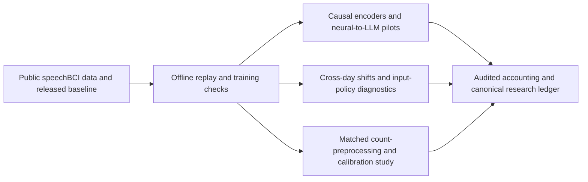

# Brain2Speech

Independent **brain-to-text reproduction and research** by Ken-Fu Liang, built on
[Willett and collaborators' speechBCI](https://github.com/fwillett/speechBCI)
(commit `522a9605ccf0818def80b6fd80007598e790408e`). Neural activity is decoded
into phonemes and text; this project does not synthesize the participant's voice.

**Research status: recorded through 2026-10-12; README reviewed 2026-10-25.**
Publication does not rerun experiments or establish new results. The
[experiment ledger](docs/research-notes.md) owns methods, results, and decisions;
the [comparative report](docs/research-results-report.md) explains the findings.

## What we reproduced

The completed work concerns **offline public-data execution**, with different
levels of agreement for checkpoint replay and training from scratch.
WER is word error rate; PER is phoneme error rate. Lower is better.

| Experiment | What we executed | Recorded result | What the evidence supports |
|---|---|---|---|
| E000: released-checkpoint replay | Authors' released RNN checkpoint + fixed 3-gram decoder, 600 public-test sentences | **18.8756% WER**, versus the upstream **18.8%** reference | Completed artifact replay. The difference is +0.0756 percentage points; no numerical pre-run tolerance was recoverable, so this is not a retrospective equivalence claim. |
| E017: released-recipe training | Completed 10,001 training attempts and selected-checkpoint evaluation on the same 600 sentences | **18.4139% WER / 17.4283% PER** | Training and scoring completed. Paired WER difference versus E000: −0.4617 points, 95% interval −2.1541 to +1.0158. The interval fails the prespecified ±1-point agreement rule: **performance reproduction remains inconclusive**, with no superiority claim. |
| E016: BIT from-scratch training | 800 epochs / 220,000 updates; selected-checkpoint evaluation | Validation **17.4943% PER**; final-test **16.2218% PER / 23.3430% WER** | Accessible scratch training completed. Cohort, recipe, and metric differences prevent matched paper reproduction. WER uses our fixed 3-gram diagnostic, not BIT's published language-model cascade. |

These rows use different evaluation fingerprints and **are not a leaderboard**.
The ledger records split identities, checkpoint selection, uncertainty, and
limitations, including one-participant/single-seed scope and public evaluation
exposure. See [the full training comparison and verdicts](docs/research-notes.md#current-research-thesis).

The Nature study's live participant results and the upstream **13.7% WER
5-gram + OPT** benchmark are reference results, **not reproduced achievements of
this repository**. The same applies to BIT-All and its published cascade claims.

## What our research adds

Our work asks how causal neural representations, input policies, and calibration
change decoding across days. Contributions include experiments and negative
findings, alongside the code needed to inspect their methods.



- **Causal decoding and neural-to-LLM pilots (E009, E012–E014).** Implemented
  causal encoders, neural-token bridges, and bridge-only versus LoRA controls.
  Some selected validation scores improved, but accuracy remains poor and
  overfitting/weak neural grounding remain problems. These pilots do not
  demonstrate a deployable decoder or an improvement over Willett.
- **Cross-day representation and input-policy diagnostics (E018–E019).**
  Measured recorded-feature and frozen-encoder distribution shifts, then tested
  normalization × trained input-layer policies. Low training-partition PER
  under matched policies is a functionality diagnostic, not future-day
  accuracy. These analyses do not establish biological neural drift.
- **Count statistics and matched preprocessing (E020, E022).** Tested Poisson
  adequacy and compared raw versus Anscombe count inputs under a matched
  causal recipe and later-day calibration. Full-calibration WER was
  **47.17% raw versus 46.16% Anscombe** on 200 sentences; the paired difference
  interval includes zero. **No clear overall advantage or demonstrated
  target-label savings** was established.
- **Reproducibility and audit tooling.** Added pinned artifact manifests,
  resume/reload checks, independent phone/word/character edit accounting,
  causal-prefix tests, resource observations, and explicit claim-level
  acceptance rules. Passing software checks is distinct from scientific success.

Detailed methods, controls, negative results, and next decisions live in the
[comparative report](docs/research-results-report.md) and
[canonical ledger](docs/research-notes.md); this overview does not replace them.

## What remains unfinished

- **Full chronological v1 study:** paused and incomplete. Three-seed confirmation,
  the full adaptation/robustness/forgetting matrix, final comparisons, and
  scientific review are unfinished. Some final-day data was already accessed
  during partial v1 collection; the entire final set must not be described as
  untouched. See the [frozen v1 plan](docs/research-plan-v1.md).
- **Poisson reconstruction experiment (E025):** implementation and technical
  pilot passed; full training had not started at the last recorded review
  because of the storage gate. Resume validation and matched downstream
  evaluation remain required. No decoding benefit has been measured.
- **Matched paper-level claims:** E017 numerical agreement is inconclusive;
  BIT source/cohort/recipe correspondence and matching cascade/checkpoint
  prerequisites remain unresolved. Multi-seed confirmation is missing.
- **Operational claims:** reliable neural-to-LLM grounding, independent
  future-day gains, clinical real-time performance, and live participant
  replication have not been established.
- **Public evidence package:** raw runs and checkpoints are not published here.
  Several figure/receipt links point to excluded local outputs, and some
  figures were already missing locally at publication. This is a source and
  report release, not a self-contained archive of every result.

## Use the repository

History was sanitized on 2026-10-25 to remove inherited signing material. Use a
fresh clone if you cloned an earlier version; see the
[history cleanup and public-object verification](docs/publication.md#history-cleanup-and-verification-2026-10-25).


```bash
git clone --recurse-submodules https://github.com/kenfuliang/Brain2Speech.git
cd Brain2Speech
```

Start with the [released-checkpoint reproduction workflow](reproduction/README.md)
for pinned downloads, hash verification, the Linux/amd64 container, and replay.
The [research runner guide](research/README.md) documents the chronological
pipeline; its dated execution snapshots are historical, and the ledger owns
current research status. Environments differ between the original TensorFlow
stack, native PyTorch research, and optional BIT/LLM experiments.

**Publication validation, 2026-10-25:** 202 research tests passed in the existing
BIT environment. This checks implementation behavior; it does not rerun training
or independently reproduce the reported accuracy. Environment versions and
publication boundaries are recorded in [publication notes](docs/publication.md).

## Upstream sources and attribution

- [Nature paper: A high-performance speech neuroprosthesis](https://www.nature.com/articles/s41586-023-06377-x).
- [Public Dryad dataset and released checkpoints/language models](https://doi.org/10.5061/dryad.x69p8czpq).
- [Original speechBCI README at the pinned commit](https://github.com/fwillett/speechBCI/blob/522a9605ccf0818def80b6fd80007598e790408e/README.md), including authors' benchmark and split definitions.
- [Author-linked PyTorch implementation](https://github.com/cffan/neural_seq_decoder).
- [BIT source](https://github.com/yzhang511/bit), pinned as a submodule under `research/vendor/bit-f107ae9`.

Original decoder code and analysis notebooks remain in `NeuralDecoder/`,
`LanguageModelDecoder/`, and `AnalysisExamples/`. Brain2Speech additions live in
`reproduction/`, `research/`, and `docs/`. Upstream authors retain attribution;
this repository applies no new blanket license to their work. See the
[source audit and component-license caveats](docs/research/willett-2023-speech-neuroprosthesis-reproducibility.md#licensing-and-availability-caveats).
