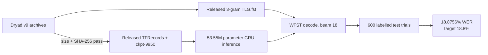

# Willett speechBCI reproduction status

This document owns the detailed E000 execution evidence. Research status, comparisons, and next-step decisions are maintained in the canonical [Brain2Speech research notes and experiment ledger](research-notes.md).

## Result

The released TensorFlow checkpoint plus released 3-gram WFST was replayed successfully on the labelled public `test` split. The local result is **18.8756% WER** over **600 trials**, compared with the repository's published **18.8% WER**. The absolute difference is **0.0756 percentage points**. The authors' bootstrap routine returned a 95% interval of **17.2470%–20.5868%**.

This is a successful numerical reproduction of the public **offline artifact benchmark**. It is not a reproduction of the Nature paper's live participant-in-the-loop 9.1% or 23.8% WER results. The [source and reproducibility audit](research/willett-2023-speech-neuroprosthesis-reproducibility.md) is the canonical owner for the paper, dataset, and claim boundaries.

## Measured output

| Metric | Local result |
|---|---:|
| WER | 0.18875611080934274 |
| WER 95% interval | 0.1724698305980309–0.20586793645539653 |
| Character error rate after text decoding | 0.13423225096312602 |
| Character error rate 95% interval | 0.12263306148568438–0.14586029975028283 |
| Trials | 600 |
| Mean WFST decode time | 203.60695918401083 ms/trial |

Evidence files are intentionally ignored by Git because they are generated run artifacts:

**Metric-label correction, 2026-10-06:** the original JSON key `phoneme_error_rate` stores text CER from upstream `_cer_and_wer`, not raw phoneme error rate. The result artifact/hash is preserved. Future replay output uses `character_error_rate`; raw PER remains unmeasured. The [canonical ledger](research-notes.md) records the correction and additional transcript error accounting.

- `reproduction/results/released-checkpoint-3gram.json` — SHA-256 `15309213c3497524b69abf8da16633f363bed1bb2c92c9cf0faf2568df5124e9`
- `reproduction/results/released-checkpoint-3gram.log` — SHA-256 `00e1c6e257a5963dedeb98eae9d540d1329930885e0e111363f59d342f08b486`
- `reproduction/results/artifact-verification.json` — SHA-256 `95c5ec95b1da372c58af22cd46a958bd841e0a8176ed5dcae24194d0c797ebc6`

## Pinned execution environment

- Official code commit: `522a9605ccf0818def80b6fd80007598e790408e`
- Container image ID/digest: `sha256:d7dad9120179787a8e2f949801fce1f9f2a360b170699e4724311fa4a8141432`
- Python 3.9, TensorFlow 2.7.0, NumPy 1.21.6, SciPy 1.7.3
- Native language decoder built with GCC/G++ 11.3 and serialized OpenFST compilation
- Host: Apple M5 Max, 128 GB unified memory
- Guest: isolated Colima x86_64 QEMU VM, 8 vCPU, 80 GiB configured RAM, AVX/AVX2 exposed
- Released checkpoint: `baselineRelease/ckpt-9950`
- Decoder: `acoustic_scale=0.8`, `nbest=1`, `beam=18`, blank penalty `log(2)`

## Compatibility changes

No model architecture, weights, neural data, split membership, or decoder scoring parameter was changed.

1. OpenFST compilation was serialized because parallel x86 compilation crashed under Apple-Silicon emulation.
2. GCC 11 was pinned because GCC 12's compiler/linker repeatedly segfaulted under that emulation; GCC 11 satisfies the repository's GCC >=10.1 requirement.
3. The runner replaces the authors' `tqdm.notebook.trange` display function with terminal `tqdm.trange`. The first complete neural pass reached decoding but failed before trial 1 because Jupyter `IProgress` was unavailable; the failed log is preserved as `released-checkpoint-3gram.failed-ipprogress.log`.
4. A full x86_64 QEMU guest was required because the standard Apple-Silicon Docker translation did not expose AVX to the official TensorFlow 2.7 x86 wheel. The default Docker profile was not restarted or modified.

## Reproduction ladder

| Stage | Status | Evidence / next gate |
|---|---|---|
| Paper, supplement, code, and seven Dryad archives acquired | Complete | Exact sizes and SHA-256 values pass `reproduction/verify_artifacts.py` |
| Released checkpoint + 3-gram replay | Complete | 18.8756% WER vs 18.8% published |
| 5-gram + OPT-6.7B rescoring | Not run | Extract 5-gram archive, pin OPT weights, then compare with 13.7% WER |
| Training reproduction from TFRecords | Not run | Define fixed seeds and report a distribution, not a best run |
| Live participant results | Not reproducible from public artifacts | Requires participant, implants, daily adaptation, and closed-loop operation |
