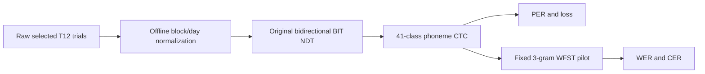
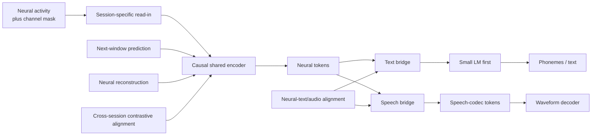
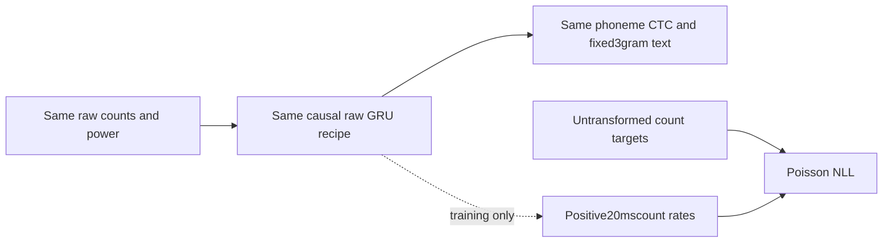
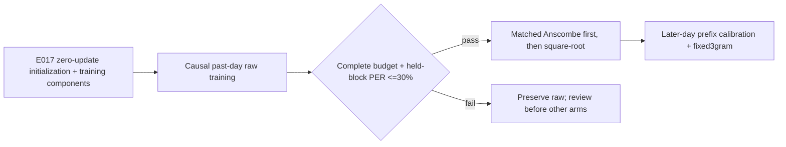
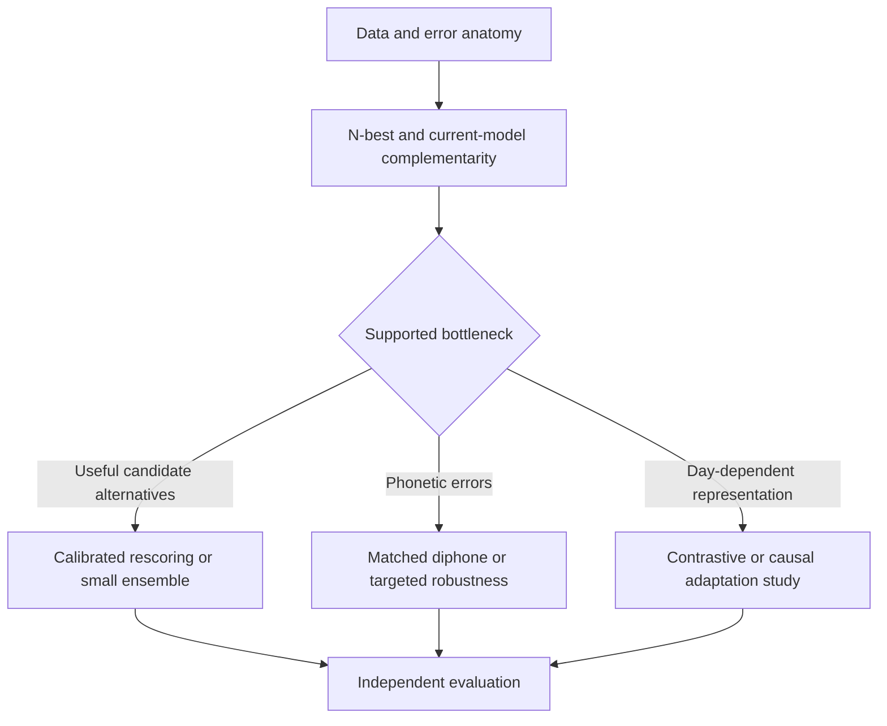
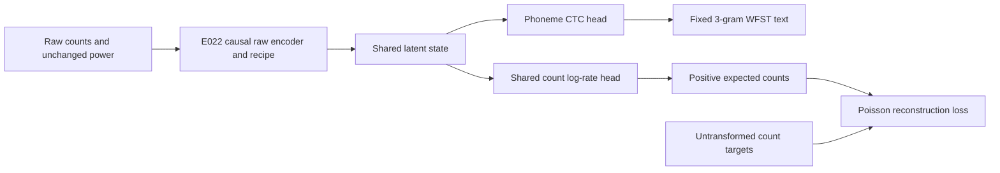
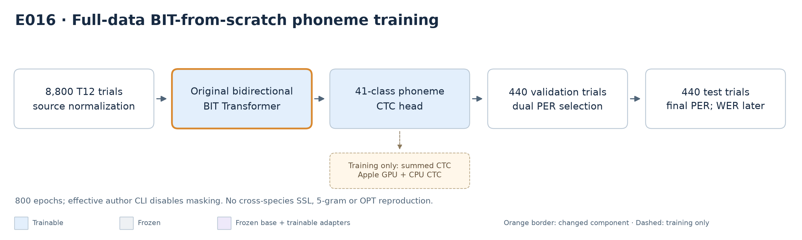

# Brain2Speech research notes and experiment ledger

## Authority and maintenance rule

This is the single source of truth for the Brain2Speech research program. It owns:

- the current research thesis and system boundary;
- the methodology and metrics required for every experiment;
- the experiment registry and cross-iteration comparison;
- accepted findings, rejected hypotheses, and the reason for each next step.

Detailed source reviews, configurations, logs, checkpoints, and machine-readable metrics remain immutable supporting evidence. This ledger links to them instead of copying their full contents. An experiment is not complete until its row and experiment record here are updated.

The [single comparative research report](research-results-report.md) organizes findings by research question, with claim-specific evidence levels, evaluation fingerprints, high-level PNG architectures and decision cards. It owns the [shared evidence definitions and presentation rules](research-results-report.md#2-definitions-and-reporting-principles); this ledger retains authority over experiment methodology, status, findings, metrics and accepted next-step decisions. The [retired report snapshot](research-results-report-20261007-before-restructure.md) preserves detailed historical tables without competing current authority.

## Current research thesis

**E025 / I005 authorized setup, 2026-10-12:** matched raw recipe versus Poisson reconstruction implementation and real MPS technical pilot pass; full training has **not started**, blocked by checkpoint-storage planning gate (39.04GiBfree versus47.32GiBrequired estimate,8.27GiBshort). [Canonical E025 record](#e025--raw-recipe-plus-poisson-count-reconstruction-i005). No deletion, final-day access, recurring watch or v1 restart. I005 is now user-authorized for this minimal comparison, not the deferred drift-aware/full-LFADS variants.

**Latest E022 outcome, 2026-10-12:** raw–Anscombe comparison complete/verified; full-calibration WER47.17%raw/46.16%Anscombe, PER39.04%/37.83%. Paired full-WER interval crosses zero;25%WERtarget not reached at any tested budget/day. Exploratory25-label signal and adverseAugust2effect retained. [Canonical final methods/results/decision](#e022--causal-raw-control-with-e017-training-components). Prior running/Not-measured E022 snapshots below are historical. Final days untouched by E022; no square-root/I005/v1 launch.

**E023 independent trajectory correction completed, 2026-10-12:** correction fitted to disjoint preceding trials reduces absolute latent distance but barely improves mean-centred shape. Different-sentence distances also decrease; stricter-duration controls and leave-one-prompt-out sensitivity do not establish correction-specific recovery. [Canonical result and limits](#e023--independent-latent-offsetgain-correction-i003). Retrospective E017 diagnostic only; no decoder/biological-drift benefit, model updates or Anscombe changes.

**E022 raw complete / Anscombe started, 2026-10-12:** raw completed10,001attempts and the [independent CPU acceptance audit](../research/runs/e022-causal-recipe-s17-20261012-01/raw/completion-audit-01.json) passes identities, schedule, training-only sample accounting, finite state, selection and independently recomputed saved-logit phone errors. Selected9900 earlier held-block corpus PER26.4923% (3,697/13,955), macro26.5739%,worst64.8862%(June23); the prespecified <=30% point gate passes, but the worst day remains poor. First/last200 augmented-batch mean unnormalized sentence CTC96.9781→7.8117. Raw trainer exit and serial-resource availability were checked before launching the user-authorized matched Anscombe arm from the same untrained initialization—not raw trained weights. Only count transform changes; causal/chronological E017 departures remain explicit. Later-day WER/PER/calibration and Anscombe benefit remain Not measured. [Protocol](../research/runs/e022-causal-recipe-s17-20261012-01/protocol.json), [status](../research/runs/e022-causal-recipe-s17-20261012-01/status.json), [canonical record](#e022--causal-raw-control-with-e017-training-components). Final recordings/E017/E021/v1 unchanged; no scheduled monitor or geometry intervention.

**E021 stopped by user, 2026-10-12:** clean stop at 6,115 raw-arm updates; trainer/controller exited, latest model/AdamW/RNG and all 43 artifacts are [preserved and sealed](../research/runs/e021-preprocessing-s17-20261012-01/seal-stopped.json). Best earlier-day held-block macro PER is 85.7597%, not later-day performance; no square-root/Anscombe production training, calibration or WER occurred. [Stop audit](../research/runs/e021-preprocessing-s17-20261012-01/stop-preservation.json), [canonical record/recovery boundary](#e021--matched-count-preprocessing-and-small-adapter-calibration). A fresh E017 GPU port gate passes and cached historical metrics independently remain [17.4283% PER / 18.4139% WER](../research/runs/raw-control-recovery-20261012-01/reference-verification.json). Those are offline reference checks, not a repaired causal control. User requests recipe-first raw recovery before transformed arms; exact offline recipe versus causal/calibration deviations must be settled before a new long run. No automatic E021/v1 restart or final-day recording access.

**E020 completed count-distribution check, 2026-10-12:** on the same 19 permitted training days, count features are often approximately Poisson-like, but an exact independent/phoneme-conditioned Poisson model is not established. Median day/channel Fano is 1.0243 and fitted histogram TV is 0.0140; local dispersion is 0.9380 at 200 ms and 0.9837 at 2 s, with channel exceptions. Sparse counts (median 0.6151/bin) limit Anscombe's unit-variance approximation. [Canonical methodology and limits](#e020--poisson-adequacy-of-unsmoothed-count-features-i003), [reader-facing figure](research-results-report.md#35-count-features-are-often-poisson-like-but-not-exactly-poisson-e020). No model, decoder, final-day recording or v1 restart was involved.

**E019 completed,2026-10-12 (initiatedOctober11):** the matched17day/6,000training-trial diagnostic identifies a strong input-policy interaction: fixed normalization/reference adapterPER72.3249%;fixed/native36.4669%;per-day/reference63.5451%;per-day/native**4.2619%training PER—not WER**. [Metrics](../research/runs/e019-normalization-adapter-20261011-01/metrics.json), [independent24,000phone-accounting/interval checks](../research/runs/e019-normalization-adapter-20261011-01/independent-verification.json), [projection/full-space QA](../research/runs/e019-normalization-adapter-20261011-01/projection-coverage.json). Normalization alone reduces day-centroid separation while PER stays poor: alignment-looking plots are insufficient. Full1,024D distances also shrink, so the effect is not solely aPCA omission. All18,000new outputs usedMPS;weights and13,563E018files unchanged;175tests pass. Target-day moments see all training observations/native layers were historically supervised: no independent benchmark, new-day/online/biological claim. No WFST/training/final recordings/v1 restart. [Report finding](research-results-report.md#34-input-policies-explain-much-of-the-fixed-instrument-failure-e019).

**E018 completed exploratory analysis, 2026-10-11:** all6,680training trials across14initial-training/five development days were collected on MPS with unchanged E017 weights/adapter0 and fixed initial-training normalization. [Metrics](../research/runs/e018-neural-drift-20261011-01/metrics.json) support marginal recorded-feature and fixed-encoder latent shifts above within-day variability; content-conditioned evidence remains inconclusive and biological drift is not established. [Independent verification, including fresh2,000draw intervals](../research/runs/e018-neural-drift-20261011-01/independent-verification-bootstrap.json) passes. Four quantitative PNGs and a high-level diagram are inspected; the audit notebook executes.169research tests pass in`.venv-bit`; the earlier`.venv-v1` full-suite collection errors were missing Transformers, not failing assertions, and its12new tests pass. **Usability caveat:** fixed-preprocessing PER73.1661% is poor and not comparable to the original recipe's18.4139%WER. No training/adaptation/WFST/final-day recording access or v1 restart. [Reader-facing finding](research-results-report.md#33-cross-day-data-and-fixed-encoder-shifts-e018--i003).

**BIT access refresh, 2026-10-09 local:** [primary-source checkpoint/scorer check](research/bit-access-check-20261009.md) identifies no author BIT-All or final T12 weight download in the inspected repository/releases/tags/author-HF/website/paper surfaces; OpenReview verification-gated supplementary material remains unverified, not absent. The official rendered EvalAI2099 page now confirms a publicly advertised Phase1 throughJanuary13,2027,1,200-line submissions and5/day,50/month limits. Participate requires login; user/team eligibility and a successful scoring job are still unverified. Thus the scorer route is **found and publicly listed open**, not a proven unavailable benchmark; exact account/scorer access remains pending. No login, contact, join, upload, model download or new training occurred. Next decisions are obtaining author weights/configuration and user sign-in for read-only eligibility inspection. The completed reproduction goal/results remain unchanged; v1 stays paused.

### Goal completion audit — 2026-10-09 local

**Goal status: complete.** The goal service confirmed completion after the requirement/evidence audit. This closes the authorized accessible retraining, evaluation and gap-reporting objective, **not** a claim that either whole paper's performance was reproduced.157 research tests pass; original artifacts remain preserved, no training/decoder is live, and v1 remains paused. Further correction runs, missing-model use or hypothesis experiments require a new user decision.

The previous goal turn made progress: E017 scoring finished, its owned decoder exited, paired uncertainty was measured and final results were recorded. The [strengthened fresh completion audit](../research/runs/reproduction-completion-audit-20261009-02.json) passes1,854 evidence seals/checks, including all1,543 preserved v1 files, unchanged public data, regenerated effective BIT configuration, Willett restart-proof seals and complete learning histories. The earlier audit01 remains preserved. This proves completion of the authorized accessible reproduction work, quantified inconclusive results, blocked inventory and next decisions—not attainment of paper accuracy. No correction, extra seed, hidden submission or new hypothesis is authorized.

| Objective requirement | Current evidence inspected | Verdict / scope |
|---|---|---|
| BIT full frozen800epoch/220,000update budget,8,800/440/440,seed42 |[Fresh full-run audit](../research/runs/e016-bit-full-s42-20261009-01/completion-audit-20261009-02.json), contract, history, all800 archives, data/cache seals|Complete accessible hybrid recipe; not exact paper configuration|
| BIT resumability, reload, dual PER, validation-only selection, final test |[Selected replay](../research/runs/e016-bit-source-metric-20261009-01/verification.json), [exact restart](../research/runs/e016-bit-resume-verification-20261009-01.json), final audit/metrics|Complete; restart is isolated two-update technical proof, not a retroactive production interruption|
| BIT17.26% comparison under prospective±1pp band |Frozen contract target,17.4943/17.9116% validation metrics, source audit|Both point gaps in band; matched reproduction inconclusive because paper/code cohort/config/metric differ|
| Willett audit/freeze before serial full continuation |Recipe audit, continuation contract, source/data seals, [fresh resume gate](../research/runs/willett-current-resume-gate-20261009-02.json)|Complete; seed17 port deviations disclosed|
| Willett complete original budget, selected model, matched600 fixed3gram |[Fresh training audit](../research/runs/e017-willett-continuation-s17-20261009-01/completion-audit-20261009-02.json), selected9900 identity, final scoring|10001 attempts/7044 child updates complete; no WER reselection|
| Sources/config/data/checkpoints, finite updates, inventory/edits/decoder |Fresh CPU audits, export identity/reload, independent scalar phone/word/character checks, graph/scoring identities|Complete within stated audit scopes; not bitwise stochastic TensorFlow training parity|
| Prospective WER rule, quantified comparison and uncertainty |[Freshly recomputed paired result](../research/runs/e017-willett-paired-comparison-20261009-01.json)|18.4139% WER; interval fails containment; inconclusive agreement, not superiority|
| WER/PER/CER/loss/per-day errors, budgets, time/resources |Final metrics, histories, resource snapshots, curves and canonical final accounting below|Complete reporting; true peak, total Willett wall time and seed dispersion explicitly Not measured|
| BIT-All/cascade and online blocked inventory; safe access investigation |[Primary-source access audit](research/bit-full-training-recipe-20261009.md#2026-10-09-post-e016-source-access-and-remaining-claim-audit), claim table below|Complete inventory; missing artifacts/permissions/scorer remain blocked, not reproduced|
| Gap diagnosis and bounded prospective correction decisions |[Canonical next decisions](#reproduction-claim-verdicts-and-bounded-next-decisions)|Complete proposal; request missing paper-run evidence and separate budget/license authority before further collection|
| Preserve artifacts, v1 pause, serial jobs and safety |Fresh1,543-file hash check, unchanged E008 parent, idle process/container inventory,106GiB free, finite-state/fail-stop tests|Complete checks; no deletion/resume/extra workload|
| Canonical report and figures |Updated registry/report, hash-bound PNGs and learning histories;157 research tests pass|Complete file/PNG evidence; full rendered-report QA not confirmed and not claimed|

Willett's10,001 recorded update timers sum **8,708.14s**, of which7,044 continuation updates sum **5,786.03s**. These exclude stream startup/replay, validation and checkpoint I/O, so they are **not total training wall time**; the latter was not precisely instrumented across both processes. BIT's measured training wall time is19,134.83s. The frozen source budgets are finished; no further collection is required to report the current inconclusive findings and blocked claims. Earlier goal-active/pending snapshots below are historical and retain their original evidence.

**Final accessible reproduction results, 2026-10-09 local:** both frozen training budgets and selected-checkpoint evaluations are complete. E017's [final scoring verification](../research/runs/e017-willett-selected-final-20261009-01/verification.json) passes scalar phone/word/character accounting, unchanged exports and actual owned-decoder exit; session46978 returned0. Selected9900 on the matched600 trials gives **PER17.4283%, WER18.4139%, CER13.3462%**. [Paired E000 comparison](../research/runs/e017-willett-paired-comparison-20261009-01.json) binds all600 ordered references: candidate678 versus baseline695 word edits over3,682 words, signed gap **−0.4617pp**, conditional95% interval **−2.1541 to+1.0158pp**. Both word policies agree. The point lies within±1pp of published18.8%, but the paired interval is not contained in frozen[-1,+1]pp: **artifact-relative agreement not established; performance reproduction inconclusive**, not superiority or a contradicted paper. Public selection/evaluation overlap, one participant/seed, stochastic port differences and E000's order/content-bound rather than originally stored trial IDs remain limitations. E016 completed800epochs/220,000updates with independently verified standard/source-compatible validation PER17.4943/17.9116%; their+0.2343/+0.6516pp gaps to17.26% are close but unmatched because of confirmed paper/code cohort differences and unresolved recipe/metric correspondence. V1 remains paused; no new workload starts. Earlier pending/live entries below are historical snapshots superseded by this result.

### Final E017 metric and resource accounting

| Metric on600 trials /15 sessions | Corpus | Conditional95% interval | Macro-day | Worst-day | Edits / reference units; S/D/I |
|---|---:|---|---:|---:|---|
| PER before LM |17.4283%|16.0998–18.9558%|17.3325%|21.7500% (June16)|2,788/15,997;1,756/763/269|
| Fixed3gram WER |18.4139%|16.0473–20.9441%|18.3385%|24.3802% (June28)|678/3,682;647/16/15|
| CER |13.3462%|11.3482–15.4816%|13.2612%|19.9854% (June16)|2,425/18,170;1,343/929/153|

[Metrics/per-day rates](../research/runs/e017-willett-selected-final-20261009-01/metrics.json), [secondary word policy](../research/runs/e017-willett-selected-final-20261009-01/metrics-standard.json) and [trial-level transcripts/edits/timing](../research/runs/e017-willett-selected-final-20261009-01/decoded-predictions.json) are immutable evidence. Intervals use2,000 session-then-trial resamples, seed101, conditional on selected checkpoints—not selection-adjusted or across-seed dispersion. Mean unaugmented unnormalized sentence CTC17.9961 differs from final augmented training-batch loss8.3826; neither is a WER proxy. Monitored680-trial selection PER19.2494% includes four days excluded from the600 benchmark.

Decoder initialization2,167.1529s and summed sentence decoding195.4874s (~0.326s/trial) exclude teardown; actual exit passes, precisely instrumented teardown duration is **Not measured**. These and [MPS-synchronized encoder batch timings](../research/runs/e017-willett-selected-final-20261009-01/metrics-before-lm.json) are offline, not streaming/end-to-end latency. Loading memory samples5.05→29.31→45.53GiB inside the78.54GiB decoder VM are rounded instantaneous samples, **not peak host memory**. Willett has54,801,193 parameters; true peak memory and seed dispersion are Not measured. BIT elapsed19,134.83s (~5h19m),8,426,322 parameters, sampled MPS driver-memory maximum2,646,032,384bytes—not a true peak. [Full-budget curve provenance](assets/reproduction-learning-20261009-01/provenance.json) keeps loss units/cohorts separate.

### Reproduction claim verdicts and bounded next decisions

| Source claim | Status after completed budgets | Evidence / prerequisite |
|---|---|---|
| Willett public fixed3gram18.8% WER | **Inconclusive** agreement; full local execution verified |18.4139% point; paired interval fails frozen containment|
| BIT-TFS17.26% validation PER | **Inconclusive, unmatched** |17.4943% standard /17.9116% source-compatible; full scratch execution and independent replay/restart verified|
| BIT-All14.39% PER | **Blocked prerequisites** |Matching checkpoint or exact reconstructable SSL/transfer manifest not identified in inspected primary sources|
| BIT5gram+OPT hidden6.35% WER | **Blocked prerequisites** |Neural prerequisite, equivalent cascade/scorer, OPT-use clearance and matched hidden-label scoring unresolved|
| Willett live participant/online claims | **Blocked for offline study** |Public offline evaluation cannot reproduce participant-in-the-loop use|

Willett source/data/CTC/inventory/global-Adam/LR/reload/decoder checks pass; no observed accounting failure establishes a required training correction. Its remaining gap is uncertainty/protocol matching, not a demonstrated architecture defect. BIT has confirmed cohort differences plus unresolved masking, duration, tuned optimizer and metric correspondence. [BIT source/access audit](research/bit-full-training-recipe-20261009.md#2026-10-09-post-e016-source-access-and-remaining-claim-audit) owns primary-source inventory; [Willett recipe audit](research/willett-full-training-recipe-20261009.md) owns port limitations.

**Prospective correction proposal—not execution authorization:** obtain first-party paper-run BIT merged configuration, validation IDs, metric and tuning record first. Then freeze a separately named full-cohort scratch correction, preserving E016; change only confirmed source mismatches, choose800-versus3000 budget/masking before launch, retain dual PER and fixed selection, and specify agreement/uncertainty and resource checks in advance. Do not retrospectively pool/reselect or silently extend E016. For Willett, do not extend10001 attempts; any demonstrated port defect requires a fresh parity fixture and separately frozen complete correction budget. Extra seeds or original-environment replication need an explicit scope/resource decision. Retain the completed local foundation and report uncertainty/blocked claims; v1/new hypotheses stay paused/deferred. The active goal still requires its final requirement-by-requirement completion audit and documentation consistency check.

**Completed-budget learning figures, 2026-10-09:** [curve provenance/contract](assets/reproduction-learning-20261009-01/provenance.json) seals all800 BIT epoch records,10,001 Willett journal batches and201 monitored-PER checks against completed-budget audits and selected indices. [BIT figure](assets/reproduction-learning-20261009-01/bit-learning.png) and [Willett figure](assets/reproduction-learning-20261009-01/willett-learning.png) are embedded with interpretation in the canonical comparative report. Visuals use separate loss/PER axes, actual source indices, explicit cohort/units and original selection; Willett loss smoothing is trailing50 only, raw batches retained. The visualization/report skills informed metric separation, caption caveats and inspected PNG QA; user-established Markdown/PNG delivery overrides creating another report surface. BIT validation CTC rises while PER improves, so loss cannot substitute for phone/text edit evaluation. No new experiment, causal effect or WER estimate follows. All original artifacts remain preserved; decoder session46978/PID83026 is live reading the fixed graph, with106GiB free at launch.

**Latest selected-model evaluation, 2026-10-09:** [E017 fresh export](../research/runs/e017-willett-selected-final-20261009-01/identity.json) binds selected9900 checkpoint SHA256 `c60225fd0759e4b591661a4b02d5d2184a10f85502c95410e2c6a1b98cd9f8ae`, completed10001-attempt ancestry, exact fresh-model reload logits and exact680-trial selected PER. [Independent CPU audit](../research/runs/e017-willett-selected-final-20261009-01/export-verification.json) passes greedy-phone inventory/edits, scalar distance, CTC,600/680 identity/accounting and saved-logit hashes. On the matched600 trials, corpus PER17.4283% (2,788/15,997; S/D/I1,756/763/269), macro-day17.3325%, worst-day21.7500%; conditional session-then-trial95% interval16.0998–18.9558%,2,000resamples. Mean unnormalized sentence CTC17.9961. This is distinct from19.2494% monitored680-trial selection PER; early four monitoring days are excluded from the600 benchmark. Export/data-service processes exited. [Fixed3gram scoring](../research/runs/e017-willett-selected-final-20261009-01/status.json) has started serially; WER/CER, decoder-exit verification and paired E000 agreement remain Not measured. V1 stays paused; goal active and no new hypothesis collection.

**Latest execution status, 2026-10-09:** Willett E017 finished its frozen10001-attempt budget; trainer/data-service processes exited and the session returned0. [Complete CPU audit](../research/runs/e017-willett-continuation-s17-20261009-01/final-training-audit-20261009-01.json) verifies7,044 child updates,141 validation checks, source/data/schedule/history, finite model/Adam/logged updates and unchanged parent; final latest SHA256 `f4c7510fd2260108ed0a0494ea8ecee3b0e1545d5e39695e5423681be4ecf073`. Selected9900 monitored680-trial PER is19.2494%; completed-model600-trial PER/WER/CER remain Not measured pending the running final export and independent evaluation. BIT E016's [fresh selected-logit/source-metric replay](../research/runs/e016-bit-source-metric-20261009-01/verification.json) passes exact trimmed logits and independently rederives source-compatible validation/test PER17.9116/16.6619%, preserving its blank/padding/batch-mean defects diagnostically. [Isolated fresh-process restart proof](../research/runs/e016-bit-resume-verification-20261009-01.json) passes exact model/Adam/scheduler/sampler/Torch/MPS RNG, order/logits/loss/LR/steps for two technical epoch800 updates from saved799. This did not extend production, reselect checkpoints or create new accuracy evidence. Both BIT GPU processes exited before Willett final export launched. Goal active, v1 paused, new ideas deferred; earlier live/queued/pending snapshots below are historical.

**Current execution refresh, 2026-10-09:** E016's fixed3gram diagnostic is complete; [final verification](../research/runs/e016-bit-full-s42-20261009-01/fixed3gram-20261009-01/verification.json) passes independent word/character accounting, unchanged sealed exports and actual owned-decoder exit. E017's [current-state fresh-process GPU gate](../research/runs/willett-current-resume-gate-20261009-02.json) passes exact model/optimizer/RNG/history and fixed-probe comparisons after attempts2957/2958; the restarted2958 update matches every non-timing journal value. Every parent artifact remains unchanged, the independent child matches its preparation, and38 TFRecord hashes pass. All134 research tests pass in `.venv-bit`. The [verified launcher](../reproduction/launch_willett_verified.py) has started the separate child's remaining7,044 attempts, with original schedule/selection and fresh serial/resource checks. Gate01 remains historical; gate02 seals immutable preparation evidence rather than a mutable approval record. The goal remains active, v1 paused, and no new hypothesis experiments authorized. Earlier pending-status snapshots are historical.

**E016 fixed3gram scoring, 2026-10-09:** selected epoch687 yields validation **WER26.5262%** (730/2,752; S/D/I642/6/82), **CER16.9972%** (2,357/13,867), and final-test **WER23.3430%** (641/2,746; S/D/I566/7/68), **CER14.8544%** (2,030/13,666). Both440-trial splits span24sessions. Conditional session-then-trial95% WER intervals are21.3108–33.2715% validation and19.2579–28.1411% test; macro/worst-day WER27.5552/76.5957% and25.4584/63.6364%. [Diagnostic metrics and transcripts](../research/runs/e016-bit-full-s42-20261009-01/fixed3gram-20261009-01) retain independent edit accounting, per-day metrics and exact selected checkpoint/export identities. Sentence decode totals41.77/46.56s exclude graph loading (~2,064s from decoder log). Final shutdown and scoring verification passes. This is a fixed3gram diagnostic on the frozen24-day split, not a matched600-trial Willett comparison or BIT's5gram+OPT hidden-holdout6.35% claim. Training/PER closeness does not establish cascade reproduction. Preserve all outputs and quantify unresolved recipe gaps; the serial Willett resume gate is now running.

**E016 full training complete, 2026-10-09:** all800epochs/220,000updates completed and PID25223 exited. [Independent final audit](../research/runs/e016-bit-full-s42-20261009-01/final-audit-20261009-01.json) passes frozen sources, schedule, finite checkpoint weights, validation-only selection at epoch687, trial separation and reconstructed export PER/CTC. Selected standard validation PER17.4943% (2,135/12,204 phone edits; S/D/I1,359/513/263), final-test PER16.2218% (1,951/12,027; S/D/I1,227/488/236); phone-normalized CTC1.9321/1.7640. Session-then-trial95% intervals are15.0164–20.2897% validation and13.6789–19.1168% test, conditional on one seed and checkpoint selection. Validation macro/worst-day PER17.5864/35.2250%; test17.0623/39.6867%. Runtime source-compatible PER17.9116/16.6619% remains separately reported, not independently rederived from trimmed exports. Exact BF16 blank/phone ties require original blank-first class priority: the audit reconstructs that priority without modifying exports; native reordered priority changes6validation/4test predictions and yields17.5025/16.1969% PER. Four regression tests cover collapse/tie handling; all126 research tests pass. Standard validation target gap+0.2343pp lies inside the exploratory numerical band but does not resolve source/split/configuration differences or prove reproduction. [Fixed3gram diagnostic](../research/runs/e016-bit-full-s42-20261009-01/fixed3gram-20261009-01/status.json) has started serially; WER/CER remain Not measured. Preserve all artifacts; Willett remains queued and v1 paused. Earlier training snapshots below are historical.

**E016750epoch milestone, 2026-10-09:** [sixteenth sealed-checkpoint audit](../research/runs/e016-bit-full-s42-20261009-01/progress-audit-20261009-16.json) passes at epoch751/206,525 updates (93.875% of the prescribed budget). Best standard validation PER17.4943% and independently selected runtime source-compatible PER17.9116% remain provisional, with point gaps+0.2343pp and+0.6516pp to17.26%. Numerical proximity inside the exploratory band does not establish matched reproduction; source/split/metric differences and final evaluation remain unresolved. Latest epoch751 standard PER17.6500% and CTC/reference-phone1.9512 are monitoring values. Frozen sources, checkpoint hash, finite saved weights and exact schedule pass; optimizer/sampler/RNG payload presence is not interrupted-process replay, and padded source-compatible PER is not independently rederived. PID25223 remains live with136GiB free. Complete the remaining49epochs unchanged, preserve every checkpoint, then verify final-test, WER, uncertainty and recipe gaps before Willett continuation. Earlier snapshots below are historical.

**E016700epoch milestone, 2026-10-09:** [fifteenth sealed-checkpoint audit](../research/runs/e016-bit-full-s42-20261009-01/progress-audit-20261009-15.json) passes at epoch700/192,500 updates (87.5% of the prescribed budget). Best standard validation PER17.4943% and independently tracked runtime source-compatible PER17.9116% have point gaps+0.2343pp and+0.6516pp to17.26%, both inside the prospective exploratory±1pp numerical band. These are provisional validation measurements, not final-test or matched-reproduction evidence; source/split/metric differences remain unresolved. Latest epoch700 standard PER17.7729% and validation CTC/reference-phone1.9222 are monitoring values. Frozen sources, checkpoint hash, finite saved weights and exact schedule pass; stored optimizer/sampler/RNG presence is not interrupted-process replay evidence, and padded source-compatible PER is not independently rederived. PID25223 remains live with141GiB free. Preserve all checkpoints and complete the remaining100epochs unchanged before final-test, WER, uncertainty and gap analysis; Willett remains queued. Earlier snapshots below are historical.

**E016650epoch milestone, 2026-10-09:** [fourteenth sealed-checkpoint audit](../research/runs/e016-bit-full-s42-20261009-01/progress-audit-20261009-14.json) passes at epoch650/178,750 updates. Best standard validation PER17.7401% and independently tracked runtime source-compatible PER18.2287% have point gaps+0.4801pp and+0.9687pp to17.26%; both now lie within the prospective exploratory±1pp numerical band. This does not establish matched reproduction: source/split/metric differences remain unresolved, uncertainty and final evaluation are pending. Latest epoch650 standard PER17.8548% and validation CTC/reference-phone1.9194 are provisional monitoring values. Frozen sources, checkpoint hash, finite saved weights and exact learning-rate schedule pass; optimizer/sampler/RNG payload presence is not interrupted-run replay, and padded source-compatible PER is not independently rederived. PID25223 remains live with145GiB free. Preserve all evidence and complete the remaining150epochs unchanged before final-test, WER and gap analysis; Willett remains queued. Earlier snapshots below are historical.

**E016 three-quarter-budget milestone, 2026-10-09:** [thirteenth sealed-checkpoint audit](../research/runs/e016-bit-full-s42-20261009-01/progress-audit-20261009-13.json) passes at epoch600/165,000 updates (75% of the prescribed budget). Best standard validation PER17.9613%, independently selected runtime source-compatible PER18.3382%; their point gaps to17.26% are+0.7013pp and+1.0782pp respectively. Only standard scoring lies inside the prospective exploratory±1pp band; unresolved recipe/split/metric differences still preclude matched reproduction. Latest epoch600 standard PER18.1006% and validation CTC/reference-phone1.9184 are provisional monitoring values. Frozen sources, checkpoint hash, finite saved weights and exact schedule pass; stored state presence does not establish interrupted-run replay, and padded source-compatible PER is not independently rederived. PID25223 remains live with151GiB free. Complete the remaining200epochs unchanged before final-test, WER, uncertainty and gap analysis; Willett remains queued. Earlier snapshots below are historical.

**E016550epoch milestone, 2026-10-09:** [twelfth sealed-checkpoint audit](../research/runs/e016-bit-full-s42-20261009-01/progress-audit-20261009-12.json) passes at epoch550/151,250 updates, verifying frozen sources, checkpoint hash, finite saved weights and exact learning-rate schedule. Best standard validation PER17.9613% and independently tracked source-compatible PER18.4092% both select epoch548. Standard point gap to the published17.26% is+0.7013pp, inside the prospective exploratory±1pp numerical band; source-compatible gap+1.1492pp remains outside. Numerical proximity does not resolve source/split/metric differences or establish matched reproduction. Stored optimizer/sampler/RNG presence is not interrupted-run replay evidence; the padded source-compatible metric is not independently rederived by this audit. PID25223 remains live with156GiB free. Continue the original remaining250epochs; final-test, WER, uncertainty, recipe-gap verdict and Willett continuation remain pending. Earlier snapshots below are historical.

**E017 child prepared, 2026-10-09:** [isolated continuation](../research/runs/e017-willett-continuation-s17-20261009-01/status.json) is **prepared, not approved or launched**. [Preparation verification](../research/runs/e017-willett-continuation-s17-20261009-01/preparation-verification.json) confirms independent copies of parent latest/identity/selection/best checkpoint, exact hashes, finite CPU payloads, unchanged parent and retained inherited selection. [Continuation contract](../research/runs/e017-willett-continuation-s17-20261009-01/continuation-contract.json) pins the source, wrapper and replay evidence; its serial approval is false and guarded GPU resume remains pending. All116 research tests pass. Live E016 reaches epoch56/800 (15,400 updates), best validation PER21.4766%; neither final-test nor WER is measured. Storage is210GiB free. Keep BIT first and v1 paused.

**E016 independent progress verification:** [second sealed-checkpoint audit](../research/runs/e016-bit-full-s42-20261009-01/progress-audit-20261009-02.json) passes at epoch70/19,250 updates, verifying frozen sources, checkpoint hash, finite model weights, full epoch history and exact learning-rate schedule. Optimizer/sampler/RNG payloads are present; this check does not establish interrupted-process replay or independently rederive the padded source-compatible PER. Live training remains the critical path; no final result or convergence verdict is inferred.

**E016 first100epoch milestone:** [third sealed-checkpoint audit](../research/runs/e016-bit-full-s42-20261009-01/progress-audit-20261009-03.json) passes at epoch103/28,325 updates. Best standard validation PER is19.9689% (2,437/12,204 phone edits), runtime source-compatible PER20.4125%, still2.7089pp above the published17.26% scratch target. Only12.875% of the800epoch budget is complete; these are provisional validation measurements, not final/test results or a matched-reproduction verdict. Sources, checkpoint hash, finite weights and exact LR schedule remain verified; storage206GiB at this check. Final WER and interrupted-process replay remain Not measured.

**E016150epoch milestone:** [fourth sealed-checkpoint audit](../research/runs/e016-bit-full-s42-20261009-01/progress-audit-20261009-04.json) passes at epoch151/41,525 updates, with frozen source/hash, finite weights and exact schedule verified. Best standard validation PER19.6329% and runtime source-compatible PER20.0135% are separate selected metrics; standard target gap is+2.3729pp. The800epoch budget, final-test evaluation, WER and convergence/reproduction verdict remain incomplete. Storage206GiB at this check; no competing workload starts.

**E016 quarter-budget milestone:** [fifth sealed-checkpoint audit](../research/runs/e016-bit-full-s42-20261009-01/progress-audit-20261009-05.json) passes at epoch200/55,000 updates (25% of budget). Best standard validation PER19.1331%, best runtime source-compatible PER19.5267%; the standard point gap to17.26% is+1.8731pp, still outside the exploratory±1pp band. This is monitored validation, not final-test or matched reproduction evidence. Frozen sources, checkpoint hash, finite weights and exact schedule pass; stored optimizer/RNG presence does not establish interrupted-process replay. Storage199GiB at this check. Preserve all checkpoints and continue unchanged; final WER and Willett continuation remain outstanding.

**E016250epoch milestone:** [sixth sealed-checkpoint audit](../research/runs/e016-bit-full-s42-20261009-01/progress-audit-20261009-06.json) passes at epoch252/69,300 updates. Best standard validation PER19.0593%, runtime source-compatible PER19.4558%; standard target gap+1.7993pp remains outside the exploratory band. Training remains live with194GiB free, unchanged sources/schedule and finite saved weights. Final-test, WER, interrupted-process replay and the reproduction verdict remain pending; continue the prescribed800epochs without changing targets.

**E016300epoch milestone:** [seventh sealed-checkpoint audit](../research/runs/e016-bit-full-s42-20261009-01/progress-audit-20261009-07.json) passes at epoch301/82,775 updates. Best standard validation PER18.6414%, runtime source-compatible PER19.0096%; standard point gap+1.3814pp is still outside the exploratory band. This is incomplete monitored validation, not final-test or matched reproduction. Sources, saved-weight finiteness, checkpoint hash and exact schedule pass;187GiB free at this check. Preserve evidence and continue the original budget; no new architecture, decoder or competing trainer starts.

**E016350epoch milestone:** [eighth sealed-checkpoint audit](../research/runs/e016-bit-full-s42-20261009-01/progress-audit-20261009-08.json) passes at epoch351/96,525 updates. Best standard validation PER18.2973%, best runtime source-compatible PER18.7749%; these are independently selected metrics. The standard point gap to17.26% is+1.0373pp, narrowly outside the prospective exploratory±1pp band. Frozen sources, checkpoint hash, finite saved weights and exact schedule pass; optimizer/sampler/RNG payload presence is not interrupted-process replay evidence. Live PID25223 remains active with182GiB free. Continue the original800epoch budget; final-test, WER, uncertainty and matched-reproduction verdict remain pending.

**E016 halfway milestone:** [ninth sealed-checkpoint audit](../research/runs/e016-bit-full-s42-20261009-01/progress-audit-20261009-09.json) passes at epoch400/110,000 updates, exactly50% of the prescribed budget. Best standard validation PER18.2973%; independently selected source-compatible PER18.6350%. Latest epoch400 standard PER19.0429% and validation CTC/reference-phone1.7319 are provisional monitoring values, not final metrics. Frozen sources, checkpoint hash, finite saved weights and exact schedule pass; saved optimizer/sampler/RNG presence still does not prove interrupted-run replay. Live PID25223 continues with177GiB free. Preserve all evidence and complete the remaining400epochs; final-test, WER, uncertainty and matched-reproduction verdict remain pending.

**E016450epoch milestone:** [tenth sealed-checkpoint audit](../research/runs/e016-bit-full-s42-20261009-01/progress-audit-20261009-10.json) passes at epoch450/123,750 updates. Best standard validation PER18.1908% (2,220/12,204 phone edits) is+0.9308pp above17.26%, within the prospective exploratory±1pp numerical band; independently selected source-compatible PER18.6350% remains outside it. Numerical proximity under unresolved source/split/metric differences is not matched reproduction. Epoch450 validation CTC/reference-phone is1.7228. Frozen sources, checkpoint hash, finite saved weights and exact schedule pass; payload-presence and source-compatible-metric audit limitations remain unchanged. Live PID25223 continues with170GiB free. Complete the remaining350epochs before final-test, WER, uncertainty and recipe-gap verdicts.

**E016500epoch milestone:** [eleventh sealed-checkpoint audit](../research/runs/e016-bit-full-s42-20261009-01/progress-audit-20261009-11.json) passes at epoch501/137,775 updates. Best standard validation PER18.1580% is+0.8980pp above17.26%, inside the exploratory numerical band; independently selected source-compatible PER18.5779% remains outside it. This is incomplete monitored validation, not matched reproduction or final-test evidence. Frozen sources, checkpoint hash, finite saved weights and exact schedule pass; stored training-state presence and source-compatible-metric verification limitations remain unchanged. Live PID25223 continues with163GiB free. Preserve all checkpoints and complete the remaining299epochs; final-test, WER, uncertainty, recipe-gap review and Willett continuation remain outstanding.

**Reproduction-goal safety refresh, 2026-10-09:** live E016 reaches epoch50/800 (13,750/220,000 updates), best standard validation PER22.0665%; final-test and WER remain Not measured. Free storage is212GiB at this check. E017's versioned wrapper now freshly checks competing Python trainers/controllers, resident fixed-decoder containers and the30GiB floor rather than trusting saved serial-approval flags. It verifies the sealed full-stream replay artifact against the unchanged parent checkpoint and resume position. A live read-only gate probe correctly rejects BIT PID25223; no Willett training starts. All112 research tests pass in the BIT environment. The v1 environment cannot collect BIT-specific tests because it lacks `transformers`; this is environment separation, not a training failure. Child preparation and guarded fresh-process GPU resume remain outstanding; the goal stays active.

**Reproduction-goal progress, 2026-10-09:** E016 remains live; the epoch16 checkpoint passes independent source/weight/schedule/RNG payload checks at4,400 updates ([progress audit](../research/runs/e016-bit-full-s42-20261009-01/progress-audit-20261009-01.json)). Live history subsequently reaches epoch24, best validation PER23.8528%; no final-test or WER result exists. [Willett full recipe audit](research/willett-full-training-recipe-20261009.md) resolves7,044 remaining attempts and the old skip-on-nonfinite safety gap. [CPU preflight](../research/runs/willett-resume-preflight-20261009-01/result.json) reproduces all2,957 historical augmented batch hashes and preserves the parent checkpoint. [Versioned fail-stop wrapper](../reproduction/willett_fail_stop.py) has finite-Adam parity/NaN-rejection tests; guarded GPU resume waits for BIT. [E016 final/progress auditor](../reproduction/verify_bit_full.py) is prepared for independent logit/edit/loss and session-uncertainty checks; final mode is not yet executed. All104 research tests pass. Neither preflight nor ongoing training completes the goal.

**E016 full BIT-from-scratch training, 2026-10-09 — launched:** the user prioritized BIT and approved keeping v1 paused to establish the decoding groundwork. [Authorization](../research/runs/e016-bit-full-s42-20261009-01/authorization.json) freshly verifies all **1,543 sealed v1 files** and its frozen source identity; no v1 scientific protocol changes. [Launch](../research/runs/e016-bit-full-s42-20261009-01/launch.json) starts controller **25223** on the Apple GPU, with the prepared contract unchanged: **800 epochs / 220,000 updates**, seed42, batch32, **8,800 train / 440 validation / 440 test**. This is a fresh full-data scratch run, not continued E015 training, a pretrained cross-species foundation model or exact BIT-All reproduction. [Recipe audit](research/bit-full-training-recipe-20261009.md) and the E016 record below retain paper/source discrepancies. Batch32 BF16 gradient/update/reload checks and100 tests pass. [Live epoch status](../research/runs/e016-bit-full-s42-20261009-01/status.json), [epoch history](../research/runs/e016-bit-full-s42-20261009-01/history.json) and [training log](../research/runs/e016-bit-full-s42-20261009-01/training.log) own progress; launch does not mean a completed epoch or final result. V1 stays paused through this training/evaluation priority, with later resume after resource/evidence checks.

**E015 evaluation refresh, 2026-10-09:** selected update100 fixed3gram **WER96.4143% (242/251; S/D/I64/178/0), CER87.0458%, PER73.5294%** on40 historical validation trials. [Independent full accounting](../research/runs/e015-bit-ctc-s17-20261008-01/independent-verification.json) passes; conditional trial-only WER interval94.09–98.44% is not selection-adjusted or independent-test evidence. Decoder initialization took approximately35 minutes before87.46s sentence decoding. Automatic v1 restart failed because container exit was not confirmed within its shutdown window; subsequent Docker inventory is empty and no v1 controller is live. V1 remains paused, not resumed. This supersedes the pending-WER/running-controller snapshot below. All artifacts remain preserved.

**E015 authorized BIT-from-scratch pilot, 2026-10-08 — GPU training complete, WER graph loading:** test the pinned original BIT NDT Transformer (`f107ae988d782609b78d1d7488490cca9fb7a103`) on Apple GPU with a phoneme CTC head, then the existing fixed 3-gram WFST. Use the historical E013 512-training/40-validation cohort, seed 17, batch eight, 200 updates, validation every 50, lowest-PER checkpoint selection. Preserve original seven-layer bidirectional architecture, centered smoothing, noise/masking and BF16 attention; float32 buffers/weights and differentiable CPU CTC are the Mac port. Use selected-cohort partition/block normalization, then training-only day moments; validation block statistics are transductive, and no final-v1 days are accessed. AdamW LR 0.0005, weight decay 0.00001, epsilon 1e-8 and source OneCycle scheduler are compressed to the pilot budget; gradient clipping at one is added. Stop for nonfinite loss/gradients or storage below 30 GiB. Report phone-normalized CTC, PER/error counts, WER/CER when decoded, checkpoint reload, finite gradients, parameter changes, runtime, and all recipe deviations. This is a feasibility pilot, **not** reproduction of BIT-All's 6.35% or the full 5-gram/OPT cascade. The user authorizes pausing preserved v1 for pilot WER and resuming after verification; no competing decoder graph, artifact deletion or full pretraining starts. Supporting runner: [E015 pilot](../reproduction/train_bit_ctc_pilot.py); run: [E015 artifacts](../research/runs/e015-bit-ctc-s17-20261008-01). Selected PER is **73.5294%**; all 200 gradient updates and saved-logit audits pass. V1 controller75905 and its decoder have exited; **1,543 completed files are sealed**. Pilot decoder/container `e45bc54d52ef` is loading; controller64390 performs accounting/preservation checks and resumes v1 only after successful verification and pilot-decoder exit. WER and v1 restart are **not yet completed**. This temporary handover supersedes the older running-v1 snapshots below without changing its scientific protocol.



**Latest E014 result, 2026-10-08 — complete and audited:** bridge-only training finishes all 1,800 finite updates with six bridge tensors changed and every language weight frozen; initial tensors/loss/word edits replay E013 exactly. Selected update 1,400 has **76.4940% WER, 57.7409% CER**, training-probe CE **0.1307** and validation CE **2.8723**, versus initial 4.7916/4.7918. E013 bridge + LoRA has the lower selected WER, **67.3307%**, by **9.16 pp**, with conditional paired-trial interval **[1.57,17.28] pp** favoring LoRA. The same historically exposed 40 sentences selected both checkpoints; this is not selection-adjusted, multi-seed or independent-test evidence. Bridge-only is feasible and has less CE deterioration, but does not improve selected WER or beat Willett. Preserve both baselines and use this ablation to guide an independent, matched next experiment; no additional training or recurring monitor started.

**E014 authorized bridge-only ablation, 2026-10-08:** the user requested testing the trainable bridge without LoRA and receiving results. Preserve the E013 frozen encoder/cache, 512/40 split, exact update-zero bridge tensors, sampler seed 17, base language weights, constant LR 0.0003, batch four and greedy 40-token decoding. Remove LoRA without merging, freeze every language parameter, and retain backpropagation through the language model to the bridge. Compare common update checkpoints with E013; maximum 1,800 updates matches E013-02's observed total training budget, with the same five-check validation-loss deterioration and ten-check WER-plateau safeguards. Same-cohort selected WER and conditional paired-trial uncertainty are exploratory, not independent test or superiority over Willett. Initial loss/word-edit replay, bridge gradients/updates, zero language gradients, frozen language/encoder/cache hashes, reload and independent accounting gate conclusions. New separate E014 artifacts; no frozen-v1 or original E013 mutation. Active-chat-turn monitoring only.

**E013-02 authorized continuation, 2026-10-08:** the user requested continuing E013 toward better performance than Willett's paper. Resume update-500 bridge/LoRA, AdamW moments, sampler and saved Torch RNG in a fresh run, with the same frozen E008 encoder/cache, 512/40 split, constant LR and greedy decoder. Monitor all 40 validation trials every 100 absolute updates; preserve every evaluated checkpoint. Hard review boundary 5,000 absolute updates; stop earlier for nonfinite loss/gradient, <30 GiB free storage, five checks above 1.25× best validation loss, or ten checks without fewer validation word edits. This remains an exploratory validation study, not a benchmark win. Willett's 18.8% public offline target requires a frozen, same-trial public comparison and disclosure of historical/June-7 selection exposure; no online Nature, untouched-test or WFST-superiority claim follows from the monitored 40 sentences. No Nemotron or I004 phoneme-interface change, no frozen-v1 mutation, no recurring automation. See E013 continuation below.

**Initial E013 pilot result, 2026-10-08 — completed and verified:** the user-approved frozen phoneme-trained encoder/LLM pilot finishes all 500 updates without instability. Our native E008 checkpoint (not the authors' released weights) passes downstream-causal checks and the ≤50% PER usability screen: **32.3529% PER (363/1,122 phone edits)** on 40 June-7 public-validation sentences. With 512 training sentences across eight days, fixed training-probe loss falls **4.7916→2.1795**, validation loss **4.7918→2.6466**, and generated validation WER **176.4940→81.6733%**. Selected real/zero/shuffled/language-only WER is **81.6733/113.1474/116.3347/143.0279%**; all 40 real generations are distinct, with zero exact matches to the selected training prompts. This is promising exploratory neural-conditioning evidence, not good accuracy, an independent-test result or superiority over WFST. No final v1 days or frozen v1 sources changed. Historical encoder/public-validation exposure and checkpoint selection prevent a confirmatory claim; see E013 below.

**Latest E012 continuation result, 2026-10-08:** the user-authorized monitored continuation stopped at update **600** after five consecutive validation-loss deterioration checks. Fixed training-probe loss fell **3.7191→0.2862**, but validation loss rose **4.3128→8.1210**. Best selected validation WER was **109.6296% (148/135 edits) at update 600**, versus 122.2222% at resume; shuffled WER **112.5926%**, zero/language-only **131.1111%**. All 16 real generations repeat only three training sentences. This is overfitting/content collapse, not a GPU/numerical failure or demonstrated neural grounding. Best checkpoint reload, causal checks, frozen weights and independent accounting pass. Active-turn monitoring only, per user choice; no automation, further training, or frozen-v1 change. See E012-02 below.

**New authorized feasibility branch, 2026-10-08 — E012 completed:** the user requested training neural activity → causal encoder → LLM → text first and checking whether training works. The separate 40-step Apple-GPU pilot completed: fixed training-probe loss **5.6424→3.7191**, validation text loss **7.3214→4.3128**. Technical gradient/update, prefix-invariance, frozen-language-weight and reload checks pass. However, all 16 real-neural validation generations collapse to one sentence; real/zero/shuffled WER is identically **122.2222%**. Optimization works; neural grounding does not. It uses only one initial day's labeled training partition, split into 64 training and 16 chronological, prompt-disjoint validation sentences. No frozen v1 source, checkpoint, split or protocol is changed. This branch precedes the earlier downstream sequencing by explicit user request, not a claim of improved WER, exact BIT/LFADS reproduction or a foundation model. See E012 below.

**Latest execution — v1 resumed after verified diagnostic and storage cleanup:** the corrected E010 two-trial smoke passes fresh independent verification with exact saved-text replay. Approved ONNX-export deletion leaves approximately 234 GiB free, clearing the immediate storage gate while retaining the 30 GiB runtime floor. The user requested continuing research. [Resume authorization/preflight](../research/runs/v1-comparison/resume-after-storage-cleanup.json) confirms unchanged pipeline/initial source/manifest identities and 1,108 sealed evaluation files across 277 completed evaluations; 285 completion records include eight training-confirmation records, whose checkpoints are verified on reuse by the frozen pipeline. [Live restart evidence](../research/runs/v1-comparison/resume-execution-after-storage-cleanup.json) confirms controller PID 75905/session 49125 and decoder container `c564a1dc614e` loading the graph. Apple GPU backend is available for native research work. Interrupted work is to be recomputed, not declared complete; completed outputs are reused under their exact identity checks. This supersedes the paused/blocked execution snapshots below. E008 training remains stopped, scientific protocols unchanged, W01–W06 and the full v1 matrix remain incomplete. No new application goal was created; execution continues under direct user authority.

**Accepted WER investigation, 2026-10-07:** the user approved baseline reproduction → candidate/error diagnosis → diphone/training or rescoring → complementary ensemble → separately controlled drift adaptation → gated neural-to-LLM/combined system. The [supporting WER plan](research-plan-wer.md) owns six decision workstreams, metrics, reproduction/control gates and research completion evidence. Benchmark accuracy and future-day robustness remain separate; no improvement is assumed. Begin with artifact/split/N-best/source audits and prospective agreements. This does not resume stopped E008 training or the paused frozen v1 matrix, replace v1 acceptance criteria, or authorize remote spending/submissions.

**WER prerequisite progress, 2026-10-07:** the [local W01/W02 audit](research/wer-local-audit-20261007.md) freshly verifies stopped-checkpoint/export hashes and the frozen 14/5/5 manifest accounting. The author Python decoder supports ranked N-best text plus acoustic/LM scores, but the frozen worker requests only top-1. A separate diagnostic accounting module passes 10 synthetic tests; runtime N-best/oracle WER remains unmeasured. Candidate diagnosis can proceed without training after its identities/scoring/resource contract is frozen. Source-recipe reproduction still needs prospective agreement and explicit restart direction; no stopped jobs were resumed. This is technical progress, not WER improvement or resolution of all six decisions.

**WER source-access audit, 2026-10-07:** [W03–W06 evidence](research/wer-source-access-audit-20261007.md) pins the candidate dependency repos and availability limits. TeamCyber has two public neural-checkpoint assets, NoMAD has motor demo data/causal code but a legacy runtime, and BIT neural pretrained weights/full pretraining remain unidentified. DCoND implementation/weights and authenticated competition scoring remain unverified. No large download, external submission or training occurred. The full local suite now passes 64 tests, including a pinned-author N-best wrapper lifecycle/score test. Local oracle extraction and every proposed method-effect estimate remain unmeasured; goal stays active.

**Execution status, 2026-10-07:** the frozen v1 comparison is paused at the user's request to free its resident decoder for E008 WER evaluation. Completed files remain preserved; the interrupted fixed-probe evaluation must be recomputed on explicit restart. The [pause and restart record](../research/runs/v1-comparison/pause-for-e008-wer-20261007.json) supersedes earlier “running” execution snapshots; the frozen scientific protocol is unchanged.

**Conditional restart authorization, 2026-10-07:** the user explicitly approved “Resume v1 after the diagnostic passes.” The [authorization record](../research/runs/v1-comparison/resume-authorization-20261007.json) permits restarting the existing frozen v1 comparison after E010's diagnostic finishes and passes independent verification. Completed results must be hash-verified and reused; interrupted work is recomputed. Both diagnostic attempts have now failed (see E010); v1 is still paused—not yet resumed. This does not authorize stopped E008 training, protocol changes or artifact deletion.

**Restart preflight, 2026-10-07:** read-only checks pass for exact stored v1 execution identity (all `research/experiment` module hashes and manifest), initial-training source hashes, manifest validation and prior WFST smoke completion presence. Inspection confirms completed evaluator outputs are reused only after expected identity and artifact-hash checks. This is restart readiness evidence, not a new full checkpoint/ancestry audit or execution claim. E010 remains the unmet runtime gate; the same diagnostic container is live with no OOM failure and no candidate outputs observed. No frozen code changed and v1 has not restarted.

**Completed-output revalidation, 2026-10-07:** [fresh read-only preflight](../research/runs/v1-resume-preflight-derived-20261007-01.json) checks all **277** existing completed evaluator outputs against sealed derived-audit hashes, exact stage-specific trial identities and corrected edit totals (14,640 trial occurrences across repeated evaluations, not unique sentences). Counts: 112 development evaluations, 160 final-day outputs, one historical probe and four sequential outputs. Three historical-probe trial occurrences receive the previously documented rate-changing whitespace correction; original data/metrics remain preserved. The [frozen matrix inventory](../research/runs/v1-resume-inventory-20261007-01.json) finds **165 / 5,172** required final-matrix evaluation completion records, with **5,007 missing**. This establishes reuse readiness for existing outputs, not full ancestry or scientific acceptance; substantial collection remains. The E010 OOM failure prevents the conditionally authorized v1 restart pending a successful revised diagnostic.

**Preserved transition audit, 2026-10-07:** the [read-only frozen-matrix ancestry preflight](../research/runs/v1-resume-ancestry-preflight-20261007-01.json) verifies **123** existing transition records: pre/post file hashes, parent hashes, prescribed configurations, calibration IDs, replay IDs/mode and reserved-evaluation separation. All **3,117** reported issues concern missing expected transitions; none has an existing pre/post checkpoint at its issue path. This is metadata/hash ancestry validation, not independent tensor-payload equivalence or completed matrix acceptance. Missing records are not declared corrupt. Preserve all records; v1 remains gated on a passing diagnostic, and the larger-memory retry still awaits user direction.

**Goal execution blocked, 2026-10-07:** after repeated checks across consecutive goal turns, the same material prerequisite remains: no user answer authorizing the separately versioned 64 GiB diagnostic retry after E010's confirmed OOM failure. No diagnostic, v1 controller or E008 trainer is running. Completed-output and preserved-transition preflights are exhausted; source-access and prospective reproduction gates for the other workstreams remain documented. Mark the execution goal blocked—not complete, and not scientifically resolved—pending direction. Immediate unblock action: approve the unchanged two-trial diagnostic at 64 GiB in a fresh run; independently verify it before exercising the conditional v1 restart authorization. W01–W06 scope and all evidence are preserved.

**Retry authorized, 2026-10-07:** user replied “OK, then let's continue” to the described 64 GiB fresh retry. [Authorization](../research/runs/wer-nbest-smoke-64g-20261007-01/authorization.json) supersedes the preceding unanswered-direction blocker. The original controller is archived byte-for-byte with its frozen hash in the failed run. The revised launcher accepts an explicit 48/64 GiB limit and verifies at least 8 GiB VM headroom; the new run freezes uncertainty before collection. Decoder worker, scoring, inputs and exact-replay requirement are unchanged. All 78 local tests pass. V1 restart remains conditional on independently verified diagnostic success; E008 training remains stopped.

**Goal resumed and workload measured, 2026-10-07:** the application confirms the original W01–W06 goal is active again. The 64 GiB diagnostic is live; candidate collection is still pending. [Historical decoder workload estimate](../research/runs/v1-decoder-workload-estimate-20261007-01.json): 5,007 missing frozen evaluations require **1,067,920 sentence-decode occurrences**. Across 14,640 existing occurrences, recorded decoder time averages 2,058.84 ms (median 1,832.43; p95 3,799.48); multiplying the remaining count by that pooled mean gives **610.74 decoder-only hours (~25.4 days)**. This is not an uncertainty-calibrated completion forecast: model/stage mix and runtime load differ, repeated occurrences are not independent samples, and training/adaptation/initialization/analysis are excluded. The increased diagnostic memory budget is not a measured speedup. Preserve the full frozen matrix; acceleration requires a separately gated compatible implementation, and reducing scope requires a new protocol rather than silently redefining v1 completion.

**V1 execution scope:** first test causal LFADS-inspired Brain2Text with a phoneme CTC head and the fixed reproduced 3-gram decoder, then evaluate chronological daily adaptation and analyze sequential encoder updates. The [v1 research plan](research-plan-v1.md) owns the planned implementation and acceptance criteria. No new model improvement has yet been measured. Contrastive learning, language-model embedding conditioning, and speech generation follow after the dynamics comparison; they are not required for v1.

The broader research direction remains:

We will test whether a shared **causal neural foundation encoder** can learn transferable latent dynamics from neural activity and support two downstream outputs:

1. neural activity to phonemes or text through a small language model first, followed by controlled comparison with larger language models;
2. neural activity to discrete speech-codec tokens, then waveform synthesis through a pretrained codec decoder.

The working encoder hypothesis is a causal LFADS-like dynamical model or causal latent-factor Transformer with predictive and contrastive objectives. “Causal LFAT” is not yet a resolved model specification; no implementation should use that label without linking the exact paper or architecture definition.



The “foundation model” claim is gated by transfer. A model trained and tested within one participant/session may be a useful pretrained encoder, but it becomes a foundation model only after demonstrating reusable gains across held-out days, tasks, recording conditions, participants, or modalities.

## Non-negotiable experimental principles

1. **Causal means causal end to end.** Report neural look-ahead, preprocessing look-ahead, window size, update interval, and algorithmic latency. Whole-trial normalization or future-aware segmentation invalidates an online-causal claim.
2. **Freeze the evaluation set.** Test labels must not affect architecture choice, early stopping, normalization, vocabulary construction, prompt design, or checkpoint selection.
3. **Preserve raw evidence.** Raw trials, run manifests, logs, checkpoints, and failed runs are retained. A rerun never overwrites the run it supersedes.
4. **Report distributions.** A new stochastic model requires multiple prespecified seeds. Report all seeds, mean/median, dispersion, and a confidence interval—not only the best checkpoint.
5. **Keep the neural contribution measurable.** Include shuffled-neural, zero-neural, and language-only controls wherever a language model can generate plausible output without brain input.
6. **Change one question at a time.** Each experiment must state its primary comparison and keep unrelated variables fixed.
7. **Separate offline, simulated-online, and live-online claims.** Results from one category never inherit the label of another.
8. **No foundation claim from scale alone.** Parameter count does not substitute for transfer, label efficiency, robustness, or calibration evidence.

## Required experiment record

Every experiment entered in this ledger must contain the following sections. Use `Not applicable` with a reason rather than silently omitting a field.

### Identity and question

- Experiment ID and descriptive name
- Status: `proposed`, `running`, `complete`, `inconclusive`, `rejected`, or `superseded`
- Start/completion date
- Owner
- Primary research question
- Falsifiable hypothesis
- Prespecified success, failure, and stop criteria
- Parent experiment and the single principal change

### Data methodology

- Dataset name, immutable version/hash, provenance, and access boundary
- Participants, sessions, tasks, trials, duration, channel count, and modality
- Inclusion/exclusion rules with excluded counts and reasons
- Train/validation/test unit and exact split identifiers
- Leakage audit: temporal overlap, repeated prompts, normalization scope, participant/session overlap
- Input features, bin width, window length, stride, augmentations, and missing-channel handling
- Label construction and text/audio normalization rules

### Model and training methodology

- Code commit and dirty-diff identifier
- Complete configuration and parameter count
- Initialization/pretrained checkpoint and its provenance
- Objective terms and every loss weight
- Optimizer, schedule, batch size, seed, precision, epochs/steps, and early stopping
- Frozen versus trainable components
- Checkpoint-selection rule fixed before test evaluation
- Hardware, software/container digest, wall time, accelerator hours, and peak memory

### Evaluation methodology

- Offline, simulated-online, or live-online setting
- Causal receptive field, look-ahead, update interval, and total algorithmic latency
- Decoder/LM version and all decoding parameters
- Primary metric and aggregation unit
- Secondary and diagnostic metrics
- Confidence-interval or statistical-test method
- Baselines, controls, and ablations run from the same frozen split
- Links to machine-readable metrics, predictions, logs, and checkpoint

### Interpretation

- Result compared with the parent and strongest baseline
- What changed, including uncertainty and practical effect size
- What did not improve
- Known confounders and failure analysis
- Accepted finding
- Decision: continue, revise, reject, or reproduce
- How the finding changes the next experiment

## Metric contract

All experiments report the universal metrics. Branch-specific metrics are mandatory when that branch is evaluated.

### Universal metrics

| Area | Required metrics |
|---|---|
| Sample accounting | participants, sessions, trials, usable duration, excluded samples |
| Reproducibility | data hash, code SHA, config hash, checkpoint hash, seeds, completed/failed runs |
| Uncertainty | sample count, aggregation unit, point estimate, 95% interval, across-seed dispersion |
| Efficiency | trainable/total parameters, training wall time, accelerator hours, peak memory |
| Online feasibility | look-ahead ms, algorithmic latency ms, real-time factor, peak inference memory |
| Robustness | held-out-day result, channel-dropout curve, performance versus labelled-data budget |
| Calibration | token/sequence negative log-likelihood and expected calibration error when probabilities are emitted |

### Text and phoneme metrics

| Priority | Metric | Reporting rule |
|---|---|---|
| Primary | Word error rate (WER) | Report corpus WER, 95% interval, substitutions/deletions/insertions, and exact text normalization |
| Secondary | Character error rate (CER) | Same frozen references and normalization as WER |
| Secondary | Phoneme error rate (PER) | State phoneme inventory, silence/blank handling, and alignment method |
| Diagnostic | Oracle and n-best WER | Report beam size and LM/rescoring configuration |
| Safety/control | Language-only, zero-neural, and shuffled-neural WER | Required for neural-to-LM experiments |

### Speech metrics

| Area | Metrics |
|---|---|
| Intelligibility | ASR-WER on generated speech plus human transcription WER when feasible |
| Signal intelligibility | STOI or ESTOI |
| Signal quality | PESQ/POLQA when licensing and signal assumptions permit; otherwise state why omitted |
| Spectral/acoustic fidelity | mel-cepstral distortion or an explicitly pinned equivalent |
| Speaker identity | cosine similarity from a pinned speaker-verification model |
| Prosody | F0 correlation/error, duration error, and voiced/unvoiced error |
| Human quality | blinded MOS with rater count, protocol, and interval when the experiment reaches that stage |
| Streaming | first-audio latency, real-time factor, underrun rate, and chunk-boundary artifacts |

### Foundation and representation metrics

- Held-out-day, held-out-task, and held-out-participant transfer
- Zero-shot and fixed-budget few-shot performance
- Gain from pretraining at identical labelled-data budgets
- Linear-probe PER/WER and neural-to-text/audio retrieval recall@K
- Representation drift across days and robustness to channel loss
- Attempted-to-imagined-speech transfer when both are available

## Mandatory comparison set

Every learned-encoder experiment must compare against the strongest applicable frozen baselines. For v1, E000 is an artifact/evaluation control; chronological transfer additionally requires baselines trained only on permitted past days. Contrastive and learned-LM comparisons below apply when those branches are introduced, rather than blocking the dynamics-only study:

1. reproduced Willett GRU + 3-gram baseline;
2. same downstream decoder with no foundation pretraining;
3. dynamics/reconstruction objectives without contrastive loss;
4. contrastive loss without the causal dynamics objective;
5. shuffled-neural and language-only controls;
6. frozen versus adapted downstream language model;
7. small LM before any large-LM claim;
8. acausal upper bound, clearly labelled, when measuring the cost of causality.

## Experiment registry

| ID | Status | Question / principal change | Primary result | Accepted finding | Next decision |
|---|---|---|---|---|---|
| E000 | Complete; metric label corrected | Can the released Willett checkpoint + 3-gram public benchmark be reproduced unchanged? | WER 18.8756%, 95% CI 17.2470%–20.5868%, CER 13.4232%, 600 trials; raw PER unmeasured | Artifact replay reproduces the reported 18.8% offline baseline within 0.0756 percentage points | Preserve E000 and its raw artifact; do not interpret legacy CER key as PER |
| E001 | Public v1 gate passed; private inventory pending | Public-data inventory and causal input gate | 24 sessions; 8,800 train and 880 test trials; 14/5/5 chronological folds; 119 repeated prompts | User accepted documented 4 ms acquisition delay; downstream processing remains causal relative to available bins | Continue smoke checks and past-days-only training; retain acquisition provenance caveat |
| E002 | Paused by user: frozen final matrix partially collected; confirmation checkpoints verified | Does causal latent dynamics improve phoneme decoding and held-out-day transfer over an equally sized supervised encoder? | Complete final comparison not measured; twelve initial candidates, 100 development adaptation evaluations and eight additional confirmation fits complete | Predictive seeds 29/43 remained at 100% development PER; checkpoint integrity is not successful learning or final performance | Preserve all seeds and negative results; obtain explicit resume direction before remaining collection |
| E003 | Proposed | What incremental value does contrastive alignment add to E002? | Pending | Pending | Ablate positive-pair definitions, negative sampling, and loss weight |
| E004 | Proposed | Can neural tokens condition a frozen small LM better than CTC + n-gram while still depending on neural evidence? | Pending | Pending | Require gains over E000 and language-only/shuffled-neural controls |
| E005 | Proposed | Can the shared encoder predict intelligible causal speech-codec tokens? | Pending | Pending | Begin only after content decoding and causal latency gates pass |
| E006 | Final-matrix collection paused by user; development steps and target frozen | Does sequential daily adapter or full-encoder adaptation improve calibration efficiency without excessive forgetting? | Complete final adaptation comparison not measured | No final benefit or label-efficiency finding yet | Preserve partial outputs; resume budgeted updates only on explicit direction |
| E007 | Diagnostics implemented; historical fixed-probe reference collection started | Do sequential encoder updates show reproducible low-dimensional or functionally meaningful structure beyond training variability? | Final drift effects not measured | No finding yet | Collect fixed probes, update vectors and transfer outputs; review paired effects and generate final figures |
| E008 | Training stopped by user after 2,957 updates; stopped-checkpoint evaluation completed and verified | Can random-initialized training with the released Willett recipe reproduce its public 18.8% 3-gram benchmark? | 600-trial PER 22.6105%, WER 22.8137%, CER 17.5564%; mean evaluation CTC loss 21.5368 | Partial-training feasibility, not convergence or reproduced 18.8% performance | Predefine performance agreement before further collection; do not restart training or other seeds automatically |
| E009 | 100-step MPS feasibility pilot complete and artifact accounting verified | Can a frozen trained GRU feed continuous embeddings into a small audio LLM and learn text through a projector and LoRA? | Fixed-set training loss 5.1723→1.2195; evaluation loss 4.4200→4.2514; frozen weights/reload checks pass | Text generation remains inaccurate; small controls show sensitivity, not established neural decoding or exact BIT reproduction | Preserve pilot; next use a larger disjoint text evaluation and trained language-only control before neural-grounding claims |
| E010 / W02 | Original 48 GiB run failed OOM; authorized fresh 64 GiB retry running | Do preserved E008 logits support scored N-best extraction and exact top-1 replay before candidate diagnosis? | Runtime/oracle metrics Not measured; 78 local tests pass | Original resource feasibility failed; scientific selection hypothesis untested | Verify retry before full diagnostic or conditional v1 restart; E008 training stopped |
| E011 / W04 | Saved-transcript complementarity diagnostic complete | Do released/stopped checkpoints offer useful alternative transcripts? | 600 trials: reference-selected best-of-two WER 15.8338% versus released 18.8756%; no deployable selector | Stopped model has fewer word edits on 84 trials; diagnostic opportunity, not achieved ensemble gain | Specify a reference-free selector/control protocol; preserve independent-evaluation and source-reproduction gates |
| E012 | 40-step MPS feasibility complete; accounting verified | Can a jointly trained causal encoder condition a small LLM to learn text without WFST? | Training-probe loss 5.6424→3.7191; validation loss 7.3214→4.3128; real/zero/shuffled WER 122.2222%, 16 trials | Pipeline optimizes, but generations collapse; neural grounding not established | Preserve pilot; test learning neural content before scaling or accuracy claims |
| E012-02 | Monitored continuation and best-WER review complete; stopped for validation deterioration | Does extending the same training resolve E012's decoding collapse? | Best validation WER 109.6296% at update 600; validation loss 4.3128→8.1210; all 16 generations repeat three training sentences | Longer training fits the training set but does not establish neural-content decoding; no numerical failure | Preserve all seven evaluated checkpoints; revise neural learning under a new protocol before more training |
| E013 | 500-step pilot complete; causal/reload/frozen-weight checks and accounting verified | Can frozen phoneme-trained GRU features support a better grounded language interface? | Causal PER 32.3529%; selected validation WER 81.6733% versus shuffled 116.3347%; 40 sentences | Exploratory conditioning signal without E012's exact training-phrase collapse; accuracy still poor and validation historically exposed | Preserve selected checkpoint; prospectively test neural-content learning on independent validation and matched controls before accuracy claims |
| E013-02 | Complete; stop/reload/accounting independently reviewed | Does more bridge/LoRA training improve E013 validation decoding before plateau/overfit? | Best 67.3307% at update 1,700; stop at 1,800 for sustained validation-loss deterioration; resume 81.6733% | Exploratory conditioning signal; 40 distinct outputs/no exact training-prompt reuse; far worse than historical same-trial WFST context | Preserve selected checkpoint; compare newly authorized E014 bridge-only ablation at common update budgets; no paper-win claim |
| E014 | Complete and audited; 1,800-update budget reached | Is bridge-only conditioning better than bridge plus LoRA at common training budgets? | Best 76.4940% WER / 57.7409% CER at update 1,400; LoRA best 67.3307% | Bridge-only learns and reduces CE deterioration, but has worse selected WER; conditional gap favors LoRA 9.16 pp [1.57,17.28] | Keep LoRA as best observed language-interface baseline and bridge-only as a useful control; independent evaluation/multiple seeds required before generalizing |
| E015 | Training and decoding/accounting complete; v1 restart gate failed | Does the original BIT Transformer train from scratch on our Mac? | Selected PER73.5294%, fixed3gram WER96.4143%, CER87.0458%; validation CTC5.7879→2.6108 | Finite gradients, updates, reload and independent accounting pass; deletions dominate and accuracy remains poor | Preserve pilot, use fresh full-data E016 recipe; resolve resource choice before further training/v1 restart |
| E016 |800epochs/220,000updates and independent evaluations complete; v1 paused|Does full scratch training approach17.26% validation PER?|Validation17.4943% standard /17.9116% source-compatible PER; final-test16.2218% PER /23.3430% diagnostic WER|Reload/restart/accounting pass; confirmed paper/code cohort mismatch prevents matched reproduction|Preserve; obtain matching source evidence before separately authorized correction; no6.35% claim|
| E017 |10001attempts,600-trial evaluation and goal audit complete|Does complete released-recipe training approach18.8% fixed3gram WER?|WER18.4139%, PER17.4283%, CER13.3462%; paired gap−0.4617pp, CI−2.1541 to+1.0158pp|Source/data/restart/reload/edits/owned-exit pass; frozen agreement containment fails|Inconclusive agreement; preserve artifacts; any extra seed/source-environment replication needs a new scope decision|
| E018 / I003 | Complete; source/geometry/interval/accounting QA verified | Do recorded features and fixed-E017 embeddings shift across days beyond within-day variation? | Between/within ratios: counts2.30×,power5.27×,latent3.81×; positive conditional excess intervals | Marginal shifts supported; content-conditioned/biological drift unestablished; fixed-preprocessing PER73.17% poor | Preserve all evidence; propose matched normalization/adapter controls before task-relevant interpretation; no automatic training/v1 restart |
| E019 / I003 | Complete; independent accounting/interval/projection QA passes | How much do normalization and existing day-input layers explain E018's poor PER/latent shifts? | Matched training PERG0/Gd/D0/Dd72.32/36.47/63.55/4.26%;joint delta−68.06pp;interaction−23.43pp | Input policies interact strongly; normalization-only latent stability does not ensure decoding; no benchmark/new-day claim | Preserve evidence; propose disjoint-trial, train-only/prefix-moment test before task-relevant/generalization claims;175tests pass |
| E020 / I003 | Complete; independent count accounting and block intervals verified | Are the released unsmoothed count channels approximately Poisson, supporting count likelihoods or Anscombe preprocessing? | Median day Fano 1.0243; fitted histogram TV 0.0140; 200 ms/2 s local dispersion 0.9380/0.9837 | Approximation useful for many channels; exceptions, changing rates and sparse-count Anscombe limits prevent exact noise-model claims | Preserve; compare preprocessing by matched training under a separately authorized protocol; 179 tests pass |
| E021 | User-stopped; 6,115 raw updates; 43 artifacts sealed | Does count preprocessing improve later-day WER/PER or reduce small-adapter calibration labels? | Best earlier-day selection macro PER 85.7597%; later-day PER/WER/calibration Not measured | Poor raw control; no transformed-production comparison or accuracy winner | Recover raw using successful E017 recipe before new arms; settle offline-versus-causal boundary; E021 and v1 not restarted |
| E022 | Raw–Anscombe training/calibration/decoding and independent audits complete; square-root not run | Does count preprocessing improve causal later-day decoding/calibration with matched recipe and adapter? | Full-calibration WER47.1730%raw/46.1603%Anscombe; PER39.0450%/37.8267%;25%WERtarget unreached all days | Full-budget paired intervals include zero; mixed per-day effects, exploratory25-label signal, no demonstrated target-label savings | Preserve completed comparison; no automatic square-root/I005/v1 launch |
| E023 / I003 | Complete exploratory fit/control/metric audit;3synthetic tests pass | Does independent offset/gain correction improve repeated-sentence trajectory similarity specifically? | Focal RMS0.852→0.790; centred shape0.242→0.243; unrelated controls also closer | Mostly position correction; shape/biological/decoding benefit inconclusive | Preserve; require separate matched decoding evidence before operational use; do not change E022 |
| E024 / I003 | Complete; independent798pair checks,2source re-inferences,2targeted tests | Do all77cross-day repeats retain trajectory similarity against strict-duration controls and7within-day repeats? | Shape medians0.097cross-day/0.171within-day;55/73controlled cross-day pairs positive;phase sensitivity60/73 | Descriptive content similarity persists; unmatched sparse within-day context and timing confounds prevent biological drift attribution | Preserve all repeats/control gaps; no decoder benefit or E022 intervention |

## Cross-iteration scorecard

**New authorized experiment registry:** E025 / I005 — implementation/three-update MPS pilot verified; full-budget training storage-blocked. No WER/PER benefit measured. Exact setup, gates and remaining validation below.


Use one row per completed configuration. Do not replace old rows.

| Experiment | Data/split | Causal look-ahead | WER | PER | Held-out-day WER | Language-only WER | Params | Latency | Finding |
|---|---|---:|---:|---:|---:|---:|---:|---:|---|
| E000 Willett released checkpoint + 3-gram | Public test, 600 trials | Offline model; not an online-causal claim | 18.8756% | Not measured; legacy value was CER | Not reported | Not applicable | 53,551,145 neural params | 203.61 ms mean WFST decode/trial under QEMU | Reproduced artifact baseline; CER 13.4232% |

Speech and transfer columns will be added when the first applicable experiment completes; absent metrics must remain explicitly marked rather than inferred.

## Experiment records

### E025 — Raw recipe plus Poisson count reconstruction (I005)

**Authorization / status:** user requests starting the next matched experiment after completed E022, keeping final days untouched. [Frozen setup](../research/runs/e025-poisson-recipe-s17-20261012-01/protocol.json), [GPU pilot](../research/runs/e025-poisson-recipe-s17-20261012-01/pilot.json), [storage gate](../research/runs/e025-poisson-recipe-s17-20261012-01/storage-gate.json). Implementation and technical feasibility verified; **full training not running**. No Poisson model performance, reconstruction-quality/convergence claim, WER/PER or calibration savings measured.



**Matched control / intervention:** reuse completed E022 raw seed17 only after verifying all10,001DayStream batches/IDs and an exact real MPS zero-auxiliary one-update original-loss/model parity fixture. Start the Poisson arm independently from the same untrained ancestor, never E022's trained checkpoint or this pilot state. Raw transform/direct power,4400training/480selection IDs, training-only per-day/global normalization, causal nine-bin filter/accepted4msdelay, five1024GRUs, input maps, CTChead/loss, stochastic noise/dropout RNG, KerasAdam .02linear-to-zero/10000updates epsilon.1, batch64,10001attempts, clip10/L2 and minimum earlier held-block corpusPER selection remain matched. Same five development days/small-adapter/prefix/decoder/calibration contract as E022; historically inspected cohort/one pairedseed, not final confirmation. No weight search or target-day selection in this first comparison.

**Count head / targets / loss:** finalGRU1024D →512linear outputs →softplus+1e-6, reshaped4×128positive expected counts per patch.524,800extra training-only parameters, explicitly reported capacity overhead. Each causal32-binpatch endpoint reconstructs its last four nonoverlapping20msbins, indexes28–31,32–35,...; skip first28warmup bins and any final<4remainder, mask padded frames, no overlapping likelihood duplication. Raw nonnegative integer count targets verified; no normalized/smoothed/noise-augmented/power targets. Head weights initialize zero, biases inverse-softplus of initial4400trial bin-weighted channel means, repeated over4bins; CPU/MPS backbone RNG remains unchanged. Loss = originalCTC+originalL2+**0.1**×exact PoissonNLL (mean128channels/four subbins, sum valid frames, equal-trial mean). Includes lgamma constant for NLL diagnostics. This is reconstruction of already-observed activity, not next-step prediction, a full LFADS model or guaranteed denoising; no KL/generator/inferred input/day gain-offset model is added.

**Implementation / verification:** standalone `reproduction/poisson_recipe.py`, `prepare_poisson_recipe.py`, `train_poisson_recipe.py`; frozen E022 files/checkpoints unchanged.3targeted tests pass for positive rates/524800parameters/RNG preservation, nonoverlapping count targets/padding exclusion, exact PoissonNLL and fractional-count rejection. Actual MPS original-versus-zero-weight one-update loss/model equality passes; all10001historicalsampler batches match. Three fresh joint updates finite: augmented total328.59→323.60/CTC316.27→311.28; countNLL1.0732238→1.0732235. These tiny changes are smoke diagnostics, not evidence of useful learning/generalization. Pilot checkpoint preserved/excluded from production. Resumable production runner implemented/syntax-checked; full production restart/ancestry/reconstruction validation and downstream Poisson-versus-raw export integration remain gates before reporting completed training or matched accuracy. No full-suite rerun or three-seed claim.

**Storage / next action:**39.04GiBfree versus47.32GiBplanning requirement,8.27GiBshort. Reserve17.32GiBbased on E022 raw's72improved checkpoints/14.70GiB,latest0.62GiBplus2GiBoutput/head allowance, retaining30GiBfloor. This is an observed-history estimate, not worst-case guaranteed storage; dynamic guard still applies. Need roughly10GiBadditional free space or a user-selected writable external artifact destination, with relocation/source access explicitly frozen. Delete nothing or reduce preservation silently. Production must rerun storage and serial-resource gates, complete isolated resume validation, then start fresh—not pilot warm start. No recurring monitor or new goal created.

**Evaluation / decision rule:** same fixed3gram/prefixes and 0/5/10/25/50/100/full labeled-adapter plus normalization-only controls; corpus/per-day/worst WER/PER/CER and S/D/I, paired session uncertainty/whole-session sensitivity, labels needed to reach fixed25%WER, countNLL/calibration/residual dispersion, cost/memory/latency/head parameter overhead. Describe conditional improvement/degradation and never infer benefit from lower NLL alone; numerical practical-benefit threshold beyond target-label comparison remains to freeze before target collection. Target failures are reportable, not extrapolated savings. Final days untouched; E021/v1/square-root and drift-aware observation work not launched.

### E024 — All repeated-sentence frozen trajectories (I003)

**Identity / scope:** user-authorized extension on2026-10-12; complete exploratory analysis, one participant/frozen E017 instrument, no training or decoder. [Sealed run](../research/runs/all-repeat-trajectories-20261012-02/seal.json), [protocol and exact pair/control IDs](../research/runs/all-repeat-trajectories-20261012-02/protocol.json), [metrics](../research/runs/all-repeat-trajectories-20261012-02/metrics.json). All6,680 permitted training trials on19initial/development days screened; all77cross-day exact normalized repeated prompts and7within-day pairs analyzed, spanning15days/27cross-day session pairs. No final-day recordings opened. E017's historical multi-day/final exposure and E018 preprocessing departure remain limitations.

**Methodology:** frozen final-GRU1,024D, evaluation mode, adapter0, fixed E018 initial-training equal-trial normalization/trailing9-bin filter, per-trial reset, CPUfloat64/two threads. No offset/gain correction or per-day coordinates. Primary scores use common elapsed-time frames cropped to the shorter sequence, reporting retained fractions, full-space RMS, centroid/centred decomposition, mean-centred shape cosine and first-difference cosine. Sensitivity resamples each full trajectory to64normalized-duration points; this is retrospective timing normalization, not phoneme alignment or causal deployment processing. No new PCA fit/display reduction is used for scoring.

**Controls / accounting:** up to5non-repeat different sentences from the same target-day block, each duration within±10%of the target repeated trial; deterministic nearest-duration selection, no relaxed fallback. All repeat prompts excluded from controls. Cross-day controls available for73/77pairs (59have≥3),298negative pair instances. Within-day controls available for6/7pairs,17instances. Extracted443unique training trials; reused controls and shared sessions are dependent. The seven within-day repeats (sixApril28/oneJuly5) use different prompts/days from cross-day repeats, so they are context—not matched within-day noise ceilings. All observations retained; four cross-day/onewithin-day control gaps flagged.

**Results:** primary median shape cosine0.09669cross-day (mean0.10777,IQR0.03061–0.19095), versus0.17116within-day (mean0.23491). RMSmedians0.93337cross-day/0.83487within-day. For73controlled cross-day pairs, median of per-prompt different-sentence median shape0.04474; median paired shape advantage0.05576,positive in55/73pairs. Do not subtract cohort medians to derive the paired advantage. Median paired RMS advantage0.02738. With≥3controls,45/59pairs show positive shape advantage, same median0.05576. Leave-one-session-out median shape advantages0.05333–0.05948: descriptive sensitivity, not confidence intervals.

**Timing sensitivity:** normalized-duration median shape0.18408cross-day/0.40250within-day; positive controlled shape advantage60/73cross-day and6/6within-day, versus55/73and4/6at elapsed time. Cross-day median paired shape advantage0.13427; RMSmedians0.89475/0.69747. Timing differences can obscure content similarity. This manipulation does not identify phoneme timing or prove that remaining differences are drift.

**Verification / resources:**2new targeted tests pass (strict block/content/duration matching, identity metric and duration interpolation). [Independent verification](../research/runs/all-repeat-trajectories-20261012-02/verification.json) checks798elapsed/phase positive-negative comparisons using alternate scalar RMS/cosine calculations, decomposition, timestamps, all source hashes, deterministic controls/summary medians and exact fresh source re-inference of two trials on different days. Original extraction pilot passed exact reload/repeated-forward and prefix atol1e-12. Run01 preserves443full arrays after a report-only NumPy-integer serialization error; run02 reuses hash-snapshotted arrays under unchanged scientific design.452artifacts sealed; PNG visually inspected, final-QA/provenance retained. Explicit CPU extraction avoids the active Anscombe GPU;30GiBfloor maintained, no artifact deletion. Wall time for run02 is15.34s using cached extraction, not total fresh extraction/validation time; peak resource/latency benchmark Not measured.

**Decision card:** **verdict**—descriptive content similarity persists across days; same-content trajectories vary and are generally less similar than the sparse within-day context. **Uncertainty**—shared days/controls, unmatched within-day prompts, frozen instrument's poor departed-preprocessing decoding and no phoneme boundaries; no iid-pair/bin p-values, population intervals or biological drift claim. **Next**—separately controlled decoding/calibration evidence and better matched repeated-content timing/within-day references, not automatic alignment. **Boundary**—WER/PER benefit Not measured; no E022 modifications, correction deployment, retraining, final-day access or v1 restart. Statistical/visualization skills informed dependency-aware reporting, strict-control coverage and inspected PNG delivery.

### E023 — Independent latent offset/gain correction (I003)

**Authorization/status:** user requests separate-training fit, repeated-sentence versus different-sentence trajectory comparison. Complete exploratory diagnostic, not a new encoder/adapter training run. [Protocol](../research/runs/trajectory-correction-20261012-02/protocol.json), [all metrics](../research/runs/trajectory-correction-20261012-02/metrics.json), [independent verification](../research/runs/trajectory-correction-20261012-02/verification.json), [final QA](../research/runs/trajectory-correction-20261012-02/final-QA.json).

**Fingerprint/fit:** frozen E017 finalGRU1,024D, eval/adapter0, E018 initial normalization/trailing9bin filter, CPUfloat64/batch1/trial reset. Model/preprocessing historically saw this cohort: only the new correction fit is disjoint, not independent model-performance evaluation. June7/June14 first20training trials/day (40total;122.34/124.84s) fit equal-trial latent mean/SD via saved full-frame moments. No evaluation trajectories or labels enter numerical fit; all fit IDs/prompts excluded from evaluation, prefixes precede every evaluation trial. One repeated prompt belongs to calibration and is excluded, leaving10eligible repeats. Up to20different target-day sentences per repeat, same target block and nearest absolute log duration ratio; exclude all calibration/positive prompts. Accounting:199negative pair instances,153unique evaluation trials, reused controls disclosed. June14→June7 correction is `h-mu14+mu7` (offset), or `mu7+clip(sd7/max(sd14,1e-6),0.5,2)*(h-mu14)` (offset+gain). Twenty gains clip, no zero target scales. First10prefix/day is a fixed sensitivity, not outcome selection.

**Scoring:** full1,024D RMS, centroid/centred RMS, mean-centred shape cosine and first-difference cosine on common elapsed patch-end frames; no word alignment/time warping, full tails retained. Positive rank and per-prompt median-negative-minus-repeat advantage distinguish generic distance reduction from content specificity. Offset cannot change centred/velocity cosine by definition. Shared original initial-training trial-mean PCA axes are display only (focal raw2D captures6.1%frame variance). Original nearest-control duration ratios0.629–1.785(median1.043): nearest is not strict matching.

| Focal sentence | Raw | Offset | Offset + gain |
|---|---:|---:|---:|
| Full-space RMS |0.852402|0.793774|0.790412|
| Centred shape cosine |0.241544|0.241544|0.242868|
| Velocity cosine |0.081897|0.081897|0.084643|
| Centroid RMS |0.456705|0.334764|0.330383|

Focal RMS reduction7.27%is not WER improvement. Across10prompts, median repeat RMS0.945341→0.851234→0.849873, median of per-prompt negative medians0.965941→0.896354→0.897147. Median centred repeat cosine0.110340→0.110340→0.111429, control medians0.041636→0.041636→0.042272. Eight/10repeats have positive distance/shape advantage throughout. Median RMS rank0.875→0.948684→0.923684; gain is not consistently better than offset. Median paired RMS advantage0.034781→0.045838→0.046611, shape advantage0.063258→0.063258→0.066281. Leave-one-prompt-out raw→gain median-advantage changes range−0.00205to0.02571(RMS),−0.00063to0.00668(shape): sensitivity ranges, not confidence intervals, not robustly positive. First10-prefix gain gives focal RMS0.79804/shape0.24201 and cohort repeat RMS0.86198, supporting the mainly-position interpretation without selecting a winning calibration budget.

**Post-hoc stricter-duration sensitivity:** audit found loose matching, so restrict existing controls to±10%target duration without refitting. [Values](../research/runs/trajectory-correction-20261012-02/duration-sensitivity-v03.json). Three focal controls qualify: median RMS0.878782→0.817554→0.810735, shape0.190484→0.190484→0.204527. Focal shape advantage shrinks0.05106→0.03834with gain. Nine prompts have≥3strict controls; one has2and is excluded only from that sensitivity cohort. Nine-repeat median RMS0.959752→0.870468→0.868850, control medians0.965925→0.897793→0.900133; median paired shape advantage0.062763→0.062763→0.065695. Explicitly post-hoc, not revised primary protocol or independent confirmation. Two sessions/reused controls/one fit block per day: no population CI or iid-bin tests.

**Verification/delivery:**3synthetic tests pass for independent affine recovery, moments/gain clipping, offset shape/velocity invariance and crop accounting. Independent audit reconstructs fits, prefix/prompt/trial separation, deterministic controls, all positive/negative RMS/shape and centroid decomposition; leave-one-prompt-out results saved. Phase01 preserved;02 changes plot layout only. [Primary PNG](../research/runs/trajectory-correction-20261012-02/offset-gain-comparison.png) and [final sensitivity PNG](../research/runs/trajectory-correction-20261012-02/duration-sensitivity-v03.png) inspected; earlier displays retained with identical numbers. Statistical/visualization skills guided separate position/shape metrics, dependent-control caveats and matching sensitivity.

**Decision card:** **verdict**—absolute latent distance reduced; descriptive same-content relative similarity exists before correction; meaningful extra shape recovery not established. **Uncertainty**—one historically exposed session pair, poor fixed-preprocessing decoder, sparse strict controls and no phoneme timing. **Next**—separate held-out decoding/calibration validation before operational use. **Boundary**—do not insert this latent map into E022, infer biological drift removed, claim WER/PER benefit or tune gain using evaluation outcomes. No decoder, final recordings, E017/E021/v1 changes or Anscombe interruption.

### E022 — Causal raw control with E017 training components

**Verified endpoint / watch closed, 2026-10-12 20:52:52 PDT:** all130decoded conditions, original process/container exit, source/export/text audits, paired/whole-session sensitivity, target-crossing checks, inspected PNGv02 and eight final-summary seals verified. Canonical report per-day/budget tables updated; whitespace checks pass. Downstream status `comparison-verified`. Heartbeat `e022-raw-anscombe-comparison-watch` set PAUSED via tool and read back, terminal reason verified authorized raw–Anscombe endpoint complete (before21:54:41expiry). No live decoder/trainer or pending restart; no final-day access, deletion, external publication or new-hypothesis launch. Last notified transition: final verified results ready. I005 and square-root remain proposed/unrun; do not resume automatically.

**Final verified raw–Anscombe comparison, 2026-10-12 20:45–20:55 PDT:** completed both10,001-attempt fits, all130calibration/control exports and fixed3gram decoding. Original decoder PID47552/container30b4bde18147exited, confirmed via process/Docker inventories. [Immutable final summary](../research/runs/e022-raw-anscombe-summary-20261012-01/metrics.json), [independent text audit](../research/runs/e022-raw-anscombe-summary-20261012-01/verification.json), [whole-session sensitivity](../research/runs/e022-raw-anscombe-summary-20261012-01/whole-session-sensitivity.json), [seal](../research/runs/e022-raw-anscombe-summary-20261012-01/seal.json). This supersedes earlier running/Not-measured snapshots for this two-arm comparison only; square-root remains Not measured, frozen-v1 remains paused.

**Evaluation fingerprint / aggregation:** one participant/pairedseed17;14past-day training,480earlier held-block parent selection; five historically inspected development days,200unique reserved public-test sentences,1,185words/5,089phones/5,791characters. Both selected parents frozen before target scoring; fixed3gram/scoring unchanged; prefix normalization/referenceinput13/4608parameter adapter contract unchanged.0/5/10/25/50/100/full prefixes identical across arms, normalization-only separated from labeled updates. Full=400labels/day exceptJuly29=200(1,800total); source and calibration/evaluation identities verified. Primary whitespace WER; literal-space legacy scores preserved. Exact corpus counts and macro/worst/per-day rates included. No final-day recordings opened by this comparison; historical exposure prevents untouched independent-confirmation claims.

**Measured result:** full-calibration raw WER47.1730%(559/1,185;S/D/I510/41/8),PER39.0450%(1,987/5,089;1,336/446/205),CER35.4688%(2,054/5,791;1,149/802/103). Anscombe WER46.1603%(547;505/35/7),PER37.8267%(1,925;1,338/430/157),CER34.8472%(2,018;1,176/751/91). Worst-dayWER68.5446%raw/75.1174%Anscombe, bothAugust2; per-day tables in the [comparative report](research-results-report.md#36-raw-versus-anscombe-later-day-calibration-e022). Corpus zero-labelWER98.7342%/96.8776%; full-prefix normalization-only WER58.8186%/54.8523% with zero labels but1,800observed sentences—not zero-shot. Full adapter gains depend on substantial calibration.

**Uncertainty / calibration:** paired Anscombe-minus-raw fullWER−1.0127pp, conditional95%session-then-trial interval[−4.9673,+3.5684]pp;PER−1.2183pp[−2.9116,+0.7535]. Whole-session-only sensitivity retains all40trials/day: fullWER[−3.8399,+3.1847]pp/PER[−2.2580,+0.2686]. Both methods fail the fixed25%WERtarget on every day and corpus at every tested budget; report **not reached**, not extrapolated savings. At25labels/day, exploratory WER90.8861%raw/84.0506%Anscombe, paired difference−6.8354pp[−12.8188,−1.4213]; whole-session sensitivity[−12.8878,−2.1016]. This is a conditional signal among13budget/control comparisons with no multiplicity correction, one pairedseed and previously inspected five days—not uniform drift tolerance or target-label reduction. Smaller-budget/per-day effects are mixed; retain all conditions, do not select a post-hoc winning budget.

**Verification / resource / delivery:** independent15,600text-edit checks (WER/legacyWER/CER), unchanged export seals, exact paired references, separate day-sum aggregates/point differences/target-crossing rederivation; prior5,200phone checks and finite ancestry/prefix audits pass.3new summary tests plus3evaluation tests pass; no claim of a freshly rerun full suite. Sentence decode total5,773.65s/mean1.1103s across5,200evaluation instances, separate graph initialization about35.4minutes from logged read to symbol-table load; neither is native online latency. True peak memory Not measured. Storage floor maintained, no deletion. Inspected PNGv02 repairs display-only clipped second-arm limits/legend overlap; original PNG and identical metrics retained,8summary artifacts sealed. Statistical/visualization skills guided paired dependence sensitivity and honest measured-budget plots.

**Decision:** no clear full-calibration advantage or demonstrated calibration-label savings; promising but limited25-label conditional signal. Do not promote Anscombe as a drift solution or claim improved independent final performance. Keep raw as the control and I005's minimal Poisson-head comparison proposed for separately frozen execution; no automatic launch/retraining/final-day access/square-root/v1 restart. Authorized endpoint complete once report/ledger readback and final seals pass; matching heartbeat should pause on verified completion.

**Second-watch observation, 2026-10-12 20:35:46 PDT:** existing decoder progresses120/130conditions, latest20:35:16; no failure, free storage39.51GiB. Preserve owner/no duplicate, full matched audit/report pending. Approved expiry21:54:41 PDT unchanged. Next checkpoint should check130outputs and actual owned exit, then implement/run text/edit/identity audit, paired uncertainty, per-day/budget comparison and25%WER-target calibration report. No partial winner or routine notification.

**Second-watch observation, 2026-10-12 20:25:46 PDT:** existing decoder progresses104/130conditions, latest20:25:45; no failure, free storage39.57GiB above30GiBfloor. No completed paired WER/calibration verdict yet. Approved expiry21:54:41 PDT unchanged; wait existing owner, then all130outputs/owned-exit independent audit and final reporting. No duplicate process, final-data access, recipe change or routine notification.

**Second-watch observation, 2026-10-12 20:15:51 PDT:** existing decoder progresses91/130conditions, latest20:15:30; no failure, free storage39.74GiB above30GiBfloor. Storage is decreasing; continue existing per-condition guard without deleting artifacts or weakening threshold. No full matched conclusion. Approved expiry21:54:41 PDT unchanged; next all130outputs/owned-exit/independent comparison audit. Notify only ready results/blockers; no routine notification or new process.

**Second-watch observation, 2026-10-12 20:05:47 PDT:** existing decoder continues81/130conditions, latest20:05:46; no failure marker, free storage41.03GiB above30GiBfloor. Full comparison/label savings unverified. New approved expiry21:54:41 PDT unchanged. Continue current owner, no duplicate launch or partial winner; next all130outputs/owned-exit audit and final reporting. Notify only ready results/blockers; no routine notification or new workload.

**User-approved second watch, 2026-10-12 19:54:41 PDT:** explicit request for two further hours; existing heartbeat `e022-raw-anscombe-comparison-watch` reactivated/read back ACTIVE,10-minute interval, new absolute expiry21:54:41 PDT (2026-10-13 04:54:41 UTC). Supersedes the prior expired terminal marker only for this new approved window. Decoder PID47552/container30b4bde18147continues with71/130conditions saved/no failure; no duplicate launch. Notify only when final verified results are ready or completion is blocked, not intermediate progress. Endpoint: all130decoded conditions/owned exit, independent text/identity audit, paired conditional uncertainty, per-day raw–Anscombe WER/PER and calibration-to25%WER with explicit not reached, canonical report/ledger update. Comparison-audit/summary helpers still need implementation; use saved outputs only, preserve scoring/prefixes and all final-day boundaries. Stop/pause at endpoint/user stop/new expiry/all-work user-action blocker; no automatic renewal or cancellation of active decoder. Last notified transition: second watch enabled; prior snapshots remain historical.

**Watch terminal handoff, 2026-10-12 19:22 PDT:** absolute19:20:48expiry passed; heartbeat `e022-raw-anscombe-comparison-watch` set PAUSED via automation tool and read back in the app/configuration. Terminal reason: authorized four-hour window expired, not experiment completion. Existing decoder PID47552/container30b4bde18147continues;25/130decoded conditions saved, no failure marker, free storage45.82GiB. No cancellation, renewal or new launch. All130exports/5,200phone checks audited; full paired WER/calibration result remains incomplete. Resumption: inspect current owner/completed outputs, never restart loading while it is alive; once all130decoded conditions and owned exit are verified, independently recompute text edits and per-day/budget paired differences/conditional uncertainty and25%WER-target label requirements, then seal/update report. New unattended window requires user approval. Final-day and paused-v1 boundaries unchanged. Last notified transition: watch expired/paused with decoder preserved.

**Watch observation, 2026-10-12 19:12:17 PDT:** existing decoder has13/130conditions saved, latest19:11:25; no failure marker, free storage46.82GiB. Active forward decoding despite wrapper's stale decoder-loading status. Full matched comparison remains incomplete; no partial-condition winner/label-savings claim. Watch expires at unchanged19:20:48 PDT (about8.5minutes remaining); next expiry check must pause this heartbeat without cancelling decoder PID47552/container30b4bde18147, preserve all outputs and request direction for renewed unattended monitoring if needed. No auto-renew, new workload, final-day access or v1 change; last notification remains verified exports/decoder launch.

**Watch observation, 2026-10-12 19:02:22 PDT:** existing container30b4bde18147finished graph loading at18:58:56; saved decoder identity matches frozen image/scoring/graph/phone order,3/130conditions decoded. Wrapper status still says decoder-loading, but readiness identity and transcripts establish active decoding; no failure marker, free storage48.05GiB. No full paired WER/calibration result yet; preserve owner PID47552and do not duplicate. Watch expiry unchanged19:20:48 PDT; if decoding remains active at expiry, pause the watch only and preserve ongoing work/handoff. Next observe complete130outputs and owned exit, then audit/paired comparison/report. No routine notification or new workload; last notification remains exports verified/decoder launch.

**Watch observation, 2026-10-12 18:52:17 PDT:** existing decoder PID47552still loading graph, approximately29minutes since logged read; no failure/readiness/decoded artifacts. Free storage48.43GiB. Preserve single owner, no duplicate launch; loading remains within historical duration. Watch before unchanged19:20:48expiry. Next readiness/complete outputs/owned-exit observation; full WER/calibration claims remain Not measured. Latest user-requested PER-only table was explicitly preliminary, not a new notification trigger. No routine notification or additional workload.

**Watch observation, 2026-10-12 18:42:17 PDT:** existing decoder PID47552still at graph loading, no failure/readiness/decoded artifact; approximately19minutes since logged graph read, within historical initialization duration. Free storage48.65GiB. Preserve single owner; no duplicate launch or accuracy claim. Watch remains before unchanged19:20:48expiry; next readiness/decoded observation, then full text/paired comparison audit after owned exit. No notification-worthy transition; last notification remains verified exports/decoder launch.

**Watch observation, 2026-10-12 18:32:14 PDT:** existing decoder owner PID47552status loading, log reports `Reading fst /data/languageModel/TLG.fst` at18:23:30; no failure marker, no readiness identity or decoded conditions yet. Free storage48.65GiB. Expected heavy graph initialization, not evidence of a stall/failure; preserve owner and do not launch duplicates. Watch remains before unchanged19:20:48expiry. Next: observe readiness/decoded artifacts, then verify all130conditions and owned exit before comparison audit. Last notification remains verified exports/decoder launch; no routine notification or new action.

**Exports verified / decoder launched, 2026-10-12 18:22–18:24 PDT:** all130conditions exported; [independent export audit](../research/runs/e022-raw-anscombe-evaluation-20261012-01/export-audit.json) passes5,200phone checks, exact trial/frame/phone accounting, parent/source hashes, normalization prefixes, label/evaluation separation and adapter-state checks. Original export PID40031exited, Docker inventory empty before launch. User-authorized single fixed3gram decoder started in tool session78044 using the existing frozen evaluation helper/run; `status.json` records decoder-loading PID. Initialization may take approximately36minutes historically, not a timeout/failure criterion. Subsequent heartbeats must inspect this existing owner/log/status and wait; never launch another decoder. Partial transcripts are not a full comparative finding. After all130decoded files and actual owned-worker exit, independently recompute text edits, paired per-day/budget raw–Anscombe PER/WER, calibration-to25%WER and conditional paired uncertainty, then update report/ledger. No new training, final-day access or v1 change. Watch expiry remains19:20:48 PDT, with no renewal; expiry must not cancel an already-running decoder. Last notified transition: export audit passed / WER decoding launched.

**Watch observation, 2026-10-12 18:12:15 PDT:** existing downstream PID40031continues, fresh18:12:10progress95/130exports, Anscombe July27/10normalization last completed; no failure marker, free storage48.77GiB. No matched full-matrix conclusion/WER yet. Prepared standalone read-only `reproduction/audit_causal_recipe_exports.py` (syntax check passes; full audit awaits all exports). After130exports and actual owner exit, run `.venv-v1/bin/python reproduction/audit_causal_recipe_exports.py --output research/runs/e022-raw-anscombe-evaluation-20261012-01`; only if it passes and serial resources are idle start the existing evaluation command with `--stage decode` on the same run. Never rerun preparation/pilot or duplicate export. Watch remains before unchanged19:20:48expiry; last notification stays audited training completion/downstream launch, no routine notification.

**Watch observation, 2026-10-12 18:02:15 PDT:** downstream owned run `e022-raw-anscombe-evaluation-20261012-01` has fresh18:02:13progress,36/130sealed exports; raw July27/100normalization last completed, PID40031status exporting. No failure marker, free storage48.83GiB. Continue existing owner; do not duplicate it. Next: complete130exports, accounting/parent/calibration audit and actual process exit, then one fixed3gram decoder. WER and full raw–Anscombe cross-day comparison remain Not measured. Watch before unchanged19:20:48expiry; last notification remains audited training completion/downstream launch. No routine notification or additional workload.

**Anscombe completed / downstream launched, 2026-10-12 17:52–18:00 PDT:** all10,001attempts completed; selected9,500 checkpoint SHA `189ae3c9f045c554f4d85bee5f85d2f2164d711192677b037ed63161d6ef2f8f`. [Independent completion audit](../research/runs/e022-causal-recipe-s17-20261012-01/anscombe/completion-audit-01.json) passes identities, schedule, training IDs, finite states, selected ancestry and saved-logit edits. Earlier480held-trial corpus PER26.3991%(3,684/13,955),macro26.5335%,worst61.8214%; conditional200-draw interval20.5482–33.2482%. Raw26.4923%differs by only13phone errors/0.0932pp; no uncertainty-supported advantage or cross-day claim. First/last200augmented-batch CTC96.9730→7.8879. Anscombe process exit/no competing trainer verified before GPU pilot.

**Downstream owner / resumption:** new immutable-protocol run [e022-raw-anscombe-evaluation-20261012-01](../research/runs/e022-raw-anscombe-evaluation-20261012-01/protocol.json), separate from frozen training artifacts. Standalone `reproduction/evaluate_causal_recipe_comparison.py` supports prepare/pilot/export/decode. Three targeted tests pass; real MPS pilot verifies4608trainable adapter parameters, unchanged parent, exact reload/trial reset and prefix tolerance1e-5. Export launched in tool session51808; its `status.json` records the actual PID. Future heartbeat must inspect that process/status/progress and reuse completed exports, never duplicate it or rerun preparation. Parent training code/protocol untouched. Each of raw/Anscombe ×5development days ×13conditions (zero-label global baseline plus normalization-only/adapter at5/10/25/50/100/full) totals130exports/5,200evaluation instances on200unique test trials. Prefix-only bin moments, referenceinput13, after-smoothing FastInput, eval/dropout off, AdamW100steps/batch16/lr.001/clip5/reg.01/wd.01; independent sibling adapters, saved20-step optimizer/sampler resumes. Final days excluded. Once exports exit and pass accounting, launch one fixed decoder using `--stage decode`; comparison/paired audit and report remain pending. No square-root/I005/v1 launch. Watch remains active to unchanged19:20:48 PDT; notified on audited training completion and downstream launch, not accuracy benefit.

**Watch observation, 2026-10-12 17:42:15 PDT:** fresh17:41:57progress advances to9,651attempts/best held-block PER26.3991%; failure/completion markers absent, free storage49.09GiB. Near budget completion, but selected-point difference from raw is not a completed or uncertainty-supported benefit. Next heartbeat checks completed-budget artifacts and independent audit before downstream implementation/freeze/tests and matched evaluation. Unchanged19:20:48 PDT expiry; last notification remains recovery. No routine notification, extra process, final-data access or v1 action.

**Watch observation, 2026-10-12 17:32:13 PDT:** fresh17:32:04progress advances to8,951attempts/best held-block PER26.5281%; failure/completion markers absent, free storage49.92GiB above30GiBfloor. No completed equal-budget or cross-day result yet; continue unchanged training. Heartbeat remains before unchanged19:20:48 PDT expiry. Next: completed-budget audit, then downstream helper freeze/tests and matched evaluation. Last notification remains recovery; no routine notification, new process, final-data access or v1 action.

**Watch observation, 2026-10-12 17:22:13 PDT:** fresh17:21:49progress advances to8,201attempts/best held-block PER26.6141%; failure/completion markers absent, free storage50.52GiB above the30GiBfloor. Training remains in progress; no equal-full-budget comparison or cross-day result established. Heartbeat remains before unchanged19:20:48 PDT expiry. Next: full-budget completion, independent audit, downstream helper freeze/tests and matched evaluation. Last notified transition remains recovery; no routine notification, new process, final-day access or v1 action.

**Watch observation, 2026-10-12 17:12:21 PDT:** fresh17:12:03progress advances to7,501attempts/best held-block PER27.0082%; failure/completion markers absent, free storage51.34GiB. Recovery continues; no final-budget or cross-day result yet. Heartbeat remains before unchanged19:20:48 PDT expiry, next step full-budget completion then independent audit and downstream helper freeze/tests. Last notification remains verified recovery; no routine notification, new process, final-data access or v1 action.

**Watch recovery, 2026-10-12 17:02:19 PDT:** fresh17:01:56 saved progress confirms Anscombe advanced beyond the sleep-interrupted6,701 checkpoint to6,801attempts/best held-block PER27.1157%. Failure/completion markers absent; free storage52.47GiB. Forward activity recovered without restart; sustained throughput is not yet established. Notify once on recovery, not as a transform-benefit claim. Heartbeat remains before unchanged19:20:48 PDT expiry; next checkpoint awaits full-budget completion before audit and matched downstream evaluation. No new training process, decoder, final-data access or v1 action. Last notified transition: verified forward-progress recovery.

**Watch timing interruption, 2026-10-12 16:41–16:42 PDT:** delayed heartbeat observed6,701attempts/best held-block PER27.1946%, last progress16:01:48; no failure/completion marker, free storage53.71GiB. Read-only process inspection confirms original PID99912 still running (no restart); macOS power log records repeated sleep/dark-wake cycles from approximately16:02 through16:41 on battery, explaining the interruption window but not yet proving forward training recovery. Fresh bounded artifact refresh remained at6,701. Notify once that laptop sleep interrupts collection; request keeping the laptop awake/plugged in, without changing system power settings. Watch remains observable and active until unchanged19:20:48 expiry; next checkpoint must verify progress resumes, not infer completion from process existence. Last notified transition becomes sleep interruption. No duplicate trainer, decoder, final-day access or scope expansion.

**Watch observation, 2026-10-12 16:01:33 PDT:** heartbeat `e022-raw-anscombe-comparison-watch` remains before unchanged19:20:48 PDT expiry. Fresh16:01:06 progress advances to6,651attempts/best held-block PER27.1946%; failure/completion artifacts absent, free storage53.72GiB. Training continues without a recorded failure; these selection metrics are not completed cross-day results. Next: full-budget completion and independent audit, then downstream helper freeze/tests and matched evaluation. No notification-worthy transition; last notified transition remains activation. No new process, final-data access or paused-v1 action.

**Watch observation, 2026-10-12 15:51:34 PDT:** heartbeat `e022-raw-anscombe-comparison-watch` remains before its unchanged19:20:48 PDT expiry. Fresh15:51:33 progress advances to6,000attempts/best held-block PER27.5314%; failure/completion artifacts absent, free storage54.32GiB. No completion, instability or cross-day comparison result established. Next: finish unchanged budget, independently audit selected checkpoint, then freeze/test downstream helpers and collect matched evaluation. Last notified transition remains activation; no routine notification or additional heavy work launched. Final-day boundary and paused-v1 state unchanged.

**Watch observation, 2026-10-12 15:41:33 PDT:** heartbeat `e022-raw-anscombe-comparison-watch` is before its unchanged19:20:48 PDT expiry. Fresh15:41:23 progress advances to5,301attempts/best held-block PER28.0473%; failure/completion artifacts absent, free storage54.70GiB. Continuing training, not completed cross-day evidence. Next: full-budget completion, independent checkpoint audit, then downstream helper freeze/tests and matched evaluation. No notification-worthy transition; last notified event remains watch activation. No additional heavy process, final-data access or new experiment launched.

**Watch observation, 2026-10-12 15:31:35 PDT:** heartbeat `e022-raw-anscombe-comparison-watch` remains within its unchanged 19:20:48 PDT expiry. Fresh progress at 15:31:17 shows 4,651 attempts and best held-block PER28.5131%; failure/completion artifacts absent, free storage55.07GiB above the30GiB floor. Saved progress advanced since activation; this is continuing training, not completion or cross-day benefit. Process-list visibility remains restricted, but fresh artifact observation is available. Next checkpoint: await full-budget completion before independent audit and downstream helper freeze/validation. No transition requiring notification; last notified transition remains watch activation. No training, decoder, square-root, final-data or v1 action taken on this check.

**Watch activation, 2026-10-12:** user approved four-hour unattended checks. Thread heartbeat `e022-raw-anscombe-comparison-watch` is ACTIVE, creation confirmed and its automation card read back; checks every 10 minutes from 15:20:48 PDT until the absolute expiry 19:20:48 PDT (2026-10-13 02:20:48 UTC). This supersedes earlier no-recurring-monitor statements for E022 only. Authorized endpoint: audited Anscombe completion followed by verified matched raw–Anscombe development-day WER/PER/calibration results; downstream helper implementation/freeze/tests remain required. Latest artifact observation: 4,001 attempts; best held-block PER29.0434%; no completion claim. No routine notifications. Stop/pause at completion, user stop, expiry, persistent visibility loss or an all-work user-action blocker; no automatic renewal. Expiry does not cancel training. No final-day access, square-root/I005 launch, v1/E021 restart or artifact deletion.

**User execution priority, 2026-10-12:** finish the already-running Anscombe arm, independently audit its full-budget selected checkpoint, then collect the matched raw–Anscombe cross-day WER/PER and calibration comparison before starting further hypotheses. Freeze and test downstream calibration/scoring identities before collection; use the existing permitted development days, identical chronological prefixes and fixed 3-gram decoder. Preserve checkpoints and final-day boundaries. I005 remains deferred; square-root is not the immediate next launch. Notify only on meaningful findings, instability or blockers. Latest observation: Anscombe progress advanced to 3,901 attempts, confirming continuing activity through saved artifacts; process-list visibility is restricted. Monitoring skill requires a confirmed unattended window: a proposed 10-minute/four-hour watch is awaiting the user's answer; no recurring automation has been activated. Without that approval, observation remains within the active chat turn.


**Accepted decision/status:** the user explicitly selected a causal raw control using compatible E017 components, then square-root/Anscombe comparison, with all five designated final-day recordings untouched. Fresh standalone E022; neither E021 nor v1 is restarted. [Frozen protocol](../research/runs/e022-causal-recipe-s17-20261012-01/protocol.json) owns exact components, source/code/derived hashes and calibration design. Raw training was interrupted after a preserved551-attempt checkpoint; process absence was verified and the same-budget model/optimizer/sampler/RNG resume was launched. No accuracy result is inferred from a stale `training` status marker alone.



**Restored components:** use the actual E017 ancestor `initial.pt`, verified `next_attempt:0`, empty history and empty optimizer state—not E017 trained weights. Published five1024-GRU architecture, 32-bin patches/stride4, 41-class head and learned first-layer initial state stay unchanged. Its19 projection slots remain, but only14 historical slots receive data; target days never route to previously supervised target layers. Restore direct power features (no log), source-compatible global Adam epsilon-hat0.1, beta0.9/0.999, LR0.02 linearly to0 over10,000 updates, clip10, unnormalized mean sentence CTC plus1e-5 input-kernel/selected-projection L2, batch64, white noiseSD1 and channel offsetSD0.2 before smoothing. No AdamW decay on initial model training. Paired arms share the same untrained weights/RNG and native sample-order policy.

**Causal/data departures:** 4,400 labeled earlier training trials,480 last-whole-training-block selection trials across14 initial days; five later development days provide1,800 calibration/200 test trials. No final recordings are loaded. Fit bin-weighted mean/SD separately on each historical day's permitted training subset, excluding held blocks; global training-only moments provide target-day fallback. Use source-style SD+1e-8, with flagged zero-SD channels falling back to training-global SD. Trailing9-bin Gaussian sigma2, trial reset and patch-end timestamps; accepted4ms acquisition delay. No centered filtering or target evaluation-block moments. Native per-day whole-session shuffle/repeat before padded batch64 restores source ordering semantics but is not a bitwise TensorFlow stream; all sessions are smaller than buffer1024. These are deliberate E017-derived departures, not an exact offline reproduction or evidence of equivalence to17.43%PER/18.41%WER.

**Budget/performance gate:** one paired seed17;10,001 attempts, source zero-LR final update. Select minimum **corpus** greedy PER on earlier held blocks after attempts0,50,...10,000; no later test labels select checkpoints. Retain improved model-only checkpoints and mutable full model/Adam/sampler/CPU+MPS RNG latest state. Full-budget selected raw held-block PER must be <=30% before either transformed arm trains. This is a prespecified useful-phonetic-decoding gate, not a future-day result or source-equivalence threshold. Identical recipe/cohort/budget/selection/normalization algorithm/augmentation/decoder across count transforms. Augmentation strength is held fixed in standardized feature space; physical-count corruption need not be identical after nonlinear transforms. Thirty-GiB free-space and nonfinite guards stop collection without deleting evidence.

**Planned cross-day comparison:** raw/square-root/Anscombe act on nonnegative counts before normalization; power remains untransformed and matched. Five later days use chronological0/5/10/25/50/100/available-full labeled prefixes, independent siblings of the selected parent. n>0 normalization observes only that earlier prefix; n0 uses past-global moments. Report matched normalization-only/no-label controls to distinguish observation-statistics benefit from labeled adaptation. The frozen target reference is the last trained historical input layer (index13), never a supervised target-day lookup. Only4,608 log-gain/bias/rank8 parameters update; backbone/head/historical projection frozen, dropout disabled. AdamW calibration LR0.001,100 steps,batch16,clip5,weight decay0.01,fast regularization0.01. Fixed3gram image/scoring settings; WER/PER/CER, per-day/worst-day, label and unlabeled-duration costs, adaptation time and paired session uncertainty. Prespecified25%WER target; not-reached outcomes remain reportable. One seed/participant,five days and historical public-data exposure limit confirmation. Calibration/scoring implementation and execution remain downstream; current live process is **Anscombe training only**, after audited raw completion, not an automatic all-arm controller.

**Verification/early observation:** [raw-only pilot](../research/runs/e022-causal-recipe-s17-20261012-01/pilot.json) passes batch64 source components, exact ancestor-weight identity, future/prefix invariance tolerance1e-6 and exact trial reset. [Fresh-process replay](../research/runs/e022-causal-recipe-s17-20261012-01/resume-gate.json) exactly matches next batch IDs, loss, complete weights/global Adam slots, sampler state and CPU/MPS RNG. Five new tests cover direct power, bin-weighted normalization, causal smoothing, shuffled-repeat resume, and small-adapter gradient flow; all188 tests pass. The test caught and corrected a sampler snapshot aliasing defect before protocol freeze/training. Technical three-update losses194.61/233.40 are unnormalized sentence CTC and not comparable to E021's normalized3.x loss. At checkpoint551, best held-block corpus PER46.6499% demonstrates stronger early learning but **does not pass** the30% gate. No future-day PER, WER or calibration result exists yet.

**Completed raw acceptance / current decision:** [completion](../research/runs/e022-causal-recipe-s17-20261012-01/raw/training-complete.json), [point performance gate](../research/runs/e022-causal-recipe-s17-20261012-01/raw/raw-performance-gate.json), [independent audit](../research/runs/e022-causal-recipe-s17-20261012-01/raw/completion-audit-01.json) pass after all10,001attempts. Selected `best-09900.pt` SHA256 `0cd13c7ad8ad40da40ffa17211d1ba2d19f063b51ecc5e28ca637131aaa79189`;480held trials/14past days,3,697/13,955phone edits, corpus26.4923%,macro26.5739%,worst64.8862%(June23). Saved200-draw session-then-trial conditional95% interval20.6010–34.1597% is exploratory, not selection-adjusted or seed dispersion; it does not turn the point gate into an uncertainty-supported improvement claim. First/last200 augmented-batch sentence CTC96.9781→7.8117; held-block PER gains slowed near27%, not numerical divergence. CPU audit verifies all frozen source/implementation/derived hashes, every64-example training batch against permitted train IDs, all201 selection checks, selected ancestry, finite weights/Adam and independent scalar saved-logit greedy PER. Actual raw process absence and serial-resource gate checked before Anscombe launch. Anscombe starts from the same untrained ancestor/RNG, with count transform as sole intervention; no raw-weight warm start. Its production is active, square-root not started. Calibration/scoring implementation remains downstream; no future-day result or count-transform winner. Current-stage live-status evidence supersedes the historical raw-only snapshot above. No automatic all-arm controller or unattended monitor; user requests notification only for meaningful milestones/instability/decisions.

**Decision card:** **verdict**—raw technical/full-budget point gate verified; comparative drift-tolerance hypothesis pending. **Uncertainty**—poor worst day, multiple components restored together, causal/source departures, one seed and selected-held-block uncertainty. **Next**—complete matched Anscombe before square-root and freeze/test downstream calibration/scoring identities before collection. **Boundary**—no final recording access, E017 alteration, E021/v1 restart, new goal, geometry intervention or recurring monitor. Do not tune the recipe or extend its budget after the plateau.

**Execution-order decision and active-turn watch, 2026-10-12:** user confirmed finishing raw before trying Anscombe; Anscombe is the first transformed arm, with square-root remaining subsequent. This changes collection order only, not the sealed protocol, paired recipe, budget or acceptance gate. Watch `E022/raw` in this chat turn only, starting 19:16 UTC (12:16 PDT), with a maximum expiry of 23:16 UTC (16:16 PDT) or earlier completion/user interruption. Observe checkpoint progress approximately every minute, trailing200-attempt CTC means, latest and best held-block PER, finite-loss/failure markers and the30GiB guard; independently refresh process liveness when status is uncertain. No automation is configured. Snapshot at1,401 attempts: best held-block corpus PER36.5245%, trailing200 mean unnormalized sentence CTC38.6791 versus96.9781 in the first200, no failure marker. These are interim selection observations, not cross-day performance or WER. Individual batch spikes are not a divergence verdict; sustained worsening of rolling loss and repeated latest PER requires review before any recipe change. Raw completion requires a verified complete artifact and selected-checkpoint audit; Anscombe launch additionally requires the frozen raw gate and exclusive GPU availability. Earlier final-day data, E021 and v1 remain outside this watch.

### E021 — Matched count preprocessing and small-adapter calibration

**Authorization/status:** October 12 user request to test raw, square-root and Anscombe with the same causal architecture, small adapter and fixed 3-gram decoder. A fresh standalone study, not a v1 restart or E017 continuation. Subsequently **stopped by the user at 6,115 raw updates** to recover a successful recipe-first raw control before comparison. Both verified processes exited; the controller's assertion exit reflects its stop gate preventing later stages, not a nonfinite training failure. [Stop audit](../research/runs/e021-preprocessing-s17-20261012-01/stop-preservation.json) confirms finite model/AdamW/history and preserved RNG. Best selected checkpoint `best-05800.pt` gives earlier-day macro PER 85.7597%; first/last 200-update mean normalized CTC is 3.6590/3.0306. All 43 run artifacts are hashed in the [stopped seal](../research/runs/e021-preprocessing-s17-20261012-01/seal-stopped.json); nothing deleted. Transformed production arms, calibration and WER never started. The technical pilots remain historical feasibility evidence. [Frozen original protocol](../research/runs/e021-preprocessing-s17-20261012-01/protocol.json) and the design below describe the stopped study, not a pending automatic restart.

**Recipe-first recovery decision:** the user requests raw recovery with successful E017 training before transformed arms. A [fresh MPS parity test](../../reproduction/results/retraining/e017-recipe-regression-20261012-01/completion.json) matches preserved first-day TensorFlow fixture logits/loss/gradients/Adam update. [Independent reference accounting](../research/runs/raw-control-recovery-20261012-01/reference-verification.json) rechecks unchanged selected E017 checkpoint and all 600 cached word/phone edit counts: 2,788/15,997 phones, 678/3,682 words. This verifies existing offline functionality, not a new trained control or refreshed decoder evaluation. No raw final-day data were read.

| Recipe component | Successful E017 | Stopped E021 |
|---|---|---|
| Initialization | Original TF CPU model weights mapped to MPS | Default PyTorch GRU initialization |
| Optimizer/schedule | TF-compatible global Adam, epsilon-hat 0.1; LR 0.02→0 | AdamW; LR 0.001→0.0003 |
| CTC/regularization | Unnormalized sentence CTC averaged; selective kernel L2 | Target-length-normalized CTC; AdamW decay |
| Batch/stream | 64; released shuffled/repeated TF stream | 16; replacement sampler |
| Augmentation | White noise SD 1.0 + channel offset SD 0.2 | No input noise/offset augmentation |
| Input normalization/power | Released blockwise normalization, no power log transform | Fixed past-only equal-trial moments, power log1p |
| Smoothing | Centered Gaussian, offline/noncausal | Trailing Gaussian, causal |
| Input mapping | 19 supervised day-specific projections | Shared projection, identity fast adapter during training |
| Data/selection | Released 19 sessions; 680 public tests select | 14 past sessions train; 480 past training-block trials select |

Multiple differences prevent causal attribution of the poor E021 result to any one component. They were held constant across its planned arms, but the raw control's suitability was not established before launching the larger comparison. A replacement must first pass raw performance and recipe-implementation gates; technical smoke passes alone are insufficient.

**Unresolved scope before a replacement long run:** exact E017 includes centered smoothing, blockwise test-feature statistics and two sessions designated final in frozen v1. It cannot simultaneously serve as strict causal, past-only, minimal-calibration evidence. The source writer normalizes raw counts into signed TFRecord features; square-root/Anscombe must be applied to the original nonnegative counts before normalization, not to those existing TFRecords. Options are an explicitly offline recipe-matched transform study, or an E017-derived causal/chronological calibration study with every necessary departure frozen and a separately validated raw control. No choice, full replacement training, final-recording access or transformed arm is inferred yet. E021 stays sealed/stopped; E017 and v1 remain unchanged.

**Comparison design:** only count transform varies: identity, `sqrt(x)`, `2*sqrt(x+3/8)`, before standardization/smoothing. Power uses identical `log1p` processing; fitted power moments are exactly equal across arms. Equal-trial means/second moments are fit separately in each transformed space on the same 4,400 earlier-day training trials, with variance floor 1e-4. Statistics stay fixed across all target-day budgets, so this first comparison isolates the transform and adapter—not rolling-statistics policies. No extra drift augmentation is added; original model dropout remains identical.


**Data boundaries:** 14 initial days, reserving the last whole labeled training block of each for checkpoint selection (4,400 training / 480 selection trials). Five later development days contribute 400/400/400/200/400 calibration trials and 40 test trials each, 200 evaluation trials total. Each day's entire calibration partition precedes its test block. All IDs/blocks are frozen in [splits](../research/runs/e021-preprocessing-s17-20261012-01/splits.json). No CTC eligibility exclusions were needed. Evaluation prompts have zero exact text overlap with initial training prompts. No designated final-day recordings are loaded. Public data/labels have historical research exposure: this is exploratory later-day generalization of fresh models, not a pristine confirmatory dataset.

**Architecture/init:** one shared 256→256 projection, softsign, five forward GRUs with 1,024 hidden units, a 41-class head, 32-bin input windows/stride four. Fresh paired initialization, seed 17, no E017 pretrained weights or target-day adapter lookup. Recurrent state resets per trial. Trailing nine-bin Gaussian sigma two, accepted 4 ms acquisition delay; output frame timestamps belong at window ends (first window completes after 32 bins), not at their starting bins. This is a Willett-style causal adaptation experiment, not an exact released-recipe reproduction.

**Small adapter:** channel log-gain/bias plus rank-eight residual mixing, 4,608 adaptable parameters; positive gains bounded by log-gain [-0.7,0.7], offsets bounded [-2,2]. The small residual is initialized to zero with one low-rank factor random/nonzero. During initial training these fast parameters remain at identity; shared projection/backbone/head learn. During daily calibration, shared projection/backbone/head are frozen, dropout disabled, and only these fast parameters update. Every day/budget starts from the same selected parent, not a previous budget or day's adapted model.

**Matched training budget:** one paired exploratory seed, 10,000 updates per arm, AdamW, batch 16, weight decay 0.01, clipping 5; linear LR 0.001→0.0003. Uniform day then within-day trial sampling, replacement, identical stochastic initialization/sampling policies. Every 100 steps select minimum macro-day greedy PER on earlier-day held blocks only, with first minimum retained. No later-day evaluation labels choose checkpoints, adaptation steps or the WER target. Resumable model/AdamW/sampler/CPU+MPS RNG every 20 updates; improved checkpoints remain separate artifacts. Runs are serial; storage below 30 GiB stops collection without deleting artifacts.

**Calibration/metrics contract:** 0/5/10/25/50/100/available-full chronological labeled sentences, identical prefixes across arms. Each nonzero budget gets 100 adapter-only AdamW updates, LR 0.001, batch 16, weight decay 0.01 and 0.01 gain/bias/residual regularization. Fixed training-only normalization for every budget; no target-day full-statistics leakage or unlabeled-adaptation claim. Evaluate the same 40 later test trials/day with greedy PER then fixed3gram WER/CER; standard whitespace WER primary, literal-space legacy retained. Decoder image, graph/word hashes and acoustic scale/beam/blank penalty are frozen. Report corpus/per-day/worst-day rates, error components, calibration time and point-estimate label requirements for a prespecified **25% WER target**; report **not reached** rather than interpolate/extrapolate. Available-full is 200 or 400 labels/day, not a common numeric x-axis. Pair 2,000 session-level bootstrap draws at each budget, seed 101; five days/one participant/one seed limit inference. No multi-seed benefit claim is authorized by this initial run.

**Technical evidence:** [pilot](../research/runs/e021-preprocessing-s17-20261012-01/pilot.json) verifies exact common initialization, preprocessing/inference prefix invariance, model reload, recurrent trial reset, adapter gradient flow and unchanged frozen parameters. Four update losses: raw 6.8850→3.6939, square-root 6.8846→3.7096, Anscombe 6.8846→3.6976; intermediate losses are nonmonotonic. These are small technical batches, not converged accuracy evidence. [Fresh-process replay](../research/runs/e021-preprocessing-s17-20261012-01/resume-gate.json) matches the next loss, full model, AdamW, CPU RNG and MPS RNG exactly. Four new tests plus all 183 research tests pass; original completed experiments are preserved.

**Decision card:** **verdict**—technical feasibility verified; user stopped a poorly performing raw control before a scientific transform comparison. **Uncertainty**—multiple recipe departures, one seed, historically exposed public labels and no target-day evaluation. **Next**—resolve the recipe/causality boundary, recover and performance-validate a fresh raw control, then freeze everything except the count transform. **Stop/revise**—do not restart this sealed run or interpret its absence of square-root/Anscombe results as evidence against those transforms. Original E017 WER/PER, E020 evidence and paused v1 remain unchanged.

### E020 — Poisson adequacy of unsmoothed count features (I003)

**Question/status:** user-authorized distribution diagnostic completed October 12, 2026. Does a Poisson approximation reasonably describe the count channels, and does that justify assuming Anscombe produces unit Gaussian noise? [Frozen protocol](../research/runs/e020-poisson-counts-20261012-01/protocol.json) and [metrics](../research/runs/e020-poisson-counts-20261012-01/metrics.json) own the exact configuration and numerical evidence.

**Data/fingerprint:** identical E018 training cohort: 14 initial-training plus five development days, 6,680 unique trials, 2,178,002 bins, 278,784,256 channel/bin observations. First 128 `tx1` channels only, released unsmoothed/untransformed 20 ms threshold-crossing counts—not raw voltage or isolated single-neuron counts. All source hashes match the manifest; finite/nonnegative/exact-integer checks pass, maximum count 29, no automatic cleaning or exclusions. Power, all public-test partitions and five designated final-day recordings are excluded. All raw bins enter day/trial histograms. No model/checkpoint or decoder is loaded.

**Methodology:** fit one Poisson mean per day/channel; compare count histograms over 0–29 plus a preserved >=30 tail using total variation, `0.5 * sum(abs(observed - expected))`. Also fit a mixture of individual trial/channel Poisson means. These are descriptive in-sample fits, not independent predictive tests. Report population variance/mean (Fano), zero-probability discrepancies, and within-trial dispersion. For nonoverlapping trial-local windows of 10/25/50/100 bins (200/500/1,000/2,000 ms), use `sum((x - window_mean)^2) / sum((window_length - 1) * window_mean)`: expected one for an independent constant-rate Poisson window. Zero-total windows remain in accounting; no ad-hoc denominator epsilon. Adjacent squared-difference ratios provide an additional sensitivity, not an independence proof. Trial-end remainders are omitted only from window measures and explicitly counted: 30,182 / 80,852 / 162,352 / 331,702 bins. Longer windows therefore cover a different subset. Summaries weight each day/channel equally, with bin-weighted moments inside it.

**Uncertainty:** 2,000 shared whole-block resamples within these fixed 19 days, seed 101; no independent-bin/channel p-values or population-of-days inference. Local windows approximate rate stationarity; they are not true repeated-content/phoneme-conditioned observations. A 0.8–1.2 dispersion band and TV<=0.05 are descriptive sensitivity thresholds, not validated Poisson acceptance criteria.

| Diagnostic | Verified result | Interpretation |
|---|---:|---|
| Day/channel mean count per 20 ms | Median 0.6151; 10–90% 0.2876–1.0544 | Sparse-count regime; not large-count Gaussian noise |
| Day/channel Fano | Median 1.0243; 10–90% 0.8965–1.1206; range 0.5695–7.5470 | Near one for many channels, substantial exceptions |
| Day Poisson histogram TV | Median 0.0140; 90th percentile 0.0466; maximum 0.4893 | Often a close descriptive marginal fit; not exact |
| Trial-rate mixture histogram TV | Median 0.0117 | Allowing trial-specific rates improves descriptive fit; more fitted parameters |
| Within-trial dispersion | Median 1.0066 | Rate pooling explains part of day-level variation |
| 200 ms local dispersion | Median 0.9380; conditional 95% interval [0.9373, 0.9396] | Mildly below Poisson expectation on average; not universal |
| 500 ms local dispersion | Median 0.9528 | Scale sensitivity |
| 1 s local dispersion | Median 0.9700 | Scale sensitivity |
| 2 s local dispersion | Median 0.9837; conditional 95% interval [0.9833, 0.9854] | Near one, but not an exact model verification |
| 200 ms adjacent-difference ratio | Median 0.9576 | Serial/rate sensitivities remain |
| 200 ms local Anscombe variance | Median 0.4952 | Cannot assume transformed variance is exactly one |

**Exception/sensitivity:** July 27 channel 117 (0-based), selected because it has the largest day-fit TV, changes from 0.4893 to 0.0039 under the fitted trial-rate mixture; day Fano is 7.1624 versus local 200 ms dispersion 0.8957. This illustrates rate heterogeneity explaining an apparently non-Poisson day histogram; it is not a representative-channel selection, proof of cause or evidence of biological drift. No flagged observation is removed. [All 2,432 day/channel rows](../research/runs/e020-poisson-counts-20261012-01/day-channel-metrics.csv) preserve exceptions.

**Synthetic controls/verification:** simulated constant Poisson produces local dispersion 0.9977; a conditionally Poisson changing-rate process produces pooled Fano 1.5584 but local 0.9973; negative binomial produces local 2.0058. Thus the diagnostic detects extra dispersion without silently equating pooled rate variation with non-Poisson conditional noise. Exact Poisson Anscombe reference calculations and simulations demonstrate sparse-count variance below one; the simulated variance at mean 0.5 is 0.4681, versus 1.0037 at mean 5. [Independent verification](../research/runs/e020-poisson-counts-20261012-01/verification.json) rescans all count observations with alternate raw-moment calculations, scalar-recomputes 19 complete trials across all channels/window scales, and rederives all four bootstrap intervals via count-matrix resampling. Four new tests and all 179 research tests pass. The [audit notebook](../research/runs/e020-poisson-counts-20261012-01/inspect-evidence.executed.ipynb) executes all three plain-Python cells without a Jupyter kernel. The inspected [v02 PNG](../research/runs/e020-poisson-counts-20261012-01/poisson-diagnostics-v02.png) fixes footer spacing; the original image/provenance remain preserved. CPU numerical analysis only; resource samples are not peak-memory or latency benchmarks.

**Decision card:** **verdict**—Poisson is a useful working count-model candidate for many channels, not an established exact independent or speech-conditioned model. **Uncertainty**—conditional rates are unobserved; local windows/fitted mixtures cannot resolve every task, recording or biological source of variation. **Next decisive test**—matched retraining for identity/square-root/Anscombe input preprocessing, with raw counts retained for any count likelihood and power treated separately; compare actual WER/PER and calibration cost. Poisson/NB likelihood sensitivity is a separate candidate, not automatic switching for every pooled outlier. **Boundary**—no training, normalization replacement, latent adaptation, WER estimate, final-day access or paused-v1 restart. Original E017 performance is unchanged.

### E019 — Normalization × trained-input-layer diagnostic (I003)

**Question/status:** diagnose E018's fixed-instrument PER and representation shift without changing model weights. User-directed analysis startedOctober11/completedOctober12,2026. All18,000new condition-trial outputs collected onMPS;6,000baseline outputs reused;no weight changes/fallback. [Frozen protocol](../research/runs/e019-normalization-adapter-20261011-01/protocol.json), [cohort](../research/runs/e019-normalization-adapter-20261011-01/cohort.json), [ancestry](../research/runs/e019-normalization-adapter-20261011-01/ancestry.json), [pilot](../research/runs/e019-normalization-adapter-20261011-01/pilot.json).

**Design/fingerprint:**17days/6,000training trials shared by all four conditions: G0=fixed initial-training normalization/reference adapter0; Gd=same normalization/native trained adapter; D0=equal-trial per-day moments/reference0; Dd=per-day moments/native adapter. Use exact recipe `datasetToLayerMap`; no untrained or neighboring-day substitute. June23/July29 lack source adapters and all680trials are excluded equally, not quality-filtered. G0 reuses original sealed E018 outputs with its metrics recomputed on the matched subset. Other conditions use the same checkpoint, untransformed count/power channels, trailing9bin smoothing, trial-state reset and greedy41class CTC. Normalization fits from entire training partition of each target day; no labels are needed for these moments, but native adapters already had supervised source training. This is retrospective/transductive inference—not new adaptation, chronological transfer or18.41%WER reproduction. Final-day recordings remain unopened.

**Metrics/controls/uncertainty:** corpus/macro/worst/per-day PER and exact phoneS/D/I under identical IDs/references; latent distances use frozen E018PCA32 without refitting.2,000paired whole-block resamples within fixed17days,seed101, shared selections across all four conditions. Candidate-minus-control PER interval upper<0 supports exploratory lower-PER evidence, not independent population or multiplicity-corrected generalization. Mean recentering after per-day normalization is expected by construction and cannot itself establish biological stability. WER/CER/loss Not measured; no WFST/training. [All metrics/contrasts](../research/runs/e019-normalization-adapter-20261011-01/metrics.json), [trial summaries](../research/runs/e019-normalization-adapter-20261011-01/summaries.npz).

| Condition | Corpus training PER;conditional95%CI | Errors /174,572phones | S/D/I | Macro/worst day PER |
|---|---|---:|---|---|
| G0:fixed norm/reference0 |72.3249%;[72.0035,72.6611]%|126,259|68,597/55,362/2,300|73.2644/81.8234%|
| Gd:fixed norm/native |36.4669%;[35.8484,37.1206]%|63,661|42,041/9,735/11,885|35.2604/74.7166%|
| D0:day norm/reference0 |63.5451%;[63.1769,63.9281]%|110,932|67,243/40,275/3,414|65.2527/75.3285%|
| Dd:day norm/native |4.2619%;[4.0310,4.5129]%|7,440|3,804/2,459/1,177|3.6343/13.2067%|

G0 is the matched6,000subset, not E018's full6,680trial73.1661%. E017's historical supervised training exposed these trials; this is a training-partition functionality diagnostic. **4.2619%is PER, not WER and not a new best benchmark result.** Original public-test17.4283%PER/18.4139%WER remains unchanged.

| Prespecified contrast | Candidate−control PER delta;conditional95%CI (pp) |
|---|---|
| Normalization at reference layer:D0−G0 |−8.7798;[−9.0771,−8.4743]|
| Normalization at native layer:Dd−Gd |−32.2051;[−32.7662,−31.6600]|
| Native layer at fixed norm:Gd−G0 |−35.8580;[−36.4815,−35.2055]|
| Native layer at day norm:Dd−D0 |−59.2833;[−59.6103,−58.9600]|
| Joint:Dd−G0 |−68.0630;[−68.3904,−67.7317]|
| Interaction:Dd−D0−Gd+G0 |−23.4253;[−24.0732,−22.8418]|

All five lower-PER contrast intervals are negative under the conditional rule; the negative interaction shows the factors are not additive, so no unique percentage-of-gap attribution is claimed. Per-day normalization alone shrinks latentPCA32 median between-day RMS **2.44973→0.35113**, but PER remains63.5451%; visually aligned/moment-stabilized latents can remain poor phonetic representations. JointDd RMS0.30184,within-day0.40768;excessCI[−0.12983,−0.02588]vsG0excessCI[1.66222,1.88731]. These centroid results concern trial means, not all temporal/manifold dynamics or biological cause.

**Projection-validity sensitivity:** [contract declared before full results](../research/runs/e019-normalization-adapter-20261011-01/projection-validity-contract.json), [coverage results](../research/runs/e019-normalization-adapter-20261011-01/projection-coverage.json). E018PCA32 capturesG0/Gd/D0/Ddtrial-mean variance88.78/82.14/78.48/72.64%. Full1,024D median between-day RMS is0.43904/0.30336/0.06919/0.05829. Thus reduced day-centroid separation is not solely an omitted-PCA-direction artifact; unchanged computation or biological stability still does not follow.

**Validation/resources:** [independent verification](../research/runs/e019-normalization-adapter-20261011-01/independent-verification.json) recomputes24,000scalar phone distances,day moments,paired intervals,adapter routing andshared-basis matrices;13,563E018files remain hash-identical.175tests pass; three audit-notebook cells execute in the existing plain-Python runner. [Executed notebook](../research/runs/e019-normalization-adapter-20261011-01/inspect-evidence.executed.ipynb), [final QA](../research/runs/e019-normalization-adapter-20261011-01/final-QA.json), [display provenance](../research/runs/e019-normalization-adapter-20261011-01/display-provenance.json).126observations sampledRSSmax1,736,392,704B,MPSallocated219,204,864B,driver1,110,376,448B;not lifetime peaks/additive memory. Minimum observed free99,275,563,008B(~92.46GiB). Last collection sample998.8s(~16m39s),summed new trial-processing984.35s;not total pipeline wall time/isolated forward latency. Original clipped-label diagrams/heatmap are preserved; final display revisions change presentation only.

**Final seal:** [immutable run seal](../research/runs/e019-normalization-adapter-20261011-01/seal.json) freshly verifies36,154files with zero mismatches; [status](../research/runs/e019-normalization-adapter-20261011-01/status.json) complete. Collection startedOctober11/completedOctober12local; the initiation-date run identifier is retained. Final175tests pass in13.51s andgitdiff whitespace check passes. Report-panel opening is queued; complete rendered-panel QA is not claimed. No goal was created/resumed and no existing training or v1 state changed.

**Technical gates/safety/decision:** pilot verifies exact baseline phone replay/latent means,requested adapter indices,determinism,reload and unchanged weights. MPSserial/batchone,30GiBfloor,no deletion. No posthoc parameter tuning. The strongest current conclusion is **input policies interact strongly and can compensate known-day recorded shifts in this pretrained model**; latent alignment alone is insufficient. Next proposed diagnostic uses disjoint public-test trials with training-only moments, followed by preceding-observation/prefix-only normalization; historical selection exposure/native-adapter supervision must remain disclosed. A true unseen-day result requires a past-days-only trained model and a separate frozen evaluation boundary. No new training/final-data access/v1 restart is authorized by this result.

### E018 — Recorded-feature and frozen-E017 cross-day shifts (I003)

<a id="repeated-sentence-full-latent-trajectories"></a>

**Repeated-sentence full latent trajectories, 2026-10-12:** [contract](../research/runs/repeated-latent-trajectories-20261012-02/chart-contract.json), [metrics/verification](../research/runs/repeated-latent-trajectories-20261012-02/metrics.json), [inspected final QA](../research/runs/repeated-latent-trajectories-20261012-02/final-QA.json). Reuse the duration-selected June7/June14 “she said in Blake's voice” pair and all seven available within-day repeat pairs (different prompts; sixApril28,oneJuly5),16training trials total. Extract all final-GRU1,024D frames with unchanged E017 weights, eval, fixed adapter0, E018 equal-trial initial normalization and trailing9bin filter; reset per trial, batch1/no padding. CPU2threads; explicit float64 forward of unchanged float32 weights avoids GPU contention. Original FP32 extraction01 failed strict bitwise prefix equality (hidden max1.22e-6); preserved failure/probe finds float64 reduces difference to3.39e-15. Replacement02 requires prefix atol1e-12, exact independent CPU model reload, sealed source/PCA/norm/cohort hashes and cached MPS means/four-frame parity (max sampled frame absolute difference3.66e-6). No claim of bitwise CPU/MPS parity. Shared axes are original initial-training **trial-mean** PCA, never refitted per day or to focal trials; paired centered frame variance retained6.1357%in2D,55.3069%in32D. Save full frames/logits/projections/timestamps for all16trials; independent scalar projection, patch-end time and einsum full-space distance checks pass. Focal54frames each at0.64–4.88s; no speech/phoneme alignment or time warping. Full-space RMS compares common elapsed-time frames only, preserving longer tails in saved data; control overlap coverage84.1–100%. Focal RMS0.852402; seven contextual within-day pairs median0.834867,range0.598376–0.961289. They are not prompt/day-matched to the focal pair; no interval or excess-drift inference. Focal greedyPER65%/70%under this departed preprocessing—not baseline/paper performance. Verdict remains descriptive temporal encoder-state differences; content-conditioned/biological drift inconclusive. No LFADS dynamics estimation, retraining, adaptation, decoder, final recordings, frozen-v1 changes or Anscombe interruption. The visualization skill guided shared axes, non-colour time/day markings and the full-space companion rather than interpreting2D separation alone.

<a id="same-sentence-recorded-activity-illustration"></a>

**Same-sentence recorded activity illustration, 2026-10-12:** supporting visualization, not a new drift inference or model experiment. [Chart contract](../research/runs/repeated-sentence-activity-20261012-03/chart-contract.json), [coverage](../research/runs/repeated-sentence-activity-20261012-03/coverage.json), [source/figure provenance and summary values](../research/runs/repeated-sentence-activity-20261012-03/provenance.json), [final visual/numerical QA](../research/runs/repeated-sentence-activity-20261012-03/final-QA.json). Recount all6,680 permitted training trials across19days:77exact cross-day repeated sentences, maximum two days per sentence, seven within-day repeated prompts. Word-day coverage is saved, but isolated word responses cannot be identified without verified timing. Select the two-trial cross-day sentence with minimum absolute log duration ratio, lexical tie-break, not maximum neural difference: “she said in Blake's voice,” June7/train0031/block4/245bins and June14/train0216/block10/246bins (4.90/4.92s). Hash-verify only these two training-source files, verify canonically normalized source text, and preserve all128 count channels plus corresponding128 power channels in released order. Plot trailing9-bin Gaussian sigma2 smoothing, reset zero state per trial; counts divided by20ms for threshold crossings/s, power in released units. Same trial-start-relative axes and same full-range colours across days; counts linear, power logarithmic colours above100units, no clipping, per-day normalization, time warping or invented word boundaries. Source arrays and display arrays are retained; independent scalar convolution checks at startup/end pass. One trial/day, no inferential intervals or biological-drift claim; same text/duration does not fix timing, speech or recording factors. CPU only; old E018/E019 artifacts, training, decoder and final recordings unchanged. Failed/display attempts01/02 are retained with replacement links;03 is the inspected deliverable.

**Claim/status:** completed exploratory cross-day recorded-feature and fixed-encoder latent distribution shifts, not a biological cause or unseen-day performance claim. Authorized2026-10-11;6,680/6,680trials completed on MPS, no exclusions/fallback. No model training/adaptation, external submission or WFST. [Protocol](../research/runs/e018-neural-drift-20261011-01/protocol.json), [cohort](../research/runs/e018-neural-drift-20261011-01/cohort.json), [pilot](../research/runs/e018-neural-drift-20261011-01/pilot.json), [executed audit notebook](../research/runs/e018-neural-drift-20261011-01/inspect-evidence.executed.ipynb).

**Fingerprint/methodology:**6,680training-partition trials over14initial-training/five development sessions.20ms unsmoothed/unnormalized threshold-count and spike-power features, channels0–127each; no raw voltage or verified rest periods. Fit equal-trial mean/second moments on4,880initial-training trials; untransformed features, variancefloor1e-4, fixed trailing9bin Gaussian, fixed adapter0, frozen eval-mode E017 finalGRU1,024D, batchone, reset trial state. Shared PCA up to32D fits initial-training trial means only. Preserve anomalous trials. Day covariance measures concern trial means, not all time-bin dynamics. The changed fixed preprocessing is not the18.41%baseline evaluation pipeline; E017's prior exposure includes two designated final days.

**Controls/uncertainty:** chronological whole-block halves;2,000whole-block resamples,seed101, shared day draws across dependent day pairs. Primary effect median between-day centroid RMS minus median within-day half distance; mean aggregation sensitivity and latentPCA16 sensitivity. Conditional95%lower excess bound>0 in primary/sensitivity supports an exploratory marginal-shift verdict, not multiplicity-corrected or population inference. All77exact cross-day repeated prompts and7within-day repeats are descriptive; sparse/mismatched within-day content prevents a confident content-conditioned verdict. No bin-level phoneme alignment invented. Different speech content and recording conditions remain confounds.

**Metrics and verdicts:** [complete metrics/quality/per-day accounting](../research/runs/e018-neural-drift-20261011-01/metrics.json), [trial summaries](../research/runs/e018-neural-drift-20261011-01/summaries.npz), [repeated-content pairs](../research/runs/e018-neural-drift-20261011-01/repeated-content.json). Counts/power use reference-bin-SD units; latents use unwhitened sharedPCA units. Cross-representation distances are not directly comparable.

| Representation | Median between-day RMS | Median within-day RMS | Ratio | Between−within excess; conditional95%CI | Verdict |
|---|---:|---:|---:|---|---|
| Counts |0.39651|0.17248|2.2988×|0.22403;[0.19724,0.25646]|Marginal shift supported|
| Power |0.70307|0.13329|5.2746×|0.56977;[0.55334,0.58650]|Marginal shift supported|
| LatentPCA32 |2.49244|0.65356|3.8136×|1.83888;[1.69939,1.93994]|Fixed-instrument shift supported; task relevance unestablished|

Mean-aggregation sensitivity intervals remain above zero; latentPCA16 excess2.64192CI[2.42615,2.75153] also remains positive. These are conditional block intervals for19fixed days, not171independent-pair significance tests, selection-adjusted or population inference. SharedPCA32 retains90.5989%variance; the2D display retains34.4283%. The77cross-day/7within-day repeated prompts show descriptive median latent distances2.45376/0.59642, but prompt populations differ, durations differ and shared sessions couple pairs: **content-conditioned evidence remains inconclusive**, with no inferential interval. Biological representational drift is **not established**.

GreedyPER **73.1661%**=141,095/192,842phones;S/D/I73,557/65,198/2,340;macro74.3750%,worst90.1306%(July29). Day-distance/PER Spearmanρ counts0.8204,power0.6636,latents0.4840,18days excluding reference; descriptive only, no significance/causality. This poor usability result limits phonetic interpretation of the latent shifts and cannot replace or be compared directly with original-recipe17.4283%PER/18.4139%WER. WER/CER Not measured; seed dispersion Not applicable.432trials(6.47%) have a zero-variance channel; all retained. All19days have at least two blocks in each chronological half. No nonfinite or duplicate trials.

**Validation/resources:** [original verification](../research/runs/e018-neural-drift-20261011-01/verification.json), [independent source/geometry/accounting and fresh-bootstrap verification](../research/runs/e018-neural-drift-20261011-01/independent-verification-bootstrap.json),169tests. The companion's three plain-Python cells execute top-to-bottom without a Jupyter kernel, with scalar edit-distance/PCA checks.171resource observations have sampled maximaRSS1,895,727,104B,MPSallocated219,204,864B,driver1,110,376,448B—not lifetime peaks or additive unified-memory totals. Minimum observed free storage99,894,472,704B(~93.03GiB). Last collection sample403.4s after loop start is not total pipeline wall time. [Final display provenance](../research/runs/e018-neural-drift-20261011-01/figure-provenance-v02.json) preserves the original PNGs: v02 only removes overlapping labels and saturates heatmap colors at±1SD(131/4,864cells); numerical values/data are unchanged.

**Final seal:** [run seal](../research/runs/e018-neural-drift-20261011-01/seal.json) freshly verifies13,563files with zero mismatches; [current status](../research/runs/e018-neural-drift-20261011-01/status.json) is complete and [final QA](../research/runs/e018-neural-drift-20261011-01/final-QA.json) passes. Summed per-trial timers400.96s include inference, summary/phone-accounting and pilot checks; despite their inherited `inference_seconds` field name they are not isolated forward-pass latency. Total pipeline time and true peak memory remain Not measured. Final169test rerun passes in14.50s;gitdiff whitespace check passes. Report-panel open is queued, so full rendered-panel QA is not claimed.

**Safety/acceptance/decision:** source/checkpoint/code/derived-input seals; finite/shape/unit/order checks; deterministic pilot, reload, state reset, synthetic gain/offset/content/coordinate controls and independent examples. MPS serial,30GiB floor, immutable trial shards/observations, no deletion. The evidence is **shareable with caveats**. Next proposed experiment separates fixed versus permitted updated normalization and fixed versus trained day-adapter routing on matched trials, with a usable phoneme control; it must receive a separate frozen protocol/authorization. Current recorded-feature shifts are the strongest defensible finding. No intervention or paused-v1 resume follows automatically.

**Historical WER tokenization correction isolated, 2026-10-07:** the first 480-trial historical fixed-probe output completed, and the original component-only audit correctly failed closed on a rate-changing whitespace discrepancy. The [failure diagnosis](../research/runs/historical-word-tokenization-failure-20261007-01.json) identifies one historical reference with a double space: the frozen scorer creates an extra empty word token. A separate derived scorer now validates source hashes, trial identities, original word edits, phoneme/character edits, finite logits and embeddings, then scores standard whitespace and recomputes corpus/per-day/stratified summaries and conditional uncertainty. The [real-output derived verification](../research/runs/historical-derived-verification-20261007-gru-s17.json) records the original and corrected metrics for all 480 trials, including the single rate-changing correction; this is a historical reference, not a future-day performance finding. Eleven targeted regression and existing audit tests pass, including repeated whitespace, empty transcripts, tampering and identity failures. Original outputs, the failed observer, frozen scorer and development freeze are unchanged. A fresh derived-output observer is live in `research/runs/v1-comparison-derived-audit-20261007-01`; its initial completed scan has verified 115 outputs, with 370 component changes and one rate-changing trial. It fails closed if development rates change. Decision: retain raw scoring for reproducibility, use versioned derived standard-whitespace metrics for scientific comparison, and complete downstream report/paired-analysis/forgetting integration before scientific acceptance. The full matrix, coverage and scientific review remain incomplete; starting the new observer does not resolve those gates.

**Confirmation stage verified and final matrix started, 2026-10-07:** all eight additional fits (GRU, capacity-matched supervised, dynamics and predictive; seeds 29/43) are complete. Each checkpoint was reloaded on CPU and checked against the development-frozen configuration plus its prescribed seed, file SHA-256, sidecar identity, completion record, consecutive finite epoch history and selected development-PER minimum. The verification records are [GRU 29](../research/runs/confirmation-verification-20261007-gru-s29.json), [GRU 43](../research/runs/confirmation-verification-20261007-gru-s43.json), [supervised 29](../research/runs/confirmation-verification-20261007-supervised-s29.json), [supervised 43](../research/runs/confirmation-verification-20261007-supervised-s43.json), [dynamics 29](../research/runs/confirmation-verification-20261007-dynamics-s29.json), [dynamics 43](../research/runs/confirmation-verification-20261007-dynamics-s43.json), [predictive 29](../research/runs/confirmation-verification-20261007-predictive-s29.json) and [predictive 43](../research/runs/confirmation-verification-20261007-predictive-s43.json). Both predictive confirmation fits stopped after six epochs with development macro-day PER 1.0 in every epoch; their selected checkpoint is epoch index 0. This is a negative learning observation under the frozen configuration, not evidence of effective decoding, final-day performance, or a diagnosed cause. Decision: preserve both failed-learning runs and carry their prescribed checkpoints into the comparison rather than selecting replacement seeds or revising settings after the freeze. The pipeline has entered `final-matrix`, with final days opened only after the confirmation stage. Its first job is the 480-trial historical public-test fixed-probe reference for GRU seed 17; encoder artifacts exist but text decoding is not complete at this check. Historical evaluation trials are probes, never replay training data. This supersedes earlier pending-confirmation and unopened-final status only. The full expected matrix, final WER/PER/CER, paired uncertainty, adaptation/forgetting/robustness comparisons, encoder analysis, figures, rendered-report review and scientific review remain incomplete; no final improvement is established.

**Development freeze verified, 2026-10-07:** twelve initial candidates and all 100 development adaptation evaluations have completed; the independent output monitor has audited all 112 completed evaluations, with component-only corrections leaving every audited error rate unchanged. Configuration, adaptation steps and the calibration target are frozen in `research/runs/v1-comparison/development-freeze.json`, SHA-256 `3662bc1c99f817e6506b45c0d3c74a6dbacef4c8463f445aced7b89dd2b16385`. The [verification record](../research/runs/development-freeze-verification-20261007-01.json) recomputes selection scores and checks all 200 pre/post checkpoint payloads/hashes, initial-parent ancestry, calibration prefixes, no replay and completed 40-trial evaluations. Selected adapter/full steps are GRU 500/100, supervised 500/100, dynamics 100/500 and predictive 500/100; dynamics/predictive unlabeled steps are both 100. The development-fixed WER target is 94.5970% macro-day WER, not an improvement finding or acceptable-quality claim. Serial confirmation training has begun with GRU seed 29; final days remain unopened. This supersedes earlier pending-freeze status only. E002/E006/E007 final comparisons, paired uncertainty, encoder analysis, figures and rendered-report review remain incomplete. Decision: retain this immutable development selection and proceed to the prescribed three-seed confirmation and final matrix without changing the protocol in response to final results.

### E000 — Released Willett checkpoint and 3-gram replay

**Status:** Complete, 2026-10-06<br>
**Question:** Can we reproduce the official offline checkpoint benchmark before building a new architecture?<br>
**Hypothesis:** The pinned public artifacts and official model will recover approximately the repository's reported 18.8% WER on the labelled test split.

**Method summary:** Official code commit `522a9605ccf0818def80b6fd80007598e790408e`; corrected Dryad release/API version 9; released `baselineRelease/ckpt-9950`; 600 public test trials; TensorFlow 2.7; 3-gram `TLG.fst`; acoustic scale 0.8; beam 18; n-best 1; blank penalty `log(2)`. The Linux/x86 stack ran in an isolated x86_64 QEMU VM with AVX/AVX2 and 80 GiB configured RAM. Compatibility changes affected compilation and progress display only.

**Metrics (corrected label, 2026-10-06):** WER 18.875611080934274%; bootstrap 95% interval 17.24698305980309%–20.586793645539653%; text CER 13.423225096312602%, interval 12.263306148568438%–14.586029975028283%; raw PER not measured; 600 trials; mean WFST decode time 203.60695918401083 ms/trial in the emulated environment. The preserved result JSON mislabeled upstream `decoded['cer']` as `phoneme_error_rate`; upstream compares transcript characters, not phonemes. Future replay output now uses `character_error_rate`. Do not alter the original artifact.

**Additional transcript diagnostics:** 695 word errors over 3,682 words (658 substitutions, 18 deletions, 19 insertions); 2,439 character errors over 18,170 characters (1,343 substitutions, 931 deletions, 165 insertions), including spaces. Deterministic edit tie order can affect component allocation but not total distance. The immutable diagnostic snapshot `research/runs/report-evidence-20261006-01/evidence.json` records raw-artifact hash, seed-101 trial bootstrap and the corrected interpretation; this is reanalysis of existing predictions, not another replay.

**Finding:** The public offline benchmark is reproducible locally. This validates the artifact and evaluation path, not the paper's prospective live participant results.

**Evidence:** [Detailed reproduction status](reproduction-status.md), [source audit](research/willett-2023-speech-neuroprosthesis-reproducibility.md), `reproduction/results/released-checkpoint-3gram.json`, and `reproduction/results/released-checkpoint-3gram.log`.

**Decision:** E000 becomes the frozen text-decoding control. New experiments must reuse its held-out split and normalization or document why a new data regime makes direct comparison invalid.

### E001 — Real-data inventory and frozen split contract

**Status:** Public v1 gate passed, 2026-10-06, after explicit acceptance of the documented 4 ms acquisition delay; private-data inventory remains pending<br>
**Primary question:** What neural, text, and audio evidence do we actually own, and which transfer claims can it support without leakage?<br>
**Principal change:** Replace assumptions about available data with a hashed manifest and explicit split policy.

**Required deliverables:**

- immutable file/session manifest without copying sensitive payloads into Git;
- participant, session, task, channel, duration, text, and audio coverage table;
- consent/use/access boundary and de-identification status;
- data-quality and synchronization audit;
- frozen train/validation/test identifiers;
- cross-day and, if possible, cross-participant transfer folds;
- normalization and augmentation fit boundaries;
- feasibility verdict for text, speech, and foundation-model claims.

**Success gate:** We can identify every example's provenance, prevent repeated-content and temporal leakage, and calculate sample counts for every proposed evaluation. No foundation-model training begins before this gate passes.

**Execution evidence:** `research/data/manifest.json`, SHA-256 `3d2e2a9c97fa26b7af92b5b0e6a6100d40da7810c207ab9799227cfc4e8657d7`; verified source archive SHA-256 `5b5c9784d80d5286e69352621366be2e4ff468e043e082e7aa7cbc90d18336b3`. The audit accounted for all 24 raw and TFRecord sessions, identified 8,800 train trials (15.3820 h), 880 public test trials (1.4693 h), and 1,200 redacted holdout trials excluded from training. It found 119 repeated normalized prompts; split-specific content handling must be completed before training.

**Frozen dates:** initial training 2022-04-28 through 2022-07-05 (14 days); development 2022-07-14 through 2022-08-02 (5 days); final evaluation 2022-08-11 through 2022-08-25 (5 days). Counts cover the full release, whereas E000 evaluated a 600-trial subset selected by the released checkpoint configuration.

**Causality finding and accepted revision:** Supplementary Methods section 1.4 documents noncausal acquisition high-pass filtering with a 4 ms delay. The competition README describes a 250 Hz cutoff while the supplement specifies 300 Hz; release-specific provenance remains a caveat. The original strict gate stopped training. The user subsequently accepted a declared 4 ms availability delay, and the current gate passes under that definition. Report acquisition, bin/output scheduling, and computation separately; claim downstream prefix invariance, not raw-voltage zero lookahead.

**Accepted-protocol manifest:** SHA-256 `944563d6eaedb55e90834719d829e71b905401a4dfbe1903ad93b3408c0260df` supersedes the historical strict-gate hash above. Preserve frozen chronological folds and repeated prompts; mark predictions as content-seen/unseen against initial training for stratified reporting, without using future labels to alter training. Initial-search execution excludes final days and does not freeze hyperparameters before fixed-WFST development selection.

**Validation and execution:** 13 synthetic pipeline tests passed after acceptance, covering downstream prefix invariance, model reload, finite gradients, edit accounting, aggregation, calibration prefixes, and gate enforcement. All four models completed the native MPS real-data smoke (16 initial-train, 2 development trials, one epoch) in `research/runs/v1-smoke-accepted4ms/`; this is technical evidence, not a decoding result. The serial 12-candidate initial search is running in `research/runs/v1-initial-accepted4ms/`, with final days unopened. E006 and E007 remain proposed; no decoding improvement or encoder-drift finding has been measured. See the [execution README](../research/README.md) for implemented and pending stages.

**Additional validation:** the expanded suite passes 15 tests, including native fit/checkpoint reload, completed-run reuse, configuration rejection, adapter-only parameter preservation, checkpoint ancestry/calibration identity enforcement, and unlabeled-batch independence from CTC label feasibility. Initial MPS search reached step 180 with finite loss and approximately 5.7 GB process RSS; this is a runtime checkpoint, not a performance finding.

**Report snapshot, 2026-10-06 21:40 America/Los_Angeles:** `research/runs/report-evidence-20261006-01/evidence.json` records the still-running first GRU candidate after six epochs: development macro-day greedy PER 72.6090%, 200 trials across five development days, seed 17/lr 0.0003. This is a provisional screening statistic, not a final comparison or WER. The collector does not load final neural data. Exact train/calibration/test counts, capacity differences, published intervals, corrected E000 CER and error components are filled in the [single report](research-results-report.md). Final-WER, seed dispersion, adaptation and encoder-drift fields remain awaiting their respective experiments.

**Validation after report collection:** 16 tests passed, including replay transcript accounting, exact agreement with preserved E000 WER and rejection of metric mismatch. Original E000 result SHA-256 remains `15309213c3497524b69abf8da16633f363bed1bb2c92c9cf0faf2568df5124e9`. Training continues independently of report collection.

**Completion implementation, 2026-10-06:** 24 tests pass, including evaluator reload/identity checks, fixed class/scoring order, calibration/replay separation, paired session/trial effects, update rank, an end-to-end small sequential matrix and streaming/batch agreement with integrated prefix invariance for all four models. New completion modules are isolated from the initial search's frozen source files. The existing `speechbci` x86 profile is running; the default profile was left running and its `colima` Docker context restored. Image identity matches E000. The real four-trial decoder smoke is loading the 27 GB graph; its success is **not yet confirmed**. A completion process is queued in `research/runs/v1-comparison/queue-status.json`, requiring that smoke artifact before starting development selection and final collection. It retains all artifacts and pauses below 30 GiB free.

**Completion still required:** actual development/final collection, scientific review of paired comparisons and calibration thresholds, all final figures, and report/ledger integration. Queue dispatch or passing synthetic tests is not a completed experiment. E000 remains unchanged apart from corrected interpretation of its legacy metric key.

**Completion validation expansion, 2026-10-06:** 27 tests pass. The required full matrix enumerates 5,172 evaluations with exact frozen sample order and artifact-hash checks; initial historical probes are shared by reference without changing comparison scope. Calibration-savings uncertainty includes zero-shot, unreached targets and zero-label crossings. Zero parent-weight norms are undefined rather than artificially divided by an epsilon. Source-linked decoding, robustness, forgetting, update-geometry and transfer figures are generated only from collected outputs; synthetic fixture exports are explicitly QA, not results. Pooled error counts across seeds are prediction instances, not independent participant observations. Scientific placeholders remain unmeasured until real collection passes its audit and review.

**Ancestry and likelihood audit, 2026-10-06:** the suite now passes 31 tests. Collection additionally checks each daily/sequential pre/post checkpoint hash, exact parent/config, mode, calibration prefix and historical-training replay pool, including rejection of a corrupted parent identity. Initial-training count quality is measured separately: 4,880 trials, 1,649,320 bins, 128 count channels; pooled median Fano 1.0851, within-trial median 0.9917. This is marginal descriptive dispersion, not evidence of generator-conditioned Poisson calibration. Keep the frozen objective; conditional residual checks or a negative-binomial follow-up must not silently change the live comparison. Evidence and interpretation are in the [single report](research-results-report.md#count-reconstruction-marginal-dispersion-is-modest-conditional-fit-remains-unverified). No final neural data was opened for this audit.

**Real WFST gate passed, 2026-10-06:** the four-trial development smoke completed. Saved logits reproduce the saved greedy phones; PER/WER/CER recomputation and corpus aggregates agree exactly; E000's result hash is unchanged. Early-checkpoint WER 100%, PER 90.2655%, CER 90.9836% are technical-smoke diagnostics, excluded from final comparison and selection. [Validation record](../research/runs/v1-wfst-smoke/validation.json) preserves artifact hashes and the legacy smoke limitations. The completed worker held about 55.8 GiB during teardown and was stopped after output preservation; the next worker was briefly paused until memory release and then resumed. No research artifact or default Colima profile was removed/restarted. The completion pipeline is live under its frozen source identity and loading one resident graph; initial search remains live with three of twelve candidates complete. Development selection, final collection and scientific conclusions remain incomplete.

### E006 — Partial completed GRU calibration control, not full v1

**Descriptive result added, 2026-10-07:** [summary of existing corrected outputs](../research/runs/v1-partial-gru-s17-summary-20261007-01/metrics.json), [analysis protocol](../research/runs/v1-partial-gru-s17-summary-20261007-01/protocol.json), [coverage/source verification](../research/runs/v1-partial-gru-s17-summary-20261007-01/verification.json). All 32 prespecified seed-17 GRU conditions across five final days are complete (160 evaluations, same 200 unique test sentences). These are the past-days causal GRU control, not E008 or LFADS. Frozen training LR 0.001; adapter updates 500 steps, full-model updates 100 steps, selected on development. Whole available calibration gives 2,120 labeled training sentences across these days; smaller budgets use frozen chronological prefixes. Normalization-only uses all available target-day training observations for statistics without their labels; it does not have equal unlabeled access to a small labeled-prefix condition.

**Accounting/uncertainty:** zero-shot WER 98.7458% (1,181 / 1,196 words, S/D/I 409/771/1), macro-day 98.7528%, worst-day 100%, conditional 95% interval 97.2383–99.9192%; PER 83.7309%, CER 90.3873%. Normalization-only WER 95.9866% (1,148; 801/325/22), PER 70.4341%, CER 77.3859%. Available-full adapter WER 82.0234% (981; 733/236/12), macro-day 81.7203%, worst-day 93.3884%, interval 74.1645–90.3360%; PER 59.4056%, CER 65.0934%. Available-full full-model WER 85.9532% (1,028; 708/310/10), macro-day 85.8316%, worst-day 97.1074%, interval 77.2239–94.4459%; PER 63.3359%, CER 69.2254%. All 32 condition edit totals and rates were checked for component/denominator agreement. Per-day metrics, all budgets, robustness and equal-budget extra same-day updates remain in the artifact. Intervals use 2,000 session-then-trial draws, seed101, conditional on one checkpoint/seed; five-day/single-participant and final-exposure limitations apply. These are marginal descriptive intervals, not paired-benefit tests or three-seed dispersion.

**Verdict/next decision:** completed control evidence confirms poor text decoding; it does not resolve E002/E006 or demonstrate dynamics, NoMAD, forgetting or practical-benefit acceptance. Do not select a new configuration from these final outputs. Full matrix, other models/seeds, paired comparisons and sequential/probe analysis remain missing. Summary performed no training, decoder call or raw-neural read; all 83 tests pass. Keep the freeze and evaluate under the existing acceptance gates after resource-cleared collection.

### E011 — Fixed-checkpoint complementarity diagnostic (W04)

**Methodology/fingerprint:** compare the saved E000/E008 600 public-test transcripts after exact ordered-reference equality. Same public recipe/test population and fixed 3-gram; different fixed checkpoints/training duration, not matched three-seed training. E000 lacks trial IDs: day metadata is inherited from E008 under the common released-test ordering assumption, not independently recovered. Already-exposed labels select the lower word-edit transcript, ties favor E000. No selector, model, LM or WFST was trained/changed. [Pre-computation protocol](../research/runs/wer-complementarity-20261007-01/protocol.json), [implementation](../reproduction/analyze_checkpoint_complementarity.py), [PNG](assets/research-architecture-v1/checkpoint-complementarity.png).

**Metrics/accounting:** E000 695 / 3,682 word errors (18.8756%); E008 840 (22.8137%); reference-selected oracle 583 (15.8338%), S/D/I 558/16/9. E008 wins 84 sentences, E000 wins 167, 349 tie; 36 sentences are exact only in E008. Paired diagnostic opportunity is 112 edits / **3.0418 percentage points**; 95% paired session-then-trial bootstrap interval **1.9967–4.3027 points** (2,000 draws, seed 101; conditional on inherited day alignment). Oracle WER interval 13.4931–18.1163%. These are label-selected diagnostic intervals, not learned/deployable improvement or seed dispersion. [Metrics](../research/runs/wer-complementarity-20261007-01/metrics.json), [independent scalar edit verification](../research/runs/wer-complementarity-20261007-01/verification.json).

**Other metrics:** derived character accounting independently checks edit totals: E000 2,439 / 18,170 characters (13.4232%), E008 3,190 (17.5564%), word-selected oracle 2,168 (11.9318%; not a CER-minimizing selector). [Character accounting](../research/runs/wer-complementarity-20261007-01/character-accounting.json). Pre-LM PER is not recomputed in this transcript diagnostic; E000 raw PER remains unavailable, E008's preserved 22.6105% is context only. Acoustic/LM scores are not present in these top-1 artifacts and were not fabricated. No new inference latency, memory, calibration or forgetting measurements apply to saved-output analysis; source costs remain separate.

**Verdict/next decision:** complementary errors exist in these fixed outputs, giving a reason to test a reference-free selector, but no achieved ensemble benefit, source TeamCyber reproduction, foundation-model or drift claim. Our oracle uses references to choose the lower-error sentence; no reference-free selector reaching its WER has been demonstrated. Specify a selector using no evaluation text/labels in prompts/training, compare to E000 and fixed member selection under equal access, and freeze independent evaluation/selection and source agreement before a supported improvement claim. Stop/revise if selection cannot beat the stronger member; do not relabel oracle as operational WER. Saved-artifact analysis required no large downloads or training restart; runtime N-best smoke remains separate and live.

### E010 — Scored N-best candidate diagnosis (W02)

**Corrected smoke completed and independently verified:** the corrected run exited normally (exit 0, OOMKilled=false) after approximately 40 minutes 11 seconds including initialization/teardown; graph readiness followed about 36 minutes 35 seconds after container start. Both trial indices 0/40 return exactly one N=1 candidate and 50 N=50 candidates; top-1 transcripts exactly match saved E008 outputs and the first N=50 candidates. [Preserved independent verification](../research/runs/wer-nbest-fixed-smoke-64g-20261007-01/verification.json) was freshly recomputed and matched without overwriting it. Across these two technical trials, N=1/10/50 top-1 and reference-selected oracle errors are 2 / 14 words (14.2857% WER), with zero oracle gap. [Prespecified uncertainty output](../research/runs/wer-nbest-fixed-smoke-64g-20261007-01/oracle-uncertainty.json) reports no interval because there are only two sessions. These are technical-smoke metrics, not overall E008 WER or evidence that alternatives are generally unhelpful. Full 600-trial diagnostic/rescoring and scientific W02 resolution remain outstanding. The technical restart gate is cleared; current resumed v1 execution is owned by the thesis-status record above. Original failures remain intact.

**Corrected retry authorized and live, 2026-10-07 21:40 PDT:** user replied “yes go for it” to the corrected two-trial launch question. [Exact-protocol authorization](../research/runs/wer-nbest-fixed-smoke-64g-20261007-01/authorization.json) clears the unanswered retry prerequisite below. Rechecks pass for free storage (~33 GiB), no competing decoder, source/export/graph hashes and exact protocol equality. [Launch record](../research/runs/wer-nbest-fixed-smoke-64g-20261007-01/launch-80283.json): controller session 20723, container `4c561b792858` / `wer-nbest-1791434405990316000`, dedicated Docker context `colima-speechbci`, started UTC 04:40:06.336519. Docker confirms running, OOMKilled=false, memory limit 68,719,476,736 bytes and four CPUs. Log shows graph loading, not readiness/candidate acceptance. V1 remains conditionally paused; E008 training remains stopped; no deletion or changed scoring. Application goal status still reports blocked at this observation; tool API cannot set it active, so app-level resume is separate from this approved run. The original W01–W06 scope and full-v1 storage prerequisite remain intact.

**Superseded goal-block snapshot, 2026-10-07:** after the same unanswered corrected-retry decision persisted across three consecutive goal turns, the goal was marked **blocked, not complete**. Fresh Docker inspection found no running dedicated containers; the corrected run directory contained preparation/protocol/uncertainty only. Free storage was approximately 33 GiB, about 3 GiB above the mandatory reserve; the previously documented full-v1 storage gate remained unresolved. This unanswered-approval condition is superseded by the authorization/live record above, not by a scientific completion claim.

**Corrected retry prepared, not launched, 2026-10-07:** [new prospective protocol](../research/runs/wer-nbest-fixed-smoke-64g-20261007-01/protocol.json), SHA-256 `704076de65b388e7e0bcbcbf5c2c7b92de721d9851a62e5f4c887111efdab9f9`, freezes the fixed-option worker/helper and a separately versioned controller. [Preparation check](../research/runs/wer-nbest-fixed-smoke-64g-20261007-01/preparation-check.json) verifies that only worker/controller identity plus helper identity and native-lifecycle declaration differ from the preceding 64 GiB attempt; data, scoring, indices 0/40, exact-replay gate, 64 GiB/four-CPU/four-hour budget and disk guard are unchanged. The [new launcher](../reproduction/run_nbest_fixed_diagnostic.py) has a prepare-only path that never launches a decoder and refuses collection without explicit approval of this exact protocol hash. Two authorization-gate tests pass within **86 passing host tests**. Preparation revalidates original export and decoder-artifact hashes; no candidate collection, v1 restart or E008 training occurred. The direct user retry decision remains unanswered; an automatic goal continuation is not that authorization. Native synthetic success does not clear the full-graph gate.

**Native lifecycle diagnosis and candidate workaround, 2026-10-07 21:29 PDT:** following the diagnosis skill, the first small `T.fst` fixture was rejected as non-discriminating: it fails N=50 even with constructor-fixed options. A compiled three-frame acyclic fixture then exercises the actual Python → native decode/reset seam. The unsafe option-switch path returns zero candidates (exit 1); fresh fixed-option construction and retaining the initial option owner both return N=1 count 1 and N=50 count 2 with identical first text/acoustic/LM scores (exit 0). The replacement shared-resource pair repeats N=1/50 twice, returning counts 1/2/1/2 and identical first scores/text, exit 0. [Captured native logs, states, image identities and source hashes](../research/runs/nbest-lifecycle-diagnostic-20261007-01/evidence.json). Image-contained C++ source hashes match local inspected files: `CtcWfstBeamSearch` stores an option reference, while `BrainSpeechDecoder::SetOpt` replaces its owning shared pointer before accessing that reference. This supports an option-lifetime hazard; no sanitizer trace establishes the precise full-run heap-error origin.

**Candidate implementation / acceptance boundary:** [new fixed-option worker](../reproduction/nbest_worker_fixed_options.py) uses [two fixed searchers sharing one native graph resource](../reproduction/nbest_fixed_decoder.py), never calling `SetOpt`. The [native fixture](../reproduction/probe_nbest_lifecycle.py) directly tests that helper; the host suite passes **84 tests** including the shared-resource/no-mutation contract. Original worker/controller, frozen v1 and failed outputs remain unchanged. This is a synthetic native-lifecycle workaround—not full-graph repair, valid oracle WER or a reproduction verdict. Freeze a new worker/helper/controller identity in a fresh 64 GiB, four-CPU, two-trial protocol with unchanged data/scoring/exact replay gates before a user-authorized large rerun. No full run or training has been restarted. V1 remains conditional on independently verified full-graph diagnostic success plus resources.

**Current verdict, 2026-10-07 21:23 PDT:** the 64 GiB retry loaded the graph and reached readiness at approximately 35 minutes 43 seconds, then failed the first trial's candidate contract. Requested N=1 returned nine candidates; requested N=50 returned one empty transcript. The host correctly rejected the output without relaxing exact replay, and the native log contains `malloc(): unaligned tcache chunk detected`. Docker confirms terminal exit 137 with **OOMKilled=false**; the controller also attempted a stop after rejection, so exit 137 is not attributed to memory exhaustion or to an independently established native-abort ordering. [Sealed-input/raw-output failure record](../research/runs/wer-nbest-smoke-64g-20261007-01/failure.json). Zero accepted trials; no valid oracle WER, technical pass or v1 restart. The container/log/mismatch are retained. The memory retry overcame initialization but did not validate the native option/decode/reset interface. Next: isolate that interface on a tiny native graph before any further large-graph run; source/scoring remain frozen and the failed worker is not overwritten. This supersedes the live-execution snapshots below, not their historical observations.

**V1 storage-cost audit while retry runs, 2026-10-07:** [logical-size workload estimate](../research/runs/v1-storage-workload-estimate-20261007-01.json) measures 179,294,684 bytes across 277 completed evaluation artifacts and 1,257,985,802 bytes across 123 preserved final/sequential checkpoint transitions. Pooled extrapolation gives approximately **12.18 GiB** remaining evaluator output plus **29.69 GiB** transition artifacts, excluding confirmation/optimizer/history/temporary outputs. Future model/mode/seed mix and filesystem allocation differ, so ~41.87 GiB is a planning estimate, not a storage guarantee or exact lower bound. Current free-space snapshot is ~35.24 GiB with a 30 GiB reserve: full collection is not resource-cleared by merely passing the diagnostic. Preserve the guard, all raw evidence and frozen scope; additional storage needs user direction. The live retry is unaffected, and no deletion or relocation occurred.

**Retry resource evidence, 2026-10-07:** the [cgroup snapshot](../research/runs/wer-nbest-smoke-64g-20261007-01/resource-20261008T035829Z.json) records the live container at 28,341,329,920 current bytes, including 18,775,592,960 anonymous bytes and 9,498,714,112 file-cache bytes; lifetime peak 28,342,996,992 bytes at that observation. The existing external sampler method hash is pinned; this is not GPU memory or a sum with host unified-memory use. Graph loading is ongoing, so this does not establish final resident/peak requirements or successful candidate extraction. Current protocol/worker remain unchanged.

**Latest execution, 2026-10-07:** the authorized [64 GiB retry protocol](../research/runs/wer-nbest-smoke-64g-20261007-01/protocol.json) is frozen in a new output directory; [launch identity](../research/runs/wer-nbest-smoke-64g-20261007-01/launch-64267.json). Container `5f8ff3e3fd12` / `wer-nbest-1791431184438363000` is observed running and loading the graph, controller session 42551. Protocol comparison confirms only controller identity and declared memory budget differ from the failed attempt; worker/data/decoder/scoring remain identical. Candidate results and exact replay remain unverified. Original failed container, controller snapshot and all artifacts are preserved. V1 remains conditionally gated; E008 training remains stopped. This supersedes prior unanswered-retry status, not the historical failure evidence below.

**Execution snapshot, 2026-10-07:** a separate two-trial smoke was launched on preserved E008 logits, fixed indices 0/40, to validate N=1 versus N=50 extraction. [Protocol frozen before extraction](../research/runs/wer-nbest-smoke-20261007-01/protocol.json), [launch identity](../research/runs/wer-nbest-smoke-20261007-01/launch-39265.json). The dedicated container was observed alive and loading the WFST; no completion/performance claim follows from launch. Training and paused v1 were not restarted.

**Methodology:** original image/graph/dictionary/logit hashes and scoring are pinned; only N-best extraction differs. Exact saved-text agreement is required for separate N=1 and the first N=50 candidate. Compute nested N=1/10/50 oracle curves, actual/unique candidate counts and exact word edits; reference labels enter only the host diagnostic scorer, never the worker. This is already-exposed public-test diagnosis, not untouched validation, learned rescoring, new neural accuracy, source-performance reproduction or a causal encoder study. [Worker](../reproduction/nbest_worker.py), [resumable driver](../reproduction/run_nbest_diagnostic.py), [independent verifier](../reproduction/verify_nbest_diagnostic.py), [PNG](assets/research-architecture-v1/nbest-diagnostic.png).

**Gates and metrics:** all 69 local tests pass, including independent-verifier rejection of changed candidates and false resealed metrics. Runtime N-best extraction, oracle/top-1 WER, per-day gaps, timing and score consistency remain pending smoke completion. Two trials cannot establish a general bottleneck or uncertainty estimate. Preserve raw scores/transcripts and logs, predeclared identities and failure records; a mismatch stops collection, not a tolerance relaxation. Budget: one 48 GiB / four-CPU container, four-hour wall limit, 30 GiB storage floor plus 1 GiB initial output reserve. Any stopped container is retained, not deleted. After technical acceptance, freeze/collect the full exposed 600-trial diagnostic in a separate output directory with independently verified accounting. Other W01–W06 decisions remain unresolved.

**Diagnostic uncertainty added before outcomes, 2026-10-07:** the [paired bootstrap module](../research/reporting/nbest_uncertainty.py) and four new tests bring the suite to **73 passing tests**. [Recorded uncertainty plan](../research/runs/wer-nbest-smoke-20261007-01/uncertainty-plan.json): 2,000 resamples, seed 101, paired session-then-trial draws; fewer than three sessions receives no interval. The [separate postprocessor](../reproduction/summarize_nbest_uncertainty.py) requires independently verified metric hashes and writes a new derived artifact without replacing collection evidence. Oracle-gap uncertainty remains diagnostic and label-selected, not deployed benefit or across-seed dispersion. At the latest live check the same container was still loading the 28,458,450,578-byte FST, using 9.601 GiB / 48 GiB; no candidate result or completion was observed. This is a verified wait, not a failed/stopped run, and no restart occurred.

**Accounting hardening before acceptance, 2026-10-07:** the independent verifier now recomputes S/D/I through full-grid backtracking with the declared tie order, rather than accepting any components that sum to the correct edit total. New tests reject resealed false components and nonfinite candidate scores; exhaustive binary-token sequences of lengths 0–3 confirm agreement with the production component convention. The complete local suite passes **78 tests**. This changes validation coverage, not decoder settings, live worker/controller code, frozen protocol or observed model performance. The same container/session remains live (25.32 GiB / 48 GiB at this check), still loading the graph with no candidate files or completion artifact; no restart occurred. Full collection stays gated on verified smoke outputs.

**Resource-risk evidence, 2026-10-07:** the [live cgroup observation](../research/runs/wer-nbest-smoke-20261007-01/resource-observation-20261008T014657Z.json) shows the 48 GiB budget reached, 4,160 memory-limit events, no OOM/kill yet, and 43,138,740,224 anonymous bytes. A preserved prior v1 decoder sample reports 59,441,496,064 anonymous bytes (~55.36 GiB), above this smoke budget; it is a historical resource comparator, not an exact N-best peak prediction. This changes the resource assessment: the current limit may be insufficient even before candidate extraction. Retain the frozen run and inspect its terminal state; any retry with a larger limit must use a new, prospectively frozen resource protocol/output, never rewrite this run as successful. V1 remains gated; its conditional authorization is unchanged.

**Terminal failure, 2026-10-07:** [Docker/controller evidence](../research/runs/wer-nbest-smoke-20261007-01/failure.json) confirms the original 48 GiB smoke exited at 01:51:51 UTC with **OOMKilled=true, exit 137**; controller session 87114 ended with exit 1. Duration was approximately 32 minutes 6 seconds. Failure occurred during graph loading before readiness; zero candidate trials and no performance metrics were produced. This supersedes preceding live snapshots. All original artifacts and the stopped container are retained. Verdict: resource feasibility failed, scientific oracle/selection hypothesis still untested. User direction for a separately versioned 64 GiB retry has been requested but not received; v1's conditional restart gate has not passed, so it remains paused.

### E009 — BIT-inspired neural-to-audio-LLM feasibility

**Saved-generation accounting added, 2026-10-07:** [versioned descriptive scoring](../research/runs/e009-saved-generation-accounting-20261007-01/metrics.json) uses only the original first four evaluation generations per condition—not all 16 evaluation sentences used for loss. [Protocol](../research/runs/e009-saved-generation-accounting-20261007-01/protocol.json), [independent edit/source verification](../research/runs/e009-saved-generation-accounting-20261007-01/verification.json). Original transcript/trial hashes match the pilot audit; references/order match the original trainer's `evaluation[:4]`. Case/punctuation are unchanged; words use standard whitespace and characters include spaces. Each condition has 25 reference words / 115 characters. Real input: WER **112% (28 errors; S/D/I 22/3/3)**, CER **88.6957% (102; 57/24/21)**. Zero input: WER 96% (24; 11/13/0), CER 80% (92; 35/56/1). Shuffled input: WER 96% (24; 18/3/3), CER 80.8696% (93; 52/22/19). Language-only: WER 100% (25; 12/13/0), CER 77.3913% (89; 22/67/0). Insertions allow WER above 100%; do not clamp it. No phoneme sequence is emitted, so PER is Not applicable to this direct generation diagnostic. Four sentences/one day/one seed and inference-only controls cannot support a neural-benefit or general inferiority conclusion; intervals are Not estimated. These examples show no faithful-decoding evidence despite decreasing loss. All 81 local tests pass, including subset accounting, identity/condition failures and empty hypotheses. No model generation/training was rerun; full 16-sentence generated WER remains Not measured.

**Current result, 2026-10-07:** the [100-step pilot](../reproduction/results/bit-feasibility/pilot-20261007-01/metrics.json) completed on MPS with 64 distinct training sentences and 16 evaluation sentences from `t12.2022.05.24`; normalized evaluation prompts were excluded from training. Fixed four-sentence training diagnostic cross entropy decreased 5.1723→1.2195; mean evaluation cross entropy decreased 4.4200→4.2514. These are text-token losses, not E008 phoneme CTC loss, PER or WER. Evaluation loss is the mean of four four-sentence batch losses, each averaged over valid target tokens; it is not a corpus-token-weighted estimate. One seed and one day do not establish generalization.

**Executed methodology:** freeze E008's last-GRU 1,024-dimensional hidden states; compress each trial to 32 continuous tokens using explicit CPU adaptive pooling, the only added CPU operation. Project through LayerNorm→Linear(1,024,512)→GELU→Linear(512,1,536); prepend projected neural tokens to an instruction prompt for Aero's audio-trained language backbone. The waveform audio tower is bypassed; this is the text-space neural-modality path, not audio synthesis or exact BIT reproduction. Pinned Aero revision `2efba6e9de291fa30e11075849631ae410b8485a` weights match upstream SHA-256 `f481632a9ced2621706a60d1b58dda5c03307c3bf9e963214561f97e837ff1ef`. Only projector and Q/V-projection LoRA train: rank 8, alpha 16, dropout 0; 2,404,352 trainable parameters. AdamW learning rate 0.0003, default weight decay 0.01, batch size 4, gradient clipping 1, seed 17, float32 MPS and eager attention; target-token labels mask neural/prompt/padding positions. Original train augmentation is applied once when frozen features are cached; evaluation features are unaugmented. No contrastive loss or encoder fine-tuning occurs. The environment is isolated in `.venv-bit`, reading the unchanged v1 Torch runtime; no CUDA/DeepSpeed or remote model Python code executes.

**Controls and checks:** final evaluation losses are real 4.2514, shuffled 4.3273, zero-input 4.9591 and language-only 4.4876. Shuffling cyclically permutes neural trials within each four-trial batch; zeroing precedes the projector; language-only removes the neural prefix from the same trained LoRA model. These are inference ablations, not separately trained equal-budget baselines. All updates have finite loss/gradients; 118 trainable tensors changed; the SHA-256 digest of all frozen language-backbone tensors is unchanged. In-place adapter/projector reload reproduces fixed-probe loss within 1e-5; fresh-process continuation is not certified. [Independent artifact audit](../reproduction/results/bit-feasibility/pilot-20261007-01/verification.json) verifies split accounting, finite features/history, pinned model hash and reported comparisons. Mean recorded update time is 0.2436 seconds, excluding setup and fixed diagnostic evaluation; sampled MPS driver allocation is 10,122,952,704 bytes, not a measured peak. No controlled speedup claim.

**Interpretation and evidence:** the differentiable neural-prefix pipeline works and learns on a small training set. Evaluation improvement is modest and unaccompanied by uncertainty; control sensitivity does not establish faithful content decoding. Example evaluation reference: “it's really hard to find something that works”; real-input generation: “you can see the difference”. [Generated transcripts](../reproduction/results/bit-feasibility/pilot-20261007-01/generated-transcripts.json), [training journal](../reproduction/results/bit-feasibility/pilot-20261007-01/training.jsonl), [run identity](../reproduction/results/bit-feasibility/pilot-20261007-01/run-identity.json), [data identity](../reproduction/results/bit-feasibility/pilot-20261007-01/data-identity.json), [implementation](../reproduction/bit_feasibility.py) and [verifier](../reproduction/verify_bit_feasibility.py) preserve the evidence. The E008 encoder previously monitored public-test PER, so this is not an untouched encoder holdout. Next enlarge the downstream split, test separately trained language-only/projector-only controls and paired uncertainty, then consider contrastive alignment; do not claim a foundation model or drift benefit from this pilot. E008 WER continues untouched, and all pilot training has finished.

**Historical setup evidence (superseded by the current pilot):** the following preflight records preserve the initial storage blocker and proposed contract, not current execution status. Smoke 01 failed at unsupported MPS adaptive pooling; smoke 02 failed at unmaterialized rotary buffers from meta initialization. Both are preserved. Smoke 03 passed finite training, frozen-weight and reload checks but three updates did not improve loss; its metrics are not pooled into the 100-step pilot. The pilot resets initialization independently of feature preparation and records its own initial/final losses. Earlier smoke checkpoints automatically included frozen embedding weights; those artifacts remain preserved, while the pilot explicitly saves only adapters and projector.

**Storage gate resolved, 2026-10-07:** with explicit user approval, removed only the inactive Ollama model `gemma4:e2b`. Other Ollama models, neural checkpoints and research artifacts remain preserved. Approximately 6.66 GiB of free capacity was recovered between filesystem checks; the model can be downloaded again from Ollama. [Fresh preflight](../reproduction/results/bit-feasibility/preflight-20261007-02.json) records 46,106,116,096 bytes free (42.94 GiB), above the 39,208,202,838-byte model/dependency/output budget. This supersedes the storage blocker below; model download, MPS compatibility checks, implementation and training are still pending. E008 WER was not interrupted.

**Status, 2026-10-07:** user approved a feasibility experiment rather than headline-WER reproduction. [Preflight evidence](../reproduction/results/bit-feasibility/preflight-20261007-01.json) pins upstream BIT and Aero revisions and records the proposed contract. No model weights downloaded and no training started. Aero files require 4,848,464,470 bytes; preserving a 30 GiB remaining-storage floor plus a 2 GiB dependency/output reserve requires 39,208,202,838 free bytes. Measured free storage is 37,375,410,176 bytes: approximately 1.71 GiB short. Obtain additional workspace space or a user-selected external storage destination; delete no artifacts. The active E008 WER worker is untouched.


**Initial pilot contract (now executed):** seed 17; 64 labeled public-train sentences and 16 disjoint public-test sentences, excluding repeated evaluation prompts from training. Freeze the encoder and base LLM; train projector and LoRA for 100 steps using continuous hidden states, never phoneme logits. Contrastive loss remains a subsequent ablation. Outputs are separate from E008 and frozen v1 sources; the current result above supersedes setup-stage pending status.

**Metrics and acceptance:** finite loss/gradients; changed projector/LoRA weights and unchanged frozen weights; initial/final training cross entropy on a fixed diagnostic set; initial/final held-out cross entropy; generated transcripts under real, zeroed, shuffled and language-only conditions; checkpoint reload consistency; update time, memory and parameter counts. Held-out improvement and neural dependence must be measured, not assumed; loss decline alone does not demonstrate decoding. Low WER is not this pilot's acceptance target. Report negative or inconclusive controls honestly. The GRU replaces BIT's pretrained Transformer, and the encoder previously monitored public-test PER: neither exact BIT reproduction nor an untouched encoder holdout is claimed. This experiment does not supersede the chronological v1 drift protocol.

**Sources:** [BIT code and training configuration](https://github.com/yzhang511/bit), [BIT paper](https://arxiv.org/html/2511.21740v2), and [Aero model card](https://huggingface.co/lmms-lab/Aero-1-Audio). The original BIT environment requests CUDA/DeepSpeed; the feasibility experiment needs a separately validated native MPS path rather than mutating the existing trainer environments.

### E008 — Original Willett public-baseline retraining

**Completed stopped-checkpoint evaluation, 2026-10-07:** fixed 3-gram decoding completed all 600 sentences / 15 sessions. Corpus WER **22.8137%** (840 / 3,682 word edits; S/D/I 793/33/14), CER **17.5564%** (3,190 / 18,170 character edits), and pre-LM PER **22.6105%**. Macro-day WER is 22.7210%; worst-day WER is 32.2314%. Conditional session-then-trial 95% bootstrap intervals (2,000 resamples) are WER 20.3263–25.6001%, CER 15.3333–19.7393%, PER 21.1129–24.0288%; these do not measure across-seed dispersion. Mean evaluation CTC loss remains 21.5368. [Completed metrics](../research/runs/e008-stopped-wer-20261007-01/metrics.json) and [independent verification](../research/runs/e008-stopped-wer-20261007-01/verification.json) confirm checkpoint/export hashes, trial counts, recomputed text edits, aggregate metrics and bootstrap summaries. Phone edits inherit the original pre-LM export. This supersedes WER-pending execution snapshots below; training remains stopped, v1 remains paused, and no restart is authorized. The 4.0137 percentage-point gap from 18.8% is a partial-run observation, not a controlled converged-recipe failure. Decision: define a prospective agreement rule before any further performance-reproduction run.

#### Historical E008 execution snapshots

The snapshots below preserve the sequence of checks and earlier pending states. Their running/pending statements are superseded by the completed evaluation above; they do not authorize restarts.

**Recorded finding — E008-S17-2957:** a working native Mac GPU recipe port reached 22.6105% corpus PER after 2,957 updates on the 600-sentence public benchmark (3,617 / 15,997 phoneme edits; S/D/I 2,207/1,114/296). Macro-day PER is 22.5185%, worst-day PER 25.6343%, and the conditional session-then-trial bootstrap interval is 21.0480–24.0197% (1,000 resamples, seed 101). This is single-seed intermediate retraining feasibility, not 18.8% WER reproduction, convergence, untouched-holdout performance or neural-drift benefit. The [shared result-format entry](research-results-report.md#e008-s17-2957-working-mac-gpu-retraining-baseline-intermediate-checkpoint) summarizes methodology, loss definitions, accounting, uncertainty and source artifacts. Next finish stopped-checkpoint WER/CER before deciding whether to complete training or add seeds; preserve the distinct chronological v1 control requirement. No automatic training restart is authorized.

**Current execution (2026-10-07):** seed 17 stopped safely by user request after 2,957 updates; `latest.pt` is preserved. Last training prediction loss is 26.4234 (last-50 mean 27.1767), total loss 26.5560. Latest checkpoint evaluation on the matching 600 public-test sentences gives PER 22.6105% and mean unnormalized per-sentence CTC loss 21.5368 without augmentation. These differ from the best-checkpoint 680-trial validation PER 24.5479% because both checkpoint and trial population differ. The [export identity](../research/runs/e008-stopped-wer-20261007-01/identity.json) binds the exact stopped checkpoint and preserved logits; [pre-LM metrics](../research/runs/e008-stopped-wer-20261007-01/metrics-before-lm.json) and [WER launch](../research/runs/e008-stopped-wer-20261007-01/decode-launch.json) are authoritative. Fixed 3-gram evaluation was launched after the user approved pausing v1 and freeing its decoder. WER remains unmeasured until `metrics.json` exists with successful completion status. Training, seeds 29/43 and v1 are not automatically restarted. This is partial-training performance, not a convergence or reproduction claim. Original [run identity](../reproduction/results/retraining/pytorch-retrain-s17-20261007-01/run-identity.json), [stopped status](../reproduction/results/retraining/pytorch-retrain-s17-20261007-01/status.json) and [training journal](../reproduction/results/retraining/pytorch-retrain-s17-20261007-01/training.jsonl) remain preserved.

```text
Original TF CPU initialization / TFRecord stream / augmentation / smoothing
    → mapped PyTorch GRU + time-locked dropout on MPS
    → explicit CPU CTC → MPS backpropagation / global-step Adam
    → public-test PER every 50 attempts → best checkpoint → fixed 3-gram (later)
```

**Recipe and resume gate:** [three-update smoke](../reproduction/results/retraining/pytorch-recipe-smoke-20261007-02/completion.json) and [fresh-process gate](../reproduction/results/retraining/pytorch-recipe-gate-20261007-01.json) verify uninterrupted versus restored third update: all model weights, optimizer slots, sampled/augmented data hashes, RNG states and fixed-probe logits are exactly equal. Original random initialization and data processing run in the [TF CPU service](../reproduction/tf_recipe_service.py); the [native trainer](../reproduction/train_pytorch_recipe.py) uses original batch size, literal day probabilities, successful-update learning-rate schedule, inclusive attempts 0–10,000, public-test validation every 50 attempts including zero and strict best-PER selection. An independent TF three-update fixture caught and corrected global Adam timing and zero-gradient inactive-adapter momentum; regression checks pass. The current [MPS deterministic parity rerun](../reproduction/results/retraining/pytorch-parity-mps-20261007-02/completion.json) retains original tolerances.

**Accounting correction:** the 19 released recipe sessions have **680** public-test trials: four early days × 20, then 15 × 40. Only the last 600 form the reported WFST benchmark. Initial recipe smoke 01 asserted 760 and stopped after its first valid update; preserved logs/identity are historical failed evidence, not a valid completed recipe run. The successful smoke checks exact per-day counts. Original sample-selection/test overlap remains explicitly disclosed.

**Remaining boundaries:** this is architecture/distribution-faithful PyTorch retraining, not bitwise original TensorFlow-code training. Torch dropout masks/random streams differ; the day selector preserves NumPy multinomial probabilities but uses a separate seeded stream rather than original Keras dropout's shared NumPy seeding consumption. A [CPU CTC precision diagnostic](../reproduction/results/retraining/pytorch-parity-cpu-double-ctc-20261007-02/diagnosis.json) makes all CPU comparison arrays pass without relaxing tolerances; it supports arithmetic sensitivity, not proof of a recurrent hardware defect. The active trainer remains the independently validated float32 MPS model plus float32 CPU CTC; automatic neural CPU fallback is disabled. Stochastic cross-framework trajectory equality and controlled speedup are not claimed. The user-authorized launch proceeds on fidelity/feasibility and resume gates, without treating a matched timing benchmark as a scientific prerequisite. All best checkpoints and initial weights are preserved; only the explicitly mutable `latest.pt` runtime state is atomically replaced. Collection pauses below 30 GiB free; no prior artifacts are deleted. Crashes/exceptions stop this port rather than silently continuing, and resume replays and hash-checks prior TF batches. Current scientific work remaining: complete training, selected-checkpoint WFST scoring, multiple seeds, uncertainty and report comparison.

**PyTorch/MPS validation stage (2026-10-07):** [small GRU checks](../reproduction/results/retraining/pytorch-gru-20261007-01/completion.json) pass CPU/MPS outputs and gradients at 4/32/1,024 units. The new [architecture port](../reproduction/pytorch_baseline.py) maps TensorFlow gate order and two bias rows, preserves learned first-layer state, time/channel patch order, five separate GRUs and 19 softsign adapters; total 54,801,193 parameters. TensorFlow epsilon-hat Adam is explicitly implemented rather than copying epsilon into default PyTorch Adam; its independent TF CPU one-update fixture passes the test-first regression. Only GRU input kernels and the active adapter kernel receive L2 (the original head does not). Port attempt 01 incorrectly regularized the head; its failure is preserved.

The [MPS full deterministic check](../reproduction/results/retraining/pytorch-parity-mps-20261007-01/completion.json) passes all 42 comparisons against the preserved original TF CPU reference under unchanged tolerances: logits, loss, 20 mapped gradients, 20 post-clipping/Adam weight arrays. Data hash matches the earlier reference. CTC is explicitly evaluated on CPU with a differentiable transfer back to MPS. Dropout and noise are disabled only for this comparison. The corrected [PyTorch CPU check](../reproduction/results/retraining/pytorch-parity-cpu-20261007-02/completion.json) passes forward/loss and all updated weights but fails one gradient array (fourth GRU layer bias, index 011; maximum absolute difference 5.4121e-5). This discrepancy remains open; thresholds were not relaxed and CPU fallback is not fully certified.

The [two-update GPU pilot](../reproduction/results/retraining/pytorch-pilot-20261007-01/completion.json) uses 64 genuine first-day train sentences, the mapped random-initialized TF CPU reference weights, per-bin noise SD 1, per-trial offset SD 0.2, centered Gaussian SD 2, adapter dropout 0.2, time-locked layer-input dropout 0.4, CTC plus original kernel L2, clip 10 and linearly decaying Adam. Gaussian output separately matches the independent TF fixture (maximum difference 5.96e-7). Update times 13.8513/12.8281 seconds, losses 401.5949/397.3741 and unclipped gradient norms 156.4058/166.3950 are finite. Sampled GPU driver allocation is 5,249,908,736 bytes (not measured peak or total host memory). Same-instance model/optimizer restore after deliberately changing learned state gives bitwise-identical fixed-probe logits. Checkpoint includes CPU/MPS RNG states; fresh-process resume is not yet verified. Both updates reuse the same training batch: this is feasibility evidence, not convergence, WER or stochastic cross-framework parity. Concurrent workloads and unmatched prior batches preclude a speedup claim. About 66 GiB remains free; nothing deleted, frozen v1 untouched.

**Historical next gate (superseded by current execution above):** audit original random initialization, stochastic preprocessing/dropout, day sampling, validation cadence, checkpoint selection and fresh-process resume in a complete trainer; resolve CPU discrepancy and perform a controlled warmed timing comparison before full retraining. This stage did not require Core ML or NPU training.

**Historical status before recipe completion (superseded above):** full retraining was stopped. The old TensorFlow/Metal parity check failed; a separate architecture-mapped PyTorch/MPS deterministic check and two-update stochastic pilot passed. Parent E000; principal research change is random-initialized training instead of loading the released checkpoint. This is a separate offline reproduction, not a revision of E002/E006/E007 or their frozen chronological split. Local checks do not establish convergence or performance equivalence.


**Methodology:** retain the released `baselineRelease/args.yaml`, five 1,024-unit GRU layers, 32-bin input stacking with stride four, 19 day-specific input transforms, batch size 64, centered smoothing, augmentation, Adam and original learning-rate schedule. Do not substitute v1 preprocessing, a smaller architecture, or released weights. Original training selects checkpoints using public-test greedy phoneme errors every 50 batches; the 600-trial reported benchmark is a subset of those selection trials. Therefore the result is test-selected artifact replication, not independent held-out generalization. The original timestamp seed is unavailable; explicit seeds 17/29/43 will disclose training variability rather than claim an exact stochastic replay. Original checkpoints are retained without the upstream ten-checkpoint pruning; no existing artifacts are deleted.

The [supporting recipe audit](research/willett-baseline-retraining-audit.md) owns the detailed source comparison, optimizer/augmentation settings, original 10,001-attempt loop semantics, and pinned source identities.

The [acceleration source audit](research/willett-training-acceleration-audit.md) identifies native ARM64 Python 3.9 / TensorFlow-macos 2.7.0 / Metal 0.3.0 as the smallest-change first compatibility candidate. Subsequent local tests below demonstrate limited operation/training support on this Mac, not complete library/platform certification. The author-linked PyTorch implementation differs in directionality, dropout, initialization, batching, loss, schedule and other training semantics, so it is not a drop-in reproduction. Cross-device parity, full operation placement and a controlled speed comparison remain required before a full resumption decision.

**Native pipeline smoke passed, 2026-10-07:** installed isolated ARM64 Python 3.9.25 / TensorFlow-macos 2.7.0 / Keras 2.7.0 / Metal 0.3.0 with the compatible pinned NumPy/SciPy/protobuf dependencies. [Runtime probe](../reproduction/results/retraining/native-metal-20261007-02/completion.json) passes import/GPU discovery and strict GPU matrix-operation gradients; [package lock](../reproduction/results/retraining/native-metal-20261007-02/packages.txt) records resolved versions. Initial probe 01 used the base interpreter by accidentally resolving the venv symlink; its preserved [diagnosis](../reproduction/results/retraining/native-metal-20261007-01/diagnosis.json) distinguishes launcher failure from TensorFlow compatibility. The launcher regression test passes.

The [original-recipe native smoke](../reproduction/native_recipe_smoke.py) calls the unchanged original trainer's `_trainStep` twice, using five 1,024-unit layers, all 19 input transforms, batch size 64, original session sampling and objective. [Completion evidence](../reproduction/results/retraining/native-recipe-20261007-01/completion.json): first update 57.3757 s including tracing, loss 174.5066, unclipped gradient norm 62.7146; second update 53.4261 s, loss 193.8398, unclipped gradient norm 81.5923; optimizer iterations 1 then 2. These reported norms precede the original global clipping and do not mean clipping failed. Learned first-layer state is retained in trainable variables. Backend count 53,551,145 plus 1,250,048 input-transform parameters; total 54,801,193. Checkpoint save and same-instance restore recover deliberately perturbed learned state and fixed-probe inference outputs; fresh-process restore remains untested. [Artifact hashes](../reproduction/results/retraining/native-recipe-20261007-01/artifact-hashes.json) preserve model/trainer and checkpoint identity.

**Interpretation and next gate:** this establishes real-data training and checkpoint plumbing, not full Brain2Text/WFST validation for this new checkpoint or reproduction of 18.8% WER. No native validation/checkpoint-selection loop or full training run was executed. Soft placement remains enabled; strict GPU support in the small runtime probe does not prove every original GRU/CTC operation ran on GPU. Two different session batches under concurrent v1 load are diagnostic timing only, not a controlled acceleration comparison or stable throughput distribution. Peak training memory and CPU/GPU numerical parity remain unmeasured. Preserve all evidence, leave full retraining stopped, and next inspect placement/fallback and benchmark equivalent warmed CPU/GPU batches before committing to three full seeds.

**CPU/Metal parity failed, 2026-10-07 (supersedes the unmeasured parity status above):** the [validation harness](../reproduction/validate_native_training.py) generated a CPU initial checkpoint and replayed the same two initial-day training trials and weights on Metal. No evaluation trials were used. Dropout/noise were disabled only for deterministic parity; the original full architecture, centered smoothing, softsign input transform, sparse CTC, L2, clipping and Adam epsilon/schedule were retained. Thresholds were fixed before comparison: logits/loss and updated weights `rtol=1e-4, atol=1e-5`; gradients `rtol=1e-3, atol=1e-5`. [CPU reference](../reproduction/results/retraining/native-validation-20261007-cpu-01/completion.json) and [GPU comparison](../reproduction/results/retraining/native-validation-20261007-gpu-01/completion.json) agree on feature hash, trial lengths, variable names and checkpoint ancestry. Logits maximum absolute difference is 4.6194e-7; loss difference 3.0518e-5. Nevertheless, unclipped gradient norms are 180.2748 versus 202.3396, and 19/20 gradient arrays plus 19/20 post-update weight arrays exceed tolerance. The test fails rather than relaxing thresholds after observing results.

**Minimized diagnosis:** [fixed-logit CTC-only gradients](../reproduction/results/retraining/native-ctc-gradient-20261007-01/completion.json) agree exactly. A [standalone GRU derivative comparison](../reproduction/results/retraining/native-gru-gradient-20261007-01/completion.json) reproduces disagreement with only four units, eight steps, a squared-output loss, identical weights and no CTC/data loader; 32/1,024-unit probes also fail gradient parity while forward outputs agree at initialization. [Finite-difference diagnostic](../reproduction/results/retraining/native-gru-derivative-20261007-01/completion.json) at a selected recurrent-bias component yields CPU analytic/numerical values -0.395235/-0.395223 and GPU -0.881094/-0.877336. Thus identical initial outputs do not imply identical behavior under parameter perturbation. [Disabling the meta-optimizer toggle](../reproduction/results/retraining/native-gru-derivative-20261007-no-meta-01/completion.json) leaves this discrepancy unchanged. These measurements localize a CPU/Metal recurrent-path semantic/derivative discrepancy in the old stack; they do not establish an exact offending kernel or a hardware-wide defect. The diagnostic probes remain reusable regression seams; no library/model fix has been applied.

**Decision:** reject this TF 2.7 / Metal 0.3 candidate for full faithful retraining on the tested Mac, while retaining its smoke and failure evidence. Do not infer training fidelity from GPU detection, finite loss or checkpoint reload. A newer TensorFlow/Keras-2/Metal runtime is a candidate requiring fresh version/parity checks; Apple's [plugin matrix](https://pypi.org/project/tensorflow-metal/) lists newer matched combinations. Alternatively audit/correct the author-linked PyTorch recipe. Neither alternative has been installed or validated in this stage. Full-operation profiling, a timing pilot, stochastic training parity and all retrained text results remain pending; v1 sources/runs were not changed.

**Evidence and resource gate:** the [isolated original-stack runner](../reproduction/retrain_baseline.py) records full resolved configuration, original Python source hashes, recipe hash, runner hash, seed, and runtime. The first smoke's [identity](../reproduction/results/retraining/smoke-20261007-01/run-identity.json) is separate from all v1 evidence. The pinned E000 image runs CPU-only under Linux/amd64 emulation; smoke is limited to two CPUs and 12 GiB container memory. A genuine batch and finite loss must pass before full training. Preserve failures; inspect runtime/memory before committing to the long run, and stop collection below 30 GiB free. Paid or remote compute requires a user choice and authorization.

**Metrics and interpretation:** full runs must report original versus whitespace-standardized corpus WER, text CER, pre-LM PER, edit components, per-day results, paired session-level uncertainty, seed dispersion, selected checkpoint hashes, wall time and memory. The numerical target is the public 18.8% 3-gram WER; report absolute deviation and confidence intervals for every seed, not just the best seed. Offline preprocessing is not causal; prospective Nature WER and words/minute cannot be reproduced by this experiment. Robustness, calibration-budget and encoder-drift claims are not this experiment's question and remain owned by v1. Smoke loss/timing alone is not a reproduced research result. Full training, scoring and a numerical acceptance review remain pending.

**Recipe confirmation and live feasibility observation, 2026-10-07:** user confirmed following the original structure and recipe rather than substituting the smaller v1 model. The live original-stack model summary reports 53,551,145 backend parameters and 19 separate 65,792-parameter input transforms. At 31 minutes 50 seconds elapsed, the smoke process remained active with increasing CPU time; the preceding memory snapshot was approximately 4.7 GiB against its 12 GiB limit. No batch-completion artifact or retrained WER exists at this observation. These are initialization/tracing/first-batch observations, not steady-state throughput, peak memory, a full-run duration estimate, or a successful training smoke. Preserve the current run while it finishes; full seeds 17/29/43 remain gated on finite-loss and runtime checks. Do not change the original architecture, batch size, augmentation, or evaluation recipe to obtain a favorable result.

## Decision log

**Original-model CPU smoke stopped, 2026-10-07:** user requested stopping E008 to investigate acceleration first. Exact container `0099585865a7…` is confirmed exited after a 20-second graceful-stop timeout; exit 137 with `OOMKilled: false` reflects requested forced termination, not an out-of-memory finding. The run lasted approximately 35 minutes 34 seconds including initialization/tracing; no batch completion or finite-loss result was verified. [Termination evidence](../reproduction/results/retraining/smoke-20261007-01/termination.json) is separate from the original identity and launch artifacts. Container/logs and all output files remain preserved; nothing was deleted. The separate v1 pipeline remains alive and was not stopped or edited. Next compare native TensorFlow/Metal against the author-linked PyTorch route, verify numerical/training-recipe parity and CPU fallbacks, then benchmark identical real batches before any full restart. Core ML conversion is not an acceleration substitute for the original training loop; no remote compute or spending has been authorized.

**GRU development adaptation tuning verified, 2026-10-07:** all twenty GRU tuning evaluations are complete: adapter-only/full-model updates, 100/500 steps, and five development days per condition. Each evaluation contains 40 reserved public-test trials and has an independent sealed-output audit; completion hashes were rechecked against those immutable audit records. Separate checkpoint checks validate pre/post file hashes, the selected initial-model parent, identical configurations, exact first-25 labeled training prefixes, no replay, and the expected adapter-only/full-model trainable counts. The pipeline has moved to supervised-encoder adaptation tuning. This completes one model's development tuning collection, not the overall configuration/step/target freeze, a demonstrated adaptation benefit, or E006/E007. The report's opening status rows now distinguish completed development evidence from unmeasured final results; historical screens and all numerical evidence are preserved. Native report-panel rendering remains unverified, and the remaining model tuning, confirmation seeds, final matrix, uncertainty, real figures and scientific review remain required.

**Twelve-candidate report integration, 2026-10-07:** the [single report](research-results-report.md#twelve-completed-development-candidates-poor-zero-shot-text-decoding-adaptation-selection-still-open) now includes all twelve initial development candidates with common methodology, corpus/macro-day WER, conditional corpus intervals, PER and CER. Every displayed row/value/interval matches sealed metrics; all twelve completion records and independent artifact hashes were rechecked. All 42 tests pass. The report preserves one-seed/development-selection caveats and does not fill final/adaptation/three-seed placeholders. Its native-panel open request is queued, so rendered QA remains unverified. Development tuning continues; the observer has accepted the first 40-trial development-adaptation evaluation in addition to the twelve candidate evaluations. Full development freeze and final scientific comparison remain outstanding.

**All initial development evaluations verified; adaptation tuning started, 2026-10-07:** all twelve initial candidates have completed fixed-3-gram development decoding and independent verification. The final predictive lr 0.001/auxiliary 1.0 evaluation verifies all 200 trials/five sessions; one empty-transcript component correction leaves every rate unchanged. Evidence: `research/runs/v1-comparison-independent-audit/evaluations/781579ab8b05d0cdc8d1192ae80e72c96dcae9e1f560d25109b4779b3c230d40.json`. The pipeline has entered development-only 100/500-step adaptation tuning. Its first GRU adapter/100-step transition records exactly the first 25 training trials of t12.2022.07.14, no replay, and preserved parent/pre/post identities. The status file's retained `decoded_candidates: 11` field is stale: `development-candidates.json` contains twelve sealed results and the independent observer verifies twelve. Configuration choices, adaptation steps and the WER target are not fully frozen yet. Final-day neural data remains unopened; all final comparison and reporting gates remain outstanding.

**Initial training search completed and checked, 2026-10-07:** all twelve seed-17 initial-search candidates have completed. Direct read-only validation of every completion record confirms its best checkpoint SHA-256, completed-epoch count, finite history loss/PER values and equality of the reported best development PER to the saved history minimum. The final predictive lr 0.001/auxiliary 1.0 candidate finished 22 epochs; its best checkpoint is `c113c5e8a8539e550d5335cfb6ab2fd2579eed9cc4be06f85936b96065358663`, selected at epoch index 16. The initial-search process has exited and the existing full pipeline is evaluating this final candidate with the resident fixed decoder. Eleven development evaluations are independently verified so far. Training completion is not development freeze or full v1 completion: final decoding, adaptation-step/target selection, confirmation seeds, daily/sequential matrix, uncertainty, figures and scientific reporting remain required. Final days remain unopened.

**Third predictive candidate completed and verified, 2026-10-07:** eleven of twelve initial candidates and eleven development text evaluations are complete. Predictive seed 17/lr 0.001/auxiliary 0.1 finished nine epochs; checkpoint SHA-256 `2fb66d443d05d99d01fcd77922677ac13e00f20824882c4b57dcb8220754aa18` matches its completion record. Its independent audit verifies all 200 development trials/five sessions with no word-component corrections; immutable evidence is `research/runs/v1-comparison-independent-audit/evaluations/9a078c88f19bd6f230e85f6999ab72daa9e9a43c23c38bd38764898a60705e1c.json`. The final initial-search candidate, predictive lr 0.001/auxiliary 1.0, is training serially. No development choice is yet frozen and final days remain unopened; final comparisons, adaptation, three-seed uncertainty and scientific reporting remain outstanding.

**Second predictive candidate completed and verified, 2026-10-07:** ten of twelve initial candidates and ten development text evaluations are complete. Predictive seed 17/lr 0.0003/auxiliary 1.0 finished 23 epochs; checkpoint SHA-256 `0f67b1c8057144449355fc19397e8d6b91ee7faa193d302c283bab0b33463e64` matches its completion record. The independent observer verifies all 200 development trials/five sessions, including artifact hashes, logits/greedy phones, exact manifest identities and edit accounting. Thirteen empty-transcript component corrections leave all error totals, denominators and rates unchanged. Immutable evidence: `research/runs/v1-comparison-independent-audit/evaluations/4f85b173734e2968bf98c98c035fda78d6982925e2fbfec214b3f72aef17253d.json`. Serial training has advanced to predictive lr 0.001/auxiliary 0.1. This updates collection status only: development configuration/adaptation freeze, three-seed confirmation, final collection and scientific review remain incomplete, and final days remain unopened.

**Active completion goal and independent audit, 2026-10-07:** complete the approved v1 collection, validation, figures and canonical reporting; do not close the goal on implementation or provisional development results. Seven of twelve initial candidates are complete. The live fixed-WFST pipeline remains in development selection with final days unopened. The separate `research.reporting.audit_collection` observer has verified three completed development evaluations against artifact hashes, exact stage-specific manifest identities and independent metric accounting; five component-only corrections leave all audited rates unchanged. Evidence: `research/runs/v1-comparison-independent-audit/status.json` and its immutable evaluation records. All 40 tests pass. Full expected-matrix coverage, three-seed comparisons, adaptation/encoder analyses and final scientific review remain outstanding; numerical placeholders are filled only from verified measurements.

**First development text result, 2026-10-07:** the completed seed-17 dynamics lr-0.0003/aux-0.1 candidate has corpus WER 98.0591%, greedy PER 78.3455% and CER 82.8872% on 200 development trials/five days. Checkpoint, artifact hashes, exact frozen trial order, finite 41-class logits and per-trial edit totals are independently verified. Silence dominates 1,226/1,233 greedy predicted phones. This is provisional candidate failure-pattern evidence, not a controlled dynamics effect or final selection; retain it and complete the original comparison. The [single report](research-results-report.md#first-fixed-decoder-development-candidate-silence-dominated-predictions-not-a-final-comparison) owns the detailed table, intervals, runtime scopes and interpretation.

**Independent-observer validation, 2026-10-07:** all 42 tests pass. Added scan-level tests confirm completed evaluation records are audited exactly once without rewriting immutable evidence, training completion records are excluded, stage-specific manifest IDs reach the verifier, and failed verification produces no accepted audit record or success status. Tests changed only; running training, evaluator and observer sources retain their pinned identities. This validates reporting infrastructure, not model quality or full-matrix completion.

**Fourth development evaluation verified, 2026-10-07:** the seed-17 capacity-matched supervised lr-0.0003 candidate completed fixed-WFST decoding on all 200 development trials across five sessions. Independent verification confirms artifact hashes, exact frozen manifest trial order and unchanged metric accounting, with no word-component corrections. Preserve `research/runs/development-verification-20261007-04.json` as supporting evidence. This remains a provisional development candidate; no model choice, final-day result, three-seed effect or improvement claim follows from this completion. All 17 pinned training/evaluation source hashes were rechecked and match.

**Fifth development evaluation verified, 2026-10-07:** the seed-17 capacity-matched supervised lr-0.001 candidate also completed all 200 development trials/five sessions. Artifact hashes, exact manifest order and independent metric accounting pass, with no component corrections; supporting evidence is `research/runs/development-verification-20261007-05.json`. Both supervised learning-rate candidates now have completed development text evaluations. Continue remaining candidates and development-only adaptation selection before freezing settings; these completions are not a final comparison or an improvement claim.

**Initial search reaches predictive models, 2026-10-07:** eight of twelve candidates have completed. The last dynamics candidate (seed 17, lr 0.001, auxiliary 1.0) finished 22 epochs; its best checkpoint hash `beb6d1fb9c87f84fa37e577226e8164bd680e60169e3f92e65331cede69bed07` matches the completion and checkpoint identity records. All history losses/PER are finite and the saved best score equals the history minimum at epoch index 16. Training has advanced serially to `predictive-s17-lr0.0003-aux0.1`. Development text scoring and adaptation selection remain incomplete; final data stays closed.

**Sixth development evaluation verified, 2026-10-07:** dynamics seed 17/lr 0.0003/auxiliary 1.0 completed all 200 development trials/five sessions. Independent artifact, logits, metric and exact manifest-order verification passes. Its 35 empty transcripts require the documented standard-whitespace word-component correction; every per-trial error total, denominator and rate remains unchanged. Preserve original outputs and `research/runs/development-verification-20261007-06.json`. Use verified canonical components when integrating results. This is development selection evidence only; continue the full comparison without inferring a final dynamics effect.

**Seventh development evaluation verified, 2026-10-07:** dynamics seed 17/lr 0.001/auxiliary 0.1 completed all 200 development trials/five sessions. Artifact/logit checks, exact manifest order and independent edit accounting pass; four empty transcripts have component-only corrections and all rates remain unchanged. Evidence: `research/runs/development-verification-20261007-07.json`. The decoder has advanced to the remaining dynamics candidate while predictive training continues. Development configuration/adaptation selection and final-day collection remain outstanding.

**Eight development candidates verified, 2026-10-07:** dynamics seed 17/lr 0.001/auxiliary 1.0 completed all 200 development trials/five sessions. Independent artifact/logit checks, exact manifest order and edit accounting pass; one empty transcript has a component-only correction and all rates are unchanged. Evidence: `research/runs/development-verification-20261007-08.json`. Both GRU, both supervised and all four dynamics candidates now have verified development text evaluations. The pipeline waits for the four predictive candidates before development-only configuration and adaptation-step selection. No final data has opened and no final model comparison is yet established.

**Development reporting integration, 2026-10-07:** the [single report](research-results-report.md#twelve-completed-development-candidates-poor-zero-shot-text-decoding-adaptation-selection-still-open) initially contained all eight measured non-predictive candidate rows with explicit cohort, corpus/macro-day distinction, metric definitions and conditional uncertainty; it has subsequently expanded to twelve as recorded below. Every displayed table value and interval was checked against the sealed metrics, and all eight original outputs were independently reverified. All 42 tests pass. These provisional rows do not fill final-day, adaptation or three-seed placeholders; rendered document-panel inspection remains pending because its open request is queued. Supporting QA metadata is `research/runs/development-candidate-table-20261007-notes.md`, not another research report.

**First predictive training candidate verified, 2026-10-07:** nine of twelve initial candidates have completed. Predictive seed 17/lr 0.0003/auxiliary 0.1 finished 22 epochs. Best checkpoint SHA-256 `79dd3f30b660ef45fab65473a935fffe3f44c3bac1fc2824b02cd1c20d7b0241` matches both completion and identity records; all history losses/PER are finite, and the best score equals the history minimum at epoch index 16. Fixed-WFST development evaluation has started for this candidate, while serial training has moved to predictive lr 0.0003/auxiliary 1.0. The predictive text metrics remain unmeasured until completed and independently verified; settings and final-day evaluation remain unfrozen/closed.

**First predictive development evaluation verified, 2026-10-07:** nine development candidates now have completed, verified text evaluations. Predictive seed 17/lr 0.0003/auxiliary 0.1 passes artifact hashes, finite logits/greedy phones, exact manifest trial order and independent edit accounting for all 200 trials/five sessions. One empty transcript requires a component-only correction, with every rate unchanged. Evidence: `research/runs/development-verification-20261007-09.json`. This supersedes the preceding candidate's pending-development status only; the remaining predictive candidates, development freeze, three-seed confirmation and final comparison are still outstanding.

**Word-component correction contract:** the running evaluator's literal-space split treats an empty transcript as one empty word. In this candidate's five empty transcripts, standard whitespace tokenization changes only word S/D/I from 783/372/7 to 778/377/7; all per-trial/corpus WER totals and selection scores are unchanged. Preserve every original artifact and use `research.reporting.verification` for independently audited canonical component counts. Require this audit for all reported results; if any word error total/reference denominator changes, repair selection/results rather than declaring equivalence. Frozen training/evaluation code remains unchanged. The suite now passes 38 tests, including this edge case and direct pinned-author inventory/column-order contracts.

**Initial search validation, 2026-10-07:** six of twelve seed-17 candidates have completed; the two GRU, two supervised and two lr-0.0003 dynamics completion records/checkpoint hashes/history minima are verified. These remain provisional phoneme screens, not selected final models or cross-model findings. Native training continues with the lr-0.001 dynamics candidate. The fixed-WFST worker is actively processing the first complete development trial set, with final days still closed. The report's configuration status labels now distinguish trained controls, active dynamics and queued predictive candidates without filling unmeasured final metrics.

**External resource observations, 2026-10-06:** an independent sampler is recording the live initial-training/completion process RSS and CPU plus the resident decoder's cgroup current/lifetime-peak memory, anonymous memory and file cache in `research/runs/resource-observations-20261006-01/`. The suite passes 33 tests. This leaves frozen experiment sources unchanged. Native sampled RSS maxima are lower bounds from sampling start, not whole-run or GPU-only peaks; decoder cgroup memory includes cache/kernel and must not be added to host RSS as a claimed unified-memory total. These observations support the final resource report without substituting estimates for measurements. Each timestamped sample is preserved separately.

| Date | Decision | Rationale | Revisit when |
|---|---|---|---|
| 2026-10-07 | Accept staged WER investigation; preserve existing freezes | Locate neural/search/selection/drift bottlenecks before changing encoder and decoder together; reproduce relevant source claims first | Evidence-linked W01–W06 decisions in the [WER plan](research-plan-wer.md) identify a supported next intervention or explicit blocker |
| 2026-10-06 | Preserve the reproduced Willett result as E000 | It gives us a verified end-to-end text baseline and catches evaluation regressions | A stronger baseline is reproduced on the same split |
| 2026-10-06 | Use a shared causal neural encoder with separate text and speech heads | Text and speech require different output representations; sharing the encoder permits transfer without forcing one head to carry all objectives | Joint training causes negative transfer or the data supports only one branch |
| 2026-10-06 | Start with a small LM before a large LM | A powerful LM can hide weak neural conditioning; an SLM makes ablations and neural-dependence controls clearer | The SLM route passes shuffled/zero-neural controls and saturates |
| 2026-10-06 | Treat contrastive learning as an auxiliary objective | Contrastive loss alone can discard fine timing; predictive/reconstruction objectives preserve neural dynamics | Ablations show contrastive-only representations retain equal causal and transfer performance |
| 2026-10-06 | Gate “foundation model” on transfer and label efficiency | Scale within one session is not evidence of reusable representations | Held-out-day/task/participant and fixed-budget results are available |
| 2026-10-06 | Keep “causal LFAT” unresolved | No exact architecture/reference has been identified; causal LFADS and causal latent-factor Transformers are materially different | The intended paper or specification is linked |
| 2026-10-06 | Scope v1 to causal latent-dynamics Brain2Text, followed by encoder-update analysis | Fixed phoneme/text decoding makes dynamics and adaptation effects measurable before adding contrastive or LM-conditioning objectives | E002/E006 evidence supports the next controlled extension |
| 2026-10-06 | Stop v1 training at the strict acquisition gate | Noncausal acquisition filtering is irreversible in released binned features; downstream causal tests do not remove it | Raw voltage/filter metadata becomes available or the protocol explicitly accepts and reports acquisition delay |
| 2026-10-06 | User accepts documented 4 ms acquisition delay; resume bounded-delay v1 | Explicit protocol revision resolves prior gate without misrepresenting acquisition | Report 4 ms acquisition separately and keep downstream preprocessing/inference causal |

## Recorded-idea priorities — 2026-10-09

**Decision scope:** user-requested prioritization for improving text WER from the completed E017 local baseline (18.4139%). This ranks proposals, not execution commitments: no training, downloads, external submissions, new goal or paused-v1 restart is authorized by this ranking. W01–W06 remain the [supporting investigation framework](research-plan-wer.md); I001–I004 below retain their original provenance and untested status. Priority is qualitative information value, evidence readiness, cost and relevance to text WER—not a predicted effect size.

**Evidence boundary:** E017's completed schedule removes unfinished baseline training as the immediate prerequisite, but source-performance agreement remains inconclusive. Its monitored 600 sentences are diagnostic evidence, not a fresh holdout. Independent evaluation access/split and development-only selection must be settled before a confirmatory improvement claim. The [BIT access check](research/bit-access-check-20261009.md) found an advertised hidden-scorer route, not verified account eligibility or successful scoring; matching BIT-All weights remain unidentified. Cheap access clarification can proceed as a separate proposed lane, not a reason to block all local diagnosis.

| Rank / horizon | Recorded idea or workstream | Why here / decisive next test | Main gate or reason to defer |
|---|---|---|---|
| 1 / next diagnostic | I003: neural-data properties plus current error anatomy | Inspect permitted train/development channel distributions, temporal structure and covariance; relate content-controlled session differences to substitution/confusion patterns. E017 has 647 substitutions of 678 word edits, a descriptive clue—not a causal explanation. Choose an intervention only if the analysis distinguishes hypotheses | Separate counts/power; preserve outliers; control content, length, preprocessing and channel changes. Do not tune on the exposed final labels |
| 2 / next diagnostic | W02: N-best oracle gap, then calibrated rescoring | Hold E017 encoder/logits fixed; measure nested candidate coverage and reference-only diagnostic oracle. Useful alternatives support a selection experiment; absent alternatives require search/neural diagnosis | Two-trial E008 extraction passed, but full-cohort gap is unmeasured. Seal a new E017 protocol; exact top-1 replay and resource checks precede collection. Oracle WER is never deployed WER |
| 3 / next diagnostic, conditional extension | W04: complementary checkpoint errors | Compare E017 versus E000 on matched trials before training more members. Historical E000/E008 sentence-oracle opportunity motivates the question but does not establish current complementarity or achievable improvement | Freeze a reference-free selector/combination on development data; audit member identities and disclose extra inference/training cost. Do not quote historical 15.8338% oracle as ensemble performance |
| 4 / next training candidate | W03: context-aware diphone targets or property-motivated robustness | After source-dependency checks, change one principal factor against a matched monophone control with fixed decoding. Data analysis may instead favor channel masking or normalization; do not bundle them into a single attribution | Audit source method/recipe before paper-based extension; pretrained diphone artifacts remain unverified. WER, not PER alone, decides practical benefit |
| 5 / research bet | I001: task-aware contrastive latent separation | Test whether equivalent phonetic content across days becomes stable while distinct content remains decodable; add one auxiliary loss to an already learning encoder with unchanged CTC/WFST | Define trustworthy training-only positives/negatives and alignment first. Repelling every pair or separating days can destroy the desired invariance. Embedding plots are not performance evidence |
| 6 / separate future-day track | Causal LFADS-inspired dynamics and W05 daily adaptation | First explain poor frozen-v1 control/dynamics learning. Then a separately authorized, versioned matched causal study can test shared dynamics, observation adapters and calibration efficiency | E017's offline preprocessing is not a causal control. Preserve v1 freeze/pause; do not launch its expensive full matrix or combine contrastive/dynamics changes before separate ablations |
| 7 / gated decoder research | I004: soft phoneme embeddings → attention LLM | Prefer a grounded, uncertainty-preserving phoneme interface over another generic hidden-state bridge. Compare hard/soft interfaces against fixed WFST using the same encoder, plus neural-dependence controls | Current direct-LLM pilots have not shown a competitive matched WER. N-best analysis informs the language-side opportunity but cannot alone validate this interface; independent data and source gates remain required |
| 8 / dependent analysis | Encoder-update trajectories; silence-based drift hypotheses | Analyze functional fixed-probe changes alongside weight updates only after useful, comparable adaptation exists. Silence hypotheses begin with coverage/cue-boundary audit inside I003 | Parameter drift is not automatically biological drift. Unlabeled bins are not verified silence; no stand-alone silence experiment has been frozen |
| 9 / later, different output goal | I002: audio-pretrained foundation model → brain-to-audio | Retain as a separate transfer/modality hypothesis, not a shortcut to improved text WER | Need paired real target audio or explicitly synthetic feasibility scope, suitable generative model and speech-specific metrics; transcripts alone cannot establish intended acoustic/prosodic recovery |

**Fast-WER versus research novelty:** ranks 1–3 are economical bottleneck tests, not necessarily novel methods. I001 and the causal-dynamics/future-day track are stronger candidates for the original research question, conditional on a learning control and discriminating data evidence. Larger LLM/Nemotron substitution alone is deferred: current evidence does not show that model size is the limiting factor. Identity-recognition/outlier analogies are mechanisms to investigate within I003/W05, not already validated speech methods.



**Shared decision rule:** freeze one principal change, matched cohort/decoder and compute/label budget, selection and stop criteria before each experiment. Report corpus/per-day/worst-day WER, PER before LM, CER, exact S/D/I, paired session uncertainty, seed dispersion when training is compared, and time/memory. Retain negative results. The existing v1 numerical acceptance rule belongs to v1; new studies must prospectively define their own benefit/degradation thresholds. This ranking does not promise a particular attainable WER.

## Idea inbox — untested, not accepted experiments

### I001 — task-aware latent separation (2026-10-07)

**User idea:** push latent embeddings away from one another so downstream decoding becomes easier. Recorded as a hypothesis, not a measured finding or authorization to change the frozen v1 protocol. Related to proposed E003; keep this note as its idea provenance rather than create a competing experiment.

**Candidate interpretation:** supervised contrastive / metric learning. Pull representations of equivalent speech content together and separate different content. [Supervised Contrastive Learning, Khosla et al.](https://arxiv.org/abs/2004.11362v5) demonstrates this objective in image classification; it does not establish a Brain2Text benefit. Alternative interpretations include margin-based objectives or embedding decorrelation; the intended mechanism remains to be specified.

```text
Neural activity → causal encoder → embeddings → unchanged CTC / WFST decoder
                                      ↑
                      training-only task-aware contrastive objective
                      equivalent content closer; different content farther
```

**Brain2Text hypothesis:** a task-aware auxiliary objective could reduce phoneme confusions and improve WER, including across days. Do not repel every pair: repetitions of the same phoneme/content can be false negatives, and separating recording days could amplify nuisance drift. Preserve timing and coarticulation rather than force all occurrences into one point.

**Decisive test, if promoted:** first audit/reproduce the relevant method dependency under a prospective agreement; then compare the same causal encoder with and without the auxiliary loss, keeping data, training budget, seeds, checkpoint selection and decoder matched. Define positives/negatives and temporal granularity before execution. Public sentence/phoneme sequences do not automatically provide trusted bin-level phoneme boundaries; use only permitted training alignments or explicitly audited training-only pseudo-alignments, never test references. Choose loss weight on development data only. Test same-content cross-day positives only where permitted labels/alignment support them.

**Metrics:** corpus/per-day WER primary; PER, CER, exact S/D/I, held-out phoneme confusion, label efficiency and future-day robustness secondary. Embedding separation, effective rank and frozen linear-probe accuracy are diagnostics, not substitutes for WER. Report paired session uncertainty, three-seed dispersion, latency and training cost.

**Failure / next decision:** better-looking clusters without a supported matched WER benefit do not validate easier decoding. Revise/stop if timing information, same-content cross-day consistency or worst-day decoding degrades. Status: untested; all metrics Not measured. Numerical gates, dependency reproduction, pair construction and a high-level PNG are required before promotion to a major experiment. No training launched for this idea.

### I002 — audio-pretrained foundation model for brain-to-audio (2026-10-07)

**User idea / analogy:** a foundation model trained on one modality may transfer to another; the user recalls text-pretrained models applied to computer vision. The specific remembered paper is unidentified, so this analogy is not yet a cited dependency claim. Could an audio-pretrained foundation model provide reusable structure for decoding brain activity into speech audio?

**Hypothesis:** learn a neural encoder and modality bridge that condition an audio-generating pretrained backbone, initially frozen, rather than learn speech generation entirely from the limited neural dataset. Test whether audio pretraining improves intelligibility, content accuracy or label efficiency against matched controls. This is untested—not an assumed transfer benefit, exact BIT reproduction, or a change to frozen v1/W01–W06 scope.

```text
Brain activity → causal neural encoder → trainable modality bridge
                                                 ↓
                               audio-pretrained generative backbone
                                                 ↓
                                     audio tokens → speech waveform
```

**Important distinctions:** an audio recognition/embedding model is not automatically a speech generator; the selected backbone must expose a usable conditional generation interface, with a codec/vocoder where required. Direct neural-to-audio differs from neural-to-text-to-TTS: the latter is a useful baseline but does not demonstrate recovery of neural prosody or voice. E009 already tests transfer into an audio-trained language backbone, but bypasses its waveform frontend and outputs text; it does not validate this audio-generation hypothesis.

**Data prerequisite:** audit whether permitted neural trials have aligned target audio. Attempted-speech transcripts alone do not provide ground-truth acoustics, timing, prosody or speaker identity. Text-derived synthetic audio may enable an explicitly synthetic-target feasibility study; it cannot establish recovery of the participant's intended acoustics. Missing paired audio blocks paired-acoustic reproduction claims, not necessarily a carefully scoped content-to-synthetic-speech pilot.

**Decisive test, if promoted:** identify and reproduce the relevant transfer/generation dependency with a prospective agreement; pin backbone, data, interface and causal/look-ahead budget. Compare frozen audio-pretrained versus architecture-matched randomly initialized backbones under disclosed parameter/update/compute budgets; separately compare neural-to-text-to-TTS and equal-budget language-only/zero-neural controls. Include shuffled-neural inference and separately trained controls so fluent speech alone cannot masquerade as neural decoding. Select bridges/adapters on development data only; disclose pretrained-data access and possible overlap.

**Metrics:** content WER/CER from a pinned independent ASR evaluator plus blinded human transcription/intelligibility where feasible; ASR error is a confound, not ground-truth neural WER. With real paired audio, add justified acoustic/prosody measures and listening evaluation. Report three-seed dispersion, paired session uncertainty, label-efficiency curves, hallucinations/content omissions, time-to-first-audio, look-ahead, generation real-time factor, memory and trainable/total parameters. All metrics: Not measured.

**Failure / next decision:** revise/stop if outputs are fluent but insensitive to neural content, gains vanish under matched controls, or cost/latency is unacceptable under prespecified gates. Status: idea recorded; paper/backbone identification, paired-audio audit, dependency reproduction, numerical gates and high-level PNG remain prerequisites before major-experiment promotion. Link this provenance to the existing speech-codec branch rather than create a competing roadmap. No downloads or training launched.

### I003 — data-first neural-property analysis (2026-10-07)

**Execution update,2026-10-11:** user-authorized [E018](#e018--recorded-feature-and-frozen-e017-cross-day-shifts-i003) completes the first19day raw-feature/fixed-encoder study. Earlier untested/Not measured statements below describe the original idea snapshot; E018 owns current methodology, metrics and limits. No data cleaning or new model training occurred.

**User idea:** examine the neural data's properties, not only model architectures, to identify mechanisms and inspire better decoding/adaptation. Status: proposed exploratory analysis; not an approved new training run, established mechanism or change to frozen v1. Existing E001 provenance/chronology/feature audits and initial-training count-dispersion checks are a starting point—not a complete representation/dynamics study. Link to those owners instead of repeating their findings.

```text
Permitted training/development neural data + acquisition/session metadata
             ↓
 Quality → distributions → temporal dynamics → population structure → day variation
             ↓
 Competing explanations + falsifiable hypothesis → matched decoding experiment
```

**Questions / properties to examine:**

- Recording/quality: feature units and channel identity, missing/nonfinite values, zero/flat/saturated channels, trial length and timing, channel availability, acquisition/filter changes. Analyze verified count and power features separately; released binned features do not permit arbitrary claims about raw-voltage spectra or spike timing.
- Distribution: per-channel/day mean, variance, quantiles, sparsity and robust outliers; count dispersion/Fano where valid. Compare raw versus permitted normalized features without retroactively refitting final-day normalization. Unusual values may be meaningful activity, not artifacts to delete.
- Time: autocorrelation, cross-channel lag structure, within-trial nonstationarity and characteristic timescales. Account for binning, smoothing and acquisition filtering. Inspect pre-cue/silence only if boundaries and actual coverage are verified; lack of speech labels is not proof a bin is silent.
- Population structure: covariance/correlation, PCA spectrum/effective rank and predictability. Fit axes/scales on permitted training data and freeze them for cross-day projections. Low variance does not imply irrelevance; high variance does not imply speech information. A visualization is not proof of a biological manifold.
- Cross-day variation: channel gain/offset versus covariance/subspace/dynamics changes. Control for prompt/phoneme composition, trial duration/order, normalization and channel loss before calling a difference neural drift; use content-matched comparisons where supported.
- Task relevance: on permitted labeled data, relate features and fixed-encoder representations to speech content, phoneme confusions and per-trial/day decoding errors. Validate any probe on disjoint trials/days; sequence labels do not provide trusted bin-level phoneme timing automatically.

**Hypothesis-to-test examples:** predominantly gain/offset changes → test normalization against matched controls; stable dynamics with changing observations → test a fixed shared generator plus day read-in; task-relevant low-rank structure → test dimensionality/regularization ablations; localized unreliable channels → test prespecified masking and channel-loss robustness. These are competing hypotheses, not automatic prescriptions or proof alignment is necessary.

**Analysis contract:** start with initial-training data; select exploratory analyses on development data, preserve exact session/trial identities and record repeated content. Exclude redacted competition labels. Final days have already been partially exposed in v1: disclose that history, but do not use their labels to tune preprocessing, architecture or thresholds. Preserve raw data/outliers and record every quality flag; no automatic cleaning. Freeze feature definitions, projection references and test criteria before confirmatory collection; hypothesis generation and confirmation need distinct evidence labels.

**Metrics / decision:** report channel/trial denominators, property distributions and session-level uncertainty, content/recording confounds and sensitivity to preprocessing. Any resulting decoding intervention must still show corpus/per-day/worst-day WER, PER/CER, exact edits, three-seed dispersion, label efficiency and resource cost against matched controls. Correlation with errors is not causation; properties alone do not establish improved WER. Continue only when the analysis supplies a discriminating hypothesis and a feasible controlled test; otherwise retain the descriptive/negative result. New property metrics are Not measured. A promoted major study needs its own frozen protocol and PNG; no analysis, cleaning or training launched for I003.

### I004 — phoneme embeddings to an attention-based LLM versus WFST (2026-10-08)

**User idea:** use a phoneme embedding sequence as the input to an attention-based LLM; test whether it produces better text than WFST. Status: recorded, untested; not an accepted improvement, literature-novelty claim or authorization to launch training/change the frozen v1 protocol. Related to E004 and E013, but a different interface: E013 conditions on last-layer GRU hidden states, not explicit phoneme embeddings. Attention alone is not the intervention—our current language backbone already uses attention; the proposed change is a phoneme-structured input bottleneck and learned phoneme-to-text decoder.

```text
Neural activity → frozen causal phoneme encoder → phoneme probabilities
                                                    ├→ fixed 3-gram WFST → text
                                                    └→ phoneme embeddings → LLM → text
```

**Hypothesis:** explicit phonetic structure may make the neural-to-language interface easier to learn than generic hidden states; richer language context may resolve ambiguous phoneme sequences. Neither guarantees lower WER. A hard phoneme bottleneck can discard uncertainty/information, and fluent LLM outputs can replace unusual intended words with plausible but incorrect text. WFST already combines phoneme evidence, pronunciation constraints and language scores; compare learned decoding against that complete baseline, not against greedy phones alone.

**Candidate representations, if promoted:** (a) hard CTC-collapsed predicted phones with learned embeddings; (b) soft posterior-weighted embeddings, `e_t = sum_k p_t(k) E_k`, with explicit position/timing and confidence information. Define the 41-class inventory and handle CTC blank separately from silence; framewise posteriors are not automatically phoneme-aligned tokens. Compare hard/soft inputs under matched compression and parameter budgets. Preserve uncertainty where possible and do not silently average away phoneme order. Optional perfect-reference-phoneme input is an explicitly labeled oracle diagnostic, never achieved neural decoding.

**Decisive experiment:** freeze the same neural checkpoint, causal preprocessing, trial IDs and phoneme logits for both WFST and LLM. Fit embeddings/bridge/LM adapters on permitted training pairs only; select settings on development data and evaluate on an independent, access-audited boundary. Include the hidden-state interface as a matched comparator to isolate the phoneme bottleneck. Keep data/compute/seed budgets disclosed; compare zero/shuffled phoneme inputs and a separately trained language-only baseline. Audit historical E008/E013 validation exposure; their selected validation results do not clear an independent-test gate. Train-only synthetic phoneme corruption may test robustness, but does not substitute for real neural errors. Record language-generation/search budgets rather than assuming equal decoding behavior. Offline full-sequence attention is permitted for an offline study; streaming claims require separate look-ahead, scheduling and prefix tests.

**Metrics / decision:** primary matched corpus/per-day WER and paired session-level difference/uncertainty; CER, exact S/D/I, worst-day WER, rare-word/name/number errors, hallucinations/omissions, three-seed dispersion, label efficiency, latency and memory. Keep pre-LM PER fixed/measured to show whether a change is in downstream decoding. All new metrics Not measured. Promote only after dependency audit/reproduction, frozen numerical benefit/stop criteria and a high-level PNG. If gains vanish on independent data, neural controls, rare content or acceptable resource budgets, revise/reject; lower text loss or fluent output alone is insufficient. No training or downloads launched for I004.

### I005 — Causal raw recipe with versus without Poisson reconstruction (2026-10-12)

**Promotion, 2026-10-12:** user authorized the minimal raw-recipe ±Poisson experiment as E025. [E025](#e025--raw-recipe-plus-poisson-count-reconstruction-i005) now owns executable specification/status; earlier proposed language below is historical provenance, not another authority. Deferred gain/offset and full LFADS variants remain unapproved for execution. GPU pilot passes; full training storage-blocked, no accuracy result.

**Status / sequencing:** proposed next experiment, recorded at the user's request. Begin protocol design after completing and reviewing E022's raw–Anscombe comparison, including cross-day WER/PER and calibration needs—not merely training loss. This note does not authorize an immediate launch, change E022, cancel its planned square-root arm, open final-day recordings or resume paused v1. Execution requires a separately frozen configuration, budget and acceptance criteria. All outcomes below are **Not measured**.

**Question / hypothesis:** does a count-aware auxiliary observation model help a causal encoder preserve speech information across days with fewer calibration labels? Test whether small day-specific recording gain/offset parameters can explain nuisance variation while shared latent dynamics and the phoneme head remain useful. Poisson adequacy and separation of recording effects from biological/content changes are hypotheses, not established facts. [E020](#e020--poisson-adequacy-of-unsmoothed-count-features-i003) motivates the count likelihood; [E023](#e023--independent-latent-offsetgain-correction-i003) shows why reduced latent distance alone is insufficient evidence of recovery.



**Revised next experiment, user decision:** compare (A) E022's successful causal raw GRU/CTC recipe without reconstruction against (B) the same recipe plus a positive count-rate head and Poisson auxiliary loss, after reviewing the completed raw–Anscombe comparison. Raw inputs and power preprocessing stay fixed in both arms; do not select a different input transform. Match untrained ancestor weights, seeds, sampler, normalization, causal filter, augmentation, optimizer, learning-rate schedule, training budget, checkpoint selection, calibration examples/adapters and fixed 3-gram decoder. Do not warm-start B alone from the trained raw checkpoint. Reuse completed A evidence only after exact protocol/source/seed/accounting equivalence is verified; otherwise run a separately named matched control. Freeze head initialization, auxiliary-loss normalization and development-only weight-selection budget before collection, preserving backbone RNG comparability. Reconstruct verified untransformed counts, not normalized/smoothed/noise-augmented targets. Power stays input-only. Report head parameter overhead. No generator, posterior, KL, next-step prediction, power reconstruction or day gain/offset model enters this first comparison.

**Existing work / deferred scope:** E002 already included Poisson reconstruction within a causal LFADS-inspired model and decoded poorly; this is a minimal revisit using E022's stronger training components, not the first implementation or a full LFADS reproduction. Successful earlier held-block raw learning does not establish future-day benefit. The drift-aware observation model below remains a later follow-up, not a third arm of the next experiment. Poisson versus negative-binomial sensitivity is also deferred. Offset/gain metrics below apply only to that later follow-up. These revised A/B scope rules supersede the original broader question and optional power/Anscombe paths below. All new outcomes remain Not measured; this documentation update launches no training.

**Observation model candidate:** for 20 ms count targets, shared log-rate `r_t = W z_t + b`; B predicts expected counts `mu_t = softplus(r_t) + epsilon`. C predicts `mu_dt = softplus(g_d * r_t + o_d) + epsilon`, with positive channelwise gain initialized to one and offset to zero, regularized toward the shared reference. These are gain/offset in log-rate coordinates, not literal electrode displacement. Anchor the reference day and constrain nuisance parameters to limit scale ambiguity. Fit target-day parameters only on permitted preceding training/calibration observations; reset recurrent state per trial. Observation-only adaptation cannot change CTC outputs if it is disconnected from the encoder: explicitly distinguish auxiliary-training benefits from any future inference-time correction, which would require its own connected path and ablation.

**Data / causal contract:** reuse E022's permitted past-day training and development boundaries; retain raw integer counts as reconstruction targets even if encoder inputs use Anscombe. Power is not Poisson; any power reconstruction uses a separate continuous likelihood and matched ablation. Specify timestamp correspondence between encoder outputs and observed count windows before implementation; overlapping patches must not silently duplicate the likelihood or invent frame-level phoneme labels. Preserve acquisition-delay reporting, causal preprocessing, training-only normalization and calibration/evaluation separation. No final-day access or transductive full-day fitting. Conditional time-varying rates, not pooled whole-day histograms, determine model adequacy.

**Metrics / decision:** primary cross-day corpus WER and calibration sentences needed to reach a development-fixed WER target; secondary pre-LM PER, CER, S/D/I, per-day/worst-day errors, forgetting and channel-loss robustness. Report paired session uncertainty, prespecified seed dispersion, training/adaptation cost, memory and causal latency. Observation diagnostics include held-out count NLL, rate calibration and conditional residual dispersion; compare offset/gain sensitivity and nuisance-parameter stability. Freeze numerical benefit/degradation thresholds and stop criteria before launch. Lower reconstruction loss or smaller latent distances without supported decoding/calibration benefit do not establish improved drift tolerance; biological drift removal remains unproven.

## E012 — Joint causal encoder to LLM text pilot

**Authorized continuation, 2026-10-08 (E012-02):** the user requested continuing training, monitoring stability, then reviewing the best WER. Resume the original step-40 encoder, LoRA, AdamW moments and sampler state in a fresh run; retain E012-01 unchanged. Architecture, 64/16 training/validation IDs, training-only normalization, constant learning rate 0.0003, seed 17, batch 2 and greedy decoding stay fixed. Evaluate all 16 validation sentences every 100 absolute updates, with token loss and generated corpus WER; preserve every evaluated checkpoint. Select minimum validation word edits, then lower validation token loss, retaining the earlier exact tie. This explicitly supersedes fixed-final-step selection for the continuation only. **Selected WER is validation WER, not an untouched test result.** Loss controls accompany each check; all four generation controls are rerun for the selected checkpoint at stop. Public test/final days remain unused.

Stop immediately on nonfinite loss/invalid gradients or storage below 30 GiB; otherwise stop for sustained validation-loss deterioration (>1.25× best continuation validation loss for five consecutive checks). The latter is a generalization warning, not automatically numerical instability. Hard review boundaries are 10,000 absolute updates or four training hours; reaching a budget is not declared unstable. No automatic restart, hyperparameter change, data expansion or frozen-v1 mutation. Original checkpoints lacked Torch RNG state: sampler/optimizer restore is exact, but bitwise trajectory continuation is not claimed; deterministic forward layers and zero LoRA dropout limit this issue. New checkpoints include Torch RNG state. [Continuation implementation](../reproduction/continue_causal_neural_llm.py), [selection/stability tests](../research/tests/test_causal_llm_continuation.py), [live continuation status](../research/runs/e012-causal-neural-llm-s17-20261008-02/status.json). The user chose **monitor during this chat turn only**; no recurring automation is authorized or created.

**E012-02 outcome — completed continuation/review, 2026-10-08:** resumed-state fixed-probe/validation losses and 165/135 word errors replay exactly. All 560 additional updates (41–600) have finite losses/gradients. Seven checkpoints were evaluated; stop occurred after checks 200/300/400/500/600 each exceeded 1.25× the best continuation validation loss (4.312754). No nonfinite-gradient, storage or GPU failure. The selected checkpoint is update 600; validation-WER selection does not turn these monitored sentences into an independent test set.

| Absolute update | Fixed training-probe loss | Validation token loss | Validation corpus WER |
|---|---:|---:|---:|
| 40 (resume) | 3.7191 | 4.3128 | 122.2222% |
| 100 | 2.0199 | 4.8205 | 133.3333% |
| 200 | 1.2084 | 5.7795 | 142.9630% |
| 300 | 0.5133 | 7.0170 | 117.0370% |
| 400 | 0.5688 | 7.4133 | 131.1111% |
| 500 | 0.3355 | 7.9975 | 125.1852% |
| 600 (selected / stop) | 0.2862 | 8.1210 | **109.6296%** |

**Selected-checkpoint review:** real/zero/shuffled/language-only WER **109.6296 / 131.1111 / 112.5926 / 131.1111%**, on the same 16 sentences / 135 reference words. Real word S/D/I **117/17/14**, total 148 edits. Derived CER **82.9736%** (692/834 characters), lowercase/collapsed whitespace with spaces included. Real and shuffled differ by only four word edits; no uncertainty-supported grounding/benefit claim. All 16 real generations are exactly one of three training prompts, despite disjoint validation references. This directly supports training-phrase reuse/content collapse. Loss and WER need not move together; a shorter or different wrong phrase can reduce word edits while reference-token likelihood worsens.

**Technical/efficiency evidence:** selected encoder/adapter reload reproduces validation loss within 1e-5; frozen language weights unchanged; MPS prefix maximum error **7.15e-7**. Runner elapsed **515.11 s (~8.6 min)**, including resume validation, training, periodic evaluations and selected-control review, excluding preparation before its timer. Largest per-update sampled MPS driver allocation **8,963,112,960 bytes**, not whole-run peak or GPU-only resident memory. Pre-clipping gradient norms stayed finite, largest sampled **53.42**; clipping remains 1.0. The complete research suite passes **91 tests in 6.14 s**. Independent [verification](../research/runs/e012-causal-neural-llm-s17-20261008-02/verification.json) recomputes all seven checkpoint WER totals, best-selection rule, stop criterion and four final controls; per-component alignment is not independently rederived. Single seed/day and reused 16-sentence validation remain severe limitations; confidence intervals and multi-seed dispersion Not measured. PER Not applicable.

**Evidence / decision:** [protocol and parent hashes](../research/runs/e012-causal-neural-llm-s17-20261008-02/protocol.json), [selected checkpoint and control metrics](../research/runs/e012-causal-neural-llm-s17-20261008-02/best-review.json), [failure analysis](../research/runs/e012-causal-neural-llm-s17-20261008-02/failure-analysis.json), [training history](../research/runs/e012-causal-neural-llm-s17-20261008-02/training.jsonl). **Accepted finding:** the continuation is technically stable but overfits this tiny dataset, and does not establish meaningful neural decoding. **Decision:** stop this run and preserve its checkpoints; define a neural-supervision/data-scale intervention and matched controls prospectively, rather than extending identical training or relaxing the stop rule after observing WER. No further run launched.

**Status / authority:** completed technical feasibility, scientific decoding hypothesis unsupported in this short pilot, 2026-10-08 under the user's explicit request. Parent E009; principal change is replacing its frozen, recipe-preprocessed E008 features with a trainable causal encoder operating on causally processed released neural bins. Dataset/split also changes to avoid public-test selection; this is a new feasibility check, not an isolated quantitative E009 improvement comparison.

**Question / criteria:** can the complete path optimize text loss with finite gradients and genuinely updated encoder/bridge/adapters? Technical acceptance requires finite training, parameter updates, prefix invariance, unchanged frozen language weights and checkpoint reload consistency. Report fixed training-probe and disjoint validation loss changes separately; decreasing training loss alone does not demonstrate generalization or neural grounding. Complete the fixed 40 steps, with no validation-based tuning/selection; stop on nonfinite values, failed checks or free storage below 30 GiB. Preserve failures and artifacts. No WER improvement threshold is claimed for this pilot.

**Methodology:** public verified T12 data, `t12.2022.04.28/train`, first 80 unique nonempty prompts in original trial order: first 64 train, next 16 validation. IDs, source/manifest hashes and exact normalization are saved in the run. No public-test or final-day inputs/labels are loaded. Same participant/session across splits; no temporal bin overlap or duplicate prompts within this pilot. Normalize on the 64 training trials only; log-power transformation and trailing nine-bin Gaussian filtering reset at trial boundaries. Accepted 4 ms acquisition delay, 20 ms bins; no raw-voltage zero-lookahead claim.

**Architecture / recipe:** 256 neural features → 128 read-in → unidirectional 128-unit inference GRU → deterministic 32-D inputs → unidirectional 128-unit generator GRU → 64 factors → bridge → pretrained Aero language backbone → text. Average fixed non-overlapping 20-bin trailing factor windows, yielding one neural token every 400 ms; discard incomplete final windows. No adaptive whole-trial pooling. This is a deterministic text-supervised causal latent architecture: **not the stochastic/reconstruction-trained v1 LFADS-inspired model**, and no contrastive loss. Encoder/bridge/LoRA train jointly; the language backbone stays frozen. LoRA rank 8, alpha 16, Q/V projections, zero dropout; seed 17, float32 MPS, AdamW constant learning rate 0.0003, effective batch 2 with per-trial gradient accumulation, clipping 1.0, 40 updates. Exact parameter counts and model/code hashes are recorded in `identity.json`. Checkpoints every ten steps preserve encoder, optimizer and sampler state plus corresponding adapters; automatic resume is not implemented for this first pilot.

**Evaluation:** offline text generation after a full neural trial, **not streaming text or measured online latency**. Prefix-invariance tests cover both preprocessing and encoder. Initial/final token-weighted target cross-entropy on all 16 validation sentences; fixed four-training-sentence probe; real, zero-neural, cyclic-shuffled and language-only conditions. Greedy generation, 40-token cap, on all 16 validation sentences per condition; standard lowercase/whitespace corpus WER with per-trial S/D/I and denominators. PER is Not applicable (no phoneme head). Single-seed/single-day feasibility: population/day-level confidence and seed dispersion Not measured; no foundation, cross-day robustness or language-grounding claim. Controls share the trained model; a separately trained language-only baseline remains necessary. Wall time and current MPS allocated memory are recorded, not whole-run peak memory.

**Results:** all 40 updates have finite losses/gradients; 130 trainable tensors changed. Fixed training-probe loss **5.642373→3.719090** (34.1% reduction); token-weighted real validation loss **7.321424→4.312754** (41.1% reduction). Final zero/shuffled/language-only validation losses **4.306651 / 4.311655 / 4.881934**: real neural inputs do not outperform zero/shuffled. Real, zero and shuffled generation each have **165/135 word errors = 122.2222% WER**; language-only has **187/135 = 138.5185%**. All 16 real generations are the same sentence, `the government has to take measures to prevent such incidents`. WER can exceed 100% through insertions. No phoneme head; PER Not applicable. No good-WER or neural-grounding finding.

**Efficiency / validation:** 1,396,064 trainable and 1,545,208,672 total parameters. Forty updates take **26.79 s**, with **64.13 s** from optimization start through final evaluation/generation, excluding model/data preparation and initial evaluation. Current MPS driver allocation at completion **7,690,027,008 bytes**, not a peak or whole-system memory measure. Frozen language weights unchanged; saved encoder/adapters reload the fixed probe within 1e-5; Apple-GPU encoder prefix maximum error **5.96e-7**; preprocessing prefix test passes. Five focused tests pass (two new encoder and three existing transcript-accounting tests). Independent artifact verifier confirms exact split/prompt separation, 40 finite steps, per-trial scalar word distances, denominators, component sums and aggregate WER; it does not independently rederive each S/D/I alignment or repeat training.

**Evidence / next decision:** [implementation](../reproduction/causal_neural_llm.py), [unit tests](../research/tests/test_causal_neural_llm.py), [completed metrics](../research/runs/e012-causal-neural-llm-s17-20261008-01/metrics.json), [configuration](../research/runs/e012-causal-neural-llm-s17-20261008-01/identity.json), [independent accounting](../research/runs/e012-causal-neural-llm-s17-20261008-01/verification.json), [all generations](../research/runs/e012-causal-neural-llm-s17-20261008-01/generated-transcripts.json). **Accepted finding:** the joint causal encoder/bridge/LoRA pipeline trains on Apple GPU, but this tiny text-only run collapses to language priors. Do not call reduced teacher-forced loss successful brain decoding. Next consider a separately prespecified neural-content-learning experiment (encoder supervision/pretraining and a matched trained language-only baseline), before scaling to multi-day accuracy claims. No further run launched or frozen v1 source modified.

## E013 — Frozen phoneme-trained causal features to LLM

**Continuation E013-02, authorized 2026-10-08:** use the exact step-500 bridge/adapter/optimizer/sampler/Torch state in [fresh continuation](../research/runs/e013-pretrained-causal-bridge-s17-20261008-02/status.json). [Implementation](../reproduction/continue_pretrained_bridge.py) is a separate explicit source file; original E013-01 and frozen v1 code/artifacts stay unchanged. Parent artifact verification and replay of update-500 validation loss, training-probe loss and word edits gate all further updates. Seed, effective batch four, LR 0.0003, feature/cache/data identities and generation settings stay fixed. Validate every 100 absolute updates; select fewer word edits, then lower token loss, then earlier step. Stop at update 5,000 or numerical/storage failure, five consecutive validation losses >1.25× best, or ten consecutive checks without a strict word-edit improvement. WER plateau and budget exhaustion are not called numerical instability. Final selected-checkpoint controls/reload and independent audit remain required. Monitoring stays within this active chat turn; no unattended automation was requested. Benchmark aspiration: lower than the source public offline 18.8% with a frozen same-trial audit, not comparison of our selected 40-sentence WER to a paper aggregate. Source/public-validation exposure, different training access and preprocessing must remain explicit; benchmark performance is Not measured for this continuation. No automatic architecture/data expansion or further training retry.

**E013-02 completed result:** 1,300 additional finite updates (1,800 total including the initial pilot), 118 changed bridge/LoRA tensors, and 14 continuation checkpoint evaluations. Five consecutive validation losses at updates 1,400–1,800 exceed 1.25× the best continuation loss (2.6274 at update 600), triggering the declared deterioration stop. No numerical/resource failure. Selected update 1,700 has **169/251 word edits, 67.3307% WER, S/D/I 133/24/12**, **628/1,266 character edits, 49.6051% CER**. Its validation CE is 3.5433, worse than update 600 despite better WER: token CE is not a reliable WER substitute. Frozen encoder PER remains 32.3529%; bridge training cannot change it.

| Absolute update | Fixed training-probe CE | Validation token CE | Validation corpus WER |
|---|---:|---:|---:|
| 500 (resume replay) | 2.1795 | 2.6466 | 81.6733% |
| 600 (lowest continuation CE) | 0.8502 | 2.6274 | 79.6813% |
| 700 | 0.3232 | 2.7370 | 75.6972% |
| 1,200 | 0.0569 | 3.2422 | 76.4940% |
| 1,700 (selected) | 0.0229 | 3.5433 | **67.3307%** |
| 1,800 (stop) | 0.0132 | 3.6406 | 96.4143% |

**Selected continuation controls / uncertainty:** real/zero/shuffled/language-only WER **67.3307 / 100 / 112.3506 / 143.0279%** (169/251/282/359 edits over 251 words). Real outputs are 40 distinct generations, none exactly matching the selected training prompts. Conditional paired-trial control-minus-real gaps (2,000 replicates, seed 101): zero **32.67 pp [23.71,41.64]**, shuffled **45.02 pp [34.85,55.18]**, language-only **75.70 pp [61.28,91.71]**. Same-day selected-validation, one seed/participant, shared trained-model ablations, duration-changing shuffle and historical encoder exposure retain all original limitations; these intervals are not selection-adjusted or independent-test evidence. Three-seed dispersion, future-day robustness, matched WFST comparison and full public benchmark remain **Not measured**.

**Technical / context / decision:** [complete metrics](../research/runs/e013-pretrained-causal-bridge-s17-20261008-02/metrics.json), [independent verification](../research/runs/e013-pretrained-causal-bridge-s17-20261008-02/verification.json) and [auditor](../reproduction/verify_pretrained_bridge_continuation.py) verify scalar edit totals, best selection, replayed loss/word edits, parent/source/input hashes and the stopping decision. Runtime frozen-weight and best reload checks pass; optimizer restoration tensors and S/D/I alignment are not independently rederived. Runner elapsed **768.19 s**, including initial replay and final controls but excluding pre-timer setup; maximum per-update sampled MPS driver allocation **8,866,906,112 bytes**, not a whole-run memory peak. The full research suite passes **93 tests in 9.04 s**. Saved E000/E008 outputs on these same 40 references have **22.7092/25.0996% WER** (57/63 edits); their historical noncausal preprocessing differs, and E000 IDs are inherited only after full exact reference-order agreement, so this is context—not a matched decoder comparison. Accepted finding: continuation improves selected validation WER but eventually overfits; it does not beat Willett. Preserve update 1,700 and test E014 bridge-only under the new explicit authorization. No full-LLM fine-tuning, Nemotron change or further E013 restart.

**Identity / status:** completed feasibility and independent artifact accounting, 2026-10-08 by explicit user approval. Parent E012/E009. The intervention bundle is pretrained frozen neural features, source-compatible raw feature units, causal preprocessing/pooling and larger training data; do not attribute a cross-experiment difference solely to pretraining. This is exploratory feasibility, not exact Willett/BIT reproduction or a foundation/held-out-day claim.

**Hypothesis / gates:** phoneme-trained representations retain sufficient content under downstream-causal preprocessing to let a language bridge learn without the E012 training-phrase collapse. Before LLM training, require finite features, preprocessing/encoder prefix invariance and **PER ≤50%** on the prespecified validation set. This is an exploratory usability threshold, not retrospective numerical agreement with a source paper. The gate passes at **32.3529% (363/1,122 edits)**; the original 600-trial E008 PER 22.6105% differs in sample/preprocessing, so is not a paired degradation estimate. Then run fixed 500 updates; preserve 0/100/200/300/400/500 checkpoints. Stop for nonfinite losses/gradients, <30 GiB free storage, or five consecutive validation-loss checks >1.25× the best loss. Select lowest generated validation word edits, then lower token loss, then earlier step. No hyperparameter tuning, encoder updates, or automatic restart. Require real-versus-zero/shuffled evidence and noncollapsed generation before a neural-grounding interpretation; loss decline alone is insufficient.

**Data / access:** same immutable public T12 release/manifest, first eight sessions in the released recipe: April 28, May 5/17/19/24/26, June 2/7. Select first 64 nonempty unique training prompts per day, excluding all 40 June-7 public-test validation prompts and global train duplicates: **512 train, 40 validation**, one participant. Exact source hashes/IDs/exclusions are in [data identity](../research/runs/e013-pretrained-causal-bridge-s17-20261008-01/data-identity.json) and [trial manifest](../research/runs/e013-pretrained-causal-bridge-s17-20261008-01/trials.json). Train and language validation prompts are disjoint; encoder training has seen these training days, and E008 public-test performance was previously monitored. Validation is therefore not an untouched full-system holdout. No redacted labels or final v1-day data loaded.

**Preprocessing / causality:** concatenate area-6v 128 threshold-count and 128 spike-power channels in original raw units (no log-power transformation). Fit each day's fixed channel moments on only its selected 64 training trials; validation uses June-7 training moments. Apply a trailing nine-bin Gaussian with SD two 20-ms bins, resetting at trial boundaries. The frozen model uses 32-bin patches, stride four, explicitly timestamped at their **right** edge. Pool every five consecutive hidden frames using fixed trailing means, yielding 400-ms neural tokens; discard incomplete final groups. First pooled token ends at bin 47, so availability is 960 ms bin completion + accepted 4 ms acquisition delay, **before computation**, not a measured clinical latency. Prefix tests modify future bins and truncate a prefix; whole-trial adaptive pooling is absent. Text generation remains offline after the full trial, not streaming. Runtime latency/peak whole-system memory Not measured.

**Model / training:** frozen E008 native Willett-recipe five-layer 1,024-unit unidirectional GRU with original learned initial state and correct session adapter mapping; source checkpoint SHA `3110a3c1e1996fc94c70c96a6fd180fe83cdd59a1c58a0240169bc1f583831d7`. It is not the author-released TensorFlow model or a newly causal-trained checkpoint. Capture last-layer 1,024-D states; phoneme head retained for the gate. Frozen cached features feed LayerNorm → 1,024-to-512 linear → GELU → language-dimension linear bridge. Existing Aero language backbone remains frozen, with Q/V LoRA rank 8, alpha 16, dropout zero. Seed 17, float32 Apple MPS, AdamW constant LR 0.0003, effective batch four with per-trial gradient accumulation, clip 1.0, masked target-token cross-entropy. No CTC training, reconstruction, KL, contrastive loss or phoneme-text prompting in this bridge stage. [Training protocol](../research/runs/e013-pretrained-causal-bridge-s17-20261008-01/training-protocol.json) records source/model hashes and parameter count. No automatic resume in this initial pilot.

**Evaluation / accounting:** all 40 validation sentences, token-weighted CE and fixed four-training-sentence mean CE; real/zero/shuffled/language-only loss controls every 100 updates. Generated WER on all 40 real inputs at each checkpoint; all four generation controls at the selected checkpoint, greedy decoding capped at 40 tokens. Standard lowercase/whitespace WER, exact S/D/I/denominators, generation diversity and training-prompt reuse; derived CER where measured. Single seed and single validation day preclude a strong day-level uncertainty claim; multi-seed dispersion/independent-test confidence Not measured. Original E012 scores are not a matched comparator (different data/access/preprocessing/encoder). Frozen language weights, frozen neural checkpoint/cache and selected reload must pass checks.

**Results / learning trajectory:** all 500 updates are finite; 118 trainable tensors change. Stop reason is **fixed step budget**, not instability; the final checkpoint is also selected. Six evaluated checkpoints preserve the following validation trajectory. Same 40 references / 251 words throughout.

| Update | Fixed training-probe loss | Validation token loss | Validation corpus WER |
|---|---:|---:|---:|
| 0 | 4.7916 | 4.7918 | 176.4940% |
| 100 | 4.1074 | 4.0277 | 137.0518% |
| 200 | 3.6248 | 4.0084 | 112.7490% |
| 300 | 3.3616 | 3.6495 | 96.0159% |
| 400 | 3.3761 | 3.2997 | 86.0558% |
| 500 (selected) | 2.1795 | 2.6466 | **81.6733%** |

**Selected controls:** real/zero/shuffled/language-only WER **81.6733 / 113.1474 / 116.3347 / 143.0279%**, corresponding to **205/284/292/359** edits over 251 reference words. Real S/D/I **177/17/11**; real CER **58.2938%** (738/1,266 characters), lowercase/collapsed whitespace including spaces. Real/zero/shuffled/language-only token losses **2.6466/4.3620/6.5530/5.1047**. Forty real generations are distinct; none exactly equals any of the selected 512 training prompts. This rejects the specific three-training-phrase collapse observed in E012-02, not all forms of memorization or hallucination. Incorrect semantic content remains common.

**Exploratory uncertainty:** paired 2,000-replicate trial bootstrap, seed 101, gives control-minus-real WER gaps: zero **31.47 pp [23.08,40.71]**, shuffled **34.66 pp [23.98,46.78]**, language-only **61.35 pp [47.49,77.69]**. These are conditional on one validation day, one participant/seed and a checkpoint selected using the same 40 trials; intervals are not selection-adjusted, population/day-level or independent-test evidence. Controls share the real-trained model, not separately trained control baselines; shuffled sequences also change prefix duration. The frozen E008 encoder was trained across 19 recipe days through August 13, including days later than June 7, so this experiment is **not past-days-only chronological evaluation**. Causal temporal processing and training chronology are distinct. No comparison with E012 or original WFST establishes an isolated improvement.

**Technical / resources:** preprocessing and frozen encoder prefix tests pass with maximum tested output difference **0.0**; selected bridge/LoRA reload reproduces validation loss within 1e-5. Frozen language weights, source neural checkpoint and cached features remain unchanged. Bridge plus LoRA has **2,404,352 trainable parameters**. Runner elapsed **348.83 s (~5.8 min)** including initial/periodic/final control evaluation but excluding preparation before its timer and separate feature extraction. Largest per-update sampled MPS driver allocation **8,908,472,320 bytes**, not whole-run peak or GPU-only resident memory. Actual software/base SHA/default optimizer values are in [environment](../research/runs/e013-pretrained-causal-bridge-s17-20261008-01/environment.json). Complete research suite passes **93 tests in 7.65 s**. Independent scalar accounting verifies all six checkpoint WERs, best selection, all phone edits, feature/checkpoint hashes, split separation and final controls; individual S/D/I alignment is not independently rederived. No further run or automation launched.

**Evidence / decision:** [feature preparation and gate](../reproduction/pretrained_causal_bridge.py), [bridge training](../reproduction/train_pretrained_bridge.py), [prefix/pooling tests](../research/tests/test_pretrained_causal_bridge.py), [phone predictions](../research/runs/e013-pretrained-causal-bridge-s17-20261008-01/phoneme-predictions.json), [complete metrics](../research/runs/e013-pretrained-causal-bridge-s17-20261008-01/metrics.json), [independent verification / derived CER and uncertainty](../research/runs/e013-pretrained-causal-bridge-s17-20261008-01/verification.json), [selected checkpoint](../research/runs/e013-pretrained-causal-bridge-s17-20261008-01/step-000500/checkpoint.pt). **Accepted finding:** frozen task-trained neural representations can train this causal-feature/LLM interface and yield an exploratory neural-input advantage; absolute accuracy remains poor and a robust independent neural-grounding claim is not established. **Next decisive experiment:** define an independent evaluation boundary and matched pretrained/random-feature, duration-controlled shuffled and separately trained language-only baselines; isolate pretraining from data-scale/pooling changes. Extending training is plausible because validation loss still falls, but requires a new explicit continuation budget; do not claim convergence or automatically restart.

## E014 — Bridge-only ablation with the entire language model frozen

**Prospective contract, authorized 2026-10-08:** compare E013's bridge plus Q/V LoRA with the same bridge and an entirely frozen Aero/Qwen language backbone. Reuse [E013 data, preprocessing and evaluation methodology](#e013--frozen-phoneme-trained-causal-features-to-llm), including its historical-access and causality limitations. Remove initial zero-output LoRA without merging; freeze every language parameter. Backpropagate through the frozen language model to bridge inputs; do not use a no-gradient context during bridge training. Exact E013 update-zero bridge tensors and initial validation loss/word edits must replay before further updates. Seed 17, batch four, constant AdamW LR 0.0003, clip 1, float32 MPS, identical sampler/generation; 1,800-update maximum and declared five-check loss-deterioration / ten-check WER-plateau stop. Compare common checkpoints as well as selected checkpoint WER; early-stop budgets can differ. E013's monitor reset at resume update 500, unlike this uninterrupted run; disclose this rather than claim identical execution histories.

**Method / acceptance:** [separate implementation](../reproduction/train_bridge_only.py), [fresh run status](../research/runs/e014-bridge-only-s17-20261008-01/status.json). Bridge gradients must be finite and tensors must change; language gradients must remain absent, and complete frozen-language/encoder/cache digests unchanged. Preserve resumable bridge/optimizer/sampler checkpoints every 100 updates; reload the selected bridge and independently check WER/PER/CER, word components, generation diversity/prompt reuse, inference ablations and paired trial uncertainty. Compare exact references with E013; intervals remain exploratory and not selection-adjusted. Primary question: does removing LoRA lower selected validation WER or reduce deterioration at common update budgets? Negative findings remain reportable. Multi-seed/day uncertainty, independent test and paper-performance improvement remain **Not measured**. No automatic follow-on training or frozen-v1 changes.

**Completed results:** all 1,800 updates finite; six bridge tensors change, zero trainable language parameters, no language gradients, no LoRA modules. Initial loss and 443/251 word edits exactly match E013. Stop is **matched step budget**, not loss deterioration or a numerical failure. Selected update 1,400: **192/251 word edits = 76.4940% WER**, S/D/I **160/14/18**; **731/1,266 character edits = 57.7409% CER**. Frozen causal encoder PER is unchanged at **32.3529%**. Fixed training-probe CE **4.7916→0.1307** and validation CE **4.7918→2.8723** at selection. Lowest validation CE is 2.6367 at update 600, with 101.9920% WER: again, low CE is not low WER. Final update 1,800 scores 84.8606% WER / 3.1869 CE, not the selected result.

| Common absolute update | Bridge-only WER | Bridge + LoRA WER | Bridge-only validation CE | Bridge + LoRA validation CE |
|---|---:|---:|---:|---:|
| 0 | 176.4940% | 176.4940% | 4.7918 | 4.7918 |
| 500 | 106.3745% | 81.6733% | 2.7150 | 2.6466 |
| 600 | 101.9920% | 79.6813% | 2.6367 | 2.6274 |
| 1,300 | 79.2829% | 88.0478% | 2.9841 | 3.2396 |
| 1,400 (bridge-only selected) | **76.4940%** | 76.4940% | 2.8723 | 3.7775 |
| 1,700 (LoRA selected) | 94.0239% | **67.3307%** | 3.2143 | 3.5433 |
| 1,800 | 84.8606% | 96.4143% | 3.1869 | 3.6406 |

**Inference controls:** selected real/zero/shuffled/language-only WER **76.4940/151.7928/117.5299/186.4542%** (192/381/295/468 edits over 251 words). Real outputs are 40 distinct generations, with zero exact selected-training-prompt matches. Conditional paired control-minus-real gaps: zero **75.30 pp [57.04,93.75]**, shuffled **41.04 pp [29.08,54.08]**, language-only **109.96 pp [91.43,131.88]**. Shared-model controls and duration-changing shuffle do not replace separately trained or duration-matched baselines.

**Comparison / uncertainty:** bridge-only minus LoRA selected WER is **+9.16 pp**, conditional paired 2,000-trial-bootstrap interval **[1.57,17.28] pp**, seed 101. Same validation sentences selected both checkpoints; interval is not selection-adjusted or independent-test evidence. LoRA does not win at every common update: bridge-only wins at 1,300/1,800 and ties at 1,400, but its best observed WER is worse. Bridge-only's late CE deterioration is smaller; this is descriptive and does not show better generalization. One seed/day/participant and historical encoder exposure preclude a general LoRA-superiority or future-day claim. Full public benchmark, independent test, seed/day dispersion, calibration/drift effects and measured streaming latency remain **Not measured**.

**Technical / resources / evidence:** **1,314,816** trainable bridge parameters versus E013's **2,404,352** bridge plus LoRA parameters. Runtime full-language digest, zero-gradient and frozen encoder/cache checks pass; no-prefix language CE remains exactly 4.9659217736 across all 19 evaluations. Selected bridge reload reproduces loss within 1e-5. Runner elapsed **936.74 s (~15.6 min)** includes initial/periodic/final evaluations, excludes setup before its timer; maximum per-update sampled MPS driver allocation **8,816,574,464 bytes**, not true peak or total system memory. Different initial/replay/control overhead prevents a clean end-to-end speed comparison with split E013 runs. [Metrics](../research/runs/e014-bridge-only-s17-20261008-01/metrics.json), [independent verification / full common-checkpoint comparison](../research/runs/e014-bridge-only-s17-20261008-01/verification.json), [auditor](../reproduction/verify_bridge_only.py), [protocol](../research/runs/e014-bridge-only-s17-20261008-01/training-protocol.json), [selected bridge](../research/runs/e014-bridge-only-s17-20261008-01/step-001400/checkpoint.pt). Independent scalar accounting, input/source/initial-tensor identity and stopping checks pass; full language tensors and individual S/D/I alignment are not independently replayed. All **93 research tests pass in 8.38 s**; syntax and whitespace checks pass.

**Failure analysis / decision:** bridge-only optimization is real but generated content remains inaccurate, sometimes fluent with wrong words or additions. For example, at update 600 the reference “it wasn't organized enough for me” becomes “it's not always obvious how much of a difference it makes”; this is an illustrative preserved trial, not a population error-rate claim or causal explanation. Keep bridge + LoRA as the lowest-WER observed language-interface baseline and bridge-only as a frozen-language control. Neither beats the historical same-trial released-WFST context (22.7092%) or establishes a matched Willett comparison. Next informative experiment should isolate input representation (e.g. proposed I004 phoneme bottleneck) and independent evaluation, with initialization/data/budget controls; not automatically scale the LLM or restart training. Both new runs have stopped; no recurring automation or frozen-v1 changes.

## E015 — Original BIT Transformer from-scratch CTC pilot

**Contract / fingerprint:** [prospectively saved contract](../research/runs/e015-bit-ctc-s17-20261008-01/contract.json), [trial identities](../research/runs/e015-bit-ctc-s17-20261008-01/trials.json), [normalization](../research/runs/e015-bit-ctc-s17-20261008-01/normalization.json). Original pinned author NDT code is unmodified: seven bidirectional Transformer layers, width384, six heads, five-bin patches, 41-class phoneme CTC; centered smoothing and training noise/masking. Random initialization, no BIT-All pretrained checkpoint, neural SSL, LLM or OPT stage. MPS encoder/decoder with float32 weights/buffers and source BF16 attention; CTC transfers differentiably to CPU. Historical E013 512/40 cohort, eight initial-fold days and June7 validation; no final-v1 access. Selected-cohort per-partition/block moments use unlabeled validation block observations, then day moments use only training observations. This is offline/transductive, not causal or independent-test evaluation. No source full-data split or reported public-T12 score is matched.

**Training:** seed17; batch8; 200 updates; AdamW maxLR0.0005, weight decay0.00001, epsilon1e-8; source OneCycleLR warmup fraction0/divisor25 compressed to200 steps; added gradient clipping1. Optimize summed CTC as source, report loss divided by reference-phone count. Every50 updates, preserve model/optimizer/scheduler/sampler/Torch/MPS RNG; select minimum validation PER. The short horizon, batch, precision, clipping, cohort/normalization and seed differ from full author training. Checkpoints permit restoration, but interrupted-run resumption has not been tested. User authorized temporary v1 pause for fixed3gram WER and resume after verification; interrupted v1 evaluation must recompute, completed outputs remain sealed.

| Update | Fixed 16-training-trial CTC / phone | Validation CTC / phone | Validation PER | Phone edits / reference phones |
|---:|---:|---:|---:|---:|
| 0 | 6.2400 | 5.7879 | 147.3262% | 1653 / 1122 |
| 50 | 3.0215 | 2.8174 | 76.3815% | 857 / 1122 |
| 100 (selected) | 2.8350 | 2.6368 | 73.5294% | 825 / 1122 |
| 150 | 2.7544 | 2.6175 | 74.0642% | 831 / 1122 |
| 200 | 2.7490 | 2.6108 | 75.4902% | 847 / 1122 |

**Technical evidence:** 200 finite nonzero-gradient updates, changed selected-checkpoint tensors and exact PER/reported-loss reload pass; **8,426,322 total parameters** (includes unused second-dataset read-in/head). Runner reports **22.81s** for training/evaluations/checkpoint saves, excluding data/model setup and WFST. [History](../research/runs/e015-bit-ctc-s17-20261008-01/history.json), [runtime checks](../research/runs/e015-bit-ctc-s17-20261008-01/verification.json), [independent saved-logit/source/checkpoint/accounting audit](../research/runs/e015-bit-ctc-s17-20261008-01/independent-verification.json). Research tests: **97 passed**. Original GPU attempt failed on the source float64 smoothing buffer; `.float()` before transfer fixes this without editing vendor code. Docker's v1 shutdown initially reported a missing exit event; later inspect confirmed container absent, allowing recorded recovery. [Handover](../research/runs/e015-bit-ctc-s17-20261008-01/handover.json), [1,543 sealed completed-file identities](../research/runs/e015-bit-ctc-s17-20261008-01/v1-preservation.json).

**Metrics / limitations, refreshed2026-10-09:** selected checkpoint fixed3gram **WER96.4143% (242/251)** and **CER87.0458% (1102/1266)**; word S/D/I64/178/0, phone S/D/I96/729/0. [Decoded metrics](../research/runs/e015-bit-ctc-s17-20261008-01/decoded-metrics.json) and [independent accounting/conditional trial interval](../research/runs/e015-bit-ctc-s17-20261008-01/independent-verification.json) pass. Conditional WER interval94.09–98.44% does not adjust for checkpoint selection or historical exposure. Sentence decoding totals87.46s, excluding approximately35minutes graph initialization. Automatic restart failed at container-exit confirmation; later empty Docker inventory does not itself restart v1. Three-seed/session uncertainty, historical forgetting, channel-loss robustness, neural-shuffle controls, peak memory and isolated neural inference latency are **Not measured**. Adaptation/drift analysis is **Not applicable to this bounded pilot**, not resolved for v1. PER>100% at initialization is valid because edit distance includes insertions. Validation loss decreases while late PER gets worse; selection therefore follows PER, not the lowest loss. One historical validation day cannot support a session-level benefit claim.

**Decision:** training feasibility verified, decoding performance still poor; do not infer superiority over GRU/WFST, LLM or the BIT paper. This branch does not clear the exact-paper reproduction gate. Finish accessible fixed3gram evaluation, preserve negative outcomes, then prospectively choose a larger matched from-scratch protocol or pursue missing source pretrained/cascade artifacts before claiming source performance. No larger training run is implied by the completed pilot.

## E016 — Full-data BIT-from-scratch paper-length training

**Final status:** all800epochs/220,000updates, selected-model standard/source-compatible PER, fresh reload/restart and fixed3gram diagnostics are complete. [Goal audit](#goal-completion-audit--2026-10-09-local) and [final claim decisions](#reproduction-claim-verdicts-and-bounded-next-decisions) supersede historical launch/prepared snapshots below. Numerical closeness to17.26% remains unmatched/inconclusive; BIT-All/cascade prerequisites remain blocked.



**Prospective contract:** [source recipe audit](research/bit-full-training-recipe-20261009.md), [run contract](../research/runs/e016-bit-full-s42-20261009-01/contract.json), [full merged author CLI config](../research/runs/e016-bit-full-s42-20261009-01/effective-config.json), [data identities](../research/runs/e016-bit-full-s42-20261009-01/data-identity.json), [batch32 BF16 GPU smoke](../research/runs/e016-bit-full-s42-20261009-01/gpu-smoke.json), [trainer](../reproduction/train_bit_full.py). Fresh initialization, not E015 checkpoint/schedule reuse. The user prioritizes BIT; [resource authorization](../research/runs/e016-bit-full-s42-20261009-01/authorization.json) permits keeping v1 paused through this longer training/evaluation run without changing its scientific protocol. [Launch command and controller](../research/runs/e016-bit-full-s42-20261009-01/launch.json), [live status](../research/runs/e016-bit-full-s42-20261009-01/status.json) and [epoch history](../research/runs/e016-bit-full-s42-20261009-01/history.json) provide execution truth.

**Fingerprint:** T12 public competitionData,24 days,8,800 labeled training trials; original author's partition/block normalization followed by training-only day normalization; original split42 yields440 validation and440 public test trials. Offline bidirectional encoder, centered smoothing, no causal claim, no cross-species pretraining or contrastive/LLM stage. Hidden-label holdout is discarded before label generation; the original loader reads its neural data for the day map. Full source prepared arrays and source hashes are pinned. Prior public-label/encoder exposure means this public-test half is not pristine independent-test evidence, and this branch does not change frozen v1's chronology/access contract.

**Method:** source effective NDT (7layers/384width/6heads/512MLP/patch5, maskingOFF, max_F1250), seed42, batch32, every labeled trial once per epoch using source group-sampler shuffle and final partial batches. AdamW maxLR0.0005, weight decay0.00001, epsilon1e-8; source OneCycleLR pct_start0/div_factor25 across800×275updates; summed CTC backward, zero_infinity, no clipping. BF16 autocast on native Apple GPU; FP32 model weights/buffers and differentiable FP32 CPU CTC are disclosed Mac-port differences. Source stochastic CUDA/MPS streams are not numerically identical.

**Endpoint / selection:**800 full epochs; no automatic early stopping for PER plateau. Pause on nonfinite loss/gradient or<30GiB free storage, preserve every completed epoch's optimizer/scheduler/RNG/sampler/model checkpoint, and recompute an interrupted epoch from its sealed predecessor. Validate every epoch, keep separate standard length-trimmed corpus-PER and source-compatible untrimmed/broken-collapse/batch-average BEST. Standard PER selects final exported validation and once-only public-test outputs. Source-selected checkpoint remains preserved for parity diagnostics; its final test/WER is not automatically substituted for the primary result. End-of-run reload must reproduce selected validation PER. Save losses, LR, PER/edit denominators, time and sampled driver allocation; driver sampling is not true peak memory.

**Agreement / reporting:** published scratch validation PER17.26% is the contextual target; prospectively define an exploratory±1percentage-point similarity band. Do not label exact performance reproduction while selected author hyperparameters, source/paper masking, epoch and metric/split correspondence remain unresolved. BIT-All14.39% PER and6.35% hidden-holdout5gram/OPT WER are not this run's targets. Correct/source-compatible PER, S/D/I, per-day rates and uncertainty belong in final analysis; seed dispersion is **Not measured** for this seed42 run. Fixed3gram WER/CER will be measured in a separate decoder handover after training, not estimated from CTC loss. Published5gram/OPT scoring and competition submission remain **Blocked / not implemented**, not reproduced.

**Resources / current status:** full800epoch training and selected-checkpoint scoring are complete; controller25223 exited and all800 epoch archives are present. Final audit and fixed3gram verification pass; selected standard validation/final-test PER17.4943/16.2218%, WER26.5262/23.3430%, CER16.9972/14.8544%. Detailed counts, uncertainty, loss and decoder timing are owned by the current-thesis refresh above. Sampled maximum MPS driver allocation is2,646,032,384bytes, not true peak process memory. Full preparation has no NaNs, no infeasible CTC trials, and maximum919bins. Approximately132GiB free was verified after decoder exit. Multi-seed dispersion, forgetting, robustness and encoder-drift analysis remain **Not measured**; this scratch reproduction does not complete v1. Earlier launch measurements below are historical.

**Launch learning check:** first complete epoch has standard validation **PER50.3851% (6,149/12,204)**, source-compatible PER51.2318%, phone-normalized validation CTC **6.1548→1.7811**, and augmented epoch-training CTC2.3849. Initial standard PER155.4408% includes insertions. The first epoch's training/validation portion takes25.55s, excluding checkpoint serialization; sampled maximum driver allocation2.63GB is not a true process peak. [Checkpoint-payload audit](../research/runs/e016-bit-full-s42-20261009-01/launch-verification.json) verifies finite weights,275 completed optimizer/scheduler steps and stored optimizer/sampler/Torch/MPS RNG state. This does not test interrupted-run replay or establish final reproduction. Continue the frozen800epoch budget; [live history](../research/runs/e016-bit-full-s42-20261009-01/history.json) supersedes this launch snapshot as epochs complete.

### E016 post-training evaluation gate

**Post-run matching/access review, 2026-10-09:** primary-paper§5.1 describes full benchmark-test validation for attempted speech, whereas the pinned T12 loader halves it; E016 follows the440/440 code split. Thus17.4943% versus17.26% is an unmatched contextual comparison, not evidence of reproducing the paper cohort/selection. No pooling/reselection or correction run is authorized by this finding. The [dated source-access inventory](research/bit-full-training-recipe-20261009.md#2026-10-09-post-e016-source-access-and-remaining-claim-audit) identifies official public5gram and OPT-6.7B metadata, but no matching BIT-All checkpoint/exact SSL manifest/selected tuning record in the inspected sources. “Not identified” does not establish nonexistence. OPT-use clearance, exact cascade scoring parity and matched hidden-label access remain unresolved; public listings do not clear these gates. Claim statuses: scratch17.26% inconclusive unmatched; pretrained14.39% and hidden6.35% blocked prerequisites. No large downloads, model use, author contact, submissions or frozen-recipe changes occurred. The research skill's primary-source background review influenced this stricter claim classification; Willett's existing budget continues unchanged.

**Remaining source-metric verification prepared:** [fresh-process source-PER helper](../reproduction/audit_bit_source_metric.py) uses the sealed epoch687 checkpoint/cache/config, replays both440-trial splits in the original32-trial groups, requires exact agreement with existing trimmed logits and independently reconstructs the padded blank-removal-before-collapse/batch-mean source metric. It will preserve full padded logits and raw phone sequences in a new artifact directory; no optimization, split changes or reselection. Three regression tests cover the intentionally preserved source collapse defect. This helper is not yet run: it rejects the live Willett trainer and must wait for a serial GPU slot. Runtime-only source-compatible PER and interrupted optimizer/sampler replay remain unverified until their corresponding evidence exists; a prepared helper does not clear those gates.

**E016 evaluation completed:** the [fixed3gram decoder runner](../reproduction/decode_bit_full.py) enforced completed800epoch training plus the [independent final audit](../research/runs/e016-bit-full-s42-20261009-01/final-audit-20261009-01.json), rejected competing trainers/resident decoders, and retained the PER-selected epoch687 without WER reselection. Validation440 and final-test440 outputs remain separate, with independent word/character edit totals, per-day/macro/worst-day metrics and2,000 session-then-trial resamples. [Final verification](../research/runs/e016-bit-full-s42-20261009-01/fixed3gram-20261009-01/verification.json) proves unchanged exports and actual owned-decoder exit. This is a fixed3gram diagnostic, not BIT5gram/OPT or6.35% reproduction. Exact metrics and uncertainty are linked in the current-thesis refresh; no decoder remains live from this run.

**BIT resumability proof prepared, 2026-10-09:** [isolated probe](../reproduction/bit_resume_probe.py) will restore epoch799, execute only the first two epoch800 batches in a separately named reference directory, and save a one-update boundary. A fresh process will restore that boundary and execute only the second batch. [CPU comparator](../reproduction/verify_bit_resume_probe.py) requires exact model/Adam/scheduler, sampler/Torch/MPS RNG, batch order, output-logit hashes, losses and learning rates. This is a technical fixture, not an extension of production's completed220,000 updates or a new selected performance run. All154 research tests pass, including three sampler/state failure tests; a live safety inventory correctly rejects the current Willett trainer before any probe GPU execution. Actual GPU reference/restart comparison remains Not measured and must run serially after E017 training exits. Frozen E016 trainer/vendor/production artifacts remain unchanged.

## E017 — Complete the preserved Willett released-recipe training

**Final status:** complete budget, selected-checkpoint export and fixed3gram scoring; all processes/owned decoder exited. [Final metrics/resource accounting](#final-e017-metric-and-resource-accounting), [paired comparison](../research/runs/e017-willett-paired-comparison-20261009-01.json) and [claim-specific verdict/next decisions](#reproduction-claim-verdicts-and-bounded-next-decisions) supersede the historical live/prepared snapshots below. WER18.4139% is close but the paired interval fails the frozen agreement gate; performance reproduction remains inconclusive.

**Fixed3gram initialization complete, 2026-10-09 local:** [decoder identity](../research/runs/e017-willett-selected-final-20261009-01/decoder-identity.json) seals image/worker/TLG/word-table hashes and original acoustic0.8/beam18/nbest1/blanklog2/native phone order, no rescoring. Measured initialization2167.1529s (~36min7s) is separate from sentence decoding and teardown. Log advances to word symbols at00:21:38UTC, and status changes to decoding600trials. Same PID83026/container292c02827f0f/session46978 remains live; full WER/CER, scalar text accounting, actual owned-container exit and paired agreement are still incomplete. No intermediate WER-based reselection or second workload starts.

**Decoder loading third sample, 2026-10-09 local:** [snapshot at00:15:36UTC](../research/runs/e017-willett-selected-final-20261009-01/resource-loading-20261009-03.json) confirms the same owned process/container at controller elapsed30:05, readingTLG.fst. Docker reports109.10%CPU and45.53GiB/78.54GiB rounded displayed memory; free storage113,725,030,400bytes clears the floor. Together with earlier5.05/29.31GiB samples this supports ongoing initialization activity, not a percentage/ETA, host footprint or peak estimate. WER/CER and owned-decoder-exit verification remain incomplete; continue session46978 without restart.

**Decoder loading second sample, 2026-10-09 local:** [snapshot at00:05:26UTC](../research/runs/e017-willett-selected-final-20261009-01/resource-loading-20261009-02.json) confirms the same PID83026/container292c02827f0f/image live at controller elapsed19:55. Docker reports109.54%CPU and29.31GiB/78.54GiB displayed memory, versus5.05GiB at the earlier4:16 sample. This is evidence of ongoing loading activity, not an initialization percentage/ETA or peak-memory measurement. Host-controller RSS is not graph memory. Free storage113,762,697,216bytes clears the floor; no restart, second workload or WER estimate is justified. The decoder session remains46978.

**Decoder loading resource sample, 2026-10-09:** [read-only snapshot](../research/runs/e017-willett-selected-final-20261009-01/resource-loading-20261009-01.json) at23:49:47UTC binds live PID83026 and owned container292c02827f0f in `colima-speechbci`, exact image SHA256d7dad9120179787a8e2f949801fce1f9f2a360b170699e4724311fa4a8141432. At controller elapsed4:16, Docker reports111.98%CPU and5.05GiB/78.54GiB displayed memory while the log is readingTLG.fst; free storage113,734,721,536bytes. These are rounded instantaneous container/VM measurements, not peak/host unified-memory footprint or a completed initialization duration. Controller RSS does not contain graph memory. Decoder session46978 remains live; no restart/second workload or WER estimate is warranted.

**Training budget complete, 2026-10-09:** [final training audit](../research/runs/e017-willett-continuation-s17-20261009-01/final-training-audit-20261009-01.json) verifies next_attempt10001 and completion metadata, all7,044 continuation updates and141 validation checks. Native trainer/data service exited; session20713 returned0. PER selection retains9900,19.2494% over680 trials; last10000 validation is19.2967%. Final augmented batch prediction loss8.3825626 (total8.5349188), LR0, optimizeriterations10001. These are not600-trial metrics or WER estimates.106GiB free at completion clears the floor. Parent artifacts/source/data remain unchanged. BIT's queued source-metric/restart proofs then ran serially and passed, as linked in current thesis. Selected-model export now runs in a new directory; independent export accounting,600-trial decoding and paired agreement remain incomplete. Earlier progress statements here are historical.

**9000-attempt verified refresh, 2026-10-09:** [eighth CPU state audit](../research/runs/e017-willett-continuation-s17-20261009-01/progress-audit-20261009-08.json) passes observed rolling snapshot next_attempt9001, SHA256 `a67ea427191e8a7d358893ffd61b453259a09a0d44a2bee5787f32030b736674`. It verifies6,044 consumed child updates and121 validation checks, source/data identity, finite model/Adam/logged updates, exact schedule/history and unchanged parent. Best monitored680-trial PER is19.5385% at8850. PID58909 remains live beyond9019, elapsed1:33:31 including replay/validation/I/O, with110GiB free. The audit covers only this saved9001-state prefix; rolling latest continues changing. The remaining1,000 budget attempts are unchanged. Final600-trial WER/CER, selected-model export/reload/accounting and paired agreement remain Not measured. Earlier progress snapshots are historical.

**8000-attempt verified refresh, 2026-10-09:** [seventh CPU state audit](../research/runs/e017-willett-continuation-s17-20261009-01/progress-audit-20261009-07.json) passes observed rolling snapshot next_attempt8001, SHA256 `80b9f48c3c47c41ca1fced2aea24296b11eb72ed614b9db35e64cefac8e913b6`. It verifies5,044 consumed child updates and101 validation checks, source/data identity, finite model/Adam/logged updates, exact schedule/history and unchanged parent. Best monitored680-trial PER remains19.9485% at7500. PID58909 remains live beyond8021, elapsed1:18:38 including replay/validation/I/O, with116GiB free. Audit scope is the saved8001-state prefix, not later updates or an immutable rolling latest. Final600-trial WER/CER and paired agreement remain Not measured; the10001-attempt budget continues unchanged. Earlier progress refreshes are retained historical snapshots.

**7000-attempt verified refresh, 2026-10-09:** [sixth CPU state audit](../research/runs/e017-willett-continuation-s17-20261009-01/progress-audit-20261009-06.json) passes observed rolling snapshot next_attempt7001, SHA256 `8d98ca7f88f510a634b12ef3ba66b0863e944be96ce5e995b24e79af64f50cc7`. It verifies4,044 consumed child updates and81 validation checks, source/data identity, finite weights/Adam/logged updates, exact schedule/history and unchanged parent. Best monitored680-trial PER is20.2218% at7000. PID58909 remains live beyond7021, elapsed1:03:49 including replay/validation/I/O, with116GiB free. The audit JSON preserves this snapshot identity; rolling `latest.pt` may subsequently change. Final600-trial WER/CER, full10001-attempt budget and paired agreement remain incomplete; continue unchanged. The BIT fresh-process comparator now rejects incomplete state payloads, changed weights and changed archive hashes; all157 research tests pass. Actual serial BIT GPU proof is still Not measured.

**Latest verified progress, 2026-10-09:** [fifth CPU checkpoint audit](../research/runs/e017-willett-continuation-s17-20261009-01/progress-audit-20261009-05.json) passes immutable `best-06500.pt`, SHA256 `e7230bd20cc1329fe2bec646dfbd486e926f55c03be3bca69e4c01e260e9d7d4`, next_attempt6501. It verifies all3,544 consumed continuation updates,71 validation checks, finite model/Adam/logged updates, exact schedule/history, source/data seals and unchanged parent. Selected monitored680-trial PER is20.5267%. Training remains live beyond6560 with117GiB free; this audit covers only the saved6501-state prefix. The frozen10001-attempt budget is incomplete, final600-trial WER/CER and paired agreement remain Not measured, and v1/new ideas remain deferred. Earlier progress paragraphs below are historical snapshots; preserve their artifacts and continue the same run without schedule or selection changes.

**Current launch status, 2026-10-09:** guarded current-state GPU/fresh-process resume passes exactly at next_attempt2959, including optimizer slots, all random state, ancestry, batch hashes and fixed-probe logits. [Passing sealed gate](../research/runs/willett-current-resume-gate-20261009-02.json), [approved child contract](../research/runs/e017-willett-continuation-s17-20261009-01/continuation-contract.json), and [verified launcher](../reproduction/launch_willett_verified.py) bind the proof to unchanged parent/source/data artifacts and enforce live serial resources. Full continuation launches from the prepared2957 state, not from probe outputs; no budget attempts are skipped or double-counted in the production child. Approximately131GiB free clears the conservative86.4GiB checkpoint estimate plus reserve at launch, not a guarantee of final storage. Full-model metrics remain Not measured. Earlier preparation/approval snapshots below are historical.

**Final evaluator preparation, 2026-10-09:** [new versioned exporter](../reproduction/export_willett_final.py) rejects live training and incomplete budgets, verifies source/data seals, checks fresh-model reload logits, retains raw phone references/predictions and transformed-batch hashes, rechecks680-trial selected PER, and separately exports the exact600-trial benchmark. [CPU independent audit](../reproduction/verify_willett_export.py) reconstructs greedy phones, scalar edit distance, components, CTC and aggregate uncertainty from saved logits/references. Four failure-injection/inventory tests pass; all142 research tests pass. These are prepared tools, not completed E017 export/reload/scoring evidence. [Read-only framing audit](../research/runs/willett-record-counts-20261009-01.json) independently counts all38 hash-bound TFRecord files:6,640training/680test over19sessions, matching the raw manifest per session/split. Framing counts do not independently validate CRC, feature construction or label content. The running continuation remains untouched.

**Initial resumed learning / scoring readiness:** production attempts2957/2958 exactly match the resume fixture's non-timing journal values. Validation at3000 yields24.6320% PER over680; inherited best24.5479% remains selected. Live PID58909 reaches3059 with finite updates and131GiB free at this snapshot; no WER estimate follows from these losses. The [versioned final decoder](../reproduction/decode_willett_final.py) requires the independently audited600-trial export, preserves primary legacy-literal-space and secondary standard-whitespace scoring, independently checks scalar text edits, saves components/per-day/uncertainty/timing, and marks completion only after exact owned-container exit. Three scoring tests cover empty outputs, repeated spaces and invalid policy. Decoder execution and completed-budget WER remain Not measured; no decoder starts during training.

**Paired final comparison prepared:** [final comparison runner](../reproduction/compare_willett_final.py) requires completed/verified decoder output, rechecks scored artifact hashes, aligns E000's exact600 ordered references to source day4…18/trial0…39 and evaluates the prospectively frozen paired rule under both word policies. E000's historical JSON lacks explicit trial IDs; the comparison therefore discloses order/content-bound identity rather than claiming the original artifact stored IDs. Three tests reject changed order/reference text and verify the adapter. This is preparation, not an observed E017 agreement result. Live training reaches3139 with best monitored validation PER24.5164% and130GiB free; no completed WER or converged finding follows.

**First sealed continuation checkpoint audit:** [CPU checkpoint-scoped audit](../research/runs/e017-willett-continuation-s17-20261009-01/progress-audit-20261009-01.json) passes `best-03200.pt` at next_attempt3201, SHA2563bae9a753f9d7c540370b243d9517553a47465f63f3f66a501248f31950ee034. All244 consumed child attempts, five source-index validation checks, exact schedule/history, finite weights/Adam moments, source/data seals and unchanged parent artifacts pass. Best validation PER23.7174% remains provisional. This audit proves only the sealed3201-state prefix, not later live batches, complete budget or WER. PID58909 remains live beyond3335 with129GiB free at this snapshot. Preserve every checkpoint; continue unchanged to10001 attempts.

**4000-attempt progress refresh:** [second CPU state audit](../research/runs/e017-willett-continuation-s17-20261009-01/progress-audit-20261009-02.json) verifies rolling latest at next_attempt4001 (SHA25655d2d3a7d33afcd42570f476bfbad0ff3d554f8957270cb8e768b4913dae202f), including1,044 consumed continuation attempts,21 validation checks, source/data hashes, original schedule/history, finite weights/Adam payload and unchanged parent artifacts. The hash identifies the observed rolling snapshot, not a promise that `latest.pt` stays immutable; saved best files and audit JSON remain preserved. Best monitored680-trial PER22.8553% at3850 is provisional. Trainer PID58909 remains live beyond4027, with126GiB free. Full budget, selected600-trial WER and paired agreement remain incomplete; continue the existing10001-attempt endpoint unchanged.

**Measured live resource snapshot:** [read-only sample](../research/runs/e017-willett-continuation-s17-20261009-01/resource-snapshot-20261009-01.json) at2026-10-09T22:15:13UTC binds PID58909/TF-data PID58931, actual process start14:54:17local, native Torch2.14.1, AppleM5Max and128GiB physical memory. At attempt4117, instantaneous per-process RSS is1,462,059,008bytes trainer and10,302,013,440bytes data service; free storage134,791,155,712bytes. RSS is not allocator/peak/unique unified-memory usage, and must not be summed as system footprint. Elapsed20:56 includes replay/validation/checkpoint I/O. Best monitored PER22.4506% at4050 remains provisional; no completed WER/latency or source-reproduction conclusion follows.

**Half-budget progress refresh:** [third CPU state audit](../research/runs/e017-willett-continuation-s17-20261009-01/progress-audit-20261009-03.json) passes rolling snapshot next_attempt5001/SHA25697ddd58e75f61771a65f6ff55426e6b43db7fc1d28340b7753ce0a440d3f8d53:2,044 consumed child attempts,41 validation checks, finite weights/Adam payload, exact source/data/schedule/history and unchanged parent. This is roughly half of the total10001-attempt budget, not half of the remaining continuation alone. Best monitored680-trial PER21.5465% at4850 remains provisional. The audit JSON preserves the historical hash; `latest.pt` continues rolling. PID58909 remains live beyond5038 with122GiB free, about34.5minutes since child process launch including replay/validation/I/O. Full-budget metrics and paired WER remain Not measured; keep the original endpoint and selection.

**6000-attempt progress refresh:** [fourth CPU state audit](../research/runs/e017-willett-continuation-s17-20261009-01/progress-audit-20261009-04.json) passes observed rolling next_attempt6001/SHA25697a4b305b3181d2ffa0fc681018b68bfdab5f7403d414538ccc403526449dd9c. All3,044 consumed child attempts and61 validation checks satisfy source/data identity, finite weights/Adam/logged updates, exact schedule/history and unchanged parent. Best monitored680-trial PER21.1417% at5900 remains provisional. PID58909 is live beyond6022 with119GiB free, approximately49minutes after launch including replay/validation/I/O. Audit scope ends at6001 and does not certify later updates or immutable rolling latest. Continue to10001 unchanged; final PER/WER/CER, paired agreement and gap decisions remain incomplete.

**Prospective protocol; not launched:** follow BIT under the user-authorized reproduction goal. Preserve E008's original directory and parent `latest.pt` SHA2563110a3c1e1996fc94c70c96a6fd180fe83cdd59a1c58a0240169bc1f583831d7. Prepare a separately named child with pinned source, parent model/optimizer/RNG/data-stream state, and inherited best-checkpoint provenance. Never overwrite the parent. The [full source audit](research/willett-full-training-recipe-20261009.md) supplies recipe evidence; this ledger adopts the following contract before new updates.

**Budget / selection:** seed17, original19-session released recipe, no LR/moment reset. Continue attempt indices2957…10000 inclusive: **7,044 remaining** of10,001 original attempts. Retain original batch64, literal day probabilities, TF CPU data pipeline, native5×1024 GRU, compatible Adam epsilon0.1/global success count/inactive-adapter momentum and clip10. Validate corpus PER over680 public trials every50 source indices; preserve improvements and inherited best. Select by PER only, then evaluate fixed3gram WER over the exact600 benchmark references. Disclose public selection/evaluation overlap, historical exposure and runtime/stochastic differences.

**Prospective numerical rule:** target source-compatible corpus WER18.8%, with an exploratory±1percentage-point band fixed before new optimizer updates. Pair with E000's released-checkpoint transcripts on exact aligned references using2,000 session-then-trial bootstrap resamples, seed101. An artifact-relative equivalence finding requires the entire95% gap interval inside[-1,+1]pp; a wider interval is inconclusive despite an in-band point estimate. A below-band score is a lower point estimate under this fingerprint, not automatically a new-method superiority or population-equivalence finding. Report standard-whitespace scoring alongside legacy scoring, S/D/I, PER/CER, per-day/macro/worst-day errors, loss, budget, time and resources. Do not retroactively apply this rule to E000/E008. One continued seed is initial scope; across-seed dispersion is Not measured unless separately collected.

**Preflight / launch gates:** [CPU replay](../research/runs/willett-resume-preflight-20261009-01/result.json) verifies all2,957 historical augmented batches, checkpoint/optimizer/sampler payloads, source/config/38 TFRecord identities and unchanged parent hash in241.75s. Original trainer skips unsafe gradients; [separate safety wrapper](../reproduction/willett_fail_stop.py) rejects nonfinite CTC/gradient norm/gradients/weights/Adam moments. Finite Adam arithmetic and pre-update NaN rejection pass CPU tests. Full guarded GPU/reload and fresh-process resume must pass **after BIT**, preserving failed smoke evidence. The wrapper requires a frozen child contract and serial-launch gate. No competing GPU trainer or decoder starts now.

**Resources / limits:** audit estimates up to86.4GiB for remaining best checkpoints, plus latest/export space and30GiB reserve; recheck actual free storage after BIT. Preserve every existing artifact; no deletion, remote spending, hidden-label submission or unbounded sweep. Completed-run WER, guarded GPU resume and seed dispersion remain Not measured. Nature's live participant-in-the-loop claims are unavailable to this offline reproduction. Completing preflight does not achieve the research goal.

**Launch-gate strengthening, 2026-10-09:** the wrapper validates the replay-result hash, parent checkpoint hash and exact historical attempt count at launch, and independently inventories live Python training/controllers, resident decoder containers and storage. Saved approval booleans alone cannot bypass these checks. Tests cover competing workloads, self-process exclusion, storage/decoder rejection, altered parent/evidence and finite-optimizer parity; all112 research tests pass using `.venv-bit`. A live inventory probe rejects the ongoing E016 PID25223. The contract's new sealed-replay fields must be populated during separate child preparation; no prepared child or guarded GPU launch is implied by these tests.

**Separate child preparation complete, 2026-10-09:** [preparation runner](../reproduction/prepare_willett_continuation.py) validates frozen sources/data, replay ancestry, finite parent model/Adam payload and inherited best before copying. [Child contract](../research/runs/e017-willett-continuation-s17-20261009-01/continuation-contract.json) and [verification](../research/runs/e017-willett-continuation-s17-20261009-01/preparation-verification.json) seal independent (not hardlinked) `latest.pt`, original resume identity, selection and `best-02950.pt`; every parent hash remains unchanged. The original identity is intentionally retained for the unchanged trainer's source check; E017 ancestry/budget/approval are separately owned by its continuation contract. Serial approval is false, status prepared-not-approved, GPU gate pending. Tests reject changed sources/replay, missing inherited best and existing output; all116 research tests pass. Nothing resumes yet.

**Paired agreement accounting prepared:** [CPU-only comparison helper](../reproduction/paired_reproduction_metrics.py) requires identical unique trial identities, sessions and exact reference text, then independently computes candidate/baseline edits and paired session-then-trial resampling (2,000 draws,seed101). It reports standard-whitespace and separately requested legacy-literal-space scoring, signed candidate-minus-E000 gap, raw components, target proximity and artifact-relative interval containment. Tests cover reordered but aligned cohorts, mismatched/duplicate identities, altered references/sessions, gap sign, deterministic resampling, empty-hypothesis component differences and an in-band point with an inconclusively wide interval. All124 research tests pass. This prepares the prospective numerical rule; E017 completed-model paired WER remains Not measured and source matching is a separate requirement. Frozen v1 metrics and E016 training sources are unchanged.

## Key references

- [Willett et al., A high-performance speech neuroprosthesis](https://www.nature.com/articles/s41586-023-06377-x)
- [Official speechBCI code and public benchmark](https://github.com/fwillett/speechBCI)
- [LFADS: Inferring single-trial neural population dynamics](https://pmc.ncbi.nlm.nih.gov/articles/PMC6380887/)
- [NoMAD — Karpowicz et al., Stabilizing brain-computer interfaces through alignment of latent dynamics, Nature Communications (2025)](https://www.nature.com/articles/s41467-025-59652-y): explicit motor-decoding reference work; causal sliding-window inference and unlabeled alignment, not locally reproduced or speech-validated. See the [canonical report card and PNG](research-results-report.md#reference-work-nomad--stabilize-decoding-by-aligning-latent-dynamics) and [literature analysis](research/cross-day-neural-drift-methods.md#4-latent-dynamical-models).
- [BIT: cross-species neural foundation model for end-to-end speech decoding](https://openreview.net/pdf?id=Lp1noMpMUG)

## Update checklist

Before declaring any experiment complete:

- [ ] Required experiment record is complete.
- [ ] Raw run artifacts and failed runs are preserved.
- [ ] Data, code, config, and checkpoint identities are pinned.
- [ ] All universal and applicable branch metrics are reported with uncertainty.
- [ ] Baselines and neural-dependence controls use the same frozen split.
- [ ] Cross-iteration scorecard is updated without deleting older rows.
- [ ] Accepted finding and limitations are written before choosing the next experiment.
- [ ] Decision log records how the finding changes the next iteration.
