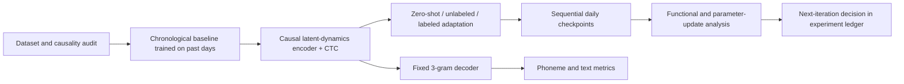

# Brain2Text v1 research plan

**Execution status, 2026-10-06:** the user accepted the documented 4 ms acquisition delay, resolving the earlier strict acquisition gate. V1 uses bounded-delay acquisition and causal downstream processing relative to available bins, not zero-lookahead raw-voltage processing. All four models passed native real-data smoke checks; the initial development search is running. Final evaluation days remain unopened and comparative results remain unmeasured. The [execution README](../research/README.md) distinguishes implemented stages from pending orchestration; the [report](research-results-report.md) includes the evidence-backed development snapshot without treating it as a final result.

**Accepted latency definition:** report 4 ms acquisition delay, 20 ms bin completion, 80 ms output scheduling, and measured computation separately. Downstream preprocessing and inference must pass prefix invariance. Offline full-trial throughput is not measured streaming end-to-end latency. The release README/supplement cutoff discrepancy remains a provenance caveat.

**Completion stage, 2026-10-06:** the fixed-WFST bridge and development/final orchestration are implemented and covered by 31 passing tests. The real four-trial WFST smoke completed with independently checked error accounting; it validates wiring, not research accuracy. The completion pipeline is now loading its resident decoder. Final data remains closed until all initial candidates finish and the hashed development selection—including adaptation steps and WER target—is frozen. Encoder diagnostics, paired reporting, matrix/ancestry auditing and source-linked figure generation are implemented; actual collection, figure inspection and scientific acceptance remain required. Initial-training marginal count dispersion has been audited without changing the frozen objective; conditional likelihood calibration remains an interpretation limitation.

## Problem Statement

We have reproduced the released Willett checkpoint plus 3-gram offline benchmark, but have no experimental evidence that our proposed encoder improves speech decoding or reduces daily calibration. We want to determine whether an LFADS-inspired causal encoder learns useful speech population dynamics, whether it transfers across days, and whether sequential encoder updates reveal reproducible structure that can guide future adaptation.

The research notes and experiment ledger own measured results, metric definitions, experiment status, and accepted findings. This document owns the v1 execution specification. The broader text/speech foundation-model vision remains a future direction.

All v1 outputs use the same methodology and results layout as the Willett reference in the [single comparative research report](research-results-report.md): main decoding table, neural/resource diagnostics, methodology record, cross-day/calibration results, encoder analysis, and result narrative. Published references, reproduced measurements, and planned values are explicitly identified.

## Solution

Use public attempted-speech data first. Build a causal LFADS-inspired encoder with a phoneme CTC head and the fixed reproduced 3-gram text decoder. Establish within-session performance, evaluate chronological transfer under explicit calibration budgets, then analyze sequential daily encoder updates. Preserve checkpoints and predictions from the first run so later analysis does not require reconstructing history.

The primary test seam is a shared experiment evaluator: a frozen manifest, chronological split, model checkpoint, and adaptation configuration enter; per-trial phoneme/text predictions, metrics, resource measurements, and checkpoint history leave. Encoder analysis consumes these outputs rather than introducing a separate data/evaluation pipeline. This seam is proposed for user review.

## User Stories

1. As a researcher, I want a versioned v1 plan, so that each experiment answers an agreed question.
2. As a researcher, I want a hashed public-data manifest, so that every trial can be traced to its source.
3. As a researcher, I want session dates and chronological folds, so that future-day performance measures transfer.
4. As a researcher, I want a preprocessing audit, so that future information cannot silently improve causal inference.
5. As a researcher, I want the released artifact baseline preserved, so that evaluation regressions remain detectable.
6. As a researcher, I want a baseline retrained using only past-day data, so that drift comparisons are fair.
7. As a researcher, I want a matched causal supervised encoder, so that extra capacity is not mistaken for a dynamics benefit.
8. As a researcher, I want a causal LFADS-inspired encoder, so that I can test the value of latent dynamics.
9. As a researcher, I want feature-appropriate reconstruction objectives, so that counts and power are modeled appropriately.
10. As a researcher, I want the same phoneme inventory and text decoder across models, so that encoder effects remain measurable.
11. As a researcher, I want an adapter-only adaptation condition, so that daily changes can be localized.
12. As a researcher, I want a full-encoder adaptation condition, so that the adapter constraint can be evaluated.
13. As a researcher, I want zero-shot and unlabeled-adaptation results, so that label-free deployment assumptions are explicit.
14. As a researcher, I want labeled calibration curves, so that calibration savings can be quantified.
15. As a researcher, I want multiple seeds and uncertainty intervals, so that findings do not depend on a fortunate run.
16. As a researcher, I want per-day PER and WER, so that aggregate accuracy cannot hide failing days.
17. As a researcher, I want sequential checkpoints and optimizer states, so that daily updates can be reproduced.
18. As a researcher, I want same-day update controls, so that ordinary training variation can be distinguished from day changes.
19. As a researcher, I want historical-day evaluation after each update, so that forgetting is measured.
20. As a researcher, I want projection swapping and embedding probes, so that parameter changes have functional interpretation.
21. As a researcher, I want channel-loss and gain/offset stress tests, so that robustness mechanisms can be distinguished.
22. As a researcher, I want bounded compute pilots on our MacBook, so that the full study has a feasible resource budget.
23. As a researcher, I want failed and negative runs retained, so that later decisions reflect all evidence.
24. As a researcher, I want each iteration recorded with methodology and next-step rationale, so that the research remains cumulative.
25. As a researcher, I want rest/preparation coverage audited, so that a future silent-period adaptation study has a defensible data basis.

## Implementation Decisions

- **Data gate:** inventory participants, dates, sessions, channels, trials, labels, raw versus derived features, and pretrial/rest/preparation intervals. Begin with public labeled data; privately owned data is a later extension once provenance and split feasibility are established.
- **Causality gate:** use causal normalization and filtering with explicit initial-state handling. If released features contain irreversible future-aware preprocessing, use appropriate raw inputs or label that dataset condition as noncausal. A causal recurrent architecture cannot repair acausal input features.
- **Two evaluation regimes:** preserve E000 artifact replay on the original public test partition. Create separately identified chronological development and final-test folds for drift research. The released checkpoint may have seen training trials from future evaluation days and therefore is not the zero-shot chronological baseline.
- **Content and time boundaries:** audit repeated transcripts across folds; report recurring-content and novel-content results separately where sample counts permit. For target-day adaptation, reserve an earlier calibration segment and a disjoint later evaluation segment. Future sessions cannot participate in training or model selection.
- **Architecture:** session read-in/adaptation module, causal recurrent latent generator with inferred inputs, appropriate feature reconstruction readouts, and a phoneme CTC head. Initial states and inferred inputs must use only available past/current observations. Causal LFADS is a design inspired by LFADS, not an assertion that standard bidirectional LFADS is causal.
- **Objectives:** first compare supervised CTC alone against CTC plus reconstruction; add next-step prediction as a separate ablation. Document variational priors, KL terms, loss weights, and warmup. Fit objective scale choices on development data. Count channels use a count likelihood with overdispersion checked; power channels use a suitable continuous likelihood after a development-fitted transform.
- **Comparison matrix:** historical-day GRU/CTC; matched-capacity causal encoder without a generative objective; dynamics encoder; dynamics encoder with adapter-only adaptation; dynamics encoder with full adaptation. Match parameters within a declared tolerance where possible and report discrepancies and compute.
- **Fixed output interface:** retain phoneme classes, blank/silence semantics, text normalization, and reproduced 3-gram decoding settings across neural model comparisons. Select any necessary decoder tuning on development folds, then freeze it for all final comparisons.
- **Adaptation regimes:** zero-shot; target-day unlabeled reconstruction adaptation; labeled calibration using budgets of 5, 10, 25, 50, and 100 sentences, plus available-full calibration. Use nested chronological prefixes with identical examples across models. Record unavailable budgets rather than duplicating data. Include simple mean/scale updates and copied previous-day adapters.
- **Sequential protocol:** initialize each day from the previous checkpoint; save pre-update and post-update states. Compare frozen-backbone adapter updates with full updates. Fix steps, learning schedule, and optimizer-state policy before final testing. Use optimizer reset as the primary policy and state carryover as a declared secondary ablation.
- **Forgetting:** compare sequential adaptation without replay against a fixed, past-only replay policy. Separate total-compute and current-day-data budgets. No evaluated examples enter later replay for the main longitudinal forgetting analysis.
- **Analysis:** measure layerwise normalized update norms, cosine similarity of consecutive updates, and singular-value spectra of accumulated update vectors. Report adapter and backbone separately. Measure embedding changes and predictions on a fixed historical probe set; evaluate checkpoint-by-day transfer matrices. Use matched phoneme/word conditions where available, avoiding unsupported correspondence between unrelated trials.
- **Attribution controls:** repeat equal-budget same-day updates, run three prespecified seeds for the main matrix, and distinguish recording changes, task/content shifts, optimization variation, and biological interpretation. Encoder weight differences alone do not establish biological neural drift.
- **Metrics:** use the ledger metric contract. Primary endpoints are chronological held-out-day WER and labeled calibration needed to reach a development-fixed WER target. Report PER before LM decoding, CER, error components, per-day results, worst-day performance, channel robustness, forgetting, adaptation duration, parameter counts, memory, training time, and causal inference latency.
- **Uncertainty:** preserve all seeds and report paired effects. Use session-level resampling with nested trial resampling where session counts permit; report limitations when too few sessions support a population interval. Avoid treating correlated bins as independent samples.
- **Neural dependence:** include zero/shuffled-neural controls for learned text conditioning and distinguish LM corrections from neural PER improvements. Retain pre-LM outputs.
- **Artifacts:** every run has immutable data/split/config/checkpoint identities, code SHA plus dirty-diff identity, software/backend/precision, seeds, predictions, logs, and failed-run status. Bind sequential checkpoints to parent hashes.
- **Compute gate:** run a small development-only pilot on the M5 Max/128 GB host, measuring memory and duration. Freeze a full-study budget before launching the matrix; accelerator/backend choices remain implementation decisions supported by that pilot. Emulated WFST timing is reported separately from native encoder timing.
- **Iteration ownership:** E001 covers data/split audit; E002 covers dynamics and cross-day comparisons. Reserve E006 for sequential adaptation and E007 for encoder analysis. Existing E003–E005 remain deferred follow-ups for contrastive learning, LM conditioning, and speech output.

## Testing Decisions

- Prefer the shared evaluator as the highest test seam. Assert externally observable predictions, accounting, metrics, and permitted adaptation boundaries instead of internal layer shapes or exact learned weights.
- Prior art is the released-checkpoint replay: pinned artifacts enter and transcripts plus WER/PER leave. Extend that contract to chronological folds and checkpoint history. Existing vendor C++ tests cover decoder internals but do not establish cross-day methodology.
- A small fixture checks that every trial is assigned once, adaptation and evaluation sets are disjoint, dates obey chronology, and repeated-content policy is enforced. Altering held-out labels must not alter preprocessing, adaptation, or checkpoint selection.
- A prefix-invariance test changes or appends future neural bins and checks that earlier encoder outputs remain unchanged within a prespecified numeric tolerance. Test this through preprocessing and encoder inference together.
- Known transcript pairs validate edit counts, corpus aggregation, blank/silence handling, and normalization. A recorded replay checks the existing decoder/evaluator for regression within documented backend tolerances.
- A pilot verifies finite losses, checkpoint reload, prediction consistency after reload, and complete run manifests. Reconstruction improvement alone does not pass a decoding-success gate.
- Main scientific comparisons use identical folds, calibration examples, selection rules, decoder configuration, and three seeds. Hyperparameters are chosen on development days, with final test days opened after protocol freeze.
- Sequential tests verify parent checkpoint identity, optimizer policy, allowed replay examples, and historical evaluation preservation. Functional probe changes accompany any claim about parameter drift.
- **Proposed practical improvement gate:** at least 10% relative reduction in macro-average future-day WER versus the strongest applicable supervised causal baseline at the same calibration budget, or at least 2× fewer labels to reach the fixed WER target. Require a paired uncertainty interval supporting benefit, inspect worst-day degradation, and report any PER/WER disagreement. Fix target WER, aggregation, and tolerances using development data before final testing.
- **Analysis gate:** a daily update pattern must exceed same-day/seed variation and recur across held-out transitions. Otherwise report an inconclusive structure result. Exploratory low-rank findings are validated on later days before motivating prediction claims.
- Continue encoder analysis even if dynamics gives no decoding gain when checkpoints are valid: report the negative performance result and narrow the analysis claims. Stop model comparisons if the causality/split audit fails or the resource pilot exceeds the approved study budget.

## Out of Scope

- Live participant experiments, closed-loop usability, clinical benefit, or online communication-rate claims.
- Nemotron/SLM/LLM embedding conditioning in the first comparison; the reproduced 3-gram decoder is the v1 output control.
- Direct waveform or speech-codec output.
- Contrastive objectives until the dynamics-only comparison is interpretable.
- A foundation-model claim from one participant's cross-day results.
- Claiming parameter changes are direct measurements of biological reorganization.
- Predicting encoder updates from silence before rest/preparation coverage and update structure are established.
- Reproducing the 5-gram + OPT pipeline as a prerequisite; that remains a separate baseline enhancement.
- Deploying or automatically launching the full training matrix from this specification.

## Further Notes

The current result is artifact replay, not from-scratch training or chronological transfer. See the [canonical research ledger](research-notes.md), [reproduction evidence](reproduction-status.md), [Willett artifact audit](research/willett-2023-speech-neuroprosthesis-reproducibility.md), and [cross-day literature review](research/cross-day-neural-drift-methods.md).

The central v1 question is whether causal latent-dynamics modeling improves future-day decoding or calibration efficiency. The second question is whether the remaining encoder changes have reproducible structure. Both questions admit negative findings.

Key prior art: [LFADS](https://doi.org/10.1038/s41592-018-0109-9), [NoMAD](https://doi.org/10.1038/s41467-025-59652-y), and [Willett speechBCI](https://doi.org/10.1038/s41586-023-06377-x). Speech generation and transformer conditioning are later branches; novelty must be assessed against the broader representation-learning literature before manuscript submission.

Pending review items: confirm the proposed evaluation seam and select the project tracker. Publication uses the requested `ready-for-agent` triage state once the tracker destination is established. No publication should infer our tracker from the upstream authors' remote.
