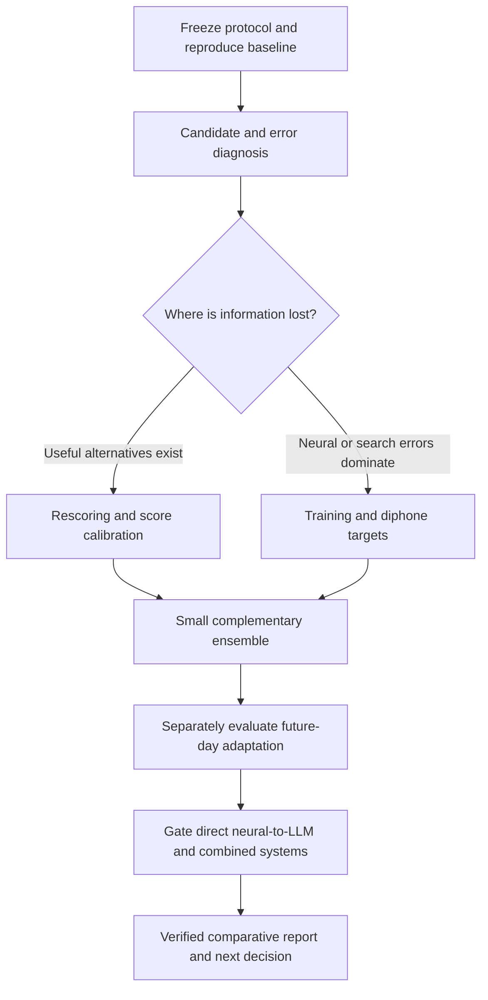

# WER improvement investigation

Accepted by the user on 2026-10-07. This supporting plan owns the new investigation, not the frozen [v1 protocol](research-plan-v1.md). The [ledger](research-notes.md) owns execution status and accepted findings; the [comparative report](research-results-report.md#2-definitions-and-reporting-principles) owns evidence definitions, fingerprints, PNG conventions and presentation. This plan is not a claim that any proposed method improves WER.

**Priority refresh, 2026-10-09:** the ledger's [recorded-idea ranking](research-notes.md#recorded-idea-priorities--2026-10-09) reflects completed E016/E017 accessible retraining and the latest access audit. E017 is the current local baseline at18.4139% WER; matched paper-performance agreement remains inconclusive. The workstream table and dated progress entries below retain the original planning/history context, not current execution status. No training, external submission or v1 restart is implied; new protocols and independent-evaluation gates remain required.

## Objective and completion

Determine which interventions credibly reduce WER on the available public attempted-speech data, and which deserve a controlled future-day study. Resolve the six workstream decisions below with verified evidence and a continue/revise/stop/blocked verdict. Supported improvement is desirable, not guaranteed: a well-controlled negative finding is a valid resolution. A blocked prerequisite must identify the missing artifact/authority and next action; it is not a successful reproduction. Implementing code or writing this plan does not complete the research goal.

This is an evidence-driven sequence, not a requirement to train every possible combination. Each gate can rule out a branch before expensive collection. No E008 or paused v1 restart is implied by accepting this direction; freeze the relevant protocol and resource budget, then obtain restart direction before resuming previously stopped jobs.

## Two evaluation tracks—never one leaderboard

**Track A: public-benchmark optimization.** E000 replay is 18.8756% WER; stopped E008 is 22.8137% WER / 22.6105% PER on 600 public-test sentences. These data have already been monitored and are not an untouched final holdout. Use them for explicitly labeled reproduction/diagnosis, not repeated tuning disguised as final validation. Define permitted train/development identities and selection rules before optimization. An independent final claim needs an access-audited holdout/evaluation service or new data; unavailable labels remain blocked. No target text, future labels or evaluation transcripts enter training or inference prompts.

**Track B: future-day robustness.** Preserve the existing v1 chronological split, seed/configuration freeze, accepted 4 ms acquisition delay, causal downstream processing and calibration boundaries. Final days have already been opened in partial collection; retain their original role and disclose exposure. New drift methods require a separately versioned protocol, not silent changes to the frozen matrix. NoMAD is motor prior art, not reproduced speech evidence.

## Required contract before each experiment

Pin source paper/code/data/checkpoint identities; specify the exact dependency claim and reproduction agreement (metric, numerical tolerance, uncertainty rule) before collection. No retrospective tolerance-setting against observed E000/E008 results. Audit released weights, label availability and environment first. Source-specific reproduction uses its source fingerprint; local extensions use matched local controls. Different published benchmark numbers are context, not directly comparable effects.

Freeze dataset/split, data access, preprocessing/causality, decoder, calibration budget, seeds, checkpoint selection, compute budget and stopping rules. Select on development data only. Exploratory pilots remain explicitly exploratory; require matched three-seed confirmation for a supported model-improvement claim, with seed dispersion and paired session-level uncertainty. Do not extrapolate strong confidence from a small session count. For new experiments, numerical practical-benefit and degradation thresholds remain **to be frozen before execution**; the existing v1 acceptance gate applies only to v1. Do not promise 5%, 10% or any other absolute WER based on a different published protocol.

All result cards need claim → high-level PNG (reuse an existing diagram when unchanged) → reproduction status → fingerprint → metrics/accounting/uncertainty → matched control → failure analysis → cost/dependencies → outcome-driven decision → immutable artifacts. Keep execution status separate from evidence level. Record failures and negative results, not only the best checkpoint.

## Decision workstreams

W01–W06 are planning identifiers, not completed experiments. Assign new experiment/run identities in the ledger when individual protocols are frozen.

| ID / priority | Hypothesis and next decisive test | Controls and primary metrics | Failure / next decision | Current status / dependencies |
|---|---|---|---|---|
| W01: baseline reproduction | Complete a prospectively specified Willett-recipe reproduction and establish a reliable evaluator/control | Released E000 replay; source-compatible training; development-selected checkpoint. Corpus WER primary; PER, CER, CTC loss, per-day rates and exact edits secondary | Parity/accounting failure → repair before collection. Controlled performance miss → retain miss, inspect cause; never relax agreement after observing results | Existing replay and stopped checkpoint measured; completion agreement and resource/restart gate pending. [Architecture](assets/research-architecture-v1/willett-cascade-wfst.png) |
| W02: candidate diagnosis and rescoring | With a fixed encoder, determine whether WFST alternatives contain better transcripts; then reproduce an accessible rescoring method | Original top-1 vs N-best oracle WER on development; oracle gap, candidate diversity, substitutions/deletions/insertions. Equal candidate set for rescoring; frozen scoring parameters | Low oracle WER with high top-1 → selection branch. High oracle WER → audit search coverage and neural errors; not proof of encoder failure alone. Oracle selection is never a deployable result | First diagnostic priority after protocol/data audit; N-best support and logging require inspection. Decoder/LM variants versioned outside fixed-decoder v1 |
| W03: training and diphone targets | Reproduce context-aware diphone decoding against monophone GRU; separately test source-supported training changes | Matched architecture/data/budget/LM; change one principal factor. WER primary; PER, phoneme confusions, loss/checkpoint history, time and memory | No paired WER benefit → report miss; PER-only gain does not establish WER gain. Improve training rather than replacing architecture by assumption | Source artifact/recipe audit and agreement gate pending. [Diphone source](https://arxiv.org/abs/2411.10657) |
| W04: complementary ensemble | Test whether independent models' errors complement each other enough to justify combination | Strongest single model vs small ensemble; retain single-model results. WER, paired effects, error overlap/diversity, latency/memory/total training cost | Correlated errors or no confirmed gain → stop expansion; improvement with excessive cost → explicitly report trade-off | Requires trained/reproduced members, fixed combination method and development-only selection. LLM merging is a distinct intervention, not free neural improvement |
| W05: drift adaptation | Test normalization/adapters and, after a NoMAD dependency audit, unlabeled alignment for future-day stability | Zero-shot, normalization-only, identical labeled budgets and unlabeled-data budgets; no replay leakage. Macro-day/worst-day WER, corpus WER, calibration curves, historical forgetting, adaptation time | No gain or unacceptable forgetting under frozen rules → revise/stop. Motor reproduction does not establish a speech benefit | Existing v1 stays paused/unchanged; new NoMAD speech protocol/access gate pending. [NoMAD diagram](assets/research-architecture-v1/nomad-reference.png), [causal encoder](assets/research-architecture-v1/causal-lfads-location.png) |
| W06: direct neural-to-LLM and combination | Reproduce the relevant BIT claim, then test whether continuous neural conditioning adds content information; combine only validated components | Separately trained equal-budget language-only/zero-input controls, shuffled neural inputs and matched phoneme cascade. Generated WER/CER primary; text loss secondary; paired uncertainty and neural-dependence checks | Loss decline alone or gains explained by language priors → grounding inconclusive; revise objective/interface. Do not claim BIT reproduction from E009 | E009 establishes feasibility only; BIT access/reproduction and larger downstream protocol pending. [BIT architecture](assets/research-architecture-v1/bit-reference.png), [local pilot](assets/research-architecture-v1/e009-neural-prefix.png) |

## Measurements and execution safety

- Every scored run: corpus/per-day/macro-day/worst-day WER, PER before LM where applicable, CER, word/phone/character S/D/I and reference denominators, transcript outputs, checkpoint/config hashes and selection history. State unavailable/not-applicable fields explicitly.
- Candidate experiments: record N, beam, acoustic/LM weights, blank/insertion penalties, candidate scores and oracle definition; score oracle only with diagnostic labels, never use the oracle-selected transcript as system output. Search tuning and LM changes cannot be credited to neural representation learning.
- Model/adaptation comparisons: paired session effects/intervals, three-seed dispersion, historical forgetting, channel-loss robustness where relevant, inference latency and adaptation time, sampled versus peak memory, parameter counts and hardware. Loss is not a calibrated predictor of WER.
- Runs execute serially on local hardware with resumable, pre/post checkpoint evidence. Preserve raw trials and failed artifacts. Pause collection below 30 GiB free; delete no existing artifacts. Remote compute, paid APIs, tracker publication and external evaluation submissions require their own authority/access checks.
- Compare experimental interventions under matched fingerprints. Ensemble compute differences must be disclosed; equal-budget controls are required when attributing benefit to a training/architecture choice.

## Completion evidence and next gate

Complete only when all six decisions have evidence-linked cards, each attempted dependency has a matched reproduction verdict, accounting/reload/selection checks pass for accepted runs, and the report/ledger state the best supported configuration **or** why no improvement is established. Include negative results, remaining blockers, resource trade-offs and the next iteration. An unresolved material prerequisite requires user direction, not a fabricated result or completion claim.

**Start with safe audits:** verify current artifacts and split exposure; inspect N-best decoder support; audit diphone/competition code and model availability; draft prospective reproduction/experiment agreements and measured resource budgets. Stop before long retraining/resuming paused jobs if agreement, holdout, storage or restart authority remains unresolved.

**Prerequisite audit progress (2026-10-07):** [local W01/W02 evidence](research/wer-local-audit-20261007.md) verifies checkpoint/export hashes and split accounting, confirms author N-best score access, and documents a diagnostic protocol proposal. The accounting and author-wrapper checks pass within a 64-test suite. Runtime extraction/oracle WER and new model-benefit estimates remain unmeasured; this does not complete W01/W02 or authorize stopped-job restarts.

**Source-access progress:** [W03–W06 primary-source audit](research/wer-source-access-audit-20261007.md) pins TeamCyber, LISA, NoMAD and BIT revisions. TeamCyber exposes two checkpoint release assets; NoMAD supplies motor demo data with a legacy runtime. DCoND weights/implementation and BIT pretrained weights/full pretraining remain unidentified in the bounded audit. Hidden-label competition evaluation and hosted LLM access are not verified. These results prioritize accessible dependency audits, not numerical reproduction or scientific decision completion. No large weights were downloaded.

**W02 runtime gate started:** [E010 ledger](research-notes.md#e010--scored-n-best-candidate-diagnosis-w02) records the separately frozen two-trial N-best smoke, its resource limits and exact-replay requirement. The full local suite passes 69 tests, including independent diagnostic verification. Wait for verified smoke completion before full diagnostic collection; do not equate launching a decoder with a WER result or resume the stopped trainers.

**W02 current runtime gate:** the corrected shared-resource/fixed-option two-trial diagnostic completed normally and passes fresh independent accounting and exact top-1 transcript replay. Both prior failures remain preserved. Full 600-trial candidate diagnosis and scientific W02 resolution remain outstanding; two technical trials do not establish a useful oracle opportunity or supported improvement. [Canonical methodology and verdict](research-notes.md#e010--scored-n-best-candidate-diagnosis-w02). Following verified smoke and user-approved storage cleanup, the user authorized resuming the unchanged v1 comparison; E008 training remains stopped. [Current execution/reuse evidence](research-notes.md#current-research-thesis).

**W04 diagnostic progress:** [E011](research-notes.md#e011--fixed-checkpoint-complementarity-diagnostic-w04) verifies complementary errors in the existing 600 aligned E000/E008 transcripts. A reference-selected best-of-two gives 15.8338% WER versus 18.8756% for the released member, an opportunity—not achieved ensemble accuracy. Proceed toward a reference-free selector protocol and source gates; independent evaluation and three-seed learned-benefit confirmation remain unresolved. No training or downloads were needed.

**Research rationale:** the competition summary identifies ensembling, language-model combination, learning-rate schedules and diphone targets as productive directions; architecture replacement alone was harder to improve. These motivate priorities, not guaranteed local gains. [Brain-to-Text Benchmark '24: Lessons Learned](https://arxiv.org/abs/2412.17227). NoMAD and BIT remain distinct dependency claims, as documented in the report.
