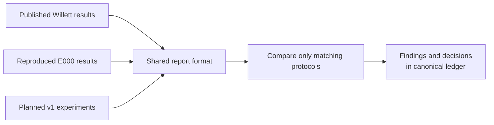

# Brain2Text comparative research report

> Historical pre-restructure snapshot, 2026-10-07. Execution status and pending fields below reflect the old report, not current state. The [current decision-oriented report](research-results-report.md) supersedes this document; the ledger and immutable artifacts retain scientific authority. Preserve this snapshot for the detailed candidate tables, prior interpretations and historical execution narrative.

## Report scope and evidence

**E009 execution update, 2026-10-07:** the 100-step BIT-inspired feasibility pilot completed on the Mac GPU. Fixed-set training text loss decreased 5.1723→1.2195 and 16-sentence evaluation loss decreased 4.4200→4.2514. Frozen-weight and checkpoint reload checks pass; controls show input sensitivity, but generated text remains inaccurate. This is a small neural-prefix learning result, not exact BIT reproduction, foundation-model evidence or established decoding performance. The [canonical E009 record](research-notes.md#e009--bit-inspired-neural-to-audio-llm-feasibility) owns methodology, deviations, failure history and next decisions. E008 WER remains untouched.

**E008 execution update, 2026-10-07:** training stopped by user request after 2,957 updates, with its checkpoint saved. Evaluation of that checkpoint on the matching 600 public-test sentences gives PER 22.6105% and mean unnormalized CTC prediction loss 21.5368 without augmentation. Fixed 3-gram WER evaluation is launched; WER is not yet measured. The separate frozen v1 run is paused by user approval to free decoder memory; completed artifacts are preserved. Training and v1 will not restart automatically. This is partial-training evaluation, not convergence or reproduced performance. Original TF CPU initialization/data preprocessing are retained; Torch dropout/random streams differ, so this is not a bitwise original-code trajectory. CTC is explicitly on CPU. The [canonical E008 record](research-notes.md#e008--original-willett-public-baseline-retraining) owns methodology, evidence, limitations and remaining gates; final scientific placeholders remain incomplete.

This is the single reader-facing report for the Willett reference, our artifact reproduction, and v1. Published, reproduced, and planned results use the same fields. `Awaiting experiment` means no result has been measured; `Not reported` means the audited source does not publish the field. Development screens are provisional, not final evaluations. Missing values are never treated as zero.

The [research ledger](research-notes.md) owns experiment status, metric definitions, accepted findings, and decisions. The [v1 plan](research-plan-v1.md) owns implementation and acceptance criteria. This report summarizes those owners and links detailed evidence rather than introducing independent experiment decisions.

Source key: **P** = [Willett Nature paper and supplement audit](research/willett-2023-speech-neuroprosthesis-reproducibility.md); **B** = [official pinned benchmark README](https://github.com/fwillett/speechBCI/blob/522a9605ccf0818def80b6fd80007598e790408e/README.md); **R** = [local E000 execution evidence](reproduction-status.md); **V** = [v1 research plan](research-plan-v1.md).

Historical local evidence snapshot: [machine-readable diagnostics](../research/runs/report-evidence-20261006-01/evidence.json), collected 2026-10-06 21:40 America/Los_Angeles. It records source hashes, fold accounting, parameter counts, transcript diagnostics and the first candidate's six-epoch screen at that time. Later completed candidate and adaptation evidence below supersedes its execution status, not its preserved measurements.

## 1. Main decoding results

**Execution status, 2026-10-07:** the public-data audit, twelve-candidate initial development search and all 100 development adaptation evaluations are complete. The user accepted the documented 4 ms acquisition delay; downstream processing remains causal relative to available bins. Configuration, adaptation steps and the WER target are now frozen using development data only. Independent checks verify the selected scores, all 200 pre/post checkpoint payloads and hashes, parent ancestry, chronological 25-sentence calibration prefixes and absence of replay during tuning. Three-seed confirmation is running; final days remain unopened. These are selection measurements, not final-day results or established adaptation benefits. The final matrix and encoder analysis remain pending. Details are in the [execution README](../research/README.md) and canonical ledger.

All four models completed the real-data MPS smoke. Smoke metrics are excluded from the research comparison. Final days remain unopened.

**Completion engineering update, 2026-10-07:** the persistent fixed-WFST evaluator, development selection, three-seed confirmation, daily/sequential adaptation, paired summaries, encoder diagnostics, full-matrix/ancestry audit and figure generation are implemented; the previously recorded suite passed 42 tests, including pinned-author phoneme-order contracts and independent completed-result verification. The real four-trial WFST smoke completed and its saved logits/phones/text error accounting was independently recomputed. All twelve initial development candidates and 100 development adaptation outputs are independently audited. The [development freeze](../research/runs/v1-comparison/development-freeze.json) and its [verification record](../research/runs/development-freeze-verification-20261007-01.json) are saved; final-day collection has not occurred. No final-WER or adaptation-benefit value is added before those measurements exist. See the [execution README](../research/README.md#completion-pipeline) for stage/resume behavior and the ledger for current evidence.

The development-fixed target is 94.5970% macro-day WER: the strongest supervised 25-label development setting at its selected step count. This is an operational threshold for the prespecified calibration comparison, not acceptable decoding quality or evidence of a future-day gain. The target was selected on the same five development sessions used for tuning; it must not be interpreted as an unbiased performance estimate. Final calibration curves, paired benefit uncertainty and three-seed results are still required.

**Technical smoke limitation:** the early seed-17 GRU checkpoint decoded four development trials from one day with WER 100%, PER 90.2655%, and CER 90.9836%. This is a wiring check, not a representative decoding result, an improvement claim, or the final configuration selection. [Validation evidence](../research/runs/v1-wfst-smoke/validation.json) preserves hashes and recomputed accounting. The original smoke predates streaming/hashing additions; actual full-matrix outputs require the newer evaluator. E000's original result hash is unchanged.

| Audit output | Measured value |
|---|---|
| Eligible sessions | 24 |
| Initial training / development / final days | 14 / 5 / 5 |
| Public train / test trials | 8,800 / 880 |
| Train / test attempted-speech duration | 15.3820 / 1.4693 hours |
| Excluded redacted holdout trials | 1,200 |
| Repeated normalized prompts | 119; require explicit content-stratified handling |
| Accepted acquisition gate | Passed under user-approved 4 ms acquisition delay; downstream causal |
| Raw voltage needed to recover zero-lookahead features | Not described in the downloaded release |
| Training / adaptation results | Twelve initial development candidates verified; GRU development adaptation tuning complete; other-model tuning and final comparison pending |

The full release has 880 test trials. E000 used the released checkpoint configuration's 600-trial subset; these totals are distinct and are not interchangeable baseline denominators.

WER is expressed in percent; lower is better. Rows describe separate protocols, not one leaderboard.

| Result ID | Evidence state | Method / output | Evaluation regime | Vocabulary | WER | WER 95% interval | Sample accounting | Source |
|---|---|---|---|---|---:|---|---|---|
| P01 | Published | RNN + LM; vocalized attempted speech | Live participant evaluation | 50 words | 9.1% | 7.2–11.2% | 250 trials, five vocalized days, one participant | P |
| P02 | Published | RNN + LM; silent attempted speech | Live participant evaluation | 50 words | 11.2% | 8.3–14.4% | 150 trials, three silent days, same participant | P |
| P03 | Published | RNN + LM; vocalized attempted speech | Live participant evaluation | 125,000 words | 23.8% | 21.8–25.9% | 400 trials, five vocalized days | P |
| P04 | Published | RNN + LM; silent attempted speech | Live participant evaluation | 125,000 words | 24.7% | 22.0–27.4% | 240 trials, three silent days | P |
| P05 | Published | Improved language model | Retrospective vocalized online-output reanalysis | 125,000 words | 17.4% | 15.4–19.5% | Same vocalized outputs; 400 trials inferred, not separately tabulated | P |
| P06 | Published | Improved LM + temporally proximal test data | Retrospective ceiling analysis | 125,000 words | 11.8% | 9.8–13.9% | 250 held-out trials: 50 per vocalized day, different temporal selection | P |
| B01 | Published | Released RNN + 3-gram | Public labeled test benchmark | Released decoder lexicon | 18.8% | Not reported in README | Public test partition; numeric denominator not reported in README | B |
| B02 | Published; locally not run | RNN + 5-gram + OPT-6.7B | Public labeled test benchmark | Released decoder lexicon | 13.7% | Not reported in README | Same named public test partition; numeric denominator not reported | B |
| E000 | Reproduced | Released checkpoint + 3-gram | Public labeled test artifact replay | Released decoder lexicon | 18.8756% | 17.2470–20.5868% | 600 trials | R |
| E008-S17-2957 | Measured neural result; WER pending | Random-initialized PyTorch recipe port; stopped latest checkpoint | Public labeled test benchmark; intermediate single-seed checkpoint, not chronological v1 | Released decoder lexicon | Awaiting decoding | Awaiting decoding | 600 trials, 15 days, one participant | [E008 ledger](research-notes.md#e008--original-willett-public-baseline-retraining) |
| V1-B | Development candidates and GRU adaptation tuning verified; final evaluation pending | Past-days-only GRU/CTC + fixed 3-gram | Chronological held-out days | Same fixed lexicon across v1 | Awaiting final evaluation | Awaiting final evaluation | 4,880 initial train; 200 development test; 200 final test, five days each | V |
| V1-C | Development candidates verified; adaptation tuning running | Matched-capacity causal supervised encoder + CTC + fixed 3-gram | Same chronological protocol | Same as V1-B | Awaiting final evaluation | Awaiting final evaluation | Same folds, calibration prefixes, and seeds | V |
| V1-D | Development candidates verified; adaptation tuning pending | Causal LFADS-inspired encoder + CTC + fixed 3-gram | Same chronological protocol | Same as V1-B | Awaiting final evaluation | Awaiting final evaluation | Same folds, calibration prefixes, and seeds | V |
| V1-A | Not yet evaluated | V1-D with adapter-only daily updates | Same chronological protocol; explicit calibration budget | Same as V1-B | Awaiting experiment | Awaiting experiment | Same folds and target-day budget | V |
| V1-F | Not yet evaluated | V1-D with full-encoder daily updates | Same chronological protocol; explicit calibration budget | Same as V1-B | Awaiting experiment | Awaiting experiment | Same folds and target-day budget | V |
| V1-P | Development candidates verified; adaptation tuning pending | V1-D plus next-step prediction + fixed 3-gram | Same chronological protocol | Same as V1-B | Awaiting final evaluation | Awaiting final evaluation | Same folds, calibration prefixes and seeds | V |

Published P01–P06 intervals are trial-bootstrap percentile intervals using 10,000 resamples, not seed dispersion; values are verified in [Nature Table 1](https://www.nature.com/articles/s41586-023-06377-x/tables/1). Trial counts are audited in the linked supplement/source note. B01/B02 point estimates do not supply comparable uncertainty.

V1-B/C/D/P/A/F are report configuration identifiers within E002/E006, not additional experiment-registry IDs. Every budget, seed, and replay condition receives its own machine-readable run and result row when collected.

E000 differs from B01 by +0.0756 percentage points. This validates the public artifact replay. The live and retrospective paper rows use different conditions and must not be presented as direct improvement targets for the public or chronological benchmarks. E000 is not the stale chronological baseline because its training history can include future evaluation days.

## 2. Neural decoding, speed, and resources

| Result ID | PER before LM | PER 95% interval | CER / word error components | Speed and latency | Parameters / compute | Evidence |
|---|---:|---|---|---|---|---|
| P03 | 19.7% vocalized raw-RNN PER | 18.6–20.9% | CER and S/D/I not tabulated in audited paper/supplement | Mean attempted-speech pace 62 words/minute; not decoder runtime | Final online training set 10,850 sentences; collection plus retraining about 140 minutes/day | P |
| E000 | Not measured | Not measured | Text CER 13.4232%, preserved CI 12.2633–14.5860%; word S/D/I 658/18/19; character S/D/I 1,343/931/165 | Mean WFST decode time 203.61 ms/trial under x86 QEMU; excludes neural inference and is not end-to-end latency | 53,551,145 neural parameters; emulated TensorFlow 2.7 stack | R + local snapshot |
| V1 GRU | Awaiting final evaluation | Awaiting experiment | Text metrics await fixed WFST | 4 ms acquisition; zero downstream lookahead; 20 ms bins / 80 ms outputs; measured streaming latency still required | 842,281 total parameters; 65,792 adapter parameters; MPS float32, CPU CTC | Local snapshot |
| V1 supervised / dynamics / predictive | Awaiting experiment | Awaiting experiment | Text metrics await fixed WFST | Same declared acquisition/bin/output policy | 686,697 total each; 65,792 adapter each; 128 read-in / 256 GRUs / 64 factors / 32 inferred inputs | Local snapshot |

**Metric correction:** the preserved E000 JSON key `phoneme_error_rate` incorrectly named upstream `decoded['cer']`, which scores decoded transcript characters, including spaces. The original artifact remains unchanged; future replay output uses `character_error_rate`. E000 contains 695 word errors / 3,682 reference words and 2,439 character errors / 18,170 reference characters. The word rate exactly reproduces the preserved WER. Error-component splits use deterministic edit tie-breaking and can vary across equally optimal alignments. Raw PER requires retained neural logits and phoneme references; it cannot be inferred from decoded text.

The supervised and dynamics controls have equal registered parameter counts. The GRU has 22.7% more parameters than the dynamics models; report it as a separate historical-style control, not the capacity-matched control. Some reconstruction/prediction heads are unused under particular objectives, so total count is not identical to parameters receiving gradients.

### E009: neural-prefix-to-Aero feasibility, not decoding-performance reproduction

**Method:** frozen E008 GRU hidden states → 32 pooled neural tokens → trainable MLP → Aero's audio-trained language backbone with Q/V LoRA. The waveform frontend is bypassed. Train on 64 distinct sentences, evaluate 16 disjoint prompts from one day; batch size 4, seed 17, 100 AdamW updates at learning rate 0.0003, float32 MPS. Only 2,404,352 projector/adapter parameters train; contrastive learning and encoder updates are not included. Full recipe, artifacts and limitations are owned by the [E009 ledger](research-notes.md#e009--bit-inspired-neural-to-audio-llm-feasibility).

| Text cross-entropy measurement | Before | After 100 steps |
|---|---:|---:|
| Fixed four-sentence training diagnostic | 5.1723 | 1.2195 |
| 16-sentence evaluation, real neural inputs | 4.4200 | 4.2514 |
| Evaluation, shuffled neural inputs | 4.5030 | 4.3273 |
| Evaluation, zeroed neural inputs | 4.7974 | 4.9591 |
| Evaluation, language-only inference ablation | 4.4239 | 4.4876 |

**Evidence and interpretation:** [metrics](../reproduction/results/bit-feasibility/pilot-20261007-01/metrics.json) and [independent artifact verification](../reproduction/results/bit-feasibility/pilot-20261007-01/verification.json) confirm 100 finite updates, prompt separation, 118 changed trainable tensors, unchanged frozen backbone weights and consistent in-place reload. Evaluation values average four four-sentence token-mean batch losses; uncertainty and across-seed dispersion are not measured. The controls ablate the same trained model, not separately trained matched baselines. Input-dependent changes are suggestive, not proof of faithful decoding: one reference is “it's really hard to find something that works”, while the real-input output is “you can see the difference”. [All generated control transcripts](../reproduction/results/bit-feasibility/pilot-20261007-01/generated-transcripts.json) are preserved.

The pipeline trains and its loss declines; low WER was not the requested target and no WER value is claimed. This result is not directly comparable with E008's CTC loss or PER. One day, one seed and a previously public-test-monitored encoder limit generalization claims. Next use a larger downstream split, separately trained language-only control and paired uncertainty before claiming neural grounding; contrastive alignment remains a subsequent ablation. The 100-step run has finished; E008 WER and paused v1 sources were not modified.

### E008-S17-2957: working Mac GPU retraining baseline, intermediate checkpoint

**Finding, 2026-10-07:** the Apple-GPU pipeline trained a random-initialized port of the released Willett model to **22.6105% greedy PER before the language model** on its 600-sentence public benchmark. This establishes local retraining feasibility; it does not yet reproduce 18.8% WER, establish convergence or demonstrate a neural-drift improvement. The [canonical E008 record](research-notes.md#e008--original-willett-public-baseline-retraining) owns the full recipe, deviations, gates and next decisions.

**Methodology:** seed 17; 2,957 successful updates; original TensorFlow CPU initialization and TFRecord preprocessing/augmentation; five 1,024-unit causal GRU layers, original day adapters and dropout structure; batch size 64; CTC plus kernel L2; gradient clipping at 10; TensorFlow-style Adam epsilon 0.1; learning rate linearly decaying from 0.02 toward zero over 10,000 updates. Neural computation/backpropagation uses PyTorch/MPS with explicit CPU CTC. Torch stochastic streams differ, so this is architecture/recipe-faithful, not bitwise TensorFlow trajectory reproduction. The original centered smoothing is retained for offline reproduction, not asserted to satisfy v1's causal-input contract. Total neural parameters, including all 19 adapters: 54,801,193; no controlled speedup or end-to-end latency measurement is claimed.

**Evaluation:** the user-requested stopped `latest.pt`, not the best-PER-selected checkpoint, is evaluated in inference mode without augmentation. Public `test` days 4–18 supply 40 sentences each: 600 sentences, 15 sessions, 15,997 reference phonemes and one participant. The original recipe monitors/selects checkpoints using public-test PER; this is not an untouched final-holdout estimate. It is not a matched comparison against chronological v1 models or Nature's online evaluation.

| Measurement | Value | Definition / scope |
|---|---:|---|
| Corpus PER before LM | 22.6105% | 3,617 edits / 15,997 reference phonemes |
| Macro-day PER | 22.5185% | Equal-weight mean of 15 daily rates |
| Worst-day PER | 25.6343% | June 21, 2022; 40 sentences |
| Conditional corpus PER 95% interval | 21.0480–24.0197% | 1,000 session-then-trial bootstrap resamples, seed 101; not seed dispersion or selection-adjusted |
| Phoneme substitutions / deletions / insertions | 2,207 / 1,114 / 296 | Deterministic edit-distance tie-breaking |
| Mean evaluation prediction loss | 21.5368 | Unnormalized CTC loss per sentence; no augmentation |
| Last training prediction loss | 26.4234 | One augmented batch; not evaluation loss |
| Last-50 training prediction loss mean | 27.1767 | Mean of 50 augmented batch means |
| Last training total loss | 26.5560 | Prediction loss plus kernel regularization |
| Latest scheduled 680-trial validation PER | 24.5479% | Attempt 2,950 best checkpoint; different checkpoint and denominator |
| Fixed-3-gram WER / text CER | Awaiting decoding | Same stopped checkpoint and 600 sentences; no estimate substituted |
| Across-seed dispersion / paired improvement | Not measured | Only seed 17; no matched paired comparison |

**Evidence:** [checkpoint/export identity](../research/runs/e008-stopped-wer-20261007-01/identity.json), [per-trial phone edit counts](../research/runs/e008-stopped-wer-20261007-01/predictions.json), [per-day metrics and uncertainty](../research/runs/e008-stopped-wer-20261007-01/metrics-before-lm.json), [training journal](../reproduction/results/retraining/pytorch-retrain-s17-20261007-01/training.jsonl), and [decoder status](../research/runs/e008-stopped-wer-20261007-01/status.json). Checkpoint SHA-256: `3110a3c1e1996fc94c70c96a6fd180fe83cdd59a1c58a0240169bc1f583831d7`.

**Next iteration:** finish fixed-3-gram WER/CER and uncertainty before assessing text performance; obtain user direction before completing training or adding seeds. Retain this intermediate recipe-port reference for LFADS-inspired comparisons; it cannot replace the past-days-only chronological control. Training and v1 will not restart automatically.

### Historical provisional development screen (not a final result)

At the October 6 snapshot, the first GRU candidate (seed 17, learning rate 0.0003) had completed six epochs. Development macro-day greedy PER decreased from 100.00% at epoch 1 to 72.6090% at epoch 6 on 200 test trials across five development days. This is preserved historical checkpoint-screening evidence, not WER, three-seed dispersion, or benefit versus dynamics. The later twelve-candidate table records completed initial development scoring; this early curve does not describe the current execution stage. Best checkpoint hash and history at collection are in the snapshot above; final days remain unopened.

Omitted published rows inherit no metrics from neighboring rows. Add their diagnostics only when the source explicitly establishes the corresponding condition and evaluated subset. Online words/minute, batch processing runtime, and causal latency remain separate quantities.

### First fixed-decoder development candidate: silence-dominated predictions, not a final comparison

The first completed dynamics candidate performs poorly: corpus WER is **98.0591%** on 200 development test trials, 40 per day across five days. This is seed 17, learning rate 0.0003, auxiliary weight 0.1, trained from random initialization on the 4,880 initial-training trials; the best greedy-PER checkpoint was selected from ten completed epochs. Evaluation uses initial-training normalization, no target-day calibration and the fixed 3-gram decoder. This candidate is not the final selected dynamics model, and E000 is not a matching chronological control.

All rates below are percentages. Corpus rates pool reference units; macro-day rates average five daily rates. Intervals are the evaluator's 2,000-resample session-then-trial corpus percentile intervals, conditional on this development-selected checkpoint. They are not selection-adjusted, participant-population intervals, three-seed dispersion or paired improvement evidence.

| Metric | Corpus | Macro-day | Worst day | Corpus 95% interval | S / D / I | Reference units |
|---|---:|---:|---:|---|---|---:|
| Greedy PER before LM | 78.3455% | 78.1832% | 83.8537% | 76.2262–81.2824% | 131 / 3,856 / 0 | 5,089 phones |
| Fixed-3-gram WER | 98.0591% | 98.0379% | 98.8189% | 97.0331–99.0034% | 778 / 377 / 7 | 1,185 words |
| Text CER, including spaces | 82.8872% | 82.7498% | 88.1102% | 80.4488–85.6819% | 573 / 4,227 / 0 | 5,791 characters |

| Development day (2022) | Trials | WER | PER before LM | CER |
|---|---:|---:|---:|---:|
| July 14 | 40 | 98.0620% | 83.8537% | 88.1102% |
| July 21 | 40 | 98.8189% | 76.9856% | 80.8812% |
| July 27 | 40 | 98.2533% | 75.7672% | 79.7932% |
| July 29 | 40 | 97.4026% | 77.5913% | 83.3043% |
| August 2 | 40 | 97.6526% | 76.7184% | 81.6602% |

Failure-pattern evidence: 1,226 of 1,233 greedy predicted phones are `SIL`; only seven are other phones. Decoded text contains 815 words versus 1,185 reference words; 693 decoded tokens are `a`. This establishes silence-dominated phoneme output and repetitive text for this candidate, not the cause of that failure or a neural-drift finding. The native phoneme inventory and WFST column permutation match the pinned authors' definitions and rearrangement function. Finish the prespecified control/candidate comparison before attributing this behavior to latent dynamics, capacity, normalization or optimization.

Mean CPU full-trial encoder runtime is 4.2832 ms; mean x86-emulated WFST runtime is 2,018.8019 ms/trial. The first-trial 128-bin neural stream has mean/p95 bin computation 0.0552/0.0609 ms. These have different scopes and are not MPS or streaming-text end-to-end latency results; acquisition/bin/output scheduling remain 4/20/80 ms separately. Reported native-process RSS is 543,932,416 bytes and excludes the decoder VM and any GPU-only peak claim.

The [completed evaluation](../research/runs/v1-comparison/development/dynamics-s17-lr0.0003-aux0.1/complete.json) seals logits, embeddings, predictions and metrics. The [independent audit](../research/runs/development-verification-20261007-01.json) checks all 200 logit/phone/text error records. Five empty transcripts expose the original evaluator's literal-space tokenization edge case: it counts an empty string as a word. The table uses standard zero-word empty-transcript components (778/377/7), rather than the preserved raw split (783/372/7). Every per-trial error total, reference count and WER is unchanged; original files remain intact. Every later result must pass this audit, and any changed word rate requires selection/results repair rather than a silent correction. Exact audit tables are used here because this is one provisional candidate, not an established temporal trend or completed model ranking. Final-day metrics, adaptation gains and seed uncertainty remain unmeasured.

### Twelve completed development candidates: poor zero-shot text decoding, adaptation selection still open

All twelve candidates have poor zero-shot development text decoding: corpus WER ranges from 96.5401% to 100.0000%. These are seed-17 checkpoints screened by greedy development PER, trained only on the initial 4,880 trials, with initial-training normalization and no target-day calibration. Each row evaluates the same 200 development trials across five days, with 1,185 reference words, 5,089 phones and 5,791 characters including spaces. This is an exact candidate lookup, not a final model ranking; initial candidate scoring is complete, but adaptation-step selection and the full development freeze remain incomplete.

All values below are percentages. WER selection uses macro-day WER, not corpus WER. The corpus intervals are 2,000-resample session-then-trial percentile intervals conditional on each selected development checkpoint; they are not paired-effect intervals or selection-adjusted uncertainty.

| Model | Learning rate | Auxiliary weight | Corpus WER | Macro-day WER | Corpus WER 95% interval | Corpus PER | Corpus CER |
|---|---:|---:|---:|---:|---|---:|---:|
| GRU | 0.0003 | 0 | 97.4684% | 97.4420% | 96.1918–98.5449% | 72.8630% | 80.1761% |
| GRU | 0.001 | 0 | 96.5401% | 96.5223% | 94.7546–98.1049% | 73.0792% | 81.3676% |
| Matched supervised | 0.0003 | 0 | 98.4810% | 98.5051% | 97.2455–99.5882% | 73.1971% | 80.0898% |
| Matched supervised | 0.001 | 0 | 97.0464% | 97.0788% | 95.4585–98.6464% | 74.7888% | 83.0427% |
| Dynamics | 0.0003 | 0.1 | 98.0591% | 98.0379% | 97.0331–99.0034% | 78.3455% | 82.8872% |
| Dynamics | 0.0003 | 1.0 | 98.0591% | 98.0694% | 97.1929–98.8237% | 91.0198% | 93.7489% |
| Dynamics | 0.001 | 0.1 | 99.1561% | 99.1606% | 97.7797–100.9519% | 76.8324% | 84.9422% |
| Dynamics | 0.001 | 1.0 | 97.8059% | 97.8107% | 96.8020–98.7655% | 74.5923% | 82.8527% |
| Predictive dynamics | 0.0003 | 0.1 | 97.8903% | 97.9281% | 96.1568–99.4700% | 75.9088% | 82.9563% |
| Predictive dynamics | 0.0003 | 1.0 | 97.0464% | 97.0604% | 95.8194–98.0953% | 91.0002% | 92.2984% |
| Predictive dynamics | 0.001 | 0.1 | 100.0000% | 100.1558% | 96.3198–105.6076% | 73.6294% | 80.1934% |
| Predictive dynamics | 0.001 | 1.0 | 97.2152% | 97.1814% | 95.9272–98.4241% | 75.6337% | 82.0584% |

The GRU has more parameters than the matched models, and these one-seed development results cannot establish a capacity-controlled or future-day benefit. Lower PER does not necessarily mean lower fixed-decoder WER: for example, the two supervised candidates reverse their ordering between these metrics. Among predictive candidates, lr-0.0003/aux-1.0 has the lowest macro-day WER despite a substantially higher PER than lr-0.001/aux-0.1. This illustrates why candidate selection uses fixed-decoder WER rather than substituting PER; it does not establish a predictive-dynamics improvement. WER may exceed 100% because insertions add errors; the dynamics lr-0.001/aux-0.1 candidate has a worst-day WER of 102.1834%, not an invalid probability. Complete the prescribed adaptation and three-seed comparison before drawing a model-effect conclusion. Retain poor runs as failure evidence rather than changing the live protocol.

Each row's sealed metrics and predictions are under the [development collection](../research/runs/v1-comparison/development/); the independent [audit records](../research/runs/v1-comparison-independent-audit/evaluations/) verify exact manifest trial order, artifact hashes and logit/edit accounting. Across the twelve rows, 60 empty-transcript component corrections leave every rate unchanged; preserved raw components must not substitute for audited canonical components. Three-seed dispersion, paired benefit uncertainty, adaptation gains and final-day results remain unmeasured. The detailed first-candidate failure analysis above is not automatically attributed to every candidate.

## 3. Methodology record used for every result

### Count reconstruction: marginal dispersion is modest, conditional fit remains unverified

The training-only quality audit covers 1,649,320 available 20 ms bins from all 4,880 initial-training trials and 128 verified nonnegative integer count channels. The Fano ratio is population variance divided by mean; zero-mean channels are excluded from ratios. This is descriptive input-quality evidence, not decoder performance or a statistical significance test.

| Diagnostic | Measured value | Denominator / scope |
|---|---:|---|
| Median pooled channel Fano ratio | 1.0851 | 128 channels, all initial-training bins |
| Pooled channel Fano 10th–90th percentile | 0.9961–1.2077 | Channel distribution, not a confidence interval |
| Channels with pooled ratio above one | 114 / 128 | Descriptive threshold only |
| Median within-trial channel Fano ratio | 0.9917 | 624,345 nonzero-mean trial-channel pairs |
| Within-trial ratios above one | 47.0277% | Same trial-channel pairs; not independent observations |
| Daily median pooled ratio range | 1.0089–1.0567 | Fourteen initial-training days |

Pooled ratios combine speech-task modulation, temporal dependence and day mixtures. They do not measure residual dispersion conditional on the latent generator, and a near-one within-trial median does not prove Poisson calibration. Keep the frozen Poisson working reconstruction objective for v1; inspect conditional residuals before making likelihood-calibration claims or specifying a negative-binomial follow-up. No development/final data or training settings changed. The [saved audit](../research/runs/count-quality-20261006-02.json) includes source hashes and per-channel/day values; the [companion notebook](../research/reporting/count-quality.ipynb) makes the calculation inspectable. An exact table is used because this is an assumption audit, not a trend or performance comparison.

The manifest supplies exact fold accounting; counts below are inventory, not proof of model exposure. The initial model uses only initial `train`. Initial public `test` is reserved for historical evaluation; development `train` is reserved for adaptation calibration. No final raw neural data was loaded to produce this report snapshot.

| Fold | Dates (2022) | Days | Labeled train / calibration trials | Reserved test trials | Train / test duration (h) |
|---|---|---:|---:|---:|---|
| Initial | Apr 28–Jul 5 | 14 | 4,880 | 480 | 9.1629 / 0.8603 |
| Development | Jul 14–Aug 2 | 5 | 1,800 | 200 | 2.9371 / 0.3021 |
| Final | Aug 11–Aug 25 | 5 | 2,120 | 200 | 3.2820 / 0.3068 |

| Field | Willett/public reference | E000 local reproduction | V1 proposal |
|---|---|---|---|
| Question | Can attempted speech be decoded, and can the public offline baseline be established? | Can released artifacts recover B01? | Does causal dynamics improve future-day decoding/calibration, and are daily encoder updates structured? |
| Data and unit | T12 intracortical speech; online and public subsets explicitly distinguished | Pinned corrected Dryad release; 600 public test trials | Frozen 14/5/5 days; 4,880 initial train, 200 development test, 200 final test; final data unopened |
| Inputs | Threshold crossings + spike-band power; 256 features from 128 area-6v electrodes | Released features and preprocessing unchanged | Feature-appropriate count/power objectives; channel mask; audited causal preprocessing |
| Training history | Live: accumulated past days plus daily labeled calibration; public baseline uses released training partition | No training; released checkpoint replay | Past-only training; development selection; untouched chronological final days |
| Model | Day-specific input transformations + shared RNN; paper and public model sizes differ | Released 5-layer GRU checkpoint | Causal latent dynamics + CTC; matched supervised control; adapter/full-update conditions |
| Language decoder | Paper-specific LMs; public 3-gram or 5-gram + OPT route | 3-gram; acoustic scale 0.8, beam 18, n-best 1, blank penalty log(2) | Same frozen 3-gram settings across neural comparisons |
| Causality | Must refer to the exact paper/public condition | Offline artifact replay; no new causal claim | Accepted 4 ms acquisition delay, downstream prefix invariance; bin/output scheduling and compute separately |
| New-day data | Daily labels in live system; row-specific retrospective conditions | No adaptation | Separate zero-shot, unlabeled, and labeled prefixes of 5/10/25/50/100/available-full sentences |
| Model selection | Source-specific procedure | Fixed released checkpoint | Development-only selection; frozen rule before final evaluation |
| Replication | Published protocol | One deterministic artifact replay with bootstrap uncertainty | Three prespecified seeds for main comparisons |
| Uncertainty | P01–P06 trial-bootstrap percentiles, 10,000 resamples; B01/B02 not reported | Authors' trial-bootstrap routine; preserve original intervals | Paired session-level analysis with nested trial resampling where feasible; across-seed dispersion |
| Evidence identity | Paper/supplement and pinned official code | Hashes, logs, result JSON, environment in R | Data/split/config/checkpoint hashes, parent checkpoints, code/dirty-diff identity, logs, predictions |
| Limitations | One participant; condition-specific conclusions | No retraining or live reproduction; emulated timing | Offline study; transfer across days does not establish cross-participant or clinical utility |

## 4. Cross-day and calibration results

Use one row for each model × day × calibration budget × seed, then aggregate across days and seeds. Populate the table from stored predictions rather than manually chosen best runs.

| Configuration / day | Days since last training | Adaptation regime | Labeled sentences | Unlabeled duration | PER | WER + 95% interval | Change versus matched baseline | Historical-day WER change | Adaptation time |
|---|---:|---|---:|---|---:|---|---|---|---|
| V1-B/C/D/P/A/F | 37–51 before any final-day update | Zero-shot / normalization / unlabeled / labeled: not yet evaluated | Planned: 0 or 5/10/25/50/100/full | Measured duration required for each prefix | Awaiting experiment | Awaiting experiment | Awaiting matched predictions; absolute pp and relative % | Awaiting sequential checkpoints; positive means forgetting | Awaiting measured adaptation |

Report macro-average per-day WER, corpus WER, worst-day WER, and dispersion separately. Calibration savings are labels required to reach a development-fixed WER target; report `target not reached` rather than extrapolating a favorable crossing.

| Final target day | Days after last initial-training session (Jul 5) | Available full labeled calibration prefix | Reserved evaluation trials |
|---|---:|---:|---:|
| 2022-08-11 | 37 | 320 | 40 |
| 2022-08-13 | 39 | 320 | 40 |
| 2022-08-18 | 44 | 440 | 40 |
| 2022-08-23 | 49 | 520 | 40 |
| 2022-08-25 | 51 | 520 | 40 |

Every final day supports the planned 5/10/25/50/100-sentence budgets and its available-full prefix. After sequential adaptation, time since the actual parent checkpoint's latest training day must replace the initial gap. Day metadata is not a decoding result.

Required figures:

1. PER/WER versus calibration-sentence budget.
2. PER/WER versus elapsed days, with per-day points and uncertainty.
3. Checkpoint-by-evaluation-day transfer heatmap.
4. Historical performance after successive daily updates.
5. Channel-dropout and gain/offset robustness curves.

## 5. Encoder adaptation analysis

Analyze sequential updates after comparable daily training budgets. Parameter changes describe encoder adaptation; biological neural drift requires additional attribution evidence.

| Metric | Presentation | Control / interpretation |
|---|---|---|
| Layerwise normalized update norm | Layer × day heatmap | Same-day equal-budget updates; report denominator and zero-norm handling |
| Consecutive update cosine similarity | Time-series / transition matrix | Across-seed consistency; a common direction is not automatically a biological mechanism |
| Update-matrix singular values and effective rank | Spectrum and cumulative explained-energy curve | Fixed rank definition; validate compactness on later days |
| Embedding changes | Fixed-probe displacement and phoneme-conditioned analysis | Same historical trials across checkpoints; measure content preservation |
| Functional drift | Cross-day PER/WER heatmap and fixed-probe prediction changes | Compare adapter-only versus full adaptation and same-day updates |
| Forgetting and recovery | Historical performance and calibration curves | Matched replay/no-replay policies and compute budgets |

No sequential adaptation checkpoints have been collected, so these analyses are **not yet measured**, not missing extracted values. They require the E006 daily replay/no-replay and same-day control runs. Silent-period statistics remain a later hypothesis test after timestamp/coverage and reproducible update structure are established.

## 6. Result narrative template

Every completed configuration uses this narrative, supported by the tables above:

1. **Question and hypothesis:** what was tested and the prespecified expected effect.
2. **Methodology:** data/split identity, model/objectives, adaptation budget, seeds, selection rule, preprocessing/causality, and decoder settings.
3. **Results:** primary and secondary metrics, uncertainty, sample accounting, resources, and links to raw predictions/checkpoints.
4. **Comparison:** absolute and relative changes against a protocol-matched baseline, including failed days and negative outcomes.
5. **Interpretation:** supported finding, confounders, and what the evidence cannot establish.
6. **Next iteration:** link to the ledger's accepted decision and the change justified by this result.

### Current E000 narrative

**Question:** recover approximately 18.8% WER using the released checkpoint and 3-gram public benchmark. **Method:** pinned code/artifacts, unchanged model/scoring, 600 labeled test trials, TensorFlow under x86 emulation. **Result:** WER 18.8756% (95% interval 17.2470–20.5868%); text CER 13.4232%; raw PER unmeasured. **Comparison:** +0.0756 percentage points versus the published public baseline. **Interpretation:** successful offline artifact reproduction; no evidence yet for causal dynamics or daily adaptation. **Next iteration:** complete past-only controls and the fixed-WFST comparison, as specified in the [ledger](research-notes.md).

### V1 proposal narrative

**Question:** determine whether causal latent dynamics reduces future-day WER or calibration burden and whether encoder updates have reproducible structure. **Method:** frozen 14/5/5 chronological folds, 4,880 initial training trials, fixed phoneme/text decoding, matched controls, seeds 17/29/43, disjoint adaptation/evaluation prefixes and sequential checkpoint preservation. **Result so far:** first candidate's provisional development screen is described above; no final WER or adaptation result exists. **Comparison:** cannot yet compare dynamics to the strongest matched control. **Interpretation:** no improvement claimed. **Next iteration:** finish the initial search, implement fixed-WFST evaluation/selection, then collect three-seed adaptation and encoder-analysis evidence; future extension decisions require those results.
