# Brain2Text research results and opportunities

This report answers **what we know, what remains uncertain, and which experiment is most informative next**. It is organized by research question, not paper chronology. The [research ledger](research-notes.md) owns methodologies, experiment status, accepted findings and decisions; the [v1 plan](research-plan-v1.md) owns its frozen protocol. This report summarizes those owners and defines the shared presentation rules. Proposed opportunities below are research-priority recommendations, not authorization to run jobs or overrides of a project roadmap.

## 1. Verified findings and next decisions

**Next experiment E025 / I005, October12:** user-authorized minimal raw-recipe ±Poisson reconstruction is implemented; exact zero-weight MPS recipe parity/allhistoricalsampler batches and three finite joint pilot updates pass. Full training has not started:39.04GiBfree versus47.32GiBplanning requirement. This is feasibility, not a decoding improvement or full LFADS reproduction. [Canonical specification/gates/storage decision](research-notes.md#e025--raw-recipe-plus-poisson-count-reconstruction-i005). No final-day access, existing-artifact deletion or automatic restart.

**Latest E022 final comparison, October12:** full-calibration WER47.17%raw/46.16%Anscombe andPER39.04%/37.83%on200later-day sentences. Paired fullWERdifference−1.01pp,95%conditional interval−4.97to+3.57pp: **no clear overall advantage**. Both fail25%WERon all five days/every measured label budget.25-label Anscombe shows an exploratory conditional gain, but effects vary by budget/day and worst-dayWER worsens. [Final tables/figure](#36-raw-versus-anscombe-later-day-calibration-e022), [canonical methods/decision](research-notes.md#e022--causal-raw-control-with-e017-training-components). Training/decoding/independent audits complete; prior running snapshots below are historical. Final recordings remain untouched by E022; square-root/I005/v1 not launched.

**Causal raw complete / Anscombe started, October12:** E022 raw completed10,001attempts; independent identity/schedule/training-ID/finite-state/phone-accounting audit passes. Selected9900 earlier held-block corpus PER26.4923% (3,697/13,955phones;480trials),macro26.5739%,worst64.8862%(June23). First/last200 augmented-batch unnormalized sentence CTC96.9781→7.8117; learning is verified, but held-block gains slowed near27%. The <=30% point gate passes—not an independent generalization or uncertainty-supported improvement claim. Actual raw exit/serial-resource gate checked; matched Anscombe launched from the same untrained initialization, changing only count transform. Later-day WER/PER/calibration and transform benefit remain Not measured. [Canonical methods/current decision](research-notes.md#e022--causal-raw-control-with-e017-training-components), [independent acceptance audit](../research/runs/e022-causal-recipe-s17-20261012-01/raw/completion-audit-01.json). Final recordings/E017/E021/v1 unchanged; no geometry intervention or scheduled monitoring.

**Preprocessing comparison stopped by user, October 12:** E021 stopped cleanly at 6,115 raw updates; trainer/controller exited and all 43 artifacts, including latest/selected checkpoints and optimizer/RNG, are preserved. Best earlier-day macro selection PER is 85.7597%; later-day PER, WER and calibration savings remain **Not measured**. Neither transformed production arm started. A fresh E017 GPU port regression passes and its unchanged cached result rechecks at 17.4283% PER / 18.4139% WER; these are offline reference checks, not a repaired causal control. [Canonical stop/recovery decision](research-notes.md#e021--matched-count-preprocessing-and-small-adapter-calibration), [preservation audit](../research/runs/e021-preprocessing-s17-20261012-01/stop-preservation.json), [reference accounting](../research/runs/raw-control-recovery-20261012-01/reference-verification.json). Raw must pass recipe/performance gates before new transformed arms; exact offline E017 versus causal calibration scope must be settled first. No final-day recordings or v1 restart.

**Count-distribution check completed, October 12:** E020 finds a useful approximate Poisson fit for many count channels, with median day/channel Fano 1.0243 and histogram TV 0.0140. Short-window dispersion is mildly below one and some channels differ substantially. Sparse counts make Anscombe's unit-variance Gaussian approximation unreliable as an exact assumption. [Finding and figure](#35-count-features-are-often-poisson-like-but-not-exactly-poisson-e020), [canonical methods and limitations](research-notes.md#e020--poisson-adequacy-of-unsmoothed-count-features-i003). No training or decoding was run.

**Input-policy diagnostic completed,October12:** E019's four-way matched6,000training-trial comparison gives PER72.32%(fixed/reference),36.47%(fixed/native),63.55%(day/reference)and4.26%(day/native). Normalization alone makes latent day means much closer while decoding stays poor; joint normalization/native input layers recover low training error. **4.26%is training PER—not WER,new-day accuracy or a new benchmark best.** [Finding and figures](#34-input-policies-explain-much-of-the-fixed-instrument-failure-e019), [canonical evidence/limits](research-notes.md#e019--normalization--trained-input-layer-diagnostic-i003).

**Data-first update,2026-10-11:** E018 completes6,680training-trial analyses on19permitted days. Recorded-count/power and frozen-E017 latent distribution shifts exceed within-day variability under the prespecified conditional block comparisons. Content-conditioned evidence remains inconclusive; biological drift is not established. Fixed-preprocessing greedyPER73.1661%limits task-relevant latent interpretation and is not a change to the18.4139%WER baseline. [Finding and four figures](#33-cross-day-data-and-fixed-encoder-shifts-e018--i003), [canonical methodology/metrics](research-notes.md#e018--recorded-feature-and-frozen-e017-cross-day-shifts-i003).

**Access-only update, 2026-10-09:** a [fresh first-party check](research/bit-access-check-20261009.md) still identifies no public matching BIT-All/final T12 checkpoint. OpenReview supplements remain verification-gated/unverified. The official EvalAI2099 scoring phase is publicly listed throughJanuary13,2027; login/team eligibility and successful scoring remain unverified. The scorer route is found, not established inaccessible; this does not clear checkpoint/cascade/license/scorer-parity prerequisites or change any measured WER. [Canonical access decision](research-notes.md#current-research-thesis).

**2026-10-09 final-result refresh:** both frozen budgets and evaluations are complete, and the [requirement-by-requirement completion audit](research-notes.md#goal-completion-audit--2026-10-09-local) passes. Willett E017 gives **18.4139% WER /17.4283% PER /13.3462% CER** on600 matched trials. Its−0.4617pp gap versus the released checkpoint has paired95% interval−2.1541 to+1.0158pp, failing frozen±1pp containment: **inconclusive agreement**, not superiority. BIT E016 selected687 gives validation **17.4943% PER /26.5262% WER**, final-test **16.2218% PER /23.3430% WER**; WER is a3gram diagnostic, not the published cascade. Source/data, reload/restart, edit accounting and actual decoder-exit checks pass. BIT's+0.2343pp validation gap to17.26% is unmatched because of confirmed cohort and unresolved recipe/metric differences. BIT-All/cascade claims remain blocked. V1 stays paused; completion of the authorized reproduction work does not automatically authorize new ideas, extra training or missing-model use. [Canonical metrics, limitations and next decisions](research-notes.md#current-research-thesis).

Execution context: E015's temporary v1 handover preserved1,543 completed-file identities, but the automated restart gate failed at decoder-exit confirmation. No pilot decoder or v1 controller remains live. V1 is **incomplete and paused**, its final days are **not unopened**, and E008 training remains stopped. Full BIT training does not complete or redefine v1. [Canonical handover, experiment and reuse evidence](research-notes.md#current-research-thesis).

| Claim / experiment | Current finding | Evidence level | Execution status | Immediate decision |
|---|---|---|---|---|
| E000: execute the released Willett checkpoint + 3-gram | WER **18.8756%**, 600 sentences; published reference 18.8% | Reproduced: artifact execution; historical numerical-agreement caveat below | Completed | Keep as artifact/evaluator reference, not a chronological neural control |
| E008: retrain the released recipe on the Mac | Stopped checkpoint: **22.6105% PER, 22.8137% WER, 17.5564% CER**, 600 sentences | Feasibility verified; reported 18.8% retraining performance not reproduced | Training stopped; evaluation completed | Specify the performance-agreement gate before any further retraining |
| E016: full-data BIT scratch, 800 epochs | Validation **17.4943% PER** versus source17.26%; final-test **16.2218% PER /23.3430% WER** | Full accessible scratch execution verified; matched reproduction inconclusive | Training and fixed3gram diagnostic completed; independent audits pass | Resolve source recipe/metric/split gaps; do not substitute3gram for5gram+OPT |
| E017: complete preserved Willett recipe |600-trial **18.4139% WER /17.4283% PER /13.3462% CER**|Full local execution verified; frozen paired agreement inconclusive|All10001 attempts, scoring and owned-decoder exit complete|Preserve results; resolve uncertainty/protocol gaps before any correction budget|
| E009: continuous neural embeddings can train a language interface | Fixed training text loss **5.1723→1.2195**; evaluation loss **4.4200→4.2514** | Feasibility verified; BIT claim not reproduced | 100-step pilot completed | Test stronger controls; do not claim faithful decoding from loss decline |
| E012: jointly trained causal encoder → LLM → text | Training-probe loss **5.6424→3.7191**, validation loss **7.3214→4.3128**; real/zero/shuffled WER all **122.2222%** on 16 trials | Technical feasibility verified; neural grounding unsupported | 40-step MPS pilot completed; independent accounting passed | Address collapsed generation and neural-content learning before scaling; [canonical methods/results](research-notes.md#e012--joint-causal-encoder-to-llm-text-pilot) |
| E012-02: continue training and review best validation WER | Best **109.6296% WER at update 600**; train-probe loss **3.7191→0.2862**, validation loss **4.3128→8.1210**; all 16 real outputs reuse three training prompts | Technical continuation/review verified; neural grounding unsupported | Stopped at update 600 for sustained validation deterioration; no numerical failure | Selected WER is not independent test; revise neural-content learning rather than merely train longer; [complete methods/checkpoint/control review](research-notes.md#e012--joint-causal-encoder-to-llm-text-pilot) |
| E013: frozen phoneme-trained causal features → LLM | Causal PER **32.3529%**; validation text loss **4.7918→2.6466**; selected WER **81.6733%**, versus shuffled **116.3347%**, on 40 sentences | Feasibility verified; promising exploratory conditioning signal, not confirmatory extension | 500-step pilot complete; accounting/reload/frozen-weight checks pass | Accuracy remains poor; independent evaluation and matched controls needed; [canonical methods, trajectory and uncertainty](research-notes.md#e013--frozen-phoneme-trained-causal-features-to-llm) |
| E013-02: continue bridge + LoRA | Best **67.3307% WER**, **49.6051% CER**, at update 1,700; token CE 3.5433 | Exploratory conditioning signal; independent-test / paper superiority unsupported | Stopped at update 1,800 for sustained validation-loss deterioration; independent accounting and stop-rule review pass | Preserve best; CE and WER disagree, so retain generated-WER checks; [trajectory, controls, uncertainty and WFST context](research-notes.md#e013--frozen-phoneme-trained-causal-features-to-llm) |
| E014: train only the bridge, freeze the entire LLM | Best **76.4940% WER / 57.7409% CER** at update 1,400; validation CE **4.7918→2.8723** | Feasibility verified; exploratory selected-WER comparison favors LoRA, not a general/independent-test conclusion | All 1,800 updates complete; freeze/reload/initialization/accounting checks pass | Keep as a useful control; LoRA has lower best observed WER despite more CE deterioration; [canonical comparison and uncertainty](research-notes.md#e014--bridge-only-ablation-with-the-entire-language-model-frozen) |
| E002/E006: causal dynamics and daily adaptation help future-day decoding | Development zero-shot WER was poor; no completed final-matrix benefit estimate | Inconclusive for the scientific hypothesis | Frozen final matrix incomplete and paused | Preserve the freeze; BIT/Willett reproduction takes priority |
| E007: encoder updates reveal useful cross-day structure | No completed controlled trajectory conclusion | Inconclusive | Partial probe collection; analysis incomplete | Complete comparable checkpoints/probes before interpreting update structure |
| E011/W04: fixed checkpoints offer complementary alternatives | E008 wins 84/600 sentences; reference-selected best-of-two WER **15.8338%**, not deployable | Feasibility verified (diagnostic accounting); operational ensemble benefit inconclusive | Saved-transcript analysis completed | Test a reference-free selector; do not report oracle as achieved accuracy |

No **extension supported** or biological neural-drift result is established. Low loss, successful checkpoint loading and completed execution are not substitutes for scientific evidence.

**Resource feasibility:** the preserved v1 matrix has 165 / 5,172 required final evaluation records. Its remaining 1,067,920 sentence-decode occurrences project to approximately **611 decoder-only hours (~25 days)** at the pooled historical 2.06-second mean. This excludes training and other work, assumes transferable historical throughput, and is not a completion-time guarantee or measured 64 GiB speedup. [Measured workload, method and caveats](../research/runs/v1-decoder-workload-estimate-20261007-01.json). The approved matrix remains unchanged; any acceleration or scope revision needs explicit parity/protocol gates.

**Storage feasibility — historical v1 estimate:** pooled existing logical artifact sizes projected about **42 GiB additional** evaluation/checkpoint output, excluding other work and with substantial model/filesystem caveats. The ONNX-cleanup preflight recorded approximately **234 GiB free at that historical check**, not current storage. [Historical storage measurement and extrapolation](../research/runs/v1-storage-workload-estimate-20261007-01.json), [dated resume preflight](../research/runs/v1-comparison/resume-after-storage-cleanup.json). Current serial-reproduction storage checks belong to the [ledger](research-notes.md#e017--complete-the-preserved-willett-released-recipe-training). The30GiB guard and artifact-preservation rule remain unchanged; these estimates are not a final-storage or completion-time guarantee.

## 2. Definitions and reporting principles

**Latest E022 completion, October12:** Anscombe finished its matched10,001-attempt budget and independent audit. Earlier held-block PER26.3991%versus raw26.4923%—only13fewer phone errors on13,955phones; no meaningful or uncertainty-supported benefit established. Real MPS calibration pilot and3targeted tests pass; the matched five-development-day raw–Anscombe export/calibration matrix is now running. Cross-day WER/PER and label-efficiency results remain Not measured. This supersedes earlier Anscombe-training snapshots; final days and frozen-v1 remain untouched. [Canonical current status/owned run](research-notes.md#e022--causal-raw-control-with-e017-training-components).

### Evidence levels

Labels apply to a **specific claim**, not an entire paper or model. Execution status is a separate field.

| Evidence label | Required definition |
|---|---|
| Published claim | Precisely cited source claim, not independently verified by us |
| Feasibility verified | Relevant inputs traverse the implemented pipeline; intended parameters update and technical checks pass. A learning claim additionally requires measured loss improvement. No reproduction or accuracy claim follows automatically |
| Reproduced | A specific source claim independently tested under matched conditions and meeting a **predefined agreement criterion**; deviations and uncertainty disclosed |
| Extension supported | A new hypothesis meets prespecified success criteria against matched controls, with appropriate uncertainty and confound checks |
| Inconclusive | Available evidence cannot reliably distinguish competing explanations; missing/incomplete experiments belong here, not in a positive-results column |
| Contradicted | An adequately controlled experiment provides evidence against the specific hypothesis; implementation failure alone is insufficient |

**Historical E000 qualification:** its existing artifact-replay finding is retained, including the +0.0756 percentage-point difference from the public reference. The ledger records an approximate 18.8% target but no recoverable numerical pre-run tolerance. Do not invent one retrospectively or claim exact point-estimate equality. The prospective definition above governs new performance-reproduction claims.

### Reproduction before extension

Define the dependency claim, target metric, matching conditions, acceptable difference and uncertainty rule **before** a new reproduction run. Record each claim as verified, failed/inconclusive or blocked. Reproduce the specific claim an extension depends on; complete-paper reproduction is not mandatory. An inaccessible participant-in-the-loop experiment or redacted label set is **blocked—not reproduced**. A substituted feasibility pilot cannot clear an exact-paper reproduction gate. The newly agreed gate is prospective and does not relabel earlier exploratory experiments as compliant reproductions.

### Evaluation fingerprints and fair comparisons

Each result group states: **dataset/participant and split; training-data access; preprocessing/causality; encoder/objective; decoder; calibration budget; seed count; checkpoint selection; aggregation and uncertainty**. Only compatible fingerprints support direct improvement claims. Differences are permitted as the explicit experimental intervention, not hidden confounds.

Never combine online, public-test, competition-holdout and chronological results into one leaderboard. PER, text CER, unnormalized CTC loss and text-token cross entropy are different measurements. Distinguish corpus, macro-day and worst-day rates; trial bootstrap, session bootstrap and across-seed dispersion are not interchangeable.

### Diagrams, missing values and decision cards

Every major idea gets a high-level **PNG** using consistent labels/layout. Blue = trainable, gray = frozen, purple = frozen backbone with trainable adapters; orange borders identify changed components versus the cascaded reference. Dashed elements are training-only. Dimensions and implementation detail remain in the linked methodology. The graphs are conceptual architecture views, not claims of identical optimization or real-time readiness.

Use `Not measured`, `Blocked` or `Not applicable` explicitly—never blank cells, substituted metrics or zero for missing results. Keep negative findings that change a decision in the main report; move detailed execution chronology and superseded tables to linked history. Each idea ends with **verdict, uncertainty, decisive experiment, cost/dependencies and continue/revise/stop rule**. New opportunities require a hypothesis, matched control, primary metric, failure condition and next decision.

## 3. Research question: how should neural activity be represented?

### 3.1 Willett GRU: establish a reproducible neural/text baseline

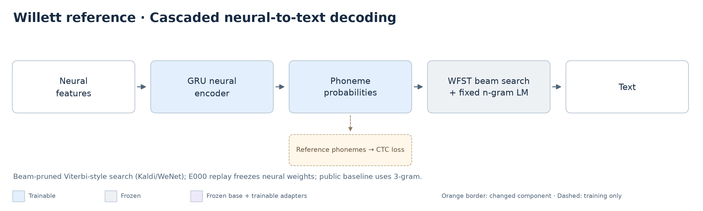

**Source claim:** the released checkpoint and 3-gram route produce approximately 18.8% public-test WER. This differs from the Nature online 23.8% large-vocabulary result. The live paper uses five 512-unit GRU layers; the released offline training recipe uses five 1,024-unit layers. [Source audit](research/willett-2023-speech-neuroprosthesis-reproducibility.md), [pinned author README](https://github.com/fwillett/speechBCI/blob/522a9605ccf0818def80b6fd80007598e790408e/README.md).

**Search algorithm:** the released Kaldi/WeNet decoder uses **WFST beam search—a beam-pruned, Viterbi-style search**, not greedy phoneme selection. The graph combines CTC token transitions, word pronunciations and n-gram language scores; neural phoneme log-probabilities score paths through it. Beam pruning limits the active hypotheses, so the result is not guaranteed to equal an exhaustive unpruned optimum. The search algorithm and language model are separate components: our fixed 3-gram specifies the language scores, while WFST beam search finds candidate word sequences. No generative LLM is used in this route. The implementation explicitly wraps Kaldi's `LatticeFasterDecoderConfig` and extracts best paths. [Search implementation](../LanguageModelDecoder/runtime/core/decoder/ctc_wfst_beam_search.h), [best-path extraction](../LanguageModelDecoder/runtime/core/decoder/ctc_wfst_beam_search.cc), [author decoder](https://github.com/fwillett/speechBCI/tree/522a9605ccf0818def80b6fd80007598e790408e/LanguageModelDecoder).

**Fingerprint — public artifact group:** T12, released recipe's 600 public `test` sentences across 15 days; original offline preprocessing, including centered smoothing; fixed 3-gram, acoustic scale 0.8, beam 18, n-best 1, blank penalty log(2). Public-test monitoring is not an untouched final holdout. E000 replays released weights without training. E008 trains from random initialization with the recipe-faithful PyTorch port, seed 17, and evaluates the user-stopped latest checkpoint after 2,957 updates—not the best checkpoint or a converged run. Source/dropout random streams differ. This group can contextualize E008 against the source benchmark but cannot establish a fully matched converged retraining effect.

| Result | Corpus PER | Corpus WER | Corpus CER | WER 95% interval | Sample accounting |
|---|---:|---:|---:|---|---|
| Published public 3-gram reference | Not reported in README | 18.8% | Not reported in README | Not reported in README | Numeric denominator not specified in README |
| E000 released-checkpoint replay | Not measured | 18.8756% | 13.4232% | 17.2470–20.5868% | 600 sentences; 695 / 3,682 word errors |
| E008 stopped retraining checkpoint | 22.6105% | 22.8137% | 17.5564% | 20.3263–25.6001% | 600 sentences; 840 / 3,682 word errors |

E008 macro-day WER is **22.7210%**, worst-day WER **32.2314%** (June 28). Word substitutions/deletions/insertions: **793/33/14**. Evaluation CTC loss is **21.5368**, an unnormalized mean per sentence; last augmented training-batch loss is **26.4234**, last-50 mean **27.1767**. These loss scales are not E009's text losses. E008 final metric intervals use 2,000 session-then-trial resamples; its earlier pre-LM PER interval used 1,000 resamples and remains historical, not a conflicting new point estimate. E000 intervals use the authors' trial-bootstrap routine. Neither measures across-seed dispersion or a paired improvement.

**Reproduction verdict:** artifact execution is established; training feasibility is established; the retrained stopped model has not reproduced the headline public performance. The +4.0137 percentage-point difference from 18.8% is a partial-run observation, not a controlled architecture effect or failed converged recipe result.

**Evidence:** [E000 ledger](research-notes.md#e000--released-willett-checkpoint-and-3-gram-replay), [E008 ledger](research-notes.md#e008--original-willett-public-baseline-retraining), [E008 checkpoint identity](../research/runs/e008-stopped-wer-20261007-01/identity.json), [completed metrics](../research/runs/e008-stopped-wer-20261007-01/metrics.json), [independent text accounting](../research/runs/e008-stopped-wer-20261007-01/verification.json), [retraining recipe audit](research/willett-baseline-retraining-audit.md).

**Decision card:** **verdict**—completed local baseline/evaluator, close WER but performance agreement inconclusive. **Uncertainty**—one seed/participant, public selection overlap, port deviations and paired interval wider than the frozen band. **Next decisive step**—complete the goal audit; extra seeds or source-environment replication require an explicit prospectively frozen scope/resource decision. **Cost/dependencies**—preserve parent/checkpoints, serial workloads and30GiB floor. **Rule**—do not extend the completed schedule, relax the agreement gate or claim superiority; a demonstrated implementation correction needs fresh parity and a separate bounded full-recipe run. [Canonical final decisions](research-notes.md#current-research-thesis).

**E017 execution proof:** CPU replay reproduces all2,957 historical augmented batches. Fresh-process continuation verifies exact model/optimizer/RNG/data history and fixed-probe logits; parent artifacts and38 TFRecords match their seals. Production consumed all7,044 remaining attempts from the prepared2957 state, with unchanged schedule/selection and no probe outputs used as production state. Full-budget audit, selected-model reload and600-trial scoring pass. Across-seed dispersion remains **Not measured**. Resume parity is not performance reproduction. [Canonical audit evidence](research-notes.md#e017--complete-the-preserved-willett-released-recipe-training).

**E017 completed-training / final-scoring refresh:** all10001 attempts,7,044 child updates and141 validation checks pass finite-state/source/data/parent/schedule audits. Selected9900 monitored680-trial PER19.2494% differs from matched600-trial PER17.4283% because four early days are excluded. Final WER18.4139% (678/3,682; S/D/I647/16/15), CER13.3462% (2,425/18,170; S/D/I1,343/929/153). Conditional95% intervals: PER16.0998–18.9558%, WER16.0473–20.9441%, CER11.3482–15.4816%; macro/worst-day WER18.3385/24.3802%, CER13.2612/19.9854%. Mean unnormalized sentence CTC17.9961 is not a WER surrogate. Fixed3gram initialization2,167.15s and sentence decoding195.49s are separate; actual owned exit passes. Parameter count54,801,193; loading memory samples up to45.53GiB inside the VM are not peak host memory. Paired E000 gap−0.4617pp,95% interval−2.1541 to+1.0158pp fails frozen containment; no superiority claim. [Canonical per-day results, resources and limitations](research-notes.md#final-e017-metric-and-resource-accounting), [sealed paired comparison](../research/runs/e017-willett-paired-comparison-20261009-01.json).

**Completed Willett learning trajectory:** augmented-batch sentence CTC and monitored680-trial PER decrease over the full budget. The raw losses remain variable across training days and augmentation; the trailing50-batch mean is descriptive smoothing, not a changed training input. The dotted line marks the exact preserved-parent continuation. This demonstrates learning, not causal preprocessing or completed WER reproduction. [Hash-bound curve data and chart contract](assets/reproduction-learning-20261009-01/provenance.json).

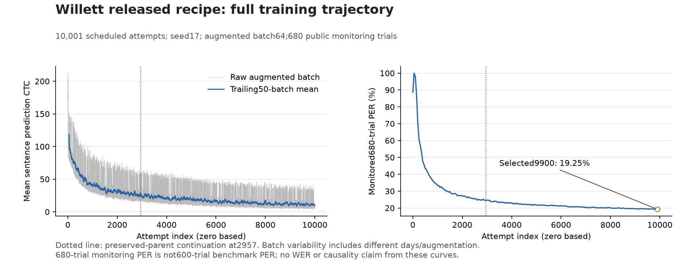

### 3.2 Causal latent dynamics: improve future-day representations without changing the decoder

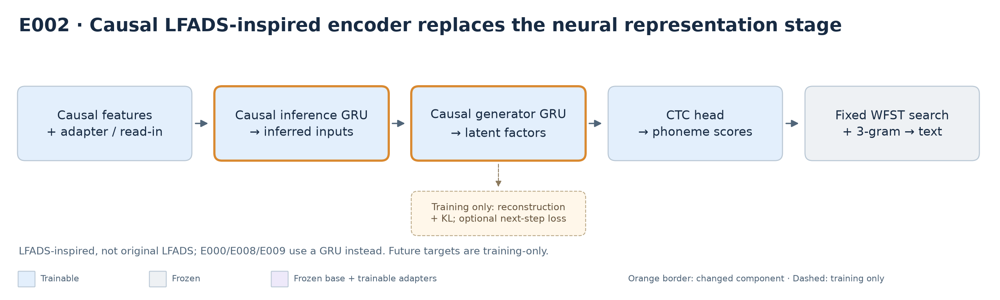

**Where LFADS is used:** in **E002's neural encoder, before the phoneme head and WFST search**. It replaces the baseline GRU representation stage—not the language model or search algorithm. The implemented path is adapter/read-in → causal inference GRU → inferred-input posterior → causal generator GRU → latent factors → phoneme CTC head → unchanged WFST/3-gram decoder → text. The inference GRU summarizes available neural bins; its posterior supplies inputs to the generator, whose factors provide the shared representation for decoding and auxiliary training. [Implemented encoder and objectives](../research/models.py).

**What makes it LFADS-inspired:** the inference/generator separation, stochastic inferred inputs, low-dimensional factors, neural reconstruction and KL regularization. The `dynamics` variant uses CTC plus count/power reconstruction and inferred-input KL; `predictive` additionally predicts the next neural bin. Reconstruction, KL and next-step objectives are training-only—future targets are not inputs during inference. Both GRUs are unidirectional, recurrent states reset at trial boundaries, and evaluation uses posterior means. This is our **causal LFADS-inspired adaptation, not an exact reproduction of original LFADS**. The matched `supervised` control retains the latent-path architecture but uses CTC only; the separate `gru` baseline has no inferred-input posterior.

**Scope boundary:** E006 adapts these encoders across days and E007 analyzes their updates. **Willett E000/E008 and the current E009 neural-to-language pilot do not use this causal LFADS-inspired encoder**; E009 currently uses the frozen E008 GRU. Connecting LFADS factors to an LLM remains a subsequent experiment, not an implemented result.

**Hypothesis:** a causal LFADS-inspired inference/generator model with reconstruction, optionally next-step prediction, improves future-day decoding or calibration efficiency versus a capacity-matched supervised encoder. This is **our hypothesis**, not a reproduced LFADS speech claim; we must identify and reproduce any external dependency claim before presenting a paper-based extension.

**Fingerprint — chronological v1 group:** one T12 participant, 24 eligible sessions; frozen 14 initial / 5 development / 5 final days; 4,880 initial-training trials, 200 development and 200 final test trials. Initial historical test probes number 480. Permitted train/calibration data only; accepted 4 ms acquisition delay and causal downstream filtering; fixed 3-gram. Main comparison seeds 17/29/43; development-only selection and frozen adaptation settings. Capacity-matched supervised/dynamics models total 686,697 parameters; the separate GRU control has 842,281 and is not capacity matched. E000/E008 are not past-days-only controls.

**Measured development evidence:** all twelve seed-17 zero-shot candidates decoded poorly: corpus WER **96.5401–100.0000%** on the same 200 development sentences. This is a development screen, not future-day improvement. Development adaptation selection and confirmation fits subsequently completed; the final matrix opened before the explicit pause. The full matrix, paired effects and final seed dispersion remain incomplete. Preserve poor runs and the frozen selection—do not quietly select new seeds or rewrite settings using final-day results. [Freeze and selected configurations](../research/runs/v1-comparison/development-freeze.json), [freeze verification](../research/runs/development-freeze-verification-20261007-01.json), [current matrix status](../research/runs/v1-comparison/status.json), [pause record](../research/runs/v1-comparison/pause-for-e008-wer-20261007.json).

**Decision-relevant negative result:** the first dynamics candidate had 98.0591% WER and 78.3455% PER; 1,226 of 1,233 predicted phones were silence. Predictive confirmation seeds 29/43 stayed at 100% development PER. These establish poor learning/output patterns, not their cause or a dynamics disadvantage under a complete controlled final comparison. Detailed candidate tables and error-component corrections remain in the [historical report](research-results-report-20261007-before-restructure.md#twelve-completed-development-candidates-poor-zero-shot-text-decoding-adaptation-selection-still-open) and [ledger](research-notes.md).

**Model-assumption constraint:** initial-training count audit: median pooled Fano 1.0851; within-trial median 0.9917. This is marginal descriptive evidence, not generator-conditioned likelihood calibration. Keep the frozen count/power objective; inspect conditional residuals in a separately specified follow-up. [Count audit](../research/runs/count-quality-20261006-02.json).

**Decision card:** **verdict**—inconclusive; no dynamics benefit established. **Uncertainty**—learning quality and incomplete matched final matrix. **Next decisive experiment**—review failure/accounting evidence and reproduction gates, then obtain direction on resuming the frozen matched comparison. **Cost/dependencies**—serial multi-seed evaluation and adaptation; one resident decoder; substantial matrix collection. **Rule**—use the existing v1 gate: ≥10% relative future-day macro-WER reduction or ≥2× fewer labels to a development-fixed target, with paired uncertainty supporting benefit and worst-day inspection. A miss is negative/inconclusive evidence, not permission to alter the frozen protocol. The 94.5970% development-fixed target is operational, not acceptable decoding quality. [Protocol owner](research-plan-v1.md).

### 3.3 Cross-day data and fixed-encoder shifts (E018 / I003)

**Question/verdict:** do recorded features and one fixed encoder's outputs differ across days beyond ordinary within-day variation? **Marginal recorded-feature shifts and fixed-instrument latent shifts are supported** by this exploratory study. **Content-conditioned evidence is inconclusive; biological representational drift is not established.** This is a measured distribution finding, not a decoding improvement or unseen-day generalization.

**Fingerprint:** one participant,T12;6,680training-partition trials,April28–August2,2022,14initial-training/five development days. Final-day recordings were not opened. Released20ms counts/power—not raw voltage—use channels0–127each. Equal-trial normalization fits4,880initial-training trials; trailing9bin smoothing, fixed trained adapter0 and frozen E017 finalGRU. SharedPCA fits initial-training means only. E017 previously saw multiple days including two designated final days; this is retrospective. Fixed global normalization/adapter routing differ from original source preprocessing.

| Representation | Median between-day / within-day distance | Ratio | Excess95%conditional block interval |
|---|---|---:|---|
| Count features |0.39651 /0.17248|2.30×|[0.19724,0.25646]|
| Power features |0.70307 /0.13329|5.27×|[0.55334,0.58650]|
| Shared latentPCA32 |2.49244 /0.65356|3.81×|[1.69939,1.93994]|

The interval measures **between-day minus within-day distance**, not uncertainty on the ratio. Counts/power distances use reference-bin-SD units; latent distances use unwhitened PCA coordinates. Do not compare absolute magnitudes across representations.2,000whole-block resamples,seed101, retain shared day draws across dependent pairs; mean aggregation and latentPCA16 sensitivity remain positive. These conditional exploratory intervals are not171independent comparisons, a multiple-testing claim or population-level evidence.

Heatmap colors saturate at±1referenceSD for readability(131/4,864cells exceed display range); every original value and trial is retained.432trials(6.47%) have a zero-variance channel. Anomalies were flagged, not removed; no duplicate/nonfinite trial passed collection.

**Content evidence:**77cross-day repeated prompts over15days show visible paired displacement. There are only7within-day repeated prompts, with different prompt populations and duration distributions; shared sessions couple the pairs. This is suggestive descriptive evidence, not a sufficient content-conditioned comparison. The2D view retains34.43%variance; numerical latent comparisons use32PCs retaining90.60%. No phoneme timing/alignment or verified silence is inferred.

**Same-sentence recorded activity, October12:** the exact-repeat inventory has77sentences spanning two days each, none spanning three or more in the19-day training cohort. The closest-duration pair is “she said in Blake's voice,” June7/June14,4.90/4.92seconds. The visualization skill informed shared channel/time/colour scales, separate count/power units and inspected PNG layout. Counts use a linear colour scale; power uses logarithmic colours above100 released units to retain visibility without deleting an anomalous value. One trial/day, trial-relative—not word-aligned—time and recording/timing confounds prevent a biological-drift verdict. [Canonical methods and provenance](research-notes.md#same-sentence-recorded-activity-illustration).

**Full temporal latent trajectories, October12:** the same pair now has54frozen-E017 final-GRU frames per trial,0.64–4.88s, rather than trial means/four retained frames. Identical E018 preprocessing/adapter0 and initial-training PCA axes are used; CPU float64 forward preserves weights and avoids competing with Anscombe. The2D projection captures only6.14%of this pair's pooled frame variance (32axes55.31%), so the full1,024D distance curve is necessary. Unaligned pair RMS0.8524 is inside the seven different-prompt within-day contextual pairs'0.5984–0.9613range (median0.8349); **this example does not establish an unusual cross-day effect**. Those sparse controls are not matched to the focal sentence/days, so no inferential comparison follows. Fixed-preprocessing focal PER65%/70%also limits task-relevant interpretation. [Canonical method/precision checks](research-notes.md#repeated-sentence-full-latent-trajectories), [metrics](../research/runs/repeated-latent-trajectories-20261012-02/metrics.json).

**Independent correction (E023, October12):** fit offset/gain from20preceding training trials/day, excluding evaluation IDs/prompts; test10repeated sentences and different-sentence controls with the frozen E017 instrument. Focal full-space RMS0.852→0.794(offset)→0.790(offset+gain), but centred shape0.242→0.242→0.243. Across10prompts, median repeat RMS0.945→0.850; unrelated distances also fall. Extra gain benefit is small, and leave-one-prompt-out specificity changes can cross zero. **Mostly position correction, not demonstrated shared-dynamics recovery.** Three synthetic tests and independent numerical/accounting audit pass. [Canonical methods, all metrics and limits](research-notes.md#e023--independent-latent-offsetgain-correction-i003).

Original nearest20controls are not always duration matched (ratios0.629–1.785). A **post-hoc±10%duration sensitivity**, with no refitting, leaves3focal controls and9cohort prompts with≥3controls. Focal shape exceeds these controls before correction(0.242vs0.190), but the gap shrinks after gain(0.243vs0.205). Descriptive content-related similarity is present; correction-specific recovery remains inconclusive. No WER/PER benefit or biological-drift removal is established. Historical model/preprocessing exposure, poor instrument decoding, timing and sparse/dependent controls remain limitations.

**All-repeat extension (E024, October12):** all77cross-day repeated sentences and7within-day pairs now have full frozen-E017 trajectories. At shared elapsed time, median centred shape cosine is0.097cross-day versus0.171within-day; RMSdistance0.933versus0.835. With strict same-target-block/±10%duration different-sentence controls,55/73cross-day pairs have positive shape advantage (median paired advantage0.056). Four pairs have no qualifying controls and remain in the full repeat distribution. Duration normalization raises cross-day median shape to0.184and positive advantages to60/73, suggesting timing contributes to apparent differences. **Content similarity persists, but biological drift remains unisolated.** Seven within-day prompts are unmatched context, not a measured ceiling; sessions/controls reused, no population CI. Independent798pair checks and two fresh source re-inferences pass. No final-day recordings, decoder or training changes. [Canonical methodology, metrics, sensitivity and verdict](research-notes.md#e024--all-repeated-sentence-frozen-trajectories-i003).

**Failure/usability boundary:** this deliberately fixed preprocessing yields corpus greedyPER **73.1661%**,macro74.3750%,worst90.1306%(July29). It is not the original recipe's17.4283%PER/18.4139%WER pipeline. Distance/PER Spearmanρ is0.8204(counts),0.6636(power),0.4840(latents),descriptively across18days excluding reference—not a causal or significance finding. Poor PER means latent movement cannot be presented as demonstrated drift in a reliable phonetic code. WER/CER are Not measured; no WFST or model updates ran.

**Decision card:** **verdict**—recorded-feature/fixed-instrument marginal shifts measured; content/biological interpretation inconclusive. **Uncertainty**—one participant, fixed-day conditional intervals, sparse content controls, unknown recording/behavior contributions and mismatched encoder preprocessing. **Next decisive test**—separately freeze normalization-versus-adapter controls with a usable matched phoneme pipeline before claiming task-relevant drift or an adaptation benefit. **Cost/safety**—MPS serial collection,171memory/storage observations,≥30GiB free floor, no deletion/final-recording access/v1 restart. **Rule**—preserve this evidence, including poor PER; do not call a scatter plot biological proof or retune this run.

[Canonical methodology, all metrics and resources](research-notes.md#e018--recorded-feature-and-frozen-e017-cross-day-shifts-i003), [independent verification including fresh bootstrap](../research/runs/e018-neural-drift-20261011-01/independent-verification-bootstrap.json), [executed audit notebook](../research/runs/e018-neural-drift-20261011-01/inspect-evidence.executed.ipynb), [figure provenance](../research/runs/e018-neural-drift-20261011-01/figure-provenance-v02.json).169research tests pass. Four final quantitative PNGs and the diagram were visually inspected; complete app-panel rendering is not independently confirmed.

### 3.4 Input policies explain much of the fixed-instrument failure (E019)

**Result:** existing normalization and trained day-input layers interact strongly in the same frozen E017 encoder. On a matched training-partition diagnostic, using both yields **4.2619%greedy PER**,versus72.3249%for the fixed-normalization/reference-layer control. This diagnoses an input-policy mismatch; it is **not** a4.26%WER result or an independent model improvement.

**Definitions/fingerprint:**17permitted days,6,000identical training trials,174,572reference phones; June23/July29excluded equally because no trained native layer exists. Fixed statistics reuse E018's initial-training moments; per-day statistics use all target-day training observations,without transcript labels. Native layers are existing historically supervised E017 adapters. Checkpoint/backbone/head,features,trailing smoothing and greedy decoder stay unchanged; no model weights update. The baseline is E018's matched subset,not its full6,680trial rate. Full target-day moments are offline/transductive; E017 previously saw multiple days including two designated final days. Final recordings were not opened.

| Normalization / input layer | Corpus **training PER** | Conditional95%block interval | Phone errors /174,572 |
|---|---:|---|---:|
| Fixed / April28reference |72.3249%|72.0035–72.6611%|126,259|
| Fixed / native trained day layer |36.4669%|35.8484–37.1206%|63,661|
| Per-day / reference |63.5451%|63.1769–63.9281%|110,932|
| Per-day / native |4.2619%|4.0310–4.5129%|7,440|

**Interpretation:** normalization's benefit depends on the input layer:−8.78ppwith reference0,−32.21ppwith native layers. Native-layer benefit is−35.86ppunder fixed moments and−59.28ppunder per-day moments. Joint effect−68.06pp,conditionalCI[−68.39,−67.73];interaction−23.43pp,CI[−24.07,−22.84].2,000paired whole-block draws within fixed17days preserve the same trials across conditions. These are exploratory conditional intervals,not population/multiplicity-corrected claims; a strong interaction prevents a unique additive share-of-gap attribution.

The native/per-day combination has macro-dayPER3.63%,worst13.21%. It uses a historically trained layer for each included day; this chart does **not** establish performance on a day without calibration. No WER/CER was measured and no WFST ran. The original public-test17.4283%PER/18.4139%WER result remains unchanged.

**Latent-space lesson:** normalization alone reduces median between-day centroidRMS2.4497→0.3511in the sharedE018PCA32space,while PER remains63.55%. A visually stabilized latent distribution can therefore remain a poor decoder input. JointRMS0.3018is smaller than within-day0.4077,but that is trial-mean geometry,not evidence that all dynamics or biological representations are unchanged. The fixedPCA captures88.78%of G0variance versus72.64%for the joint condition; full1,024D RMS also drops0.4390→0.0583,so the reduction is not solely hidden variance outside the plotted subspace.

**Decision card:** **verdict**—input-policy compensation verified on known-day training data; biological/new-day interpretation remains unestablished. **Uncertainty**—historical supervision/training exposure,full target-day moments,17fixed days and limited projection coverage. **Next decisive test**—disjoint public-test trials using training-only moments,then permitted-prefix/preceding-observation normalization; preserve historical selection disclosure. True unseen-day claims need a separately trained past-days-only control. **Safety**—18,000MPSinferences,no training/decoder/final-recording access/v1 restart;allE018evidence preserved. **Rule**—require functional decoding checks alongside latent alignment; do not silently reinterpret training PER as benchmark WER.

[Canonical methodology,all contrasts/resources](research-notes.md#e019--normalization--trained-input-layer-diagnostic-i003), [independent verification](../research/runs/e019-normalization-adapter-20261011-01/independent-verification.json), [projection coverage/full-space sensitivity](../research/runs/e019-normalization-adapter-20261011-01/projection-coverage.json), [executed notebook](../research/runs/e019-normalization-adapter-20261011-01/inspect-evidence.executed.ipynb).175tests and independent24,000scalar phone-distance/interval checks pass; final PNGs were inspected. Complete app-panel rendering is not independently confirmed.

### 3.5 Count features are often Poisson-like, but not exactly Poisson (E020)

**Result:** across 6,680 training trials on 19 permitted days, the unsmoothed first 128 count channels have median day/channel variance-to-mean ratio **1.0243** and fitted Poisson histogram total variation **0.0140** (zero means a perfect histogram match). These are descriptive in-sample fits—not proof of an independent Poisson process. Power and all final-day/public-test recordings are excluded.

**Rate versus noise:** a poor pooled-day fit can reflect changing rates. The illustrated largest mismatch, July 27 channel 117, falls from TV 0.4893 to 0.0039 when allowing individual trial rates. Some channels still depart from the model. Short-window dispersion medians are 0.9380 / 0.9528 / 0.9700 / 0.9837 for 200 / 500 / 1,000 / 2,000 ms; conditional whole-block intervals are narrow but do not address unobserved speech conditioning or population-of-days uncertainty. No bins/channels are treated as independent inferential replicates.

**Anscombe implication:** median rate is only 0.6151 counts per 20 ms. In this sparse regime, transformed noise variance is not exactly one even under a true Poisson model; observed local transformed variance has median 0.4952 at 200 ms. Anscombe remains an input-preprocessing candidate, not a demonstrated drift remedy or ready-made unit Gaussian likelihood. Keep raw counts for count reconstruction and power on a separate continuous path.

**Decision card:** **verdict**—approximate Poisson count model plausible for many channels; exact conditional noise/independence unestablished. **Uncertainty**—in-sample rate fits, local-window stationarity, channel exceptions, changing content and retained trial-end remainder accounting. **Next**—compare identity/square-root/Anscombe through matched retraining and actual decoding/calibration metrics; do not insert a new transform into E017 and interpret an input mismatch as improvement. **Verification**—all 278,784,256 count observations independently rescanned; synthetic controls distinguish rate mixing from extra dispersion; 179 tests and the executed audit companion pass. No training, decoder, final-day recording or v1 restart; WER/PER unchanged. Statistical/data-quality/validation skills informed grain, dependence controls and explicit caveats; the visualization/notebook skills informed inspected PNG delivery and a runnable audit trail.

[Canonical methodology and all metrics](research-notes.md#e020--poisson-adequacy-of-unsmoothed-count-features-i003), [machine-readable metrics](../research/runs/e020-poisson-counts-20261012-01/metrics.json), [independent verification](../research/runs/e020-poisson-counts-20261012-01/verification.json), [executed audit notebook](../research/runs/e020-poisson-counts-20261012-01/inspect-evidence.executed.ipynb).

### 3.6 Raw versus Anscombe: later-day calibration (E022)

**Verdict:** modest, inconsistent effects—not a demonstrated drift remedy or calibration-label saving. Fingerprint: matched causal raw/Anscombe parents selected on earlier held blocks, five development days/200test trials, one participant/pairedseed, prefix-only statistics and100small-adapter steps, unchanged fixed3gram. These are later days excluded from this training, but historically inspected—not independent final confirmation. [Canonical methodology, counts, uncertainty and decision](research-notes.md#e022--causal-raw-control-with-e017-training-components).

Full available labeled calibration (400sentences/day exceptJuly29=200):

| Day | Raw WER | Anscombe WER | Raw PER | Anscombe PER | Labels to25%WER, raw / Anscombe |
|---|---:|---:|---:|---:|---|
| July14 |37.60%|34.88%|32.02%|29.71%|Not reached / Not reached|
| July21 |48.43%|43.70%|42.51%|40.25%|Not reached / Not reached|
| July27 |46.29%|42.79%|37.46%|35.34%|Not reached / Not reached|
| July29 |37.66%|38.10%|33.37%|32.77%|Not reached / Not reached|
| August2 |68.54%|75.12%|51.55%|53.22%|Not reached / Not reached|
| Corpus |47.17%|46.16%|39.04%|37.83%|Not reached / Not reached|

Measured labeled-adapter calibration budgets; zero uses the no-update global-statistics baseline:

| Labels/day | Raw WER | Anscombe WER | Raw PER | Anscombe PER |
|---|---:|---:|---:|---:|
|0|98.73%|96.88%|84.04%|83.59%|
|5|92.66%|88.86%|66.14%|65.38%|
|10|94.18%|92.49%|66.54%|64.81%|
|25|90.89%|84.05%|67.75%|62.98%|
|50|85.23%|83.04%|61.47%|64.55%|
|100|85.32%|83.12%|61.17%|61.29%|
|Full(200/400)|47.17%|46.16%|39.04%|37.83%|

**Uncertainty / controls:** full Anscombe-minus-rawWER−1.01pp, conditional paired95%interval[−4.97,+3.57]pp; whole-session-only sensitivity also crosses zero. Full calibration improvesWERon three days, slightly worsensJuly29, and substantially worsensAugust2. At25labels, difference−6.84pp[−12.82,−1.42]is an exploratory conditional signal;13budget/control comparisons have no multiplicity correction, so do not treat a selected budget as confirmed superiority. Full-prefix normalization-onlyWER58.82%raw/54.85%Anscombe consumes all target training observations without labels and is distinct from zero-shot. Both methods miss25%WERat every measured labeled budget on every day; do not extrapolate fewer labels. [All normalization controls, per-day budgets and paired intervals](../research/runs/e022-raw-anscombe-summary-20261012-01/metrics.json).

**Decision card:** execution/audits complete; overall transform benefit and calibration savings unestablished. Preserve the negative/mixed result and raw control. Next proposed I005 isolates Poisson reconstruction using the successful raw recipe, not a full LFADS repeat; no new launch follows automatically. Independent15,600text/5,200phone checks,3summary/3evaluation tests and owned-decoder exit pass. One participant/seed/five historically exposed days; no independent final-day or biological-drift claim. [Sealed evidence](../research/runs/e022-raw-anscombe-summary-20261012-01/seal.json).

## 4. Research question: how should neural representations become text?

### 4.1 BIT: reproduce the neural-to-language dependency claim first

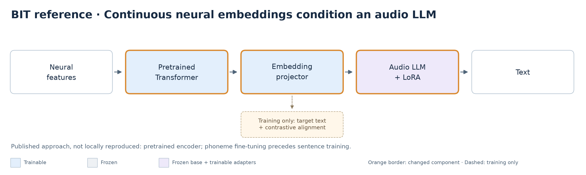

**Published claim:** pretrained Transformer embeddings, an embedding projector, audio LLM adaptation and contrastive alignment enable end-to-end text decoding. Paper stages include masked neural pretraining, phoneme fine-tuning and sentence training. This is distinct from merely rescoring phoneme-decoded sentences. [Paper, methods and Table 1](https://arxiv.org/html/2511.21740v2), [author code](https://github.com/yzhang511/bit).

**Fingerprint — BIT source group, not locally reproduced:** approximately 367 hours of human/monkey intracortical pretraining; attempted and imagined speech tasks; bidirectional encoder. Brain-to-Text '24 competition results use 1,200 holdout sentences; end-to-end WER **15.67%**, end-to-end plus ensemble **10.22%**, cascaded **6.35%**. These are distinct configurations, not one result. Appendix A.4 permits unlabeled evaluation/holdout neural data in pretraining, a transductive setting unlike our strict chronological v1. Exact split/data/checkpoint availability, source uncertainty and accessible matched evaluation must be audited before a local reproduction target is frozen. Redacted competition labels prevent direct local headline scoring without an accessible evaluation service.

**Reproduction verdict:** published claim only; local BIT reproduction is not complete. Our E009 substitutes the encoder and training stages and cannot clear this gate.

**Decision card:** **verdict**—full scratch execution/proofs complete, matched source-performance reproduction inconclusive. **Uncertainty**—pretraining access, paper-run configuration and evaluation correspondence. **Next decisive step**—retain E016 and obtain source-matching evidence before a prospective correction; do not substitute3gram for BIT-All's cascade. **Cost/dependencies**—BIT-All needs separately audited pretraining,5gram/OPT, license eligibility and matched hidden-label scoring. **Rule**—mark inaccessible claims blocked and numerical proximity separately; no extension support follows. [Source audit and prerequisite inventory](research/bit-full-training-recipe-20261009.md).

### E016 update: full-data BIT scratch reproduction attempt

**Runtime/resources:**800epochs/220,000updates took19,134.83s (~5h19m);8,426,322 parameters. Sampled MPS driver-memory maximum2,646,032,384bytes is not a true peak. Decoder initialization took~2,064s, with validation/test sentence-decode totals41.77/46.56s, excluding teardown. Willett recorded update timers sum8,708.14s over10001 attempts (continuation5,786.03s); startup/replay, validation and checkpoint I/O are excluded, so total Willett wall time remains Not measured. Seed dispersion and true peak host memory are Not measured, not zero. [Canonical completion/runtime audit](research-notes.md#goal-completion-audit--2026-10-09-local).

**Completed BIT learning trajectory:** training phone-normalized CTC falls sharply, while validation CTC rises after its early minimum and standard validation PER continues improving. Loss and discrete phoneme errors therefore tell different stories; neither predicts WER without decoding. The selected epoch687 comes from the frozen minimum-PER rule, not the final epoch or minimum validation loss. Training/evaluation conditions differ, so the loss gap alone does not isolate a cause. [Hash-bound curve data and chart contract](assets/reproduction-learning-20261009-01/provenance.json).

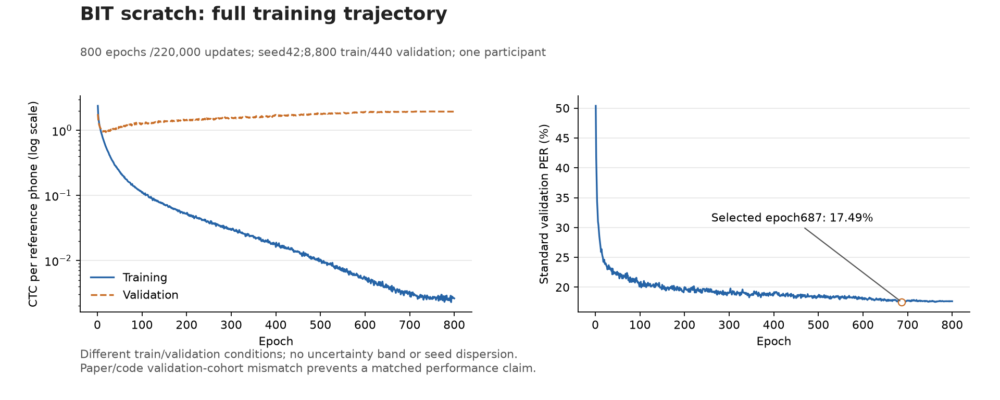

**Fixed3gram scoring refresh, 2026-10-09:** selected epoch687 gives validation **WER26.5262% /CER16.9972%** and final-test **WER23.3430% /CER14.8544%** (440trials each). Conditional session-then-trial95% WER intervals are21.3108–33.2715% and19.2579–28.1411%. No WER-based reselection. Independent accounting, unchanged exports and actual decoder exit pass verification. This diagnostic does not reproduce BIT's5gram+OPT6.35% hidden-holdout claim or establish superiority over Willett's differently defined600-trial benchmark. Source-gap review is complete, with unmatched/blocked claims retained. [Canonical per-day metrics, timing and limitations](research-notes.md#current-research-thesis).

**Completed training refresh, 2026-10-09:** all800epochs/220,000updates are complete. Independent export accounting verifies selected epoch687 standard PER **17.4943% validation /16.2218% final test**, with phone-normalized CTC **1.9321/1.7640**. Conditional session-then-trial95% PER intervals are **15.0164–20.2897% /13.6789–19.1168%**; single-seed dispersion is Not measured. The auditor preserves original blank-first argmax priority on exact BF16 ties rather than silently changing runtime PER through export class permutation. Fixed3gram WER/CER scoring is complete, as reported above; it is not the published5gram+OPT cascade. Fresh selected-model replay independently verifies padded source-compatible PER17.9116/16.6619% and exact trimmed logits. An isolated two-update epoch800 fixture also verifies exact fresh-process optimizer/sampler/scheduler/RNG restart; it is not a production-budget extension. Numerical proximity to17.26% is exploratory, not matched reproduction. [Canonical metrics and technical-proof evidence](research-notes.md#current-research-thesis).

**Fingerprint / execution:** pinned author NDT and effective T12 CLI configuration,8,800 train/440 validation/440 final-test trials, seed42, batch32,800 epochs/220,000 updates. Native Apple-GPU BF16 attention with FP32 weights/buffers and differentiable CPU CTC; original summed-CTC optimization and OneCycle schedule. Offline centered smoothing and evaluation-block normalization are not causal. Select by standard validation PER only; retain source-compatible PER separately and decode selected validation/final-test logits with the fixed3gram as a diagnostic. [Canonical frozen recipe, trial identities, checks and live progress](research-notes.md#e016--full-data-bit-from-scratch-paper-length-training).

**Claim-specific target:** published BIT-TFS validation PER17.26%, exploratory±1percentage-point band frozen before collection. Completed standard validation PER17.4943% has a+0.2343pp gap; separately tracked source-compatible PER17.9116% has a+0.6516pp gap. Both point estimates are inside the exploratory band, not proof of matched reproduction. Paper800epoch/source3000epoch, paper masking/effective CLI masking-off, source PER accounting and exact selected split/configuration remain unresolved. BIT-All14.39% PER and6.35% hidden-holdout5gram+OPT WER are distinct claims requiring unavailable/unverified prerequisites, not targets satisfied by this scratch run.

**Confirmed matching gap:** paper§5.1 uses the full benchmark test set for attempted-speech validation; pinned code and E016 use440/440 halves. This is now a documented paper/code cohort mismatch, not merely an unknown split seed. No retrospective pooling or checkpoint reselection can recreate the paper's selection trajectory. Public5gram/OPT listings have been located, but matching BIT-All weights/manifests, license clearance, cascade parity and hidden-label scoring remain unresolved. [Canonical claim classification and dated access inventory](research-notes.md#e016-post-training-evaluation-gate).

**Decision card:** **verdict**—full scratch budget, dual-PER replay/restart and text scoring complete; matched reproduction inconclusive. **Uncertainty**—single seed, historical exposure, confirmed cohort mismatch and unresolved optimizer/masking/metric correspondence. **Decisive next step**—obtain paper-run configuration/IDs/metric, then prospectively specify any separate correction before execution. **Cost/dependencies**—preserve every checkpoint,30GiB floor, serial workloads and explicit new-budget authority. **Rule**—retain completed results and blocked claims; no retrospective pooling/reselection or silent extension. [Canonical gap analysis and next decisions](research-notes.md#reproduction-claim-verdicts-and-bounded-next-decisions).

### E015 update: original BIT Transformer, bounded phoneme pilot

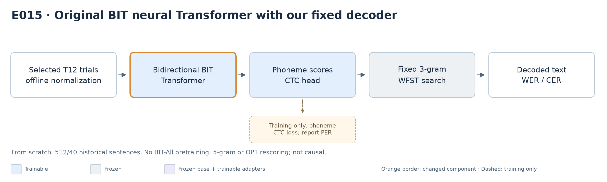

**Feasibility verified, not source-performance reproduction:** the unmodified pinned BIT NDT trains on the Apple GPU for 200 updates. Validation phone-normalized CTC falls **5.7879→2.6108**; selected update100 has **73.5294% PER (825/1122), 96.4143% WER (242/251), 87.0458% CER**. Missing words/phones dominate. Gradients, parameter changes, checkpoint reload and independent saved-logit/text accounting pass. The pilot uses the historical512/40 cohort, one seed, bidirectional attention/centered smoothing and transductive block statistics—not causal v1. Its raw defaults differ from the effective author CLI, as now audited. No BIT-All pretraining,5gram or OPT rescoring is used. [Canonical methods, deviations, trajectory and missing metrics](research-notes.md#e015--original-bit-transformer-from-scratch-ctc-pilot).

**Decision card:** working GPU training, poor accuracy; pilot WER is complete and independently checked. The later user-authorized BIT/Willett-first goal supersedes the original immediate-v1-resume sequence; v1 stays preserved and paused. E016's full scratch training, scoring and technical proofs are complete. E015 cannot reproduce6.35% or establish an architecture improvement; full-cascade prerequisites remain separate.

### 4.2 E009: test our simplified continuous-embedding interface

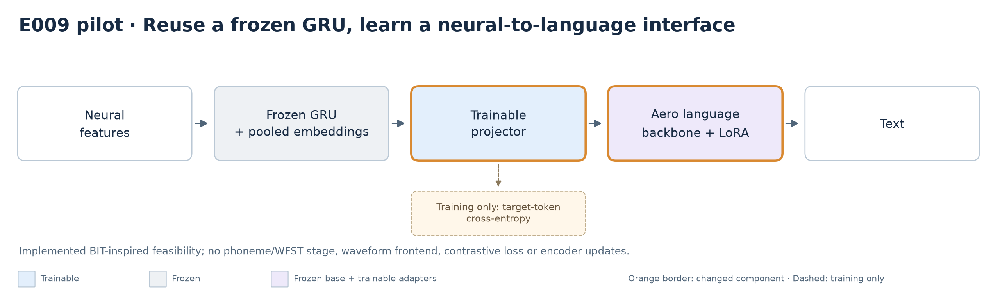

**Local claim:** a frozen trained GRU can feed continuous hidden states into Aero's audio-trained language backbone through a trainable projector and LoRA, with finite training and decreasing text loss. **Not claimed:** exact BIT, contrastive learning, pretrained neural foundation model, waveform decoding, high accuracy or causal streaming readiness.

**Fingerprint — E009 feasibility group:** 64 distinct public-train sentences and 16 disjoint public-test prompts from May 24; one seed, one day, 100 updates. Frozen E008 encoder has previously monitored public-test PER, so downstream separation does not create an untouched encoder holdout. Original train augmentation is applied once in frozen feature extraction; evaluation is unaugmented. Thirty-two pooled neural tokens enter the text-embedding space; the waveform frontend is bypassed. Only 2,404,352 projector/Q-V LoRA parameters train; masked target-token cross entropy, no contrastive loss. Evaluate mean losses across four four-sentence batches, not corpus-token-weighted loss. [Methodology and deviations](research-notes.md#e009--bit-inspired-neural-to-audio-llm-feasibility).

| Text-loss measurement | Before | After 100 updates |
|---|---:|---:|
| Fixed four-sentence training diagnostic | 5.1723 | 1.2195 |
| Evaluation: real neural inputs | 4.4200 | 4.2514 |
| Evaluation: shuffled neural inputs | 4.5030 | 4.3273 |
| Evaluation: zero neural inputs | 4.7974 | 4.9591 |
| Evaluation: no neural prefix | 4.4239 | 4.4876 |

**Saved generation diagnostic — four sentences only:** these are the original `evaluation[:4]` examples, not the full 16-sentence loss cohort. Each condition has 25 reference words and 115 characters; standard whitespace words, unchanged case/punctuation. [Exact S/D/I, transcripts and independent verification](../research/runs/e009-saved-generation-accounting-20261007-01/metrics.json), [methodology](research-notes.md#e009--bit-inspired-neural-to-audio-llm-feasibility).

| Inference condition | Word errors | WER | Character errors | CER |
|---|---:|---:|---:|---:|
| Real neural input | 28 | 112% | 102 | 88.6957% |
| Zero neural input | 24 | 96% | 92 | 80% |
| Shuffled neural input | 24 | 96% | 93 | 80.8696% |
| No neural prefix | 25 | 100% | 89 | 77.3913% |

WER can exceed 100% through insertions. The same trained model supplies all inference ablations; these are not separately trained equal-budget controls. With four sentences, one day and one seed, no uncertainty or neural-benefit conclusion is established. No generation was rerun. Full-cohort generated WER remains **Not measured**; these saved examples reinforce why loss decline is not evidence of faithful content decoding.

**Verdict and failure condition:** feasibility verified. Finite gradients, 118 changed trainable tensors, unchanged frozen backbone weights and in-place reload consistency pass. Generated text remains inaccurate: reference “it's really hard to find something that works”; real-input output “you can see the difference”. Control sensitivity and modest loss improvement do not establish faithful neural decoding; no uncertainty or across-seed estimate exists. Current controls ablate the same trained model, not separately trained equal-budget baselines. [Metrics](../reproduction/results/bit-feasibility/pilot-20261007-01/metrics.json), [artifact verification](../reproduction/results/bit-feasibility/pilot-20261007-01/verification.json), [generated control transcripts](../reproduction/results/bit-feasibility/pilot-20261007-01/generated-transcripts.json).

**Decision card:** **verdict**—working local interface, grounding inconclusive. **Uncertainty**—language-domain adaptation/memorization versus neural information. **Next decisive experiment**—specify a larger disjoint downstream evaluation and separately trained language-only/zero-input controls at equal update budgets; compare real versus shuffled predictions on paired trials. **Cost/dependencies**—small adapter-only local pilot using downloaded weights; sample size, seeds and budget must be fixed before execution. **Rule**—continue only if the predefined paired neural-benefit criterion is met; if no-prefix or shuffled controls explain the gains, revise the interface/objective rather than call it neural decoding. BIT-derived extensions still require the relevant BIT reproduction gate.

### 4.3 E013/E014: does the language backbone need trainable adapters?

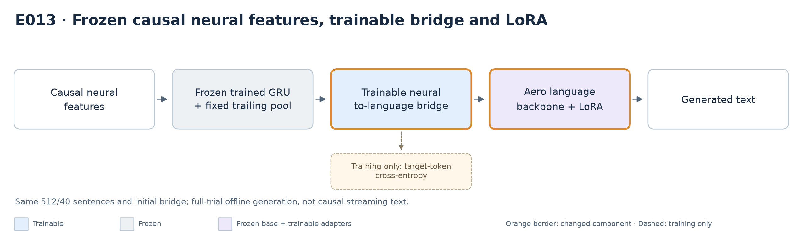

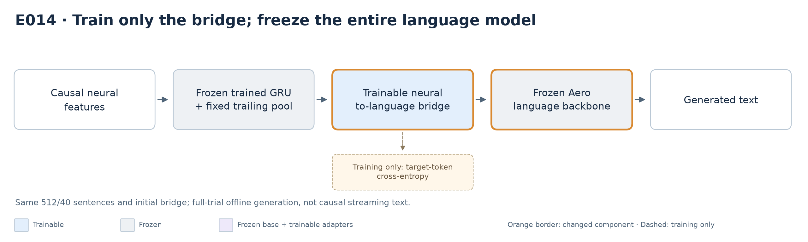

**Fingerprint:** 512 training sentences across eight days, 40 June-7 public-test sentences used as monitored validation; one participant/seed. Same frozen E008 causal-feature cache, initial bridge tensors, prompt, constant LR and greedy generation. E013 trains bridge plus Q/V LoRA; E014 removes LoRA and freezes all language weights. Causal features do not imply causal streaming text: both generate after the full trial. Historical encoder/public-validation exposure prevents independent-test claims. E013's optimizer/sampler-preserving continuation reset its loss monitor at update 500; E014 runs uninterrupted. Compare common update checkpoints, disclose actual early-stop budgets, and do not attribute a best-selected score solely to one component without uncertainty and additional seeds. [Canonical E013 findings](research-notes.md#e013--frozen-phoneme-trained-causal-features-to-llm), [E014 contract and status](research-notes.md#e014--bridge-only-ablation-with-the-entire-language-model-frozen).

**Audited comparison:** both reach 1,800 total updates; E013 stops for sustained CE deterioration, E014 reaches its matched budget. Best-selected bridge-only WER is **76.4940%** versus bridge + LoRA **67.3307%**; bridge-only minus LoRA gap **+9.16 pp**, conditional paired-trial interval **[1.57,17.28] pp**. Bridge-only trains 1.31 million parameters versus 2.40 million with LoRA and has less late CE deterioration, but its best WER is worse. It can win at individual common checkpoints; do not infer universal LoRA superiority. Both initializations, frozen inputs, reloads and scalar accounting pass. [Exact common-budget trajectory, controls, resources and limitations](research-notes.md#e014--bridge-only-ablation-with-the-entire-language-model-frozen).

**Decision card:** **verdict**—bridge-only feasibility verified; the best observed language-interface WER favors LoRA in this exploratory pilot. **Uncertainty**—single selected validation day/seed, historical access, CE versus generated WER, and shared-model inference controls; interval is not selection-adjusted or independent test. **Decisive experiment**—freeze an independent evaluation boundary and isolate the input representation, retaining both language-adaptation conditions as controls. **Cost/dependencies**—reuse local MPS/features where valid; new study needs a prospective data/budget/uncertainty contract. **Rule**—preserve negative findings and keep LoRA as best observed baseline; do not use lower CE to select an accuracy winner or automatically scale/restart. Neither result clears the independent paper-superiority gate.

## 5. Research question: how can decoding remain stable across days?

### Reference work: NoMAD — stabilize decoding by aligning latent dynamics

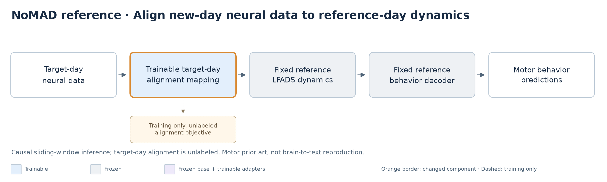

**Reference:** Karpowicz et al., *Stabilizing brain-computer interfaces through alignment of latent dynamics*, Nature Communications 16, 4662 (2025). NoMAD means Nonlinear Manifold Alignment with Dynamics. It learns reference-day LFADS dynamics and a supervised behavior decoder, then fits a target-day neural mapping without behavior labels while preserving reference dynamics/decoding. **Causal sliding-window inference** uses previously observed bins plus the current bin. Its evidence concerns motor decoding, not brain-to-text or LLM conditioning. [Paper and causal-inference methods](https://www.nature.com/articles/s41467-025-59652-y).

**Evidence level:** Published claim; **not locally reproduced**. Local NoMAD metrics, uncertainty, runtime and agreement criteria: **Not measured / not yet specified**. Our E002/E006 models are LFADS-inspired, not implementations or reproductions of NoMAD. Causal inference does not establish prospective online adaptation.

**Decision card:** assess a matched motor-decoding reproduction before a NoMAD-derived speech extension; then test unlabeled target-day alignment against normalization-only and labeled-adaptation controls using chronological WER, label budget and forgetting. Cost/access remain unaudited. A speech benefit must be independently demonstrated; otherwise retain an inconclusive result. This reference does not alter the frozen v1 protocol or authorize training. [Detailed literature owner](research/cross-day-neural-drift-methods.md#4-latent-dynamical-models).

### 5.1 Daily adaptation: compare label efficiency and forgetting

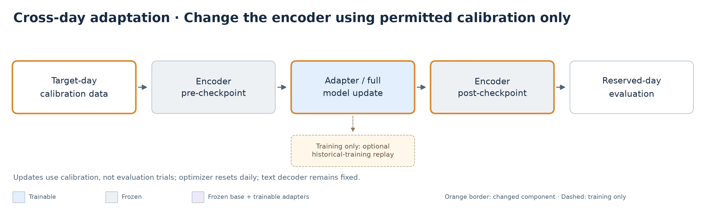

**Hypothesis:** adapting normalization, adapters or full encoders with permitted target-day data reduces calibration burden without unacceptable forgetting. **Fingerprint:** chronological v1 above; identical calibration prefixes across methods, budgets 0/5/10/25/50/100/available-full; reserved public-test trials never become replay. Sequential weights carry forward, optimizer resets daily; no replay versus 25% historical-training replay. The frozen development rule chooses update steps from 100/500. Unlabeled adaptation is a separate condition, not counted as zero-shot.

**Evidence level:** inconclusive. Development selection is complete; final collection is partial and paused. Do not infer final benefit from development tuning, or treat implemented adaptation code as a measured result. [Calibration/adaptation protocol](research-plan-v1.md), [frozen choices](../research/runs/v1-comparison/development-freeze.json), [ledger](research-notes.md).

**Completed control subset — seed-17 GRU only:** all five final days / 200 test sentences, 1,196 reference words; these are the causal past-days GRU, not E008. All 32 prespecified conditions are accounted, with no available-day selection or new training. Adapter/full updates use development-frozen 500/100 steps, respectively. Corpus zero-shot WER is **98.7458%** (PER 83.7309%, CER 90.3873%); normalization-only WER is **95.9866%**. Normalization-only consumes all available target-day training observations without labels, unlike smaller labeled-prefix conditions. [Exact counts, per-day WER/PER/CER, controls and provenance](../research/runs/v1-partial-gru-s17-summary-20261007-01/metrics.json).

| Labeled sentences per day | Adapter WER | Full-model WER | Adapter + extra same-day updates WER | Full model + extra same-day updates WER |
|---|---:|---:|---:|---:|
| 5 | 96.4047% | 97.9097% | 97.9097% | 96.6555% |
| 10 | 97.4916% | 97.6589% | 96.6555% | 98.2441% |
| 25 | 96.7391% | 97.9097% | 98.1605% | 96.4047% |
| 50 | 95.9866% | 96.9900% | 98.4950% | 95.8194% |
| 100 | 95.4849% | 95.4849% | 96.4047% | 96.4047% |
| Available-full (2,120 total across days) | 82.0234% | 85.9532% | 77.7592% | 77.6756% |

These extra same-day controls reuse the same examples and add a second equal-step update, not equal total compute to the one-update column. Available-full adapter/full-model WER intervals are 74.1645–90.3360% / 77.2239–94.4459%; worst-day WER is 93.3884% / 97.1074%. Intervals are conditional session-then-trial bootstrap (2,000 draws, seed101), **not paired-effect intervals or three-seed confirmation**. One participant/five days, prior final exposure and poor decoding limit interpretation. No LFADS/NoMAD benefit, forgetting effect, practical-improvement gate or full v1 completion follows from this subset. Preserve the frozen choices; do not tune against these final results.

**Decision card:** **verdict**—final label-efficiency/forgetting effects not measured as a complete comparison. **Uncertainty**—unequal budgets, replay leakage, historical degradation and small day count. **Next decisive experiment**—after dependency/reproduction review, complete the unchanged budget × model × day × seed matrix with ancestry and sample-accounting audit. **Cost/dependencies**—larger than a single-day pilot; serial adaptation plus fixed decoding. **Rule**—evaluate the prespecified paired-WER/label-efficiency gate, worst-day degradation and historical forgetting; if the target is not reached, report `target not reached`, not extrapolated label savings.

### 5.2 Encoder-update analysis: separate optimization changes from biological drift

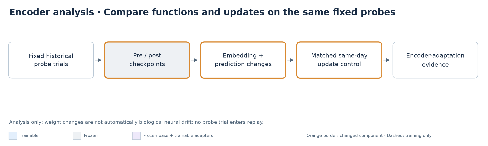

**Hypothesis:** sequential encoder updates contain repeatable low-dimensional structure useful for future adaptation. This does **not** equate parameter changes with biological neural drift. **Fingerprint:** matched daily update budgets/parent checkpoints, identical historical probes, adapter/full and replay/no-replay conditions, equal-budget same-day update controls, all prescribed seeds. Probes are evaluation only.

**Evidence level:** inconclusive. Some sequential/probe artifacts exist, but controlled trajectories, cross-day transfer and attribution are incomplete. Required analysis: layerwise normalized update norms, consecutive-update cosine, defined effective rank, fixed-probe embedding/prediction changes and historical forgetting. [Analysis protocol](research-plan-v1.md), [ledger](research-notes.md), [partial matrix state](../research/runs/v1-comparison/status.json).

**Decision card:** **verdict**—no useful drift structure established. **Uncertainty**—optimizer effects, same-day variability, seed variability and changing probe content. **Next decisive experiment**—compare consecutive cross-day updates with equal-budget same-day updates using fixed probes and held-out later transitions. **Cost/dependencies**—mainly analysis once E006 checkpoint/probe collection is complete; no separate foundation-model run. **Rule**—if structure is not repeatable or no stronger than controls, reject the useful-structure hypothesis; biological attribution requires additional measurement evidence regardless of weight patterns.

## 6. Prioritized research opportunities

**Accepted WER-focused investigation (2026-10-07):** baseline reproduction → candidate/error diagnosis → training/diphone or rescoring → small complementary ensemble → separately controlled drift adaptation → gated direct neural-to-LLM/combination. The [canonical supporting plan](research-plan-wer.md) defines W01–W06 decision gates, methodology, metrics, controls and completion evidence. This is the execution sequence for the newly accepted WER investigation; the table below retains the broader research opportunities, not a competing WER execution order. Existing v1 freezes and pauses remain unchanged.

**Prerequisite evidence:** [W01/W02 local audit](research/wer-local-audit-20261007.md) verifies preserved E008 checkpoint/logit identities and confirms the author decoder exposes N-best candidates and acoustic/LM scores. New diagnostic accounting passes 10 synthetic tests; **runtime N-best extraction, oracle WER and new improvement estimates are not measured**. The current fixed worker emits only top-1. No training or paused v1 collection was restarted.

**Source readiness:** [W03–W06 access audit](research/wer-source-access-audit-20261007.md) identifies two released TeamCyber neural checkpoints and NoMAD motor demo data. DCoND trained artifacts and BIT neural pretrained weights remain unverified/unidentified in the inspected sources; hidden-label headline scoring and hosted LLM access are not cleared. These findings change reproduction feasibility and next-step cost—not evidence labels for model performance.

### W02 / E010: separate candidate generation from sentence selection

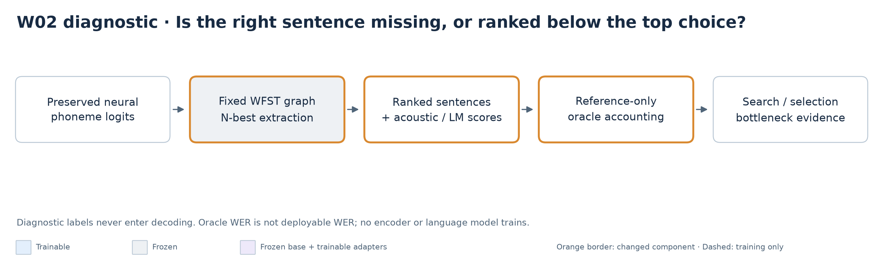

**Claim and status:** determine whether lower-error sentences exist in the fixed decoder's alternatives. The separately frozen two-trial smoke (E008 indices 0/40, N=1/50 extraction) **failed during graph loading under its 48 GiB limit**: Docker confirms OOMKilled=true / exit 137 after approximately 32 minutes 6 seconds; zero candidate outputs. [Preserved failure evidence](../research/runs/wer-nbest-smoke-20261007-01/failure.json). This is a resource failure, not evidence against useful alternatives. Exact top-1 replay remains an unmet technical gate; oracle curves use nested N=1/10/50 candidates. The worker sees logits only, not target text. [Frozen smoke protocol](../research/runs/wer-nbest-smoke-20261007-01/protocol.json), [ledger methodology and resource gates](research-notes.md#e010--scored-n-best-candidate-diagnosis-w02).

**Fingerprint/verdict:** already-exposed E008 public-test logits and original 3-gram graph/scoring; no training, adaptation, LM rescoring or parameter search. Runtime/oracle metrics remain **Not measured** until completion/independent verification. Synthetic/interface/verification checks pass in the 69-test suite; they do not establish native extraction or WER benefit. Two trials establish at most technical feasibility, not a general search/selection bottleneck.

**Decision card:** continue to a separately sealed full diagnostic only after exact replay and accounting pass. A substantial oracle gap motivates rescoring; a small gap requires search-coverage/neural-error diagnosis, not an automatic encoder-failure conclusion. References select oracle candidates only for analysis; oracle WER must never become deployed WER. Stop/revise on mismatch or resource failure, preserve all evidence and keep training/v1 stopped. General effect uncertainty and three-seed model-improvement claims belong to subsequent matched experiments.

**Uncertainty readiness:** a separately recorded, outcome-blind [diagnostic uncertainty plan](../research/runs/wer-nbest-smoke-20261007-01/uncertainty-plan.json) uses 2,000 paired session-then-trial resamples (seed 101), with no interval below three sessions. The suite now passes 73 tests. Collection remains pending; this is uncertainty infrastructure, not measured benefit. [Implementation and live execution evidence](research-notes.md#e010--scored-n-best-candidate-diagnosis-w02).

**Resource retry — failed interface gate:** the authorized [64 GiB diagnostic](../research/runs/wer-nbest-smoke-64g-20261007-01/protocol.json) loaded the graph (~35 minutes 43 seconds), but its first trial returned nine candidates for N=1 and one empty transcript for N=50. The host rejected the counts; the native log reports heap corruption. Docker confirms terminal exit 137 with **OOMKilled=false**; controller stop was attempted after rejection, so this is not labeled another OOM. [Preserved failure and hashes](../research/runs/wer-nbest-smoke-64g-20261007-01/failure.json). Zero accepted trials; oracle WER/exact replay remain unverified. Revise the technical option/decode/reset interface using a small native regression fixture before another large run. No tolerance relaxation, v1 restart, E008 training restart or artifact deletion occurred. All 83 prior local tests passed, demonstrating that wrapper/synthetic checks alone did not cover this native lifecycle failure.

**Interface diagnosis:** a discriminating acyclic native fixture fails through option replacement but passes when the original option owner is retained or options stay fixed at construction. Source inspection supports a dangling-option-reference hazard. A separately implemented fixed N=1/N=50 pair shares one graph and passes repeated native fixture decoding with exact first-text/score agreement; **84 host tests pass**. [Native evidence and limitations](../research/runs/nbest-lifecycle-diagnostic-20261007-01/evidence.json), [canonical diagnosis/workaround record](research-notes.md#e010--scored-n-best-candidate-diagnosis-w02). No sanitizer trace or full-graph parity yet: next is a newly frozen, authorized two-trial rerun, not acceptance of the failed run or a WER claim.

**Corrected smoke — technical pass:** the [corrected two-trial protocol](../research/runs/wer-nbest-fixed-smoke-64g-20261007-01/protocol.json) completed normally and passes fresh [independent verification](../research/runs/wer-nbest-fixed-smoke-64g-20261007-01/verification.json). Each trial returns N=1 count 1 and N=50 count 50, with exact top-1 transcript replay. Both top-1 and diagnostic oracle WER are 2 / 14 words (14.2857%) at N=1/10/50; zero gap on two trials is not a general bottleneck conclusion or new overall WER. [Uncertainty](../research/runs/wer-nbest-fixed-smoke-64g-20261007-01/oracle-uncertainty.json) is explicitly unavailable below three sessions. Runtime was about 40 minutes 11 seconds including loading/teardown. Full 600-trial candidate diagnosis remains uncollected. V1 now resumes under its own frozen protocol after this technical gate and storage checks; E008 training is not restarted. [Canonical methodology/current status](research-notes.md#e010--scored-n-best-candidate-diagnosis-w02).

### W04 / E011: complementary checkpoint errors give an ensemble opportunity

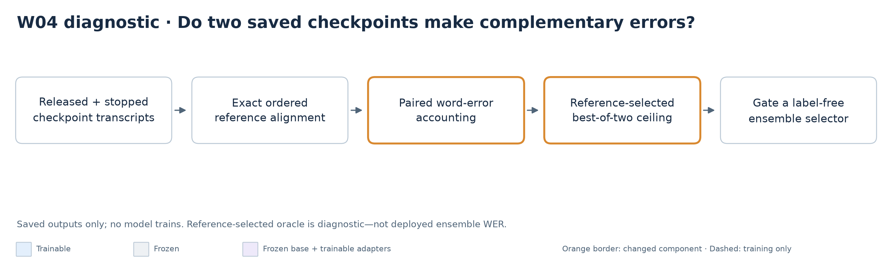

**Fingerprint:** saved released E000 and stopped E008 transcripts, identical ordered references for 600 already-monitored public-test sentences; unchanged 3-gram decoding, different fixed training histories. This is not a new trained ensemble or source-method reproduction. E000 contains no explicit trial IDs; session metadata is inherited from E008 after exact reference-order matching under the common release ordering assumption.

| Fixed transcript source / diagnostic | Word errors / 3,682 | WER | CER |
|---|---:|---:|---:|
| Released checkpoint | 695 | 18.8756% | 13.4232% |
| Stopped checkpoint | 840 | 22.8137% | 17.5564% |
| Reference-selected best of two — **not deployable** | 583 | 15.8338% | 11.9318% |

The stopped model has fewer word edits on **84** sentences (released wins 167; 349 tie), including 36 sentences exact only in the stopped model. The reference-selected opportunity is **3.0418 percentage points**, paired diagnostic 95% interval **1.9967–4.3027 points** (2,000 session-then-trial draws, seed 101). This interval describes label-selected opportunity, not a demonstrated selector gain; one participant, 15 days and inherited metadata limit interpretation. CER uses the word-selected member, not a separate character oracle. PER/seed dispersion are not measured by saved-text analysis; no new inference-cost measurement applies.

**Decision card:** diagnostic accounting verified; actual ensemble benefit inconclusive. Continue to a prespecified reference-free selection test against the stronger fixed member, with permitted calibration data and independently audited evaluation. If no real selector gains under matched conditions, revise/stop rather than report the oracle. No ground-truth text may enter inference prompts. TeamCyber/source reproduction remains a distinct gate. [Canonical methodology, limitations and metrics](research-notes.md#e011--fixed-checkpoint-complementarity-diagnostic-w04), [verified artifact](../research/runs/wer-complementarity-20261007-01/verification.json).

This oracle selects one of two whole sentences; it is not a bound on a text-fusion model that can generate a different sentence. No such model has been tested here.

**Current priority refresh, 2026-10-09:** completed E017 training/evaluation replaces unfinished E008 training as the immediate baseline gate. The [canonical recorded-idea ranking](research-notes.md#recorded-idea-priorities--2026-10-09) orders data/error anatomy → N-best diagnosis → current-checkpoint complementarity → matched diphone/targeted robustness. Task-aware contrastive learning and causal dynamics/adaptation remain conditional research bets; phoneme-to-LLM, encoder-update interpretation and audio transfer have explicit later gates. The ledger owns the full rationale, dependencies and metrics rather than duplicating a second ranking here. Independent evaluation is required for a new improvement claim. This is prioritization, not execution authorization; v1 remains paused and existing failed/negative results remain preserved.

## 7. Methodology and historical evidence index

- **Canonical owners:** [ledger and findings](research-notes.md), [frozen v1 protocol](research-plan-v1.md), [artifact reproduction evidence](reproduction-status.md).
- **Source audits:** [Willett paper/artifacts](research/willett-2023-speech-neuroprosthesis-reproducibility.md), [released retraining recipe](research/willett-baseline-retraining-audit.md), [acceleration audit](research/willett-training-acceleration-audit.md), [cross-day literature](research/cross-day-neural-drift-methods.md).
- **Detailed history:** [retired pre-restructure report](research-results-report-20261007-before-restructure.md). Its published online result rows, twelve-candidate tables, count-quality analysis and setup chronology are preserved; its stale running/unopened-final statements are not current evidence.
- **Current measured artifacts:** [E008 complete evaluation](../research/runs/e008-stopped-wer-20261007-01/metrics.json), [E009 complete pilot](../reproduction/results/bit-feasibility/pilot-20261007-01/metrics.json), [development freeze](../research/runs/v1-comparison/development-freeze.json), [paused final-matrix status](../research/runs/v1-comparison/status.json).
- **Figure source:** [deterministic PNG renderer](../reproduction/draw_research_architectures.py). All diagrams use the same vocabulary, trainability colors and change/training-only conventions.

New result entry contract: **claim/hypothesis → PNG → reproduction target/status → evaluation fingerprint → metrics/accounting/uncertainty → matched comparison → failure analysis → decision card → immutable evidence links**. Store raw predictions/checkpoint histories once; link rather than copy full logs into this report.
