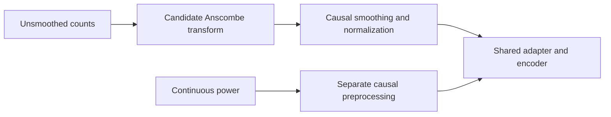

# Anscombe count preprocessing: candidate for drift-tolerance ablation

The [canonical ledger](../research-notes.md) owns results and accepted decisions; the [cross-day methods synthesis](cross-day-neural-drift-methods.md) owns the literature overview. This note supports the [proposed drift-tolerance directions](drift-tolerance-calibration-directions-20261012.md). No training, evaluation or frozen-v1 restart is included.

## Name and method

The user's phrase “Ascon ensemble” may mean **Anscombe transform**, but that identification is tentative. It is a variance-stabilizing transformation, not an ensemble method. If another named ensemble was intended, a title or link is needed rather than inventing a method.

For a nonnegative count observation, the conventional Poisson Anscombe transformation is:

\[
y=2\sqrt{x+3/8}.
\]

It aims to make **conditional observation variance approximately constant** under a Poisson count model, whose conditional mean and variance equal its rate. It does not make the transformed mean zero, remove different underlying rates, align neural representations, or establish drift tolerance. The original work covers transformations for Poisson, binomial and negative-binomial data. [Anscombe, 1948](https://academic.oup.com/biomet/article-abstract/35/3-4/246/280278), DOI [10.2307/2332343](https://doi.org/10.2307/2332343).

Mäkitalo and Foi discuss Anscombe variance stabilization and low-count inverse bias in Poisson image denoising. This is supporting statistical methodology, not a neural-decoding result. An inverse is unnecessary if a decoder consumes transformed features; reconstructing rates after denoising is a separate problem. [Mäkitalo and Foi, 2011](https://pubmed.ncbi.nlm.nih.gov/20615809/); [author methodology page](https://webpages.tuni.fi/foi/invansc/).

## Application boundary for our recordings

- Test only on verified unsmoothed, nonnegative **count channels**, not spike-power channels. Power is a continuous feature; its units do not establish a Poisson observation law.
- Sparse 20 ms counts can be far from the large-rate approximate Gaussian regime. Neural counts may be under/overdispersed, correlated or influenced by variable speech state. Existing E018/E019 analyses did **not** measure conditional Poisson adequacy or Fano factors.
- A variance/mean ratio pooled across different speech states is not a valid stand-alone Poisson test: variation of the latent rate inflates unconditional variance even when conditional counts are Poisson. Our sparse repeats and absence of bin-level phoneme boundaries limit conditioning.
- For an input-transform ablation, apply the transform to unsmoothed counts, then perform trailing causal smoothing and training-only or preceding-observation normalization. Keep the power branch separate; preserve original raw counts for any count-likelihood reconstruction targets.

## Proposed decision test, not a result

Compare unchanged counts, square-root counts and Anscombe counts with matched retraining, architecture, normalization policy, decoder, calibration examples and budgets. Do not drop transformed features into frozen E017 and interpret deterioration as a fair method comparison: E017 was trained on a different input distribution.

Assess future-day WER, pre-LM PER, worst-day performance and labels required to reach a development-fixed WER target. Track conditional mean/variance diagnostics where justified, without substituting them for decoding outcomes. Treat variance stabilization as a candidate front-end complement to a small adapter, not a solution to cross-channel mapping changes. No current benefit or calibration reduction has been measured.

If the user intended a decoder/adapter ensemble instead, that remains a separate, unnamed hypothesis requiring clarification and a matched compute/calibration comparison.
