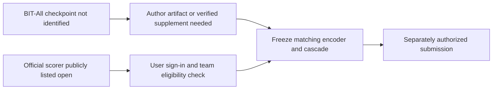

# BIT-All checkpoint and hidden-scorer access check

This supporting note records a read-only access check on **2026-10-09, America/Los_Angeles**. The [canonical ledger](../research-notes.md) owns findings and decisions; the [comparative report definitions](../research-results-report.md#2-definitions-and-reporting-principles) govern reproduction claims. Training results and recipe limitations remain in the [BIT recipe audit](bit-full-training-recipe-20261009.md), rather than being duplicated here. No login, author contact, issue creation, model download, training or competition submission occurred.

## Checkpoint access: not identified in inspected public sources

We did **not identify an author-provided download for either the BIT-All self-supervised checkpoint or its final T12 phoneme-fine-tuned checkpoint**. This is a bounded search result, not proof that the checkpoints do not exist or cannot be shared privately.

| Checked first-party surface | Observed evidence |
|---|---|
| Author repository main tree | Revision remains `f107ae988d782609b78d1d7488490cca9fb7a103`; complete recursive tree is not truncated and contains source/configuration files, not a released weight artifact. [Tree API](https://api.github.com/repos/yzhang511/bit/git/trees/main?recursive=1) |
| README and training/configuration pointers | Training/evaluation take user-supplied checkpoint paths; no BIT-All download link is supplied. The configuration's `/projects/bfsx/yzhang39/checkpoints` is a filesystem output path, not a public endpoint. [Pinned README](https://github.com/yzhang511/bit/blob/f107ae988d782609b78d1d7488490cca9fb7a103/README.md), [phoneme configuration](https://github.com/yzhang511/bit/blob/f107ae988d782609b78d1d7488490cca9fb7a103/configs/finetune/phoneme/ndt/trainer.yaml) |
| Releases, tags and branches | Releases and tags API responses are empty arrays; branch enumeration lists only main at the same revision. [Releases](https://api.github.com/repos/yzhang511/bit/releases), [tags](https://api.github.com/repos/yzhang511/bit/tags), [branches](https://api.github.com/repos/yzhang511/bit/branches) |
| Public issue discussion | Issue1 requests manifests, preprocessing, checkpoints and paper-run clarification. Its one visible follow-up is by the same non-maintainer requester (`author_association: NONE`); no maintainer reply or checkpoint URL appears in the inspected comments response. Third-party reproduction numbers are **not** author confirmation or our experimental evidence. [Issue](https://github.com/yzhang511/bit/issues/1), [comments API](https://api.github.com/repos/yzhang511/bit/issues/1/comments) |
| Author's Hugging Face account | Public model API for `author=yzhang511` returns an empty array. Global searches for `BIT-All` and `brain-to-text` yield no identifiable author BIT-All artifact; unrelated similarly named models are not substitutes. [Author models API](https://huggingface.co/api/models?author=yzhang511&limit=100), [author profile](https://huggingface.co/yzhang511) |
| Author website / primary paper | Author website links the benchmark but provides no BIT weight-download pointer in the inspected page. Paper v2 explains checkpoint selection, without an identified downloadable encoder checkpoint. [Author website](https://yzhang511.github.io/), [paper v2](https://arxiv.org/html/2511.21740v2) |
| OpenReview | Live forum, PDF and notes API requests encounter a verification challenge/403. Supplemental artifacts and author responses there therefore remain **unverified**, not absent. No challenge bypass or account access attempted. [Forum](https://openreview.net/forum?id=Lp1noMpMUG), [notes API](https://api2.openreview.net/notes?id=Lp1noMpMUG) |

Search scope also included web queries `"BIT-All" checkpoint`, `"yzhang511" "BIT" pretrained checkpoint`, `"A cross-species neural foundation model" checkpoint huggingface`, `"yzhang511/bit" checkpoint pretrained`, `"Yizi Zhang" BIT pretrained model`, and `site:huggingface.co "BIT" "cross-species"`. Searches located primary surfaces above; secondary summaries were not used to establish access. Private repositories, alternate unlinked accounts, gated author storage and inaccessible OpenReview supplementary material are outside the verified scope.

### What would clear the checkpoint gate

Prefer an author-authorized final **T12 BIT-All phoneme checkpoint used for the 6.35% cascade**, together with source revision, effective configuration, normalization/day/channel mapping, vocabulary/logit order, selected epoch, validation trial IDs and a small expected-output fixture. A self-supervised checkpoint alone still requires matched T12 transfer/fine-tuning and selection before it can support the published cascade comparison. Record license/permission, immutable weight checksum and download provenance before use. If no checkpoint can be provided, obtain the exact reconstructable SSL corpus and transfer manifest; the existing scratch model cannot clear this gate.

Author outreach is a possible next decision, **not performed or authorized by this access check**. OpenReview manual verification is another unresolved inspection route. Do not infer model release rights from the code's MIT license.

## Hidden-test scorer access

**Public scoring route found; authenticated eligibility and successful execution not yet verified.** Anonymous rendered-browser inspection of the official EvalAI challenge succeeds where the plain web reader returns an empty JavaScript page. This resolves the earlier uncertainty about whether a public scoring route is still advertised; it does not expose hidden labels or prove the user's account can submit.

| Official surface inspected | Verified public evidence | Remaining check |
|---|---|---|
| [Overview](https://eval.ai/web/challenges/challenge-page/2099/overview) |Brain-to-Text Benchmark '24, challenge2099. Overview says the benchmark remains open for research. Submissions are1,200-line text files corresponding to competitionHoldOut trials.|Confirm exact file order and rules for any future authorized submission.|
| [Phase1](https://eval.ai/web/challenges/challenge-page/2099/phases) |Listed end date **January13,2027**, later than this check. Displayed limits:5 submissions/day,50/month,1000total,3concurrent.|User/team eligibility, remaining quota and live scoring-worker success are not proven by public phase metadata. The page labels its time GMT−7 even for January; only the displayed date is reported, not a corrected timezone conversion.|
| [Evaluation](https://eval.ai/web/challenges/challenge-page/2099/evaluation) |Corpus WER is summed word edit distance divided by total reference words across1,200 sentences. Spaces delimit words; apostrophes matter; periods/question marks/commas should be omitted. Data terms request citation and list CC0.|Verify actual scorer implementation/version and normalization correspondence before claiming exact paper scoring parity.|
| [Participate](https://eval.ai/web/challenges/challenge-page/2099/participate) |Anonymous page requires login.|User sign-in is the next access gate. No account, team or challenge membership was created.|
| [Official participation guide](https://evalai.readthedocs.io/en/latest/03-for-participants/participation-guide/participate.html) |EvalAI participation uses an account and a participant team, then challenge participation.|Authenticated inspection must determine whether team selection/creation, rule acceptance or host approval is required here. No signup, agreement acceptance or submission is authorized by this audit.|

The public overview/phase/evaluation/participation states were inspected in the rendered browser on2026-10-09 local. A read-only request to `/api/challenges/2099` returned200 with star-count metadata only; it was **not** treated as proof of submission access. The earlier plain-reader failure was a rendering/access-path limitation, not evidence that this competition had closed.

## Current decision and next access gates

Checkpoint access remains the principal model-artifact blocker. Scorer access is now **plausible through the official active phase**, rather than an unidentified route, but remains unverified for this account. Recommended next decisions: user manually inspects any OpenReview verification gate or authorizes a focused author request for final T12 weights/configuration; user signs in to EvalAI so we can inspect participation eligibility without submitting. Any later team creation, terms acceptance, upload or scoring submission requires its own appropriate user authority. Keep E016/E017 unchanged; no training, large download, license clearance or hidden submission occurred. This research-skill check changes the prerequisite classification only, not any performance claim.
