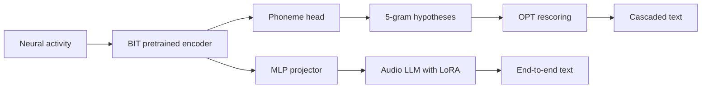

# BIT comparison clarification

Supporting source audit only. The [canonical ledger](../research-notes.md) owns local methodology, status and decisions; the [comparative report](../research-results-report.md#2-definitions-and-reporting-principles) owns evidence definitions and presentation. No training, downloads or new performance experiment occurred in this audit.

## Published results, not local reproductions

BIT improves earlier end-to-end decoding, **not** the best cascaded route. Table 1 reports the following Brain-to-Text ’24 competition holdout results (1,200 sentences). [Primary paper, Table 1](https://arxiv.org/html/2511.21740v2#S5.T1).

| Entry | WER |
|---|---:|
| Earlier end-to-end (Feng et al.) | 24.69% |
| BIT end-to-end | 15.67% |
| BIT end-to-end + ensemble | 10.22% |
| RNN cascaded baseline | 9.76% |
| BIT cascaded | 6.35% |
| BIT cascaded + ensemble | 5.10% |

The cascaded decoder uses 5-gram hypotheses plus OPT rescoring; ensembles add an LLM merger of seeded outputs. These are not WFST-only results. [Methods §4.2](https://arxiv.org/html/2511.21740v2#S4.SS2), [results §5.1](https://arxiv.org/html/2511.21740v2#S5.SS1).

BIT uses approximately 367 hours of human/monkey masked neural pretraining, bidirectional attention and phoneme CTC. Sentence training updates the encoder, projector and attention/MLP LoRA with CE plus contrastive loss; training lasts 150 epochs. [Methods §3](https://arxiv.org/html/2511.21740v2#S3), [paper, training appendix R](https://arxiv.org/html/2511.21740v2).

Audio-LLM and contrastive ablations report validation benefits, but they do not explain our performance gap by themselves. [Ablations §5.2](https://arxiv.org/html/2511.21740v2#S5.SS2).

## Why E013/E014 do not reproduce that claim

Our [E013/E014 record](../research-results-report.md#43-e013e014-does-the-language-backbone-need-trainable-adapters) uses a frozen causal GRU, 512 training sentences, 40 monitored validation sentences, no masked neural pretraining or contrastive objective, and Q/V-only LoRA (E013) or no LoRA (E014). Those are feasibility ablations, not the paper's recipe or holdout evaluation. Our fixed 3-gram benchmark is also distinct from BIT's cascaded decoder.

Possible contributors to our gap include data volume, frozen representation quality, pooling, missing alignment objectives and restricted adaptation. These remain **hypotheses**, not established causal explanations. The paper's bidirectional setting also differs from our causal feature requirement. [Paper limitation §6](https://arxiv.org/html/2511.21740v2#S6), [local evaluation fingerprint](../research-notes.md#e013--frozen-phoneme-trained-causal-features-to-llm).

Interpretation: BIT supports testing better neural representations and neural/language alignment. It does not justify claiming that direct LLM generation already outperforms cascaded decoding, nor does our small pilot refute BIT.

## Checkpoint reuse addendum — 2026-10-08

The inspected author README documents training and user-supplied checkpoint paths, but identifies no downloadable pretrained neural encoder or complete brain-to-text checkpoint. Fresh GitHub API checks at main SHA `f107ae988d782609b78d1d7488490cca9fb7a103` return a complete recursive tree (`truncated: false`) with no identified weight files and zero releases; encoder/decoder `from_pt` defaults are null. This means **not identified in these inspected author sources**, not proof that weights are unavailable everywhere. [Pinned author README](https://github.com/yzhang511/bit/blob/f107ae988d782609b78d1d7488490cca9fb7a103/README.md), [author releases](https://github.com/yzhang511/bit/releases).

The public Aero audio/language model has downloadable weights; it is a reusable component, **not BIT's neural pretrained model or its brain-to-text fine-tuned system**. Our E013/E014 already reuse its language backbone, as recorded in the canonical ledger. [Aero model card](https://huggingface.co/lmms-lab/Aero-1-Audio), [published files](https://huggingface.co/lmms-lab/Aero-1-Audio/tree/main), [local E013 record](../research-notes.md#e013--frozen-phoneme-trained-causal-features-to-llm).

Conditional options if a licensed, provenance-verified neural checkpoint becomes available:

- Reproduce the bidirectional offline system before modifying it; match preprocessing, participant read-in, inventory and evaluation fingerprint.
- Initialize a causal variant and fine-tune with prefix-invariance checks. Changing the attention mask alone would not preserve the published accuracy claim.
- Use the offline model as a teacher for a causal student trained only on permitted training data; distillation benefit is an untested hypothesis.

These options authorize no implementation and establish no improvement. The causal mismatch is grounded in the paper's stated bidirectional limitation. [Paper discussion](https://arxiv.org/html/2511.21740v2#S6). No large files were downloaded, and no training or author outreach occurred during this refresh.

## Data availability addendum — 2026-10-08

**Source datasets are shared; a ready-made assembled BIT pretraining corpus has not been identified.** The author README links the two main attempted-speech datasets and documents preparation/training paths: [T12 / Brain-to-Text ’24 (Willett)](https://doi.org/10.5061/dryad.x69p8czpq) and [T15 / Brain-to-Text ’25 (Card)](https://doi.org/10.5061/dryad.dncjsxm85). [Author setup instructions](https://github.com/yzhang511/bit#setup).

Appendix A identifies additional public human sources (Willett 2021, Fan 2023, FALCON and Kunz 2025) plus seven monkey datasets, hosted across Dryad, DANDI and Zenodo. Its source links are an acquisition inventory, not an already normalized, split-frozen, approximately 367-hour download. [Primary dataset appendix](https://arxiv.org/html/2511.21740v2#A1).

Competition holdout transcript labels remain hidden; the headline scores require the benchmark scoring service, whereas public labeled partitions support local training/validation. [Evaluation §5.1](https://arxiv.org/html/2511.21740v2#S5.SS1). Also disclose that the paper permits unlabeled evaluation/holdout neural recordings in SSL pretraining: this is a different data-access contract from strict held-out-day training. [Pretraining splits, Appendix A.4](https://arxiv.org/html/2511.21740v2#A1.SS4).

This refresh verifies the primary descriptions/links, not every source file download, license, checksum or preparation result. No consolidated full pretraining corpus was identified in the inspected author repository tree. No data downloads, messages or training occurred; local experiment status and permissions remain unchanged.

## Cascaded reproduction readiness — 2026-10-08

**A BIT-style local implementation is feasible to investigate; exact reproduction of 6.35% WER is not ready.** The single-model target is BIT-All on 1,200 hidden-label competition sentences; the separate 5.10% ensemble uses ten models and a fine-tuned GPT-3.5 merger, and is not the initial reproduction target. [Table 1 and Appendix H](https://arxiv.org/html/2511.21740v2#S5.T1).

Required gates:

1. Obtain provenance-verified BIT-All neural weights, or reconstruct the full pretraining data access, execution and fine-tuning recipe. Inspected sources provide from-scratch/fine-tuning code, but no identified released neural weights, complete pretraining execution script or assembled corpus. A transformer trained from scratch is BIT-TFS, not BIT-All. Published T12 validation PER anchors are **14.39% BIT-All** and **17.26% BIT-TFS**. [Author training](https://github.com/yzhang511/bit#training), [paper Appendix C](https://arxiv.org/html/2511.21740v2#A3).
2. Validate phoneme inventory, preprocessing, checkpoint loading and complete neural → logits → text accounting in a Mac smoke test. Existing MPS GRU/LLM success does not validate the BIT transformer or its memory/runtime needs; no guaranteed timing/resource estimate is established.
3. Establish **5-gram + OPT-6.7B** decoder parity. Appendix D specifies 100 candidate sentences, acoustic scale 0.325, blank penalty 90 and OPT rescoring coefficient 0.55. Verify implementation units and parameter semantics before use: the reported candidate count is not automatically interchangeable with our decoder's beam-pruning setting. Our fixed 3-gram cannot substantiate the 6.35% claim. [Decoder appendix D](https://arxiv.org/html/2511.21740v2#A4).
4. Freeze a claim-specific agreement criterion and uncertainty rule, secure competition scoring access, and use the matching holdout/evaluation contract. Public validation alone cannot reproduce hidden-holdout WER. [Evaluation §5.1](https://arxiv.org/html/2511.21740v2#S5.SS1), [canonical reproduction principles](../research-results-report.md#2-definitions-and-reporting-principles).

Replacing bidirectional attention with a causal encoder is a separate extension, not an exact reproduction. [Paper limitation](https://arxiv.org/html/2511.21740v2#S6). These gates are a readiness assessment only; no training, model/data download, scorer submission or author outreach was initiated.

**Concrete recipe/porting caveats:** the inspected author phoneme fine-tuning YAML specifies `num_epochs: 3000`, whereas the paper's Appendix R describes 800 transformer phoneme-training epochs. Resolve the intended configuration before declaring recipe parity rather than choosing one silently. Also, `eval_phoneme.py` converts non-CUDA tensors directly to NumPy; an MPS port must explicitly move tensors to CPU first. These are bounded source observations, not completed fixes or reasons the scientific method cannot work. [Pinned training configuration](https://github.com/yzhang511/bit/blob/f107ae988d782609b78d1d7488490cca9fb7a103/configs/finetune/phoneme/ndt/trainer.yaml), [training appendix R](https://arxiv.org/html/2511.21740v2#A18), [pinned evaluator](https://github.com/yzhang511/bit/blob/f107ae988d782609b78d1d7488490cca9fb7a103/eval_phoneme.py).
