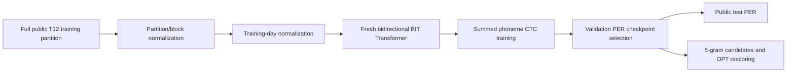
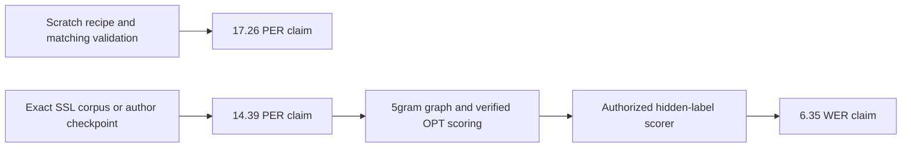

# BIT full scratch training recipe audit

The [canonical ledger](../research-notes.md) owns experiment contracts and findings; the [comparative report](../research-results-report.md#2-definitions-and-reporting-principles) owns presentation and reproduction definitions. This note audits pinned author code and the primary paper. It changes no running job or source artifact.

## Published target and limits

The accessible scratch target is **T12 BIT-TFS validation PER 17.26%**; pretrained BIT-All reports 14.39%. BIT-All uses approximately 367 hours of neural pretraining, so extending scratch training cannot reproduce that configuration. Appendix R specifies 800 phoneme-training epochs, AdamW, BF16 and lowest-validation-PER selection. Appendix Q describes 30 sampled optimizer configurations, but gives ranges rather than the selected T12 optimizer values. Table 10 lists T12 masking ratio 0.5. [Paper, Appendices C/Q/R](https://arxiv.org/html/2511.21740v2).

The separate **6.35% cascaded WER** uses 1,200 competition holdout sentences, not our public validation sentences. Its decoder uses a 5-gram LM and OPT-6.7B rescoring: 100 candidates, acoustic scale 0.325, blank penalty 90 and OPT scale 0.55. Score conventions must be checked against the original decoder before applying these numbers. Hidden labels and missing pretrained neural weights prevent an equivalent local headline-score claim. The paper defines corpus edit-normalized PER/WER, which is important because the inspected code differs. [Paper, Table 1 and Appendices B/D](https://arxiv.org/html/2511.21740v2).

## Executable author configuration, not just the raw YAML

All code links below are pinned to `f107ae988d782609b78d1d7488490cca9fb7a103`. The effective CLI configuration merges base trainer, scratch trainer, keyword overrides, and then dataset registry overrides. Saving only `ndt.yaml` is insufficient. [Configuration builder](https://github.com/yzhang511/bit/blob/f107ae988d782609b78d1d7488490cca9fb7a103/utils/config.py).

| Component | Inspected source behavior |
|---|---|
| Duration | Scratch phoneme trainer sets **3,000 epochs**, conflicting with the paper's 800 |
| Seed / batches | Seed 42; train and validation batch 32; shuffle train; do not drop last train batch |
| Optimizer | AdamW, LR `0.0005`, weight decay `0.00001`, epsilon `1e-8`; defaults provide Adam betas |
| Schedule | YAML `cosine` means **PyTorch OneCycleLR**, `total_steps=epochs*len(train_loader)`, `max_lr=0.0005`, `pct_start=0`, `div_factor=25`; unspecified options retain installed PyTorch defaults |
| Optimizer loss | Per-trial CTC with `reduction=none`, `blank=0`, `zero_infinity=True`, then **sum across batch**; gradient accumulation 1. No phone normalization in backward; displayed epoch loss is divided by total target phones |
| Checkpoint selection | Validation every epoch; strictly improved source PER saves BEST plus optimizer/scheduler state; periodic save every 500 epochs |
| Gradient clipping | No clipping call identified in the inspected source training loop |
| Encoder | Seven bidirectional Transformer layers; width 384, six attention heads, feed-forward width 512, five-bin patches, RoPE, centered Gaussian smoothing SD2, embedding dropout0.2, transformer dropout0.4, white noise0.2, constant-offset noise0.05 |
| Effective T12 masking | **Disabled**, ratio0, by dataset registry—even for scratch mode. Raw NDT YAML instead enables masking0.5 |
| Effective T12 position capacity | Registry sets `max_F=1250`; raw NDT YAML sets2500. `features=all` doubles registry `max_channels128` to256; registry `input_dim128` remains128 |

[Scratch trainer YAML](https://github.com/yzhang511/bit/blob/f107ae988d782609b78d1d7488490cca9fb7a103/configs/train_from_scratch/phoneme/ndt/trainer.yaml), [training loop and scheduler](https://github.com/yzhang511/bit/blob/f107ae988d782609b78d1d7488490cca9fb7a103/models/trainer.py), [model loss](https://github.com/yzhang511/bit/blob/f107ae988d782609b78d1d7488490cca9fb7a103/models/ndt.py), [dataset overrides](https://github.com/yzhang511/bit/blob/f107ae988d782609b78d1d7488490cca9fb7a103/registry.py), [encoder YAML](https://github.com/yzhang511/bit/blob/f107ae988d782609b78d1d7488490cca9fb7a103/configs/models/encoder/ndt.yaml).

The 800/3,000 duration discrepancy and masking discrepancy are **unresolved**. Neither can be described as an established typo or silently resolved in favor of the previous pilot. The source LR/weight decay are not proven to be the paper's selected Ray Tune configuration; source weight decay is even below the paper's listed search lower bound.

## Source data preparation and evaluation traps

The author CLI loads `competitionData/train` as training, original `test` as public labeled evaluation, and `competitionHoldOut` as hidden-label holdout. It then applies `RandomState(42).permutation(n)` to the concatenated original public test trials: the first `n//2` become validation and the rest public test. Freeze exact trial IDs and ordering rather than assuming a 300/300 or 480/480 denominator. These source names must not be confused with our frozen chronological v1 partitions. [Data preparation](https://github.com/yzhang511/bit/blob/f107ae988d782609b78d1d7488490cca9fb7a103/data/willett_2023_text/prepare_data.py), [training entry point](https://github.com/yzhang511/bit/blob/f107ae988d782609b78d1d7488490cca9fb7a103/train.py).

For `features=all`, concatenate raw `tx1` and `spikePow` channels0:128, without log transform. First compute per-feature block statistics separately inside each original file/partition, using all its trial bins; then compute day statistics on the resulting training trials and apply those to every partition. Validation block moments therefore use unlabeled future observations: this is offline/transductive normalization, **not causal preprocessing**. Division by zero is unguarded in source; audit all statistics before training, and disclose any safeguard rather than hiding a change. Sentence preprocessing removes punctuation except apostrophe, lowercases and strips. G2P strips stress digits, converts spaces to SIL and appends SIL. Source vocabulary uses blank0; the existing research WFST interface uses blank40 and needs an explicit checked mapping.

Three metric issues exist in the pinned source:

1. `format_ctc` updates the previous-token marker only when emitting a nonblank. `[A, blank, A]` incorrectly becomes `[A]` instead of standard CTC `[A, A]`.
2. `per()` decodes the entire padded output sequence without trimming to each trial's valid patch length.
3. The trainer averages batch PER ratios equally, rather than summing corpus edits and corpus target phones.

These are direct source inspections, not evidence that the authors' published result necessarily used the same defective path. Report **correct length-trimmed corpus PER** and a separately labeled **source-compatible PER**. Save both selections if they differ; do not quietly claim exact agreement between metrics. [PER implementation](https://github.com/yzhang511/bit/blob/f107ae988d782609b78d1d7488490cca9fb7a103/utils/eval_llm.py), [evaluation aggregation](https://github.com/yzhang511/bit/blob/f107ae988d782609b78d1d7488490cca9fb7a103/models/trainer.py).

## Recommended bounded full-data protocol

Create a **fresh full-data scratch experiment**, not a continuation of E015's 200-update compressed schedule. Preserve E015 and all frozen v1 artifacts. Use all audited public T12 training trials, source split seed42, fresh model seed42, batch32 if memory/gradient smoke passes, summed CTC optimization, and the author OneCycle schedule over the prospectively frozen complete budget. The recommended first budget is **800 epochs**, explicitly paper-duration/source-code hybrid; calling it exact source-YAML reproduction would be wrong. Alternatively a literal source-code recipe must freeze3,000 epochs before launch. Do not decide the duration after seeing performance.

Use the effective CLI **masking-disabled** configuration for a code-recipe run, preserve its complete merged config, and mark the paper masking difference. Validate positional-capacity coverage before launching; if raw trial timestamps exceed1250, preserve the required capacity increase as an explicit port deviation. Native Mac GPU can reuse the source network, but BF16 attention with float32 weights/buffers and differentiable CPU CTC are mixed-backend port deviations, not source-wide BF16 equivalence. Test gradients, source-sum loss accounting, reload, inventory mapping, valid lengths and batch32 memory before long training.

Monitor and save each epoch's LR, summed/phone-normalized CTC, correct PER/error components, source-compatible PER, day rates, time, memory and storage. Keep latest resumable state, source-selected BEST, and independently corpus-PER-selected BEST. Nonfinite loss/gradients, invalid data, inconsistent reload or storage below30GiB are technical stop conditions; a validation plateau alone must not silently shorten the chosen full-duration experiment. Save exact RNG/sampler/optimizer/scheduler state, and resume without resetting the schedule.

Evaluate the public test half only after the selection contract is frozen; historical exposure means it is not pristine independent test evidence. First collect correct PER and fixed3-gram WER as diagnostics. The latter **cannot** establish reproduction of BIT's 5-gram/OPT claim. Full cascade requires separately audited graph/OPT artifacts, licensed access, scoring semantics and one resident decoder at a time. Define a numerical agreement criterion and uncertainty rule before launching a performance-reproduction attempt; 17.26% is a contextual target until source split/metric/selected optimizer ambiguities are resolved. A miss remains reportable, and completing800epochs alone is not proof of reproduction.

## Open evidence requests

Request the authors' final merged T12 scratch configuration, selected optimizer setting, trial-ID split, code revision used for Table4, precise PER computation and matching checkpoint. These resolve disagreements more directly than guessing new recipes. This audit sends no outreach and authorizes no external spending or hidden-label submissions.

## 2026-10-09 post-E016 source-access and remaining-claim audit

This is a dated **read-only access snapshot**, not a new experiment or a replacement result ledger. E016's completed metrics, exact artifact identities and uncertainty remain in the [canonical E016 entry](../research-notes.md#e016--full-data-bit-from-scratch-paper-length-training). No weights, graph archives or additional neural datasets were downloaded; no decoder, GPU job, author contact or competition submission was started for this audit.

### Matching-condition finding that changes the next decision

The paper's Section5.1 distinguishes **attempted speech**, where the provided benchmark test partition supplies validation, from **imagined speech**, where evaluation is halved. The pinned T12 loader nevertheless unconditionally halves the original labeled benchmark test partition with `split_val(seed=42)`. E016 follows that code's440/440 division, rather than the paper-described full attempted-speech validation cohort. This is a documented paper/code mismatch, not merely an unspecified seed. Table4's17.26% therefore remains an unmatched comparison even when the exploratory numerical band is met. Exact trial identities and paper-run code correspondence still need confirmation. [Paper §5.1 and Appendix C](https://arxiv.org/html/2511.21740v2), [pinned loader](https://github.com/yzhang511/bit/blob/f107ae988d782609b78d1d7488490cca9fb7a103/data/willett_2023_text/prepare_data.py).

Do not merge the two E016 halves and retroactively select a different checkpoint. A fixed-checkpoint pooled audit could describe this accessible880-trial cohort, but would remain post-selection/historically exposed and would not recreate full-cohort model selection. Any matched correction must prospectively freeze its split, metric, selection rule, masking and optimizer schedule before collecting new results. This is a decision requirement, **not authorization for another run**.

### Public artifact inventory

| Prerequisite | Fresh read-only evidence | Status and consequence |
|---|---|---|
| BIT neural checkpoints / exact selected configs | GitHub `main` still resolves to the pinned `f107ae988d782609b78d1d7488490cca9fb7a103`; complete recursive tree reports34 files and `truncated=false`, with no distributed neural checkpoint, full SSL trainer configuration, dataset manifest or selected Ray Tune run record identified. Releases API returns an empty array. README instructs users to supply their own checkpoint paths. [Commit metadata](https://api.github.com/repos/yzhang511/bit/commits/main), [complete pinned tree](https://api.github.com/repos/yzhang511/bit/git/trees/f107ae988d782609b78d1d7488490cca9fb7a103?recursive=1), [releases](https://api.github.com/repos/yzhang511/bit/releases), [pinned README](https://github.com/yzhang511/bit/blob/f107ae988d782609b78d1d7488490cca9fb7a103/README.md) | **Not identified in inspected primary sources**, not a claim that artifacts do not exist. A Hugging Face author-name model-list query also returns an empty array; a different account/repository remains possible. [Bounded query](https://huggingface.co/api/models?author=yzhang511&limit=100). |
| BIT-All full pretraining | AppendixA supplies13 dataset-family references and preprocessing rules, and permits unlabeled evaluation/holdout neural data in SSL. It is not an exact versioned participant/session/trial/channel-selection manifest or released pretrained encoder. [Paper Appendix A](https://arxiv.org/html/2511.21740v2) | **Blocked for matched14.39% reproduction** pending matching checkpoint or reconstructable corpus/selection/transfer contract. Public family references are actionable starting points, not proof that the exact367-hour corpus is recoverable. Scratch weights cannot substitute. |
| Official5gram graph | Dryad's current file listing includes `languageModel_5gram.tar.gz`, displayed38.25GB, alongside the separate3gram archive. [Primary dataset file listing](https://datadryad.org/dataset/doi:10.5061/dryad.x69p8czpq) | **Publicly listed; not locally audited/downloaded by this check.** Archive identity, extracted graph footprint, memory and scoring parity remain prerequisites. A small readme fetch through the web reader returned403; that is a fetch-path limitation, not proof the archive is unavailable. |
| OPT-6.7B weights | Meta's model API reports `private=false`, `gated=false`, revision `a45aa65bbeb77c1558bc99bedc6779195462dab0`. PyTorch shards are9,960,750,957 and3,356,360,185bytes (13,317,111,142bytes total, excluding tokenizer/config files); metadata includes LFS SHA256 identities. [First-party model metadata](https://huggingface.co/api/models/facebook/opt-6.7b?blobs=true), [model card](https://huggingface.co/facebook/opt-6.7b) | **Public metadata/weights identified, not used.** No quantized substitute is assumed equivalent. Pin revision/files/tokenizer and budget storage/runtime before access. |
| OPT permissions | The pinned license permits non-commercial research subject to restrictions, including an express biometric-processing restriction. [Distributed Meta license](https://huggingface.co/facebook/opt-6.7b/blob/a45aa65bbeb77c1558bc99bedc6779195462dab0/LICENSE.md) | **Use clearance unresolved.** Public/non-gated is not permission for this neural-decoding application. Obtain the user's appropriate licensing determination before use; this audit makes no legal eligibility claim. |
| Runnable cascade/scoring semantics | BIT's pinned `eval_llm.py` generates candidates from its end-to-end BCI model; it does not provide a complete5gram+OPT cascade invocation. Upstream speechBCI exposes OPT construction and score interpolation in `lmDecoderUtils.py`. [BIT evaluator](https://github.com/yzhang511/bit/blob/f107ae988d782609b78d1d7488490cca9fb7a103/eval_llm.py), [upstream scoring implementation](https://github.com/fwillett/speechBCI/blob/522a9605ccf0818def80b6fd80007598e790408e/NeuralDecoder/neuralDecoder/utils/lmDecoderUtils.py) | **Implementation available in parts; equivalent runtime unverified.** Freeze score signs, blank-penalty units,100-best versus search beam, graph rescoring, length penalty, tokenizer/BOS handling and acoustic/LM interpolation; require reference-output parity before performance collection. Do not paste paper blank90 into a log-space interface without this check. |
| Hidden1200-sentence labels/scorer | The paper reports6.35% on competition holdout. Dryad describes `competitionHoldOut` as withheld labels; the linked EvalAI overview renders no readable content through this audit's reader. [Paper Table1/§5.1](https://arxiv.org/html/2511.21740v2), [dataset README](https://datadryad.org/dataset/doi:10.5061/dryad.x69p8czpq), [linked challenge](https://eval.ai/web/challenges/challenge-page/2099/overview) | **Local matched scoring blocked.** Current authenticated submission availability, eligibility and scorer version are unverified; no login/submission attempted. Even an authorized future public-cohort cascade diagnostic cannot establish6.35% hidden-holdout reproduction. |

### Claim verdicts and bounded next decisions

- **17.26% scratch validation PER:** accessible full scratch execution is complete; matched performance reproduction remains **inconclusive**, principally because validation cohort, optimizer selection, masking/duration and metric correspondence are unresolved. Numerical proximity is separately reported in the ledger. Neither observed training loss nor a longer schedule resolves those mismatches.
- **14.39% BIT-All validation PER:** **blocked by unidentified matching neural weights/exact pretraining contract**. The next safe step is locating first-party manifests/checkpoints and auditing transfer, not calling E016 a pretrained result or silently building a reduced corpus.
- **6.35% cascaded hidden-holdout WER:** **blocked by the preceding neural prerequisite, unverified equivalent cascade, unresolved OPT-use clearance and inaccessible/unverified matched scoring**. The5gram and OPT public-access leads narrow the access question, but do not clear those scientific or permission gates.

Keep E016 artifacts unchanged and finish Willett's already-frozen serial continuation first. Any correction-run proposal must identify the particular source mismatch it resolves, preserve E016 as a historical control, define its complete budget and agreement/uncertainty rule before execution, and avoid interpreting unmatched results as a contradicted paper. No new architecture hypothesis is proposed by this inventory.
