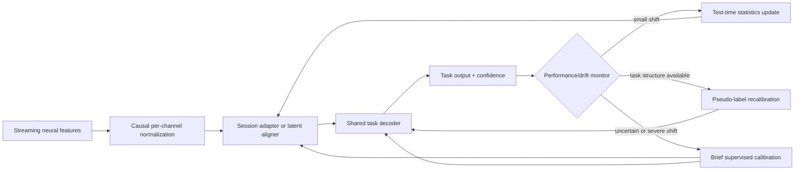

# Cross-day neural drift methods for intracortical BCIs

This document owns the literature synthesis for cross-day/session neural nonstationarity. Research status, experiment comparisons, and next-step decisions remain in the canonical [Brain2Speech research notes and experiment ledger](../research-notes.md).

## Scope and conclusion

This audit covers primary publications available through 6 October 2026. It focuses on intracortical spiking or multi-unit BCIs. Results from electrocorticography (ECoG), stereo-EEG and scalp EEG are not treated as direct evidence for intracortical stability.

“Neural drift” is used here as shorthand for several distinct shifts: changes in channel mean or scale, electrode–neuron coupling and unit turnover, changes in tuning/decoding axes, context and behavior changes, and true reorganization or user learning. These require different remedies. A method that matches firing-rate distributions can correct moment shifts yet fail when the neural-to-intent mapping rotates; a supervised decoder can track that rotation but imposes calibration burden.

The current evidence favors a **layered system**:

For speech BCIs specifically, the strongest human evidence is not yet an unsupervised manifold method. It is multiday training with day-specific affine input transforms, rolling/causal feature normalization, a shared sequence decoder, brief optional daily prompts, and continual background fine-tuning. Manifold alignment and latent-dynamics methods have compelling motor evidence; adversarial, self-supervised and test-time approaches are promising but have little or no prospective closed-loop speech validation.

## Comparison matrix

“Online-compatible” means that, after any required adaptation state is available, inference can be causal. It does not imply that the alignment/training procedure itself is instantaneous or safe to update on every sample.

| Method class | Mechanism | New-session supervision | Adaptation timing / causality | Best direct evidence | Main limitation |
|---|---|---|---|---|---|
| Feature normalization and bias correction | Update per-channel center/scale; suppress common-mode noise; use stable multi-unit features | None, or a short rest block | Causal with trailing statistics; immediate | Human motor; human speech | Cannot correct a rotated neural-to-intent map or label shift |
| Session-specific input transforms | Learn a small affine projection per day into a shared decoder space | Usually labelled prompts; copying a prior adapter can bootstrap | Causal inference; supervised daily/background fitting | **Human speech** | New adapter parameters can overfit small daily datasets; not zero-shot |
| Robust multiday training and augmentation | Train one nonlinear decoder over many recording conditions; synthetically drop/scale channels | Historical labels; no labels at deployment if shift is covered | Fixed causal decoder | NHP motor; human speech uses multiday pooling | Requires representative history; unseen severe shifts remain out of distribution |
| Linear manifold alignment | Fit FA/PCA latent spaces and align by Procrustes/CCA or stable-channel geometry | Often no intent labels; may require paired trials or stable channels | Usually block/periodic; causal after map is fitted | NHP closed-loop motor; human motor retrospective | Assumes stable low-dimensional geometry; distribution symmetries can make alignment ambiguous |
| Latent dynamical alignment | Fit a day-0 dynamical prior and map new activity so its latent trajectories obey those dynamics | Day-0 labels; new day unlabeled | Batch/periodic optimization; causal decoder after alignment | NHP motor, mainly offline | More compute and model assumptions; no prospective human speech validation |
| Adversarial/domain-invariant alignment | Train an encoder/aligner to preserve task information while hiding session identity | Source labels; target labels optional depending on variant | Primarily offline or periodic; causal forward pass | NHP motor; 2026 speech preprint | Domain matching can erase task information or align the wrong modes |
| Self-supervised/contrastive pretraining | Learn representations by masked prediction or invariance to synthetic recording perturbations | No labels for pretraining; labels for downstream decoder/fine-tuning | Offline pretraining; causal deployment depends on architecture | Motor iBCI, mostly offline | Better sample efficiency is not equivalent to autonomous drift correction |
| Supervised / few-shot recalibration | Update adapter or decoder from prompted movements/utterances | Ground-truth intent labels | Brief explicit calibration; causal thereafter | Strong human motor and **human speech** | User burden and interruption; can bias toward copy-task distribution |
| Pseudo-label and retrospective recalibration | Infer intended target/text from selections, task geometry or an LM; retrain on confidence-weighted pseudo-labels | No explicit labels, but strong task prior/feedback | Periodic or continual online | Human cursor; human handwriting communication | Confirmation bias; depends on task structure and a usable initial decoder |
| Test-time adaptation | Update moments, adapter parameters or hidden-state distributions during inference | Usually none | Online in principle | 2026 intracortical motor preprint | Catastrophic drift, correlated samples and weak clinical validation |
| Co-adaptive / closed-loop learning | Adapt decoder while the user adapts neural strategy through feedback | Targets, inferred intent or reward | Truly online closed loop | NHP motor and human cursor | Moving user and model can destabilize each other; offline scores are inadequate |
| Drift monitoring and triggered fallback | Estimate shift/performance without intent labels; recalibrate only when needed | None for detection | Causal/periodic | Human motor | Detects a problem but does not itself restore the mapping |

## 1. Preprocessing, normalization and stable features

### Mechanism

Per-channel mean subtraction, z-scoring, clipping, common-average or linear-regression referencing, threshold normalization, and rolling estimates of feature statistics target fast changes in baseline firing rate, gain and shared noise. A trailing window is causal; a centered window or statistics computed from an entire held-out trial leak future information and are not valid online evidence.

For human motor iBCIs, the MINDFUL study used per-channel z-scoring for one participant and bias correction for another, and showed that a neural-only instability measure correlated with degradation of fixed-decoder cursor performance across 142 and 28 days. It is a monitoring result, not proof that z-scoring alone removes tuning drift. [Harrison et al., *Communications Biology* 2024](https://doi.org/10.1038/s42003-024-06784-4)

The 2025 PRI-T work used a 30-second daily rest block to update mean rates, but found that updated means did not rescue stale decoder weights when preferred-direction mappings changed. That is direct human evidence for the boundary of moment normalization. [Wilson et al., *Nature Biomedical Engineering* 2025](https://doi.org/10.1038/s41551-025-01536-z)

### Speech-specific evidence

Willett et al. combined threshold crossings and spike-band power, blockwise rolling normalization and day-specific input layers. Their offline ablation showed rolling z-scoring materially improved held-out-block performance; using prior-day data without any current-day training reached about 30% WER versus 23.8% in the reported online condition. [Willett et al., *Nature* 2023](https://doi.org/10.1038/s41586-023-06377-x) · [supplementary methods](https://media.springernature.com/original/springer-static/esm/art%3A10.1038%2Fs41586-023-06377-x/MediaObjects/41586_2023_6377_MOESM1_ESM.pdf)

**Limitations:** normalization assumes that task-relevant relationships survive the transform. It can also remove meaningful slow changes if statistics are updated too aggressively. Every reproduction must record whether normalization is trialwise, blockwise or streaming and whether future bins enter the estimate.

## 2. Session-specific transforms and multiday robust training

### Mechanism

A shared temporal decoder is trained across sessions while a small input projection is unique to each session. The projection absorbs electrode-space changes; the shared backbone learns speech or movement structure. At deployment, a new adapter can be initialized from the previous day and fitted with a small amount of labelled data. An alternative is to train one high-capacity model over many past conditions and synthetic perturbations so no explicit target-day update is needed when the shift resembles training variation.

Sussillo et al. trained a multiplicative RNN on months of NHP motor data and synthetic firing-rate scaling/electrode dropping. It remained usable under perturbations that disabled a same-day Kalman decoder, demonstrating robustness through history plus augmentation rather than alignment. [Sussillo et al., *Nature Communications* 2016](https://doi.org/10.1038/ncomms13749)

### Speech-specific evidence

- The 2023 Willett decoder used one affine input layer per day plus a shared 5-layer GRU. Day-specific layers outperformed one shared input layer. This is supervised multiday alignment, not unsupervised domain adaptation. [Willett et al. 2023](https://doi.org/10.1038/s41586-023-06377-x)
- Card et al. demonstrated rapid calibration in a second person with ALS, online fine-tuning during use and a mean 3.7% WER after 16 cumulative hours. The study supports few-shot supervised initialization and within-session adaptation, not calibration-free cross-day use. [Card et al., *New England Journal of Medicine* 2024](https://doi.org/10.1056/NEJMoa2314132)
- Over 19 months and more than 3,800 hours of independent home use, the same participant later used a transformer speech decoder with day-specific transforms, continual background recalibration and 0–20 optional prompted sentences at the start of a day. Structured copy-task word accuracy reached 99.2%. This is the strongest prospective long-horizon speech evidence, but it combines architecture, accumulated labelled/pseudo-labelled data, software workflow and relatively stable neural modulation; it does not isolate one drift algorithm. [Card et al., *Nature Medicine* 2026](https://doi.org/10.1038/s41591-026-04414-6)

**Limitations:** a day-ID adapter cannot generalize to an unseen day until it is initialized or fitted. Multiday models can memorize session identity, and gains from more data can be confounded with more task labels.

## 3. Linear manifold alignment

### Mechanism

Population activity often occupies a lower-dimensional manifold even when individual recorded units turn over. Factor analysis or PCA estimates the session manifold; CCA, Procrustes rotation, or geometry from stable electrodes maps the new latent coordinates to a reference day. The fixed downstream decoder then operates in the aligned space.

Degenhart et al. prospectively tested a manifold stabilizer during NHP intracortical cursor control under abrupt and across-day recording instabilities. It needed no intent labels and sometimes outperformed supervised recalibration, including when directional information was weak. [Degenhart et al., *Nature Biomedical Engineering* 2020](https://doi.org/10.1038/s41551-020-0542-9)

The biological premise is supported by long-term NHP recordings showing stable motor-cortical population dynamics despite unstable single-neuron activity. [Gallego et al., *Nature Neuroscience* 2020](https://doi.org/10.1038/s41593-019-0555-4)

**Supervision and causality:** reference-day decoder fitting is supervised. Target-day alignment can be unlabeled, but typically needs a batch covering the task distribution; after fitting, the projection and decoder are causal. CCA variants that need timepoint correspondence are not autonomous in free use.

**Limitations:** manifolds can drift, change dimension or be incompletely sampled. Distribution-only alignment is non-identifiable under rotations/reflections that preserve the distribution. Human five-year cursor analyses found that FA stabilization and adversarial matching degraded over long horizons relative to target-inference updates. [Wilson et al. 2025](https://doi.org/10.1038/s41551-025-01536-z)

**Speech evidence:** no peer-reviewed study located here prospectively demonstrates unsupervised manifold alignment for an intracortical speech BCI. Day-specific affine layers are related but are trained with speech labels.

## 4. Latent dynamical models

### Mechanism

LFADS uses a sequential variational autoencoder to infer de-noised latent neural dynamics from spiking data. LFADS itself is an analysis/generative model, not a cross-day stabilizer. [Pandarinath et al., *Nature Methods* 2018](https://doi.org/10.1038/s41592-018-0109-9)

NoMAD adds an alignment objective: a day-0 LFADS model and supervised behavior decoder are fixed, while a new-session mapping is optimized so target-day trajectories obey the learned day-0 dynamics. This supplies a stronger constraint than merely matching static distributions. Across NHP motor datasets spanning weeks to 95 days, NoMAD improved offline decoding relative to static, aligned-FA and adversarial baselines; a retrospective closed-loop-data analysis also showed benefit when combined with target inference. [Karpowicz et al., *Nature Communications* 2025](https://doi.org/10.1038/s41467-025-59652-y)

**Supervision and causality (corrected 2026-10-07):** day 0 requires neural/behavior labels; target-day alignment is unlabeled. Unlike standard full-sequence LFADS, NoMAD explicitly uses **causal sliding-window inference** for Day 0 and Day K, with past bins plus the current bin. This is distinct from prospective online adaptation. [Source methods](https://www.nature.com/articles/s41467-025-59652-y). The [report reference card](../research-results-report.md#reference-work-nomad--stabilize-decoding-by-aligning-latent-dynamics) distinguishes this motor-decoding prior art from our unreproduced speech extension.

**Limitations:** assumes invariant latent dynamics and comparable task coverage. Computation and hyperparameter selection are heavier than affine alignment. No direct speech-BCI validation was found.

## 5. Adversarial and domain-invariant learning

### Mechanism

A domain discriminator tries to identify the recording session from latent features while the encoder/aligner tries to fool it. Task loss anchors useful information. ADAN instead learns a generator that maps new-day neural data toward the day-0 distribution before a fixed decoder.

Farshchian et al. compared CCA, KL distribution matching and an adversarial domain adaptation network on NHP motor recordings; the adversarial method used few target-day samples and outperformed the latent-distribution baselines. [Farshchian et al., ICLR 2019](https://openreview.net/forum?id=Hyx6Bi0qYm)

A larger retrospective NHP study found CycleGAN and ADAN could extend motor-decoding accuracy across days, while also showing that no alignment method dominated all datasets and timescales. [Kao et al., *eLife* 2023](https://doi.org/10.7554/eLife.84296)

### Speech-specific evidence

ALIGN applies a multi-domain adversarial encoder to the public intracortical speech datasets and reports lower PER/WER on unseen sessions than non-adversarial baselines. As of this review it is an **arXiv preprint, not peer-reviewed**, and evaluation is offline rather than prospective closed loop. [Zhang et al., ALIGN preprint, 2026](https://arxiv.org/abs/2603.18299)

**Supervision and causality:** source sessions need task labels. Target-session data may be unlabeled for pure ADAN or partly labelled for semi-supervised variants. Training is normally batch/offline; the learned forward map is causal if it sees only current/past bins.

**Limitations:** making sessions indistinguishable does not guarantee intent is aligned. If session and label distributions are correlated, the adversary can remove task signal or match the wrong class modes. Training instability and target-day model selection are additional deployment risks.

## 6. Self-supervised and contrastive pretraining

### Mechanism

Masked modeling reconstructs hidden spikes; contrastive objectives make two augmented views of the same neural sequence similar while separating unrelated sequences. Session/subject/task tokens or small adapters can specialize a shared backbone. The intended benefit is a representation that uses unlabelled history and needs fewer labels in a new context.

NDT2 pretrained a spatiotemporal transformer across sessions, subjects and motor tasks using masked neural modeling and context tokens, then rapidly adapted it to held-out motor contexts. Evidence includes NHP and human motor-cortex datasets, but not a prospective speech BCI. [Ye et al., NeurIPS 2023](https://proceedings.neurips.cc/paper_files/paper/2023/hash/fe51de4e7baf52e743b679e3bdba7905-Abstract-Conference.html)

Jude et al. used self-supervised identification/permutation of consistent neuron ensembles so a sequential autoencoder could decode unseen future NHP motor sessions. The publication is a workshop proceeding, and evidence is offline. [Jude et al., PMLR 2023](https://proceedings.mlr.press/v197/jude23a.html)

Wu et al. combined neural recording-condition augmentations with contrastive learning and reported robustness over 83 days on one public NHP motor dataset. [Wu et al., *Computer Methods and Programs in Biomedicine* 2024](https://doi.org/10.1016/j.cmpb.2024.108208)

**Supervision and causality:** pretraining uses no behavior labels, but downstream decoding generally still needs labelled source data and often target-context fine-tuning. Masked/bidirectional encoders are noncausal unless redesigned or restricted at inference.

**Limitations:** augmentation choice defines the invariances; unrealistic perturbations can erase neural information. Strong linear-probe or fine-tuning results do not demonstrate stable online control. No peer-reviewed intracortical speech study located here establishes contrastive pretraining as a cross-day solution.

## 7. Decoder recalibration with labels or pseudo-labels

### Explicit and few-shot supervision

Brief prompted trials remain the most reliable anchor because they identify changes in the neural-to-intent map directly. Three people with tetraplegia reached peak cursor performance within roughly three minutes of calibration in a human iBCI study, showing that supervised fallback need not be long. [Brandman et al., *Journal of Neural Engineering* 2018](https://doi.org/10.1088/1741-2552/aa9ee7)

Speech copy prompts provide exact text/phoneme labels and support fitting a day adapter or fine-tuning a shared model. The 2024 NEJM and 2026 Nature Medicine results above are the strongest speech examples.

### Retrospective and probabilistic target inference

For cursor tasks, selected targets reveal likely prior movement intent. RTI recalibrates from recently selected targets during free point-and-click use. In BrainGate participants, this enabled self-calibrating typing without separate target-prompt blocks. [Jarosiewicz et al., *Science Translational Medicine* 2015](https://doi.org/10.1126/scitranslmed.aac7328) · [Sarma et al., *Journal of Neural Engineering* 2016](https://doi.org/10.1088/1741-2560/13/2/026017)

PRI-T uses an HMM over cursor trajectories, target locations and optional clicks to produce confidence-weighted pseudo-targets. It outperformed or matched distribution alignment over long timescales, including one month of closed-loop human use and five years of retrospective data. [Wilson et al. 2025](https://doi.org/10.1038/s41551-025-01536-z)

### Language-model pseudo-labels

CORP used LM-corrected handwriting outputs as pseudo-labels to continually update a GRU plus day-specific input layers. One participant maintained 93.84% character accuracy over 403 days. This is human intracortical communication evidence, but the modality is attempted handwriting rather than speech. [Fan et al., 2023 preprint/PMC manuscript](https://pmc.ncbi.nlm.nih.gov/articles/PMC11086983/)

For speech, an LM can similarly correct high-confidence sentences and feed them back, but fluent hallucinations can create convincing wrong labels. The 2026 home-use speech system used continuous fine-tuning and correction tools, yet the publication does not isolate an LM pseudo-label algorithm comparable to CORP. [Card et al. 2026](https://doi.org/10.1038/s41591-026-04414-6)

**Limitations:** pseudo-labeling requires a bootstrap region where output is already usable. Errors can reinforce themselves, and the task prior can bias decoding toward expected targets or fluent text. Confidence thresholds, replay buffers, update frequency and rollback must be logged.

## 8. Test-time adaptation

### Mechanism

Test-time adaptation updates a restricted part of a pretrained decoder from unlabeled deployment data, commonly by matching moments/distributions, minimizing entropy or enforcing temporal consistency. It differs from offline domain adaptation mainly in when and how often updates occur.

As of this review, direct intracortical evidence is early. Membrane Potential Alignment updates a spiking neural decoder by matching hidden membrane-potential distributions with KL divergence and is designed for lightweight online adaptation. It is a **2026 preprint**, with no prospective human speech validation. [Borowiecki et al., MPA preprint, 2026](https://arxiv.org/abs/2606.14866)

Rolling z-scoring and mean/bias updates are the mature, low-risk end of the same spectrum. Updating deep weights at test time is higher risk.

**Supervision and causality:** no labels are intended. A streaming implementation must use only past samples, bound parameter changes and preserve a frozen rollback checkpoint.

**Limitations:** iBCI samples are autocorrelated and task distributions change naturally, violating common independent/test-stationary assumptions. Entropy minimization can make wrong predictions more confident. Target-free model selection is unresolved.

## 9. Co-adaptive and online methods

### Mechanism

Closed-loop decoder adaptation (CLDA) updates decoder parameters while the user observes feedback and adapts neural strategy. Bayesian updates, Kalman-filter retraining and reward/target-driven changes can rapidly move the pair toward usable control.

Bayesian parameter updates maintained NHP motor control without measured hand movement or explicit intended targets. [Li et al., *Neural Computation* 2011](https://doi.org/10.1162/NECO_a_00110)

Orsborn et al. showed that decoder adaptation and NHP neural plasticity jointly improved control and compensated nonstationary recordings. [Orsborn et al., *Neuron* 2014](https://doi.org/10.1016/j.neuron.2014.04.048)

Human cursor studies found closed-loop calibration better than otherwise matched open-loop calibration and demonstrated self-calibrating typing. [Jarosiewicz et al., *Journal of Neural Engineering* 2013](https://doi.org/10.1088/1741-2560/10/4/046012) · [Jarosiewicz et al. 2015](https://doi.org/10.1126/scitranslmed.aac7328)

**Speech evidence:** online decoder fine-tuning in Card et al. 2024/2026 is machine adaptation during participant use, but evidence that the participant's speech neural strategy co-adapted is not isolated. Speech outputs are discrete sequences with delayed error signals, so cursor CLDA results do not transfer automatically.

**Limitations:** both halves of the loop move. Fast decoder changes can invalidate the user's learned strategy; slow changes may not rescue poor initial control. Evaluation must be closed-loop and longitudinal, not only offline replay.

## Evidence hierarchy: motor versus speech

### Direct speech-BCI evidence

| Evidence | Participants / duration | Drift handling actually demonstrated | What it does not establish |
|---|---|---|---|
| [Willett et al. 2023](https://doi.org/10.1038/s41586-023-06377-x) | One person with ALS; weeks of sessions | Rolling normalization, multiday data, day-specific input layers; reduced but nonzero new-day calibration need | Calibration-free prospective stability |
| [Card et al. 2024](https://doi.org/10.1056/NEJMoa2314132) | One person with ALS; eight months reported | Rapid initial calibration, previous-day/multiday initialization and online fine-tuning | Isolated comparison of drift algorithms |
| [Card et al. 2026](https://doi.org/10.1038/s41591-026-04414-6) | Same person; 19 months, >3,800 h home use | Day transforms, transformer backbone, continuous background fine-tuning, optional 0–20 daily prompts | Zero-supervision stability or multi-participant generality |
| [ALIGN 2026](https://arxiv.org/abs/2603.18299) | Public datasets; offline | Adversarial session-invariant speech representations | Peer review, prospective or closed-loop use |

### Motor/handwriting evidence that is not yet speech evidence

- Degenhart manifold stabilization and NoMAD concern NHP motor control.
- ADAN/CycleGAN, contrastive augmentation and NDT2 are primarily NHP/human motor datasets and mostly offline.
- PRI-T/HMM and RTI exploit cursor target geometry and selections.
- CORP is human attempted-handwriting-to-text. Its LM pseudo-label concept is relevant to speech, but its neural task and error structure differ.
- ECoG “plug-and-play” studies benefit from a different recording modality and should not be used as direct evidence of microelectrode stability.

## Practical evaluation requirements for Brain2Speech

A credible cross-day experiment should report more than aggregate WER:

1. Hold out entire sessions chronologically; do not randomly mix trials from every day.
2. Separate **zero-shot**, **unlabeled adaptation**, **few-shot labelled adaptation**, and **full supervised retraining** curves.
3. Use streaming-safe normalization and audit every statistic for future leakage.
4. Compare against four minimum baselines: stale decoder, current-day mean/scale update, copied prior-day affine adapter, and full supervised current-day adapter.
5. Report PER/WER by day, time since reference, number of labelled sentences, unlabeled adaptation minutes, inference latency and adaptation compute.
6. Run multiple seeds and preserve raw decoded phonemes before the LM so language-model gains are not mistaken for neural stability.
7. Stress test missing channels, gain/offset shifts and session-distribution changes separately.
8. For online adaptation, bound updates, log confidence and pseudo-label acceptance, maintain a frozen rollback model, and test recovery after deliberately corrupted pseudo-labels.
9. Treat motor-method transfer as a hypothesis until evaluated on speech data; treat preprint results as provisional.

## Primary source index

- Normalization/monitoring: [Harrison et al. 2024](https://doi.org/10.1038/s42003-024-06784-4).
- Robust multiday decoder: [Sussillo et al. 2016](https://doi.org/10.1038/ncomms13749).
- Stable motor manifolds: [Gallego et al. 2020](https://doi.org/10.1038/s41593-019-0555-4).
- Linear manifold stabilization: [Degenhart et al. 2020](https://doi.org/10.1038/s41551-020-0542-9).
- LFADS: [Pandarinath et al. 2018](https://doi.org/10.1038/s41592-018-0109-9).
- NoMAD: [Karpowicz et al. 2025](https://doi.org/10.1038/s41467-025-59652-y).
- Adversarial alignment: [Farshchian et al. 2019](https://openreview.net/forum?id=Hyx6Bi0qYm) and [Kao et al. 2023](https://doi.org/10.7554/eLife.84296).
- Self-supervised pretraining: [Ye et al. 2023](https://proceedings.neurips.cc/paper_files/paper/2023/hash/fe51de4e7baf52e743b679e3bdba7905-Abstract-Conference.html), [Jude et al. 2023](https://proceedings.mlr.press/v197/jude23a.html), [Wu et al. 2024](https://doi.org/10.1016/j.cmpb.2024.108208).
- Human target-inference recalibration: [Jarosiewicz et al. 2015](https://doi.org/10.1126/scitranslmed.aac7328), [Sarma et al. 2016](https://doi.org/10.1088/1741-2560/13/2/026017), [Wilson et al. 2025](https://doi.org/10.1038/s41551-025-01536-z).
- Co-adaptation: [Li et al. 2011](https://doi.org/10.1162/NECO_a_00110), [Orsborn et al. 2014](https://doi.org/10.1016/j.neuron.2014.04.048).
- Human speech: [Willett et al. 2023](https://doi.org/10.1038/s41586-023-06377-x), [Card et al. 2024](https://doi.org/10.1056/NEJMoa2314132), [Card et al. 2026](https://doi.org/10.1038/s41591-026-04414-6).
- Provisional 2026 methods: [ALIGN](https://arxiv.org/abs/2603.18299), [MPA](https://arxiv.org/abs/2606.14866).
