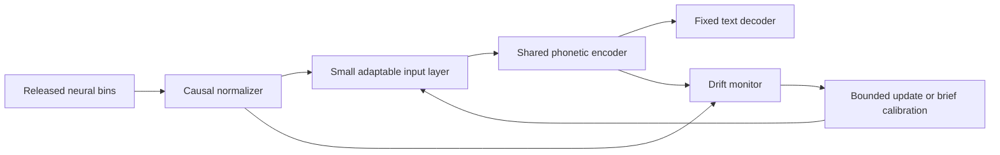

# E018/E019-derived directions for drift tolerance and calibration efficiency

The [ledger](../research-notes.md) owns experimental findings and accepted decisions; the [comparison report](../research-results-report.md#2-definitions-and-reporting-principles) owns evidence definitions. The [cross-day methods synthesis](cross-day-neural-drift-methods.md) remains the literature owner. This bounded note connects completed observations to proposed tests. No training, evaluation, frozen-v1 restart or goal is authorized by this note.

## What the exploration actually supports

[E018](../research-notes.md#e018--recorded-feature-and-frozen-e017-cross-day-shifts-i003) supports recorded-feature and fixed-instrument latent distribution shifts, but does not establish biological representational drift or fully control speech content. [E019](../research-notes.md#e019--normalization--trained-input-layer-diagnostic-i003) compares the same 6,000 training trials on 17 known training days:

| Normalization / input layer | Training corpus greedy PER |
|---|---:|
| Fixed / reference | 72.3249% |
| Fixed / trained native-day | 36.4669% |
| Day-specific / reference | 63.5451% |
| Day-specific / trained native-day | 4.2619% |

The factors interact: normalization alone brings day-centroid latents closer without recovering useful decoding. Therefore, marginal distribution matching is not an adequate sole success criterion. The combined result suggests a useful compensation mechanism on known days, not an unseen-day remedy already demonstrated. Day-specific moments use whole-day observations, including future trials; native input layers were previously trained with supervision. These are training PER values, not WER. Original public-test E017 WER remains 18.4139% on a different cohort and preprocessing path.

## Recommended hypothesis

Keep a shared phonetic backbone and decoder stable, while letting a restricted observation front-end compensate for changing recordings.

This is a proposal, not an implementation or a claim that neural intent is invariant. Separate three costs: labeled sentences, unlabeled observation duration, and update computation. Label-free adaptation still consumes neural observations; full-day transductive adaptation is not immediate zero-shot deployment.

## Prioritized tests and primary-source grounding

1. **Establish realistic normalization first.** Compare training-only moments against preceding-observation updates on separate evaluation trials, preserving causal smoothing and decoder settings. Treat already-trained native-day adapters as a known-day reference, not a zero-shot method. Willett's original speech study explicitly uses unique daily input layers and rolling feature adaptation; Extended Data Fig. 5 reports ablation benefits from both. This supports the components, not our proposed new-day policy. [Willett et al., 2023](https://pmc.ncbi.nlm.nih.gov/articles/PMC10468393/).

2. **Train tolerance rather than rely on daily correction.** With past-day data only, test day-balanced phoneme supervision and realistic gain/offset/channel-loss perturbations derived from training recordings, against an equal-budget unaugmented control. Preserve the speech task; do not apply arbitrary rotations or corrupt labels. Sussillo et al. show that accumulated recording history plus synthetic neural perturbations can make a recurrent decoder robust to later variability, including firing-rate scaling. Their evidence is nonhuman-primate motor decoding, so a speech-WER benefit remains a hypothesis. [Sussillo et al., 2016](https://pmc.ncbi.nlm.nih.gov/articles/PMC5159828/).

3. **Concentrate few-shot learning in a small adapter.** Test a shared initial adapter with restricted gain/bias and low-rank residual updates, freezing the backbone and text decoder. Compare 0/5/10/25/50/100 chronological labeled sentences with identical prefixes. Episodic held-out-training-day initialization is a later hypothesis if basic adapter-only adaptation is beneficial. E019 motivates changing the observation mapping; it does not identify the optimal adapter size or prove that zero labels suffice.

4. **Add unlabeled dynamics only behind a task-preservation gate.** A NoMAD-inspired candidate can keep shared dynamics/readout fixed while fitting a target observation mapping with reconstruction and latent-state constraints. NoMAD combines fixed LFADS dynamics with unsupervised alignment and reconstruction, reporting stability in monkey motor tasks and retrospective human cursor data—not speech WER. Its full-session offline target access must not be silently substituted for causal adaptation. Accept the candidate only if PER/WER improve, not merely if day clusters overlap. [Karpowicz et al., 2025](https://www.nature.com/articles/s41467-025-59652-y).

5. **Calibrate only when a validated monitor indicates need.** MINDFUL demonstrates neural-distribution measures associated with closed-loop human cursor performance without target-intent labels. For speech, validate thresholds on development days; content shifts can trigger alarms and stable marginals need not imply an unchanged intent mapping. Use bounded updates and rollback rather than a guarantee of label-free performance monitoring. [Pun et al., 2024](https://pmc.ncbi.nlm.nih.gov/articles/PMC11494208/).

## Decision and evaluation boundary

Primary endpoint: future-day corpus WER under a fixed decoder. Supporting endpoints: pre-LM PER, worst-day errors, labels needed to reach a development-fixed WER target, historical-day forgetting, unlabeled duration, update time and inference latency. Require matched calibration prefixes, past-days-only training, whole-day chronology, paired uncertainty and prespecified seeds for new stochastic training.

The immediate low-cost diagnostic is training-only versus prefix-only normalization on separate trials before modifying LFADS or the language model. Existing public tests have already been inspected and cannot become a pristine confirmation set by renaming them; E017 also saw two designated final days during training. A prospective independent generalization claim needs a clean chronological model/data boundary rather than reuse of E017 as an unseen-day baseline. Preserve paused v1 and all sealed evidence.

**Verdict:** useful design direction, not a measured calibration reduction. **Uncertainty:** content, recording interface and biological changes remain partly inseparable; adapter identifiability from unlabeled moments is not guaranteed. **Decisive criterion:** task error and label cost improve against matched controls without unacceptable forgetting. **Stop/revise:** latent alignment without decoding benefit, unstable updates or hidden future-data access.
