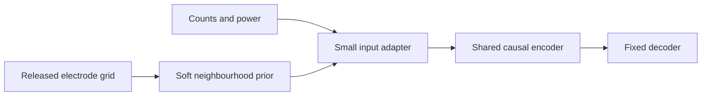

# Electrode geometry as a drift-tolerance prior

The [canonical ledger](../research-notes.md) owns experiment status, methods and accepted decisions. The [comparative report](../research-results-report.md#2-definitions-and-reporting-principles) owns evidence definitions. This note distinguishes released static electrode layout from unobserved day-to-day tissue/neuron changes. No training, decoder, adaptation or final-day recording access is included.

## Evidence and released mapping

**A usable static feature-column-to-array-grid mapping is released.** The local author [competition readme](../../artifacts/dryad/competitionData_readme.txt) specifies zero-based column numbers in four 8×8 grids, labels area 44/6v superior/inferior, and indicates superior/inferior and anterior/posterior directions. Threshold crossings and power share that electrode correspondence. The [sentences readme](../../artifacts/dryad/sentences_readme.txt) and [tuning readme](../../artifacts/dryad/tuningTasks_readme.txt) provide the same layout. These are author-release documents linked from [Dryad](https://datadryad.org/dataset/doi:10.5061/dryad.x69p8czpq); the live downloadable readme returned HTTP403 during this check, so detailed grids were verified from the already-downloaded local readmes, not a fresh downloaded payload.

The current decoder uses raw columns0–127 for area6v. **They are not spatially sorted, and first64/last64 are not the two physical arrays:** superior6v is columns32–95; inferior6v is columns0–31 plus96–127. Parsing the readme verified64 unique entries per6v grid and their union exactly0–127. Do not reshape feature-index order directly into images. The author's [unscrambleChans](../../AnalysisExamples/analysis.py:22) supplies a static permutation for geometrical plotting; [tuningHeatmaps.ipynb](../../AnalysisExamples/tuningHeatmaps.ipynb) explicitly uses it before spatial displays. Coordinate orientation must be validated against the readme before implementing any graph or image encoder.

Our extraction [trial_raw](../../reproduction/analyze_neural_drift.py:70) concatenates count columns0–127 and power columns0–127. Thus combined featurej andj+128 describe the same electrode; combined feature128 is **not** raw physical electrode128. A bounded metadata inspection of permitted June7training MAT using scipy.whosmat found sentenceText, tx1–tx4, spikePow and blockIdx only. The mapping lives in documentation, not that MAT's fields. No final recording was opened. This audit establishes documented nominal geometry, not a measured per-day moving-electrode map.

Willett2023 records from two area6v arrays for speech decoding and reports articulator tuning **spatially intermixed at individual electrodes**, with each array covering3.2×3.2mm². It uses unique daily input layers and rolling feature adaptation—not a claim that geometrical realignment eliminates drift. [Nature main text, Fig1 and decoding section](https://www.nature.com/articles/s41586-023-06377-x).

## What geometry could—and could not—provide

Geometry can supply a **soft prior**: distinguish arrays, identify neighbouring electrodes, visualize spatially correlated gain/offset changes, regularize a small adapter, or simulate local channel failures. These are hypotheses, not demonstrated T12 improvements. Nearby electrodes need not encode the same phoneme: hard spatial averaging could erase informative mixed tuning.

Static chip coordinates do not reveal relative tissue displacement, which neurons each electrode detects on each day, threshold/gain changes, or changing speech timing/behaviour. The release contains binned counts/power, not the continuous voltage needed to infer arbitrary waveform identity. Static geometry alone therefore cannot identify or reverse every source of cross-day distribution shift, and it does not convert current evidence into proof of biological drift.

## Prospective decisive experiment—not authorized execution

After current raw/Anscombe controls are completed, compare capacity-matched adapters: (1) unrestricted small adapter, (2) trainable neighbourhood-weighted adapter using the actual grid, (3) the same adapter with shuffled coordinates, preserving array membership, parameter count, training budget and calibration examples. Include gain/bias-only and identity controls where affordable. Keep count/power pairing explicit and never infer an inter-array nearest-neighbour distance from a nominal grid alone. Test actual-coordinate spatial gain/offset and contiguous-channel-loss augmentation separately from independent channel perturbations, without changing preprocessing simultaneously.

Primary decision metrics are held-out cross-day fixed3gram WER and calibration labels to a development-fixed WER target; pre-LM PER, worst-day performance and channel-loss robustness are supporting metrics. Per-day evaluation trials cannot train/select adapters. Improvement must survive matched parameter/budget controls and paired session uncertainty; better-looking latent overlap alone is insufficient. If true and shuffled layouts perform similarly, geometry-specific benefit is inconclusive even if both improve over identity. No result is presently measured.

**Verdict:** mapping availability is verified from local author documentation; geometry-guided drift tolerance is proposed. **Limitation:** known recording layout is not known neural identity or actual electrode motion. **Next decision:** record a prospectively frozen geometry ablation only after current preprocessing comparison, rather than modifying the running experiment.
