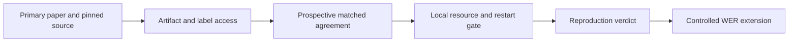

# WER source and evaluation access audit

Scope: supporting evidence for [W03–W06](../research-plan-wer.md), using the [report's evidence definitions](../research-results-report.md#2-definitions-and-reporting-principles). Availability is not successful loading, training, numerical reproduction or local scientific benefit. This audit fetched small source/metadata files only: no model downloads, installation, training, evaluation submissions or paused-job restart. Repository metadata was read through GitHub's public read-only API on 2026-10-07; complete recursive trees below reported `truncated: false`. No numerical agreement criterion has been approved here.

## 1. Decision summary

| Workstream | Verified access | Missing prerequisite / unknown | Next decision |
|---|---|---|---|
| W03 diphone / training | DCoND paper gives objective and training details; TeamCyber publishes training code/configs and two neural checkpoint assets | DCoND author implementation/checkpoints not located; ambiguous paper window/stride wording; exact GPT-3.5 fine-tune unavailable in this audit | Reconstruct only after resolving recipe ambiguities; distinguish source reproduction from a new matched diphone implementation |
| W04 ensemble | TeamCyber two-model selection code and released neural weights; LISA source and a Brain-to-Text recipe | 5-gram/OPT and Llama access/environment not locally verified; proprietary LISA model access unverified; headline competition labels hidden | Prefer auditing the accessible two-member TeamCyber dependency; local 3-gram substitution is a different fingerprint |
| W05 NoMAD | Pinned author code, shipped Day 0/95 demo data, published motor-data locations and causal inference helper | Legacy TensorFlow/CUDA stack not validated on Apple hardware; full experiment identities/seeds/preprocessing not yet frozen; pretrained weights not identified | Audit a matched motor dependency before any speech extension; motor accuracy is not WER evidence |
| W06 BIT | Author Transformer/phoneme/sentence source, configs, preparation scripts, T12/T15 data links and evaluation entry points | Released pretrained neural checkpoint/full pretraining execution recipe not identified; complete pretraining-corpus access not individually verified; headline holdout scoring needs authorized service access | Gate an accessible claim first; E009 feasibility cannot reproduce the pretrained BIT claim |

These are access-audit recommendations, not evidence-resolved improvement verdicts. All local method-effect metrics remain **Not measured** in this audit.

## 2. W03 — DCoND: separate diphone learning from language-model improvements

Primary source: Li et al., [arXiv 2411.10657v1](https://arxiv.org/html/2411.10657v1), §§3–4 and Appendix A.6. It models preceding/current phoneme pairs, marginalizes pair probabilities to monophones, and combines diphone/monophone CTC. Reported PER is 15.34% versus 16.62%; 5.77% WER additionally depends on language-model processing and ensembling, not diphone targets alone. Data are 8,800 training / 600 validation / 1,200 competition sentences. The encoder is bidirectional, so this is not the frozen causal v1 fingerprint.

Appendix A.6 specifies batch 32, Adam learning rate 0.02, up to 120 diphone epochs, initial subclass training for ten epochs, then monophone-loss weight increments of 0.1 every ten epochs to 0.6. It also specifies temperature 1.2 before 5-gram decoding. Its window/stride notation is confusing and requires resolution rather than silently treating `14` as our kernel or stride. The headline route uses 5-gram, OPT and GPT-3.5; Appendix A.4 reports a separate Llama-3.1-70B variant.

**Unknown:** no verified author diphone repository, released trained diphone checkpoint or exact fine-tuned GPT-3.5 artifact was located through the paper, author website and targeted source searches. This is a bounded search outcome—not proof none exists. Missing implementation details require an author-source follow-up or an explicitly labeled reimplementation. Any local fixed-3-gram diphone comparison tests a new matched hypothesis, not exact 5.77% reproduction.

## 3. W04 — accessible competition ensemble dependencies

The [organizer/entrant retrospective](https://arxiv.org/html/2412.17227v1), §§3–5, identifies LISA, TeamCyber and DCoND-LIFT as different combinations, not one generic ensemble algorithm. TeamCyber combines two separately decoded sentences using Llama2-7b-chat scoring; the source reports 8.89% and 9.16% individual competition WER versus 8.26% combined. DCoND-LIFT merges ten independently decoded candidates plus phoneme sequences. A different number of members, averaging logits instead of selecting sentences, or replacing the language models changes the intervention.

### TeamCyber: pinned, small ensemble with published neural weights

[Author repository](https://github.com/CIBR-Okubo-Lab/speechBCI_2024/tree/1747832ffc5899c8bdf91883fc20fe52e72a4c66), revision `1747832ffc5899c8bdf91883fc20fe52e72a4c66` (commit 2024-11-19). Verified `conf/config_1.yaml`, `conf/config_2.yaml`, training/evaluation source and `notebooks/LLM_ensemble.ipynb`. Its README specifies bidirectional five-layer 1,024-unit GRUs, batch 128, SGD momentum 0.9, initial LR 0.1, factor-0.1 step decay after 4,000/5,000 steps, with/without Nesterov.

The public [v1.0.0 release](https://github.com/CIBR-Okubo-Lab/speechBCI_2024/releases/tag/v1.0.0) API lists `modelWeights_1` and `modelWeights_2`, each **1,077,136,565 bytes**. These sizes are metadata, not downloaded/hashed/loaded checkpoint evidence. Full inference also requires the Willett decoder, 5-gram/OPT path and Llama2-7b-chat weights. Model access terms, Mac compatibility, memory/latency and final checkpoint ancestry remain unverified locally. A released-weight diagnostic can precede retraining once protocol, storage and permissions gates are met.

### LISA: source exists; distinguish neural data from EMG artifacts

[Author repository](https://github.com/tbenst/silent_speech/tree/177a844aec78171bf8c255824756687efbff1e09), revision `177a844aec78171bf8c255824756687efbff1e09`. README's Brain-to-Text subsection requests ten baseline RNN models, 5-gram beam search and a LISA script; it reports separate validation and competition outcomes. The repository also covers Gaddy EMG, so its overall MONA-LISA result and most fine-tuning files cannot automatically become our neural benchmark controls. GitHub releases were empty.

The README's `notebooks/tyler/2024-02-13_wiilet_competition.py` exists; its source references OpenAI and GPT-3.5. Nearby Willett/LISA scripts and `fine_tuning_data/2024-02-12_willet-ensemble.jsonl` also exist. Their split provenance and hosted fine-tuned LLM availability need verification before execution. Script existence is not a working reproduction; do not assume its candidate/target JSONL is permitted local training data or use remote APIs without authority.

## 4. W05 — NoMAD: motor dependency with an accessible demo

The [Nature Communications paper](https://www.nature.com/articles/s41467-025-59652-y), data/code availability sections, identifies [monkey motor data](https://doi.org/10.5061/dryad.cvdncjt7n) and [human motor BCI data](https://doi.org/10.5061/dryad.q83bk3jtp). Their Dryad landing pages were accessible. Human data are not attempted-speech data; no speech-WER claim follows. This audit did not download or account all sessions.

[Author repository](https://github.com/snel-repo/nomad/tree/aa3c8faadf053d0b22160458854c076dcb13eb7e), revision `aa3c8faadf053d0b22160458854c076dcb13eb7e` (2025-03-31). `demo/demo.ipynb` uses Jango Day 0/95, 20 ms bins, chopped LFADS/alignment training data and trialized force evaluation. Six HDF5/pickle data blobs total **17,886,463 bytes** by tree metadata. The notebook trains reference LFADS if no checkpoint exists, then trains alignment and evaluates force; a demo is not the full paper's stability experiment. No pretrained checkpoint or release asset was identified in the inspected tree/releases.

[Causal helper](https://github.com/snel-repo/nomad/blob/aa3c8faadf053d0b22160458854c076dcb13eb7e/demo/utils.py) supplies sliding-window inference. [LFADS dependencies](https://github.com/snel-repo/nomad/blob/aa3c8faadf053d0b22160458854c076dcb13eb7e/lfads_tf2/setup.py) pin `tensorflow-gpu==2.0.0`; README uses Python 3.7.7, CUDA 10.0 and cuDNN 7.6. This is a compatibility prerequisite, not proof the algorithm cannot run on our Mac. A port requires parity, causal-prefix checks, matched force-decoding metrics and prospective agreement. Its human/monkey motor dependency cannot clear our speech-WER gate.

## 5. W06 — BIT: code is accessible, full pretrained result is not yet access-cleared

[Author repository](https://github.com/yzhang511/bit/tree/f107ae988d782609b78d1d7488490cca9fb7a103), revision `f107ae988d782609b78d1d7488490cca9fb7a103` (2026-05-13). Verified phoneme/sentence training configurations, neural encoder/projector source, T12/T15 preparation scripts and `eval_phoneme.py` / `eval_llm.py`. README links Willett competition data at [Dryad](https://doi.org/10.5061/dryad.x69p8czpq) and T15 at [Dryad](https://doi.org/10.5061/dryad.dncjsxm85). Code labels public benchmark test as `val`, and competition data as `holdout`. No trained neural checkpoint, pretraining directory or GitHub release assets were identified in the complete tree/release audit. That bounded finding does not rule out an elsewhere-hosted checkpoint.

[Sentence recipe](https://github.com/yzhang511/bit/blob/f107ae988d782609b78d1d7488490cca9fb7a103/configs/finetune/sentence/ndt/trainer.yaml) uses Aero-1-Audio-1.5B, contrastive loss, neural-encoder updates and broader LoRA targets than E009. [Environment](https://github.com/yzhang511/bit/blob/f107ae988d782609b78d1d7488490cca9fb7a103/env.yaml) assumes CUDA/DeepSpeed. These are not a validated Mac execution recipe. Full corpus preparation and pretraining availability remain to be audited separately.

The [paper v2](https://arxiv.org/html/2511.21740v2), Table 1, reports T12 **15.67%** end-to-end WER and **10.22%** with ensemble on **1,200 hidden-label competition sentences**; the cascaded result is a separate route. §5.1 obtains headline scores through competition submissions. Appendix A.4 includes unlabeled validation/holdout neural data in SSL pretraining; this is a different access fingerprint from causal future-day generalization. Matching its pretrained claim requires the complete corpus/checkpoint, preprocessing and selection recipe, not only its T12 fine-tuning code. E009's frozen-GRU, no-contrastive pilot remains feasibility evidence.

## 6. Shared evaluation prerequisite

The [organizer's EvalAI challenge](https://eval.ai/web/challenges/challenge-page/2099) advertises a 1,200-line held-out transcription submission and names the competition results above. The overview route returned no readable body during this audit; the indexed organizer page was readable. **No account registration, authenticated scoring availability, quota, permission or successful submission was verified.** Accordingly headline competition evaluation is not locally accessible merely because a public leaderboard exists. Local public-test diagnosis is possible but cannot substitute for hidden-label reproduction or an untouched final holdout.

Next gate: freeze each specific accessible claim, numerical agreement/uncertainty rule and full fingerprint; verify license/model access, source parity, local storage and compute; obtain direction for materially blocked access or previously stopped-job restarts. Preserve all historical evidence and frozen v1 settings. This audit resolves source-discovery questions, not W03–W06 scientific decisions.
