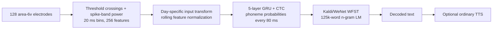

# Willett 2023 speech neuroprosthesis: source and reproducibility audit

This document owns the literature and artifact audit. Research status, experiment comparisons, and next-step decisions are maintained in the canonical [Brain2Speech research notes and experiment ledger](../research-notes.md).

## Bottom line

The relevant Frank/Francis Willett paper is **“A high-performance speech neuroprosthesis”**, published in *Nature* 620, 1031–1036 on 23 August 2023, DOI [10.1038/s41586-023-06377-x](https://doi.org/10.1038/s41586-023-06377-x). It is open access under CC BY 4.0. This is a **brain-to-text** system: neural activity is decoded into phonemes and then words. The demonstration used ordinary text-to-speech only after decoding; it did not synthesize the participant's voice directly. [Nature article](https://www.nature.com/articles/s41586-023-06377-x) · [supplementary methods](https://media.springernature.com/original/springer-static/esm/art%3A10.1038%2Fs41586-023-06377-x/MediaObjects/41586_2023_6377_MOESM1_ESM.pdf)

The paper, code, neural data, an example trained RNN checkpoint, and 3-gram/5-gram language-model artifacts are public. The practical public reproduction target is the repository's **offline benchmark**, not the participant-in-the-loop headline experiment. The repository reports 18.8% word error rate (WER) for its RNN + 3-gram baseline and 13.7% WER for RNN + 5-gram + OPT rescoring on the public `test` split. Those figures must not be presented as direct reproductions of the paper's online 9.1%/23.8% WER results. [Official code README](https://github.com/fwillett/speechBCI/blob/522a9605ccf0818def80b6fd80007598e790408e/README.md)

## Paper result being referenced

The study had one BrainGate2 participant, T12, with bulbar-onset ALS who could vocalize but could not produce intelligible speech. Four 64-channel Utah arrays were implanted: two in ventral premotor cortex (area 6v) and two in area 44. The speech decoder used the two area-6v arrays, yielding 128 electrodes and two features per electrode. [Nature main text](https://www.nature.com/articles/s41586-023-06377-x) · [supplementary methods](https://media.springernature.com/original/springer-static/esm/art%3A10.1038%2Fs41586-023-06377-x/MediaObjects/41586_2023_6377_MOESM1_ESM.pdf)

The paper's primary online results were:

| Mode | Vocabulary | WER | Other result |
|---|---:|---:|---:|
| Vocalized attempted speech | 50 words | 9.1% | Five evaluation days |
| Silent attempted speech | 50 words | 11.2% | Three evaluation days |
| Vocalized attempted speech | 125,000 words | 23.8% | Mean pace 62 words/minute |
| Silent attempted speech | 125,000 words | 24.7% | — |
| Raw RNN phoneme output, vocalized | phonemes | 19.7% phoneme error rate | Before language-model correction |
| Offline analysis with improved LM | 125,000 words | 17.4% | Retrospective, not the live result |
| Offline analysis with improved LM and temporally proximal tests | 125,000 words | 11.8% | Retrospective ceiling analysis |

These values and the evaluation design are reported in the [Nature article](https://www.nature.com/articles/s41586-023-06377-x). The final online decoder accumulated 10,850 training sentences; the participant attempted 260–480 new training sentences per evaluation day, and collection plus retraining averaged 140 minutes per day. Test prompts were held out from training.

### Audited comparison-table fields (2026-10-06)

The following are published values, not local recomputations. [Nature Table 1](https://www.nature.com/articles/s41586-023-06377-x/tables/1) gives numerical 95% intervals; no figure digitization is required.

| Report ID | WER 95% CI (%) | Raw-RNN PER (%) and 95% CI | Evaluated sentence trials |
|---|---:|---|---|
| P01 | 7.2–11.2 | 21.4 (19.6–23.2) | 250; five vocalized days |
| P02 | 8.3–14.4 | 22.1 (19.9–24.3) | 150; three silent days |
| P03 | 21.8–25.9 | 19.7 (18.6–20.9) | 400; five vocalized days |
| P04 | 22.0–27.4 | 20.9 (19.3–22.6) | 240; three silent days |
| P05 | 15.4–19.5 | 19.7 (18.6–20.9) | Reanalysis of vocalized online outputs; 400 inferred from the unchanged online evaluation set |
| P06 | 9.8–13.9 | 17.0 (15.7–18.3) | 250 held-out trials; five vocalized evaluation days |

Trial counts are explicit in supplementary Table 7 except P05, whose 400-trial denominator is an inference from the unchanged vocalized online outputs and supplementary section 8.5, not a separately tabulated count. The intervals use trial-bootstrap percentiles with 10,000 resamples and aggregate edit errors divided by reference units; they do not quantify between-participant or three-seed variation. [Supplementary methods, sections 4.1, 8.5 and 9/Table 7](https://media.springernature.com/original/springer-static/esm/art%3A10.1038%2Fs41586-023-06377-x/MediaObjects/41586_2023_6377_MOESM1_ESM.pdf)

Vocalized evaluation dates were 2022-07-21, 2022-07-27, 2022-08-02, 2022-08-11 and 2022-08-13; silent dates were 2022-08-18, 2022-08-23 and 2022-08-25. P06 uses 50 randomly held-out open-loop/stage-1 sentences per evaluation day, excluding stage-2 evaluation data from its partition. It is therefore not the original online test set or the public last-block benchmark. [Supplementary methods, sections 1.6, 1.9 and 7.1](https://media.springernature.com/original/springer-static/esm/art%3A10.1038%2Fs41586-023-06377-x/MediaObjects/41586_2023_6377_MOESM1_ESM.pdf)

For P03, aggregate substitution/deletion/insertion counts and CER are **not tabulated in the audited article and supplementary methods**. Extended Data Fig. 6 describes phoneme-confusion structure, not the requested aggregate error accounting. These fields require a separately identified raw-output reanalysis; they should not remain labelled merely “not extracted”. [Nature article, decoding results and Extended Data Fig. 6](https://www.nature.com/articles/s41586-023-06377-x)

For B01/B02, the pinned README reports point WERs only: **benchmark confidence intervals, seed dispersion and a numerical trial denominator are not reported there**. Its partition description is not enough to assert that the authors evaluated all 24 release sessions; distinguish local manifest counts and the local 600-trial replay from the published benchmark denominator. [Pinned official README, Results and partition sections](https://github.com/fwillett/speechBCI/blob/522a9605ccf0818def80b6fd80007598e790408e/README.md)

The public Dryad release describes 12,100 sentence trials because it also packages later/public-benchmark partitions, including a competition holdout. This is not a contradiction with the paper's 10,850-sentence final-day training total. [Dryad dataset record](https://doi.org/10.5061/dryad.x69p8czpq)

## Reproduction boundary

There are three distinct claims to test:

1. **Artifact replay:** load the released checkpoint, run inference and the released language model on the public `test` split, and compare against 18.8% WER (3-gram) and 13.7% WER (5-gram + OPT). This is the fastest and strongest initial integrity check.
2. **Training reproduction:** retrain the TensorFlow RNN from released TFRecords and compare WER distributions across fixed seeds. The repository does not publish a numerical tolerance or deterministic guarantee.
3. **Paper replication:** reproduce the online 9.1%/23.8% WER and 62 words/minute with a participant, implanted hardware, daily adaptation, and closed-loop feedback. The public files allow retrospective analysis, but they cannot recreate the prospective human-in-the-loop experiment.

The public benchmark uses a different partition: the last 40 sentences of each day are `test`, the first 80 are `competitionHoldOut`, and the remainder are `train`. Competition-holdout transcriptions are redacted in the release. [Official code README](https://github.com/fwillett/speechBCI/blob/522a9605ccf0818def80b6fd80007598e790408e/README.md)

## Official artifacts and access status

The Dryad record is public, CC0-1.0, version 9 in the Dryad API / “version 4” in the dataset README, last updated 1 September 2023. It totals **80,440,635,830 bytes (~80.44 GB decimal)** and explicitly says to use the latest release because it fixes trial partitions, one misaligned block, an audio-envelope error, and a competition data leak. [Dryad landing page](https://datadryad.org/dataset/doi%3A10.5061/dryad.x69p8czpq) · [Dryad metadata API](https://datadryad.org/api/v2/datasets/doi%3A10.5061%2Fdryad.x69p8czpq) · [file-list API](https://datadryad.org/api/v2/versions/253293/files?per_page=100)

| Artifact | Status | Size | SHA-256 | Purpose |
|---|---|---:|---|---|
| [Nature paper](https://www.nature.com/articles/s41586-023-06377-x.pdf) | Downloaded; open access | 6,771,104 B | `0fca4ed4d2d6ecdc7eaebf03c64a514f03268b64dca170281d2abae70ad298a9` | Article (CC BY 4.0); local artifact verified 2026-10-06 |
| [Supplementary methods](https://media.springernature.com/original/springer-static/esm/art%3A10.1038%2Fs41586-023-06377-x/MediaObjects/41586_2023_6377_MOESM1_ESM.pdf) | Downloaded | 849,919 B | `3cfa194e1d710e3ab66320e74f3310ca40d3465138a5630cbe0987d9ec49be0f` | Full model, signal, and evaluation methods; local artifact verified 2026-10-06 |
| [`fwillett/speechBCI`](https://github.com/fwillett/speechBCI) | Public Git clone | GitHub reports ~80 MB | pin `522a9605ccf0818def80b6fd80007598e790408e` | TensorFlow decoder, C++ LM decoder, notebooks and analyses |
| `competitionData.tar.gz` | Public on Dryad | 3,669,638,707 B | `5b5c9784d80d5286e69352621366be2e4ff468e043e082e7aa7cbc90d18336b3` | Simplified train/test/hidden-holdout `.mat` data |
| `derived.tar.gz` | Public on Dryad | 8,062,039,321 B | `44d31076a68969738a72475d3dc708fd91c3d6c2f9adcadba7496f48b3e31117` | TFRecords and **released example RNN checkpoint** |
| `languageModel.tar.gz` | Public on Dryad | 14,106,240,558 B | `7b64d36c64765dc0a5e890bb0cc795657c827b7d314fbf5ed5dc8778bd166d7e` | 3-gram LM/WFST used for the basic baseline |
| `languageModel_5gram.tar.gz` | Public on Dryad | 38,245,502,441 B | `bb2b15cc13d40e484359ffe0afe74580cdbad02440c27586074bfe2e51e7867e` | 5-gram graph for the 13.7% WER route |
| `sentences.tar.gz` | Public on Dryad | 14,803,440,418 B | `d354c97d3fa5e4684adb7046de73e5a21fde805824954490e34cb042d1c948da` | Full sentence-task neural data and online BCI output |
| `diagnosticBlocks.tar.gz` | Public on Dryad | 612,391,492 B | `dc204dda6a67f25824f6f9b7a7cb6b83ca8142376a9787ebb66fa223402882e7` | Seven-word across-day stability task |
| `tuningTasks.tar.gz` | Public on Dryad | 941,344,404 B | `8e245a00391f7d6558e6846effdfb29d0c145872864b110a85523a6a2a40fcbf` | Figure 1 movement/phoneme/word tuning tasks |
| [`cffan/neural_seq_decoder`](https://github.com/cffan/neural_seq_decoder) | Public, optional | small Git repo | pin `e01c313fb88c2158e55724bef0922e795eb81f55` | Author-linked PyTorch reimplementation; not the paper's original TensorFlow path |

There is no separate Hugging Face model or formal GitHub release/tag. The pretrained RNN is embedded in `derived.tar.gz`, and the language models are large Dryad archives. Pin the exact commits above rather than relying on a moving branch. At the time of this audit, direct automated Dryad file requests from this environment received 401/403 responses even though the dataset metadata marks the files public and the web page exposes download controls; this appears to be a delivery/session restriction, not a scientific-data access gate. Browser-mediated download or a Dryad-supported authenticated/session request may be required.

## Model and software details

The released decoder takes 256 neural features (threshold-crossing counts and spike-band power from 128 area-6v electrodes), binned at 20 ms. The paper model is a unidirectional, 5-layer GRU trained with CTC. The supplement specifies 512 units per layer for the live model, a 14-bin input kernel, stride 4 (one output every 80 ms), dropout 0.4, Adam for 10,000 minibatches, and batch size 64. The public baseline notebook overrides the GRU to 1,024 units and the kernel to 32 bins; its saved output reports 53,551,145 trainable parameters. [Supplementary methods](https://media.springernature.com/original/springer-static/esm/art%3A10.1038%2Fs41586-023-06377-x/MediaObjects/41586_2023_6377_MOESM1_ESM.pdf) · [training notebook](https://github.com/fwillett/speechBCI/blob/522a9605ccf0818def80b6fd80007598e790408e/AnalysisExamples/rnn_step2_trainBaselineRNN.ipynb)

The repository's declared stack is:

- Python 3.9 and `tensorflow-gpu==2.7.0` for the original decoder.
- NumPy 1.25.0, SciPy 1.11.1, PyTorch 1.13.1, Transformers 4.28.1 and related pinned Python packages.
- CMake >=3.14, GCC >=10.1 and libtorch/PyTorch 1.13.1 for the language-model decoder.
- Linux for the released C++ decoder build: its CMake file explicitly rejects non-Linux systems when fetching libtorch.
- The checked-in baseline training notebook ran on one NVIDIA A100-SXM4-80GB GPU with cuDNN 8.6. This is provenance, **not a published minimum requirement**. The inference notebook explicitly disables CUDA, so released-checkpoint inference can run on CPU, subject to RAM and the large WFST graph.

The 5-gram + OPT route used OPT-6.7B in 8-bit mode; the supplement states that it fits on one NVIDIA A100 40GB GPU. The 3-gram baseline does not require OPT. [Supplementary methods](https://media.springernature.com/original/springer-static/esm/art%3A10.1038%2Fs41586-023-06377-x/MediaObjects/41586_2023_6377_MOESM1_ESM.pdf) · [`NeuralDecoder/setup.py`](https://github.com/fwillett/speechBCI/blob/522a9605ccf0818def80b6fd80007598e790408e/NeuralDecoder/setup.py) · [LM build README](https://github.com/fwillett/speechBCI/blob/522a9605ccf0818def80b6fd80007598e790408e/LanguageModelDecoder/README.md)

## Licensing and availability caveats

- The article is CC BY 4.0 and the Dryad data are CC0-1.0.
- The GitHub repository has **no repository-wide license declaration** in GitHub metadata and no root `LICENSE`; absence of a license means reuse rights for the original code are not clearly granted.
- `LanguageModelDecoder/LICENSE` is Apache-2.0, but the vendored SRILM tree has its own Research Community License restricting use to specified government/non-profit research and teaching contexts; commercial use requires a separate license. [SRILM license in the pinned repository](https://github.com/fwillett/speechBCI/blob/522a9605ccf0818def80b6fd80007598e790408e/LanguageModelDecoder/srilm-1.7.3/License)
- The competition holdout labels are redacted, so its WER cannot be independently computed from the released archive. The ordinary public `test` split is labelled and is the correct local reproduction target.
- The USC-TIMIT and Haskins articulography datasets are only needed for the phoneme-representation analyses, not the core decoding benchmark. Their own access and licensing terms must be checked separately. [USC-TIMIT](https://sail.usc.edu/span/usc-timit/) · [Haskins data link](https://yale.app.box.com/s/cfn8hj2puveo65fq54rp1ml2mk7moj3h)

## Recommended first-pass acceptance criteria

1. Record immutable manifests for Git commit `522a9605…`, Dryad version 9, every downloaded archive size and SHA-256, and the extracted-file inventory.
2. Replay the released checkpoint against the labelled public `test` split with the 3-gram graph. Treat **18.8% WER** as the first target.
3. Run the 5-gram + OPT pipeline separately and treat **13.7% WER** as a distinct, more expensive target.
4. Only after artifact replay succeeds, train from scratch with fixed seeds and preserve per-seed WER, software lockfiles, hardware details and raw logs.
5. Report the online Nature figures as paper results, not as reproduced results, unless a prospective closed-loop experiment is actually performed.

This ordering isolates data/code integrity and environment compatibility before spending compute on training, while keeping the public offline benchmark separate from the human-in-the-loop paper claim.

## Primary sources

- Willett et al., [Nature article and DOI](https://doi.org/10.1038/s41586-023-06377-x), published 23 August 2023.
- Willett et al., [supplementary methods](https://media.springernature.com/original/springer-static/esm/art%3A10.1038%2Fs41586-023-06377-x/MediaObjects/41586_2023_6377_MOESM1_ESM.pdf).
- Authors' [official `speechBCI` repository](https://github.com/fwillett/speechBCI) and pinned [commit `522a9605…`](https://github.com/fwillett/speechBCI/commit/522a9605ccf0818def80b6fd80007598e790408e).
- Authors' [Dryad dataset](https://doi.org/10.5061/dryad.x69p8czpq), [metadata API](https://datadryad.org/api/v2/datasets/doi%3A10.5061%2Fdryad.x69p8czpq), and [latest-version file inventory](https://datadryad.org/api/v2/versions/253293/files?per_page=100).
- Author-linked [PyTorch implementation](https://github.com/cffan/neural_seq_decoder), pinned [commit `e01c313f…`](https://github.com/cffan/neural_seq_decoder/commit/e01c313fb88c2158e55724bef0922e795eb81f55).
