# Willett released baseline: retraining recipe audit

This is supporting evidence, not a competing experiment ledger. The [research notes](../research-notes.md) own experiment status and accepted findings. No retraining result is reported here. The target is the **public offline RNN + 3-gram benchmark (18.8% WER)**, not the Nature paper's live participant-in-the-loop results. [Pinned official README](https://github.com/fwillett/speechBCI/blob/522a9605ccf0818def80b6fd80007598e790408e/README.md)

## Recipe resolved from original artifacts

The original [training notebook](../../AnalysisExamples/rnn_step2_trainBaselineRNN.ipynb) overrides the generic YAML defaults. Its effective settings agree with the [released checkpoint configuration](../../workspace/derived/rnns/baselineRelease/args.yaml); do not substitute the default 512-unit, 14-bin model for this recipe.

```mermaid
flowchart LR
    A[Released block-normalized 256 features] --> B[Centered Gaussian smoothing]
    B --> C[One day-specific 256-unit softsign transform]
    C --> D[32-bin VALID stacking / stride 4]
    D --> E[Five unidirectional 1024-unit GRUs]
    E --> F[41-class phoneme / silence / blank logits]
    F --> G[Fixed released 3-gram WFST]
    G --> H[Public offline text evaluation]
```



| Component | Effective released recipe |
|---|---|
| Sessions | Exactly the 19 sessions in `speech_release_baseline.yaml`, April 28–August 13; not all 24 released sessions |
| Inputs | 128 area-6v threshold-crossing features plus 128 spike-power features; 256 total |
| Input transforms | 19 independent day-specific dense 256→256 layers, identity kernels, softsign, dropout 0.2 |
| Preprocessing | Released per-block mean/std normalization; centered Gaussian smoothing SD 2, `SAME` padding; `normLayer: false` disables additional fitted normalization |
| Temporal model | Five 1024-unit unidirectional Keras GRUs, input dropout 0.4; 32-bin stacking, stride 4, `VALID`; no additional subsampling |
| Output/objective | 39 phonemes + SIL + CTC blank; mean CTC loss plus L2 kernel regularization `1e-5` |
| Augmentation | White noise SD 1.0 and per-trial constant feature offset SD 0.2, before smoothing; synthetic mixing, random walk, static gain and time warp disabled |
| Optimizer | Adam β1=0.9, β2=0.999, **epsilon=0.1**; learning rate 0.02 linearly decays to zero over 10,000 optimizer steps; no warm-up |
| Batch/gradient | Batch 64, shuffled/repeating within-day stream, buffer 1024, one sampled session per batch; global gradient norm clip 10 |
| Session sampling | Preserve the literal 19 probabilities of 0.052. NumPy's multinomial residual convention makes the final category absorb the remainder; silently replacing these with exact uniform probabilities changes the recipe |
| Attempts | `range(restoredStep, nBatchesToTrain + 1)` means 10,001 fresh-run batch attempts, indexed 0–10,000; exceptions can reduce successful steps |
| Selection | Validate every 50 batch indices, including index 0; save strict improvements in corpus phoneme edit rate (`bestValCer`, misleadingly called CER); retain at most 10 improvement checkpoints |
| Initialization | Random backend initialization and learned first-layer initial state; do not load the released pretrained checkpoint for fresh retraining |

Primary implementation evidence: [training class](../../NeuralDecoder/neuralDecoder/neuralSequenceDecoder.py), [GRU implementation](../../NeuralDecoder/neuralDecoder/models.py), [dataset pipeline](../../NeuralDecoder/neuralDecoder/datasets/speechDataset.py), [dataset YAML](../../NeuralDecoder/neuralDecoder/configs/dataset/speech_release_baseline.yaml), [model YAML](../../NeuralDecoder/neuralDecoder/configs/model/gru_stack_inputNet.yaml), and [preprocessing/label writer](../../AnalysisExamples/makeTFRecordsFromSession.py). These files were inspected at pinned code commit `522a9605ccf0818def80b6fd80007598e790408e`, with no local differences in the inspected training class, model, or dataset YAML. [Official pinned training notebook](https://github.com/fwillett/speechBCI/blob/522a9605ccf0818def80b6fd80007598e790408e/AnalysisExamples/rnn_step2_trainBaselineRNN.ipynb)

## Evaluation and leakage boundary

The training class uses each of the 19 days' original public `test` partition as validation and selects the lowest corpus phoneme error rate across those days. The original [inference notebook](../../AnalysisExamples/rnn_step3_baselineRNNInference.ipynb) then scores only session indices `4:19` (May 24–August 13), 15 days × 40 test sentences = 600 local trials. Its fixed WFST settings are acoustic scale 0.8, beam 18, n-best 1, `speech_sil`, and blank penalty `log(2)`. This is the same selection/evaluation overlap as the released code, **not an untouched-test generalization estimate**. Faithful reproduction must disclose this overlap; removing it creates a different experiment. [Official pinned inference notebook](https://github.com/fwillett/speechBCI/blob/522a9605ccf0818def80b6fd80007598e790408e/AnalysisExamples/rnn_step3_baselineRNNInference.ipynb)

Competition-holdout labels are redacted and must not be trained on or scored as references. Whole-block normalization and centered smoothing also make this route **offline/noncausal**. Neither accepted 4 ms acquisition delay nor the separate causal v1 preprocessing makes this original recipe causal.

The original config records `seed: -1`. The constructor saves `args.yaml` **before** replacing -1 with the current microsecond and seeding NumPy, TensorFlow and Python. Therefore the released file does not recover the original realized seed. Prespecify explicit retraining seeds and report all results; bitwise reproduction of the original optimization trajectory is not possible from these artifacts alone.

## Command and environment feasibility

The notebook's original command is:

```bash
python3 -m neuralDecoder.main \
  dataset=speech_release_baseline model=gru_stack_inputNet \
  learnRateDecaySteps=10000 nBatchesToTrain=10000 learnRateStart=0.02 \
  model.nUnits=1024 model.stack_kwargs.kernel_size=32 \
  seed=17 outputDir=/absolute/new/output/directory
```

Before execution, relocate all 19 dataset `dataDir` entries to the existing extracted TFRecord root without mutating the released config; use a derived, persisted configuration or equivalent command override. The output must be a fresh directory, `loadDir` must remain null, and the notebook's transitive imports require `wandb` even when logging is disabled. Report seeds 17, 29 and 43 separately, not best-of-three. These explicit seeds and local paths are documented reproduction substitutions.

The existing [replay container](../../reproduction/Dockerfile) already pins Python 3.9 / TensorFlow 2.7 / compatible NumPy-SciPy, but deliberately targets CPU replay. It does not include `wandb`, and its default entrypoint runs checkpoint inference, not training. Running the original trainer in that Linux/amd64 environment would require a separate entrypoint or direct class driver and audited dependencies. On Apple Silicon it is CPU emulation, **not Apple GPU training**. Native TensorFlow/Metal would change the runtime and requires operation/parity smoke tests; replacing the trainer with PyTorch also changes initialization, dropout, optimizer and CTC details and must not be described as exact original-code retraining. An original TensorFlow-compatible CUDA machine is the straightforward accelerated route, but no remote execution or spending is authorized by this audit.

The upstream [package dependency file](../../NeuralDecoder/setup.py) combines TensorFlow-GPU 2.7 with newer NumPy/SciPy pins; do not blindly install the full package dependency set. Existing CPU replay compatibility pins are a starting point, not proof that a full training step, validation, checkpoint reload or resource budget succeeds. Verify those before launching 10,001 attempts. No training was started by this audit.

## Preserved source identities

| Artifact | SHA-256 |
|---|---|
| Released `baselineRelease/args.yaml` | `ae1ff616b600d2340785899f48231cc0b2091843a73bfb14c00497fd2bd630f7` |
| Training notebook | `2494d7d00bf01b9ad838103c4e9a846cdbecdd6569841cb07bb4e00498bc9a05` |
| Training class | `86c010501dd39d56d36776440838568778671c90d7cdfe3b44c1ee8fb60915f2` |

## Native port conformance update (2026-10-07)

The [canonical E008 record](../research-notes.md#e008--original-willett-public-baseline-retraining) owns live execution status. The native port uses original TF CPU random initialization and the unchanged original TFRecord parser/shuffle/repeat/padded batch, normalization identity, augmentation and Gaussian smoothing through a separate process. Model gate order, patch flattening, learned initial state, bias layout and time-locked input dropout semantics were audited. Adam must use a **global** successful-update counter and update inactive adapters with **zero gradients**, retaining momentum decay/movement; the original traced `switch_case` does not simply omit inactive variables. An independent TF multi-update fixture checks this correction. Validation is **680** original public-test trials (four early sessions × 20, 15 later × 40), not 19 × 40; the later benchmark remains 600. Three real updates, validation and fresh-process continuation pass. See the gate and source identities linked from the ledger.

Explicit substitutions: native PyTorch/MPS recurrence/dropout and explicit CPU CTC, fixed seeds, separate NumPy day-selector stream, preservation of all best checkpoints plus an atomic mutable latest resume state, and fail-stop on exceptions rather than the upstream catch-and-continue. Framework-specific stochastic sequences differ even though distributions and recipe settings match. Original Keras dropout consumes shared NumPy seed draws, so preserving literal day probabilities does not imply preserving its exact day sequence. Fresh-process stream replay and continuation are hash/weight checked; a controlled speedup is not measured. These are disclosed architecture-faithful retraining substitutions, not claims of bitwise original-code replay.

## Reporting requirements

Report successful/failed attempts, validation PER and selected index, WER/PER/CER and edit totals, all seed outcomes, session-level uncertainty, software/image identity, training time, memory, and checkpoint hashes. Show raw legacy scoring alongside any explicitly derived standard-tokenization metrics so the 18.8% benchmark comparison does not silently change scoring. Do not conflate the already completed E000 pretrained-checkpoint replay with from-scratch retraining, or mix this noncausal same-days benchmark into the frozen chronological v1 matrix.
