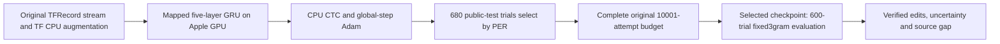

# Willett public released recipe: full-training and safe-resume audit

This is a supporting audit, not a new experiment contract or a competing ledger. The [research notes](../research-notes.md) own protocol, status and decisions; the [comparative report](../research-results-report.md#2-definitions-and-reporting-principles) owns evidence definitions. This audit performs no training, decoder launch, goal change or scientific-protocol mutation. BIT remains first; Willett work must run serially after BIT's required verification/evaluation.

## Claim and scope

**Subsequent execution evidence, 2026-10-09:** a separate [CPU-only preflight](../../research/runs/willett-resume-preflight-20261009-01/result.json) now reproduces all2,957 stored batch hashes with the original checkpoint unchanged. The historical “not performed in this audit” statement below describes this audit's narrower scope. A [versioned safety wrapper](../../reproduction/willett_fail_stop.py) and finite-Adam/NaN tests are added; guarded GPU resume is not yet exercised. The [canonical E017 record](../research-notes.md#e017--complete-the-preserved-willett-released-recipe-training) adopts the prospective protocol and comparison rule; it is not launched while BIT trains.

The accessible target is the author's **18.8% public offline WER using the released RNN and fixed 3-gram WFST**, not the Nature live 23.8% large-vocabulary result, a chronological drift experiment, or a competition-hidden-label score. The author [README](https://github.com/fwillett/speechBCI/blob/522a9605ccf0818def80b6fd80007598e790408e/README.md), [training notebook](https://github.com/fwillett/speechBCI/blob/522a9605ccf0818def80b6fd80007598e790408e/AnalysisExamples/rnn_step2_trainBaselineRNN.ipynb) and [inference notebook](https://github.com/fwillett/speechBCI/blob/522a9605ccf0818def80b6fd80007598e790408e/AnalysisExamples/rnn_step3_baselineRNNInference.ipynb) are the primary sources. The complete original artifacts are available locally; no additional online source is needed to establish this recipe.

The old [recipe audit](willett-baseline-retraining-audit.md) remains source/context evidence. This document addresses the newly authorized full-completion prerequisites; it does not change historical E008 findings.

## Effective full recipe

The notebook overrides generic YAML defaults. The [released checkpoint args](../../workspace/derived/rnns/baselineRelease/args.yaml) are the effective configuration. Read with the original [trainer](../../NeuralDecoder/neuralDecoder/neuralSequenceDecoder.py), [model](../../NeuralDecoder/neuralDecoder/models.py), [dataset pipeline](../../NeuralDecoder/neuralDecoder/datasets/speechDataset.py) and [TFRecord writer](../../AnalysisExamples/makeTFRecordsFromSession.py).

| Dimension | Source-faithful setting |
|---|---|
| Sessions/data | Exactly the 19 April28–August13 sessions listed in released args, **not** all24 BIT sessions. Raw manifest reports6,640 training and680 public-test trials for these sessions;38 train/test TFRecord files are sealed in E008. Runtime TFRecord sample accounting must independently confirm the manifest totals before a complete claim. |
| Input |256 features: first128 area-6v threshold crossings and first128 spike-power features; original block normalization already in TFRecords. No new log transform or causal feature replacement. |
| Smoothing/normalization |Original centered Gaussian SD2, SAME padding; `normLayer:false`. Block normalization and centered smoothing make this offline/noncausal even though GRUs are unidirectional. |
| Input transform |19 day-specific256→256 identity-initialized dense transforms, softsign, dropout0.2. One session per batch; literal probabilities19×0.052 with NumPy multinomial residual convention. |
| Temporal network |Five unidirectional1,024-unit reset-after GRUs; input dropout0.4 with time-locked mask; learned first-layer initial state. VALID32-bin patches at stride4, no further subsampling. |
| Head/objective |41 outputs:39 phones, SIL, blank. Unnormalized per-sentence CTC averaged over batch, plus1e-5 L2 on input kernels and selected-day adapter kernel; no L2 on recurrent kernels or output head. |
| Augmentation |White noise SD1.0 and per-trial channel offset SD0.2 before smoothing. No synthetic mixing, random walk, time warp or gain augmentation. |
| Data stream |Batch64; source sorted/shuffled TFRecord files; buffer1024; repeat before padded batching; source prefetch. No replacement with an epoch-based PyTorch sampler. |
| Optimizer |Adam β1=0.9, β2=0.999, epsilon0.1 with TensorFlow epsilon-hat semantics; LR0.02 linearly decays to0 over10,000 **successful optimizer updates**, no warm-up; global clip10. Inactive adapters receive zero gradients and retain momentum movement. |
| Budget |Source loop indices0…10,000 inclusive: **10,001 batch attempts**, not10,000 epochs/updates. With all finite updates, attempt10,000 uses LR0 and increments optimizer iteration to10,001. |
| Selection |Validate after each attempt divisible by50, including0. Select strict lowest **corpus phoneme edit rate over680 trials**; source variable `bestValCer` is PER, not text CER. Do not select by600-trial WER or most recent checkpoint. |
| Evaluation |Use only session indices4…18:15 days×40 public-test trials=600. Fixed source3gram, acoustic scale0.8, beam18, n-best1, `speech_sil`, blank penalty log2. |

The first four selection days each have20 trials, not40. Selection and benchmark share public-test trials, as in the source: this is explicitly **not independent final-test generalization**. Competition labels remain redacted and excluded. Source args save `seed:-1` before replacing it with a timestamp; original realized seed is not recoverable. Explicit seed17 and Torch/MPS stochastic streams are declared substitutions, not a bitwise author trajectory.

## Fresh preserved-state inspection

On2026-10-09, read-only CPU checkpoint inspection, journal accounting and SHA256 recomputation establish:

| Evidence | Verified value |
|---|---|
| Original run |[pytorch-retrain-s17-20261007-01](../../reproduction/results/retraining/pytorch-retrain-s17-20261007-01) |
| Parent checkpoint |`latest.pt`, SHA256 `3110a3c1e1996fc94c70c96a6fd180fe83cdd59a1c58a0240169bc1f583831d7` |
| Safe-stop metadata |`stopped-signal`, `next_attempt:2957`; seed17 |
| Budget consumed |2,957 journal rows, exact indices0…2956, all `update_applied:true`, all logged losses finite |
| Payload |61 finite model tensors;61 optimizer states; global optimizer iterations2,957; CPU RNG5,056bytes and MPS RNG44bytes present, plus NumPy RNG |
| Sampler reconstruction |History length2,957, each day and transformed-batch hash agrees with journal |
| Selected historical model |Attempt2,950, best680-trial validation PER24.547939%; selection references `best-02950.pt` |
| Identities |All seven current source/config hashes match sealed run identity; all four current gate hashes match; all38 TFRecord hashes match |
| Remaining exact budget |Attempts2,957…10,000 inclusive: **7,044** attempts; next LR0.014086 if no skipped updates |

The historical stopped `latest.pt` result—PER22.6105%, WER22.8137%, CER17.5564% on600—was not the selected best model and is not converged-recipe evidence. Its [identity](../../research/runs/e008-stopped-wer-20261007-01/identity.json), [metrics](../../research/runs/e008-stopped-wer-20261007-01/metrics.json) and [verification](../../research/runs/e008-stopped-wer-20261007-01/verification.json) remain immutable.

The checkpoint is **structurally adequate for continuation**, but a2,957-batch fresh-process replay has **not** been performed in this audit. The [existing gate](../../reproduction/results/retraining/pytorch-recipe-gate-20261007-01.json) proves only a three-update fixture, exact model/optimizer restoration, and short data/RNG replay. It does not independently prove long-run TensorFlow iterator/augmentation restoration, converged performance, or exact original stochastic draws.

## Implementation gaps to close before restarting

Read-only inspection of [native trainer](../../reproduction/train_pytorch_recipe.py), [native model/optimizer](../../reproduction/pytorch_baseline.py), [TF data service](../../reproduction/tf_recipe_service.py), [launcher](../../reproduction/launch_pytorch_recipe.py) and [exporter](../../reproduction/evaluate_pytorch_recipe.py) identifies these concrete prerequisites:

1. **Preserve parent artifacts and fork continuation explicitly.** The present `--resume` mutates rolling `latest.pt`, `status.json`, selection and potentially completion files in the original directory. `--resume-probe` restores from a checkpoint into a new directory but deliberately omits a normal run identity; it is not a production fork protocol. Add a separately versioned `--resume-from`/ancestry wrapper, persist full effective contract/source/data/environment identities in a fresh directory, inherit and independently verify all prior best candidates, and preserve every original artifact. Reusing the original best path must include hash/selection evidence. Do not reset optimizer, RNG, schedule or selection minimum.

2. **Make the goal's nonfinite stop real.** Current code checks gradients and skips `opt.step()` when nonfinite, then continues collection and can validate/save. It does not fail-stop, and has no explicit finite loss/parameters/optimizer-state assertion. This contradicts an interpretation of the older audit's “fail-stop” wording as numerical protection. Before restart, make a versioned safety-only correction that records failure, preserves a verified last-finite checkpoint, and stops on nonfinite loss/gradient/model/optimizer state. Add failure-injection tests. Catching source exceptions and continuing is not the local goal's allowed behavior.

3. **Revalidate full parent data replay without updates.** Reconstruct the exact TF service/environment and replay all2,957 saved session requests, checking every `data_hash`; restore optimizer/CPU/MPS/NumPy state and compare a fixed eval-mode probe with the parent export or newly derived immutable parent probe. Then test one bounded continuation against an uninterrupted fixture including optimizer slots and RNG. No missing replay hash or observation timeout justifies a fresh initialization. The parent history, not a reshuffled replacement loader, owns the stream position. Current resume gate checks source identity but not TFRecord hashes; the production resume must check both.

4. **Freeze the complete budget and selection before further collection.** Continue to last attempt10,000 on the original optimizer-step schedule, preserving the original selection over680 public-test trials. Do not silently extend because accuracy is unsatisfactory, compress the schedule, select by WFST WER, or stop on an exploratory loss plateau. Finite/storage safety stops preserve resumable state and are not completed budgets. Export the selected final-budget candidate and terminal checkpoint separately; only the selected candidate is the primary metric.

5. **Close scoring/reload/accounting coverage.** The existing exporter correctly uses15×40 and native blank40, but its verifier inherits phone counts rather than independently rederiving phone edits from saved logits+references. Add raw reference phone sequences/lengths and independent greedy-CTC collapse/edit verification; bind TFRecord trial IDs/order, source/code/model/LM/decoder hashes, reload logits, and matched E000 transcript identities. Keep legacy `split(' ')` WER as primary source-compatible scoring; any standard-whitespace scoring is separately named, never silently substituted. Report PER/WER/CER, S/D/I, per-day/macro/worst-day, loss definitions, uncertainty and actual budgets.

6. **Resource feasibility before serial launch.** Each current full resume checkpoint is657,949,646bytes (~0.613GiB);43 historical best checkpoints are preserved. Remaining attempt3,000…10,000 has141 selection checks. If every check improves and all best checkpoints are retained, fresh output can consume about86.4GiB for best states alone, plus latest, ancestry, logs and exports. This is an explicit conservative storage bound, not a predicted improvement count. Recheck free space after BIT and budget this bound plus30GiB floor; do not prune historical research artifacts. No concurrent BIT/v1/decoder training workload. Sample memory/runtime and compute completion estimates from fresh measured throughput rather than the old2.23-second batch alone.

These corrections do not replace the GRU architecture, causalize preprocessing, or authorize a new research hypothesis. Any correction affecting optimization or scoring beyond safety/provenance needs a new prospectively frozen protocol and parity evidence. Since source hashes are intentionally frozen, do not patch the sealed original then present its old gate as still valid.

## Prospective numerical agreement proposal—not an adopted contract

Before new Willett collection, the canonical ledger should explicitly adopt an agreement rule. A defensible exploratory proposal is:

- Primary selected model: lowest680-trial validation PER over the **complete source budget**, seed17. No best-of-seeds or WER-driven checkpoint choice.
- Primary matched public metric: legacy source-compatible corpus WER on exact600 references with fixed source3gram. Declare numerical closeness to published18.8% using a prospectively fixed **±1 percentage-point** band. This is a proposal for this new collection, not retroactive E000/E008 acceptance.
- Uncertainty check: pair the retrained model with the verified E000 released-checkpoint transcripts on exactly the same trials, hierarchical paired session-then-trial bootstrap (2,000 repetitions, seed101); report WER difference and95% interval. Require that entire interval lie within[-1,+1]pp for an exploratory *artifact-relative equivalence* finding. A point estimate inside the band with a wider interval is inconclusive, not reproduced by proximity alone. Published18.8% is rounded and has no supplied sampling interval, so this pairing tests the artifact-relative gap, not proof of identical population performance.
- Separate labels: numerical agreement, protocol matching, and uncertainty adequacy. Runtime/MPS dropout/seed differences remain even if numbers match; broad Nature/online claims remain blocked. A lower result outside the equivalence band is separately “better point estimate under this fingerprint,” not automatically equivalent or a new-method superiority claim.
- Seeds29/43: the older audit recommends three seeds, but the new goal does not explicitly require a three-seed complete schedule. Freeze seed scope/budget in the canonical contract before starting extra full runs; seed17-only must explicitly report dispersion **Not measured**. Do not add expensive repetitions implicitly or cherry-pick the best seed.

## Bounded gap diagnosis after full budget

If the selected complete-budget run misses or is inconclusive, first verify source identity, preprocessing, checkpoint choice, labels/inventory, effective global Adam/LR, inactive-adapter momentum, augmentation/dropout semantics, CTC and fixed decoder. Distinguish implementation failure from sampling variation or source-environment differences. Any training-affecting correction needs a separately named bounded run, prospective target/budget, fresh parity gate and preserved predecessor. Do not extend the source schedule until a result resembles18.8%.

The original TensorFlow2.7/Linux training environment is not this native AppleGPU port; full original-code training parity on that hardware is unavailable locally without a separately audited route. The live participant experiment and redacted hidden-label benchmarks remain inaccessible claims, not substitutions satisfied by this600-trial evaluation. No author contact, cloud spending, hidden submission or artifact deletion is authorized here.
