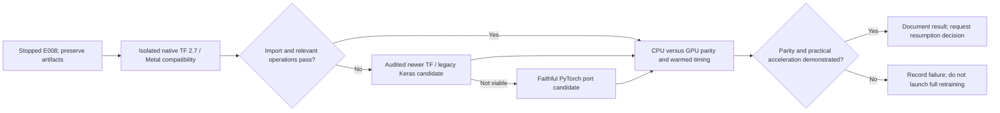

# Willett original-model training: acceleration source audit

This is a compatibility investigation, not a training result or permission to resume training. The [research notes](../research-notes.md) own E008 status and decisions; the [retraining recipe audit](willett-baseline-retraining-audit.md) owns the resolved original recipe. The user requested stopping the original training while acceleration is investigated. No packages were installed, training restarted, original source changed, or frozen v1 run modified by this audit.

## Smallest-change candidate

Investigate **native ARM64 Python 3.9 + tensorflow-macos 2.7.0 + tensorflow-metal 0.3.0 first**, in an isolated environment. Apple's published plugin matrix explicitly pairs TensorFlow 2.7 with Metal 0.3.0. Both packages still expose CPython 3.9 ARM64 wheels. This retains the original TensorFlow/Keras generation while replacing Linux/amd64 CPU emulation with a native backend. This is a compatibility candidate, **not verified support for the M5 Max or today's macOS**. [Apple-maintained plugin matrix](https://pypi.org/project/tensorflow-metal/), [TensorFlow 2.7 macOS wheels](https://pypi.org/project/tensorflow-macos/2.7.0/), [Metal 0.3.0 wheels](https://pypi.org/project/tensorflow-metal/0.3.0/)

Apple's current general guidance requires Apple silicon or AMD GPU, macOS 12+, Python 3.9+, and Xcode command-line tools. TensorFlow 2.13+ uses the `tensorflow` base package; earlier versions use `tensorflow-macos`. Missing GPU kernels can cause placement failures; dispatch overhead can also make GPU execution slower. The published compatibility table does not certify every current TensorFlow version. Consequently, neither importing the plugin nor seeing a GPU establishes that this GRU/CTC training graph is accelerated. [Apple setup and troubleshooting](https://developer.apple.com/metal/tensorflow-plugin/)

The inspected latest plugin listing is 1.2.0, with ARM64 wheels for Python 3.9–3.12. Its description's compatibility table explicitly discusses TensorFlow through 2.18, not every newer release. Pin a tested combination and retain dependency resolution; do not assume latest packages are mutually compatible. [Plugin release listing](https://pypi.org/project/tensorflow-metal/)

## Original-code compatibility gates

Local read-only checks on 2026-10-07 returned macOS **26.6.1**; neither `python3.9` nor `uv` resolved on the current shell's PATH. Therefore a compatible native Python runtime is an additional prerequisite, not something this audit installed. PATH absence does not prove no runtime exists elsewhere on disk.

The original [model](../../NeuralDecoder/neuralDecoder/models.py) and [trainer](../../NeuralDecoder/neuralDecoder/neuralSequenceDecoder.py), inspected locally at upstream commit `522a9605ccf0818def80b6fd80007598e790408e`, have the following relevant semantics:

- Five separate Keras GRUs, 1024 units, input dropout 0.4, default reset-after behavior, Glorot input initialization and orthogonal recurrent initialization. The first layer has a **trainable initialized state**, later layers default to zero. Preserve GRU gate order, bias layout and reset convention; setting dropout to zero to obtain faster execution is a recipe change. [Keras 2 GRU semantics](https://keras.io/2/api/layers/recurrent_layers/gru/)
- The learned state is a raw `tf.Variable` attribute. Keras 3 no longer automatically tracks such attributes, unlike Keras 2. A modern environment could silently lose this parameter from training; explicitly verify the variable list, gradients, and checkpoint round trip. Keras 3 also changes saved-model handling. Prefer retaining Keras 2 for the initial test; any compatibility migration must be separately documented. [Keras migration guide](https://keras.io/guides/migrating_to_keras_3/)
- Original CTC uses sparse labels, `blank_index=-1`, raw predictions, and an arithmetic mean of per-example losses. Relevant CPU/GPU support must be tested with this exact signature; a dense-label demonstration does not prove sparse-label support. A CPU CTC boundary is permissible for a speed feasibility test only if gradients propagate back to GPU parameters and its transfer overhead is measured. No claim is made here that this exact CTC operation has a Metal kernel.
- Preserve original Adam epsilon **0.1**, beta values, learning-rate schedule, global clipping, and kernel-only L2 regularization. These are not interchangeable with generic Adam/AdamW defaults. Compare one update with identical weights/data, not just output shapes.
- Verify centered smoothing, 32-bin `VALID` stacking/stride 4, all padding and logit lengths, day selection, augmentation, first-layer state, and validation/checkpoint selection. Native execution does not make the original offline recipe causal. Exact original seed cannot be recovered; the separate recipe audit explains this limitation.

These original-source requirements remain authoritative even if a newer library supplies faster kernels. GPU placement, CTC gradient coverage, checkpoint tracking and optimizer parity remain unmeasured in this investigation.

## Author-linked PyTorch implementation is an alternative, not a drop-in reproduction

The alternate repository was inspected at commit **`e01c313fb88c2158e55724bef0922e795eb81f55`** (2024-08-01), resolved through GitHub's commit API. The README describes it as a PyTorch implementation; it does not establish architecture-faithful recipe equivalence. [Pinned repository](https://github.com/cffan/neural_seq_decoder/tree/e01c313fb88c2158e55724bef0922e795eb81f55)

Its training script selects five 1024-unit layers and kernel 32, but **bidirectional=True**, white-noise SD 0.8 and a constant 0.02 learning rate, unlike the released unidirectional, SD 1.0, decaying recipe. [Pinned training script](https://github.com/cffan/neural_seq_decoder/blob/e01c313fb88c2158e55724bef0922e795eb81f55/scripts/train_model.py)

The model has detached zero initial states instead of the learned first-layer state. Its single PyTorch GRU applies inter-layer dropout, not the original Keras input dropout to every layer. Day softsign transforms lack the original input-transform dropout; extra `inpLayer` modules are registered but unused in forward. Unfold flattens channel/window axes differently from TensorFlow patch extraction, requiring an explicit permutation when importing weights. [Pinned model](https://github.com/cffan/neural_seq_decoder/blob/e01c313fb88c2158e55724bef0922e795eb81f55/src/neural_decoder/model.py), [PyTorch GRU dropout contract](https://docs.pytorch.org/docs/2.14/generated/torch.nn.GRU.html)

The trainer hardcodes CUDA. It samples mixed-day batches, validates every 100 steps, lacks original global clipping, and uses optimizer weight decay across parameters rather than kernel-only model regularization. Adam does preserve epsilon 0.1. CTC blank is zero, mean reduction includes target-length normalization, infinite losses are zeroed, and logit lengths omit the original `+1` after VALID stacking. These must be resolved rather than silently accepted. [Pinned trainer](https://github.com/cffan/neural_seq_decoder/blob/e01c313fb88c2158e55724bef0922e795eb81f55/src/neural_decoder/neural_decoder_trainer.py), [PyTorch CTC contract](https://docs.pytorch.org/docs/2.14/generated/torch.nn.CTCLoss.html)

MPS supplies a native Mac GPU route for a corrected implementation, but GPU availability is not operation coverage or speed proof. Unsupported operations can use the documented `PYTORCH_ENABLE_MPS_FALLBACK=1` mechanism; an explicit CPU CTC boundary is easier to account for than unnoticed fallback. Report actual operation placement and gradients, synchronization, transfers, and device memory. [MPS backend](https://docs.pytorch.org/docs/2.14/notes/mps.html), [MPS environment variables](https://docs.pytorch.org/docs/2.14/mps_environment_variables.html)

## Core ML / Neural Engine boundary

Core ML does support constrained on-device model updates; therefore “Core ML cannot train anything” is too broad. Its documented updatable-model interfaces are not a drop-in replacement for the original TensorFlow arbitrary GRU/CTC training graph. No conversion/update route preserving this training recipe has been established. Keep Core ML inference optimization a subsequent experiment, not an assumed training accelerator. [Apple updatable models](https://apple.github.io/coremltools/docs-guides/source/updatable-model-examples.html)

## Proposed minimum evidence before a resumption decision

1. Record native architecture, macOS/Python/package versions, dependency resolution, source/config hashes and visible devices in a fresh environment. Start with import and a small relevant operation check, **not a full 10,001-attempt run**.
2. On fixed tensors and identical initialized weights, compare CPU/GPU inference logits, valid output lengths, CTC loss, gradients, and one optimizer update. Freeze numerical tolerances before inspecting differences. Verify trainable first-layer state and checkpoint reload. Test dropout/augmentation semantics separately because identical numeric seeds do not guarantee cross-backend random masks.
3. After those pass, separately measure initialization/tracing and warmed forward, CTC, backward, update and data input times. Use synchronized device timing and repeated trials; record median/spread and peak memory. Compare native CPU with native GPU, not only emulated CPU. Include real-data duration/length distributions and ultimately original batch 64/1024 units/five layers; a tiny synthetic benchmark cannot establish practical speed.
4. Estimate full-run cost including validation every 50 indices and checkpointing; disclose fallback and data movement. Reducing batch size, layers, dropout or precision changes the recipe and requires an explicit decision. Stop safely before exhausting memory/storage; preserve all failed feasibility evidence.
5. Update the canonical ledger with measured compatibility, parity, timing and remaining differences before deciding whether to resume seeds 17/29/43. This audit itself provides **no accelerated timing or retrained WER**. External CUDA hardware could retain the original runtime more naturally, but no cloud execution or spending is authorized.
