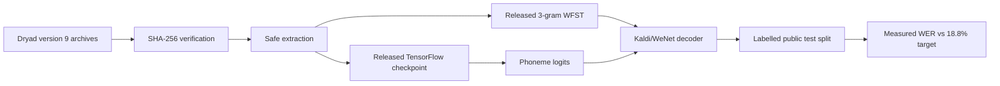

# Reproduction workflow

This workspace pins the authors' code at `522a9605ccf0818def80b6fd80007598e790408e` and the corrected Dryad release (API version 9, dataset “version 4”). The first executable target is the released-checkpoint **offline** benchmark: 18.8% word error rate (WER) with the 3-gram model on the labelled public `test` split.

That target has now been reproduced at **18.8756% WER over 600 trials** (an absolute difference of 0.0756 percentage points). See the [dated reproduction status and execution evidence](../docs/reproduction-status.md).

That target is deliberately separate from the Nature paper's prospective, participant-in-the-loop results (9.1% WER for 50 words, 23.8% WER for 125,000 words, and 62 words/minute). Public artifact replay cannot recreate the live experiment.



## Artifact layout

```text
Brain2Speech/
├── artifacts/dryad/        # seven immutable archives; ignored by Git
├── papers/                 # article and supplement; ignored by Git
├── workspace/              # extracted archives; ignored by Git
├── reproduction/
│   ├── artifacts.json      # authoritative sizes and hashes
│   ├── verify_artifacts.py
│   ├── extract_artifacts.py
│   ├── Dockerfile
│   └── run_released_checkpoint.py
└── docs/research/          # source and reproducibility audit
```

## Verify and extract

The verification command intentionally fails until every pinned archive is present and correct:

```bash
python3 reproduction/verify_artifacts.py
python3 reproduction/extract_artifacts.py --scope core
```

`--scope core` extracts only `derived.tar.gz` and `languageModel.tar.gz`, which are sufficient for the 18.8% checkpoint replay. Use `--scope all` later for the paper's neural-tuning and full sentence analyses.

## Build and run the replay

The checked-in language-model decoder rejects non-Linux systems and fetches an x86_64 libtorch build. On this Apple Silicon host, Docker therefore runs the original stack under Linux/amd64 emulation:

```bash
docker build --platform linux/amd64 -f reproduction/Dockerfile -t speechbci-repro:522a9605 .
mkdir -p reproduction/results
docker run --rm --platform linux/amd64 \
  -v "$PWD/workspace:/data:ro" \
  -v "$PWD/reproduction/results:/results" \
  speechbci-repro:522a9605
```

The compatibility changes are limited to build/runtime mechanics: the legacy OpenFST build is serialized, the image pins GCC 11, and the headless runner replaces the upstream notebook-only progress bar with terminal `tqdm`. GCC 12's compiler and linker repeatedly segfault under linux/amd64 emulation on this host; GCC 11 satisfies the repository's documented GCC >=10.1 requirement. These changes affect compilation and display only, not decoder semantics.

The result file contains aggregate WER and text CER, confidence intervals returned by the authors' code, per-sentence decoded/reference text, and mean decode time. The preserved E000 file incorrectly named CER `phoneme_error_rate`; future output uses `character_error_rate`. Raw PER requires neural-logit/phoneme-reference evaluation and was not measured by this runner. Preserve the original file, full console log and image digest before attempting retraining.

## Acceptance ladder

1. Verify every archive byte count and SHA-256 from `artifacts.json`.
2. Replay the released checkpoint and compare to 18.8% WER.
3. Run the separate 5-gram + OPT-6.7B route and compare to 13.7% WER.
4. Retrain from TFRecords with fixed seeds and report the distribution, not a single best run.
5. Never label the offline results as a reproduction of the live human-in-the-loop figures.

See [the primary-source audit](../docs/research/willett-2023-speech-neuroprosthesis-reproducibility.md) for the paper/data distinction, licenses, exact artifact provenance, and compute caveats.
