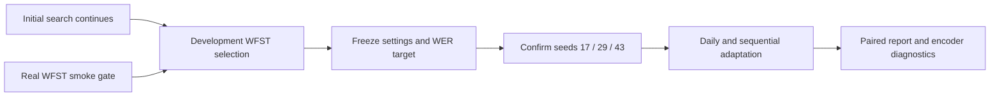

# V1 execution: accepted 4 ms acquisition delay

**Current status, 2026-10-06:** the user explicitly accepted the documented 4 ms acquisition delay. The earlier strict stop below is historical and superseded for v1. Downstream processing stays causal relative to available bins; raw-voltage zero lookahead is not claimed. Report acquisition delay, bin completion, output scheduling and computation separately.

```text
Verified archive → frozen 14/5/5 folds → accepted 4 ms acquisition gate
    → causal processing → native four-model smoke → initial development search
    → fixed 3-gram selection → three seeds → adaptation → encoder analysis
```

The runner now implements serial native initial training with optimizer/RNG checkpoint resume at epoch boundaries. It records source/config/manifest identities, sample accounting, environment and status, and leaves final days unopened. A process lock prevents duplicate execution per run; the 30 GiB storage guard deletes nothing.

```bash
.venv-v1/bin/python -m pytest research/tests -q
.venv-v1/bin/python -m research.run --stage gate
.venv-v1/bin/python -u -m research.run --stage smoke --output research/runs/v1-smoke-accepted4ms
.venv-v1/bin/python -u -m research.run --stage initial-search --output research/runs/v1-initial-accepted4ms
```

Initial search uses seed 17, learning rates 0.0003/0.001, auxiliary weights 0.1/1.0 for dynamics, and at most 30 epochs with patience 5. Development PER screens checkpoints, but **does not freeze final hyperparameters** before fixed-WFST development WER and adaptation-step selection. Smoke uses 16 initial training and 2 development trials and is not a research result.

The completion pipeline now implements a persistent fixed-WFST bridge, development-only configuration/step selection, three-seed confirmation, daily adaptation, sequential replay, same-day controls, robustness conditions, fixed probes, update diagnostics and paired reporting. Real-data end-to-end validation and research collection are still in progress. Existing E000 artifacts remain unchanged; implementation is not a completed scientific result.

**Live execution update:** the four-trial real WFST smoke completed with independently recomputed phone/text error accounting; see `research/runs/v1-wfst-smoke/validation.json`. It is a technical wiring check, not a representative accuracy result. The queued completion process has dispatched and is loading its resident graph; final data remains closed. Its source identity is frozen, so do not edit `research/experiment/*.py` during this run. The completed smoke container was stopped after preserving outputs to avoid simultaneous large graph residents; the next worker resumed after memory release.

**Development stage reached:** the resident decoder finished graph loading and the pipeline is evaluating the first completed dynamics candidate on all 200 development test trials. Completion must be confirmed by its `complete.json`, not merely by preliminary logits or metrics files. No configuration/step/target freeze or final-day collection has occurred yet; inspect live `research/runs/v1-comparison/status.json` for authoritative progress.



## Completion pipeline

The new modules are isolated under `research/experiment/` so the running initial search's source identity is unchanged. Use the existing x86 `speechbci` Colima profile and verified E000 image; every decoder call explicitly selects that Docker context. Starting Colima may change the default context; restore `colima` and do not restart its separate default profile.

```bash
.venv-v1/bin/python -u -m research.experiment.evaluator --checkpoint research/runs/v1-initial-accepted4ms/gru-s17-lr0.0003-aux0.0/best.pt --limit 4 --output research/runs/v1-wfst-smoke
.venv-v1/bin/python -u -m research.experiment.pipeline --stage full --wait --require-smoke research/runs/v1-wfst-smoke
```

Do not run both commands' decoder workers concurrently: the graph is 27 GB and has substantial emulated deserialization cost. The full pipeline evaluates completed initial candidates on development trials using CPU while the original GPU search runs. It waits for all 12 candidates before using the GPU for adaptation-step selection and confirmation. Final data opens only after the hashed development freeze, including 100/500-step selection and the WER target from the strongest supervised 25-label development condition.

The final matrix uses nested labeled budgets, adapter/full updates, and reconstruction-only unlabeled updates for dynamics models. Zero-shot uses initial moments; normalization-only uses all available unlabeled calibration trials; budgeted conditions use only their calibration prefix. Sequential replay samples 12 current plus 4 historical training examples per batch; public test trials never enter replay. Each budget/mode/replay trajectory has separate parent checkpoints. Fixed-probe comparisons use initial normalization throughout; transfer evaluations use the current checkpoint normalization. All final-day transfer evaluations are reporting-only after freeze, never selection inputs.

Artifacts include decoder hashes/scoring, evaluation identities, logits/text/phoneme errors, content strata, streaming-bin timing, adaptation histories, transfer predictions, update norms/cosines/effective rank, fixed-probe displacement and paired macro-day comparisons. The paired intervals resample shared sessions/trials across seeds and report seed dispersion separately. Full-model inference time and emulated WFST time are not combined into a clinical communication latency claim.

Run `--stage development --wait` to stop at development freeze instead. Reruns reuse completed work only with matching identities; changed pipeline code requires a new output directory. Mid-adaptation interruptions restart that transition deterministically from its preserved parent. Collection pauses below 30 GiB; no existing artifacts are deleted. After matrix collection, generated comparisons still require scientific review, figure inspection and canonical ledger/report integration before v1 is complete.

The expanded suite passes 42 tests (verified 2026-10-07), including independent-audit scan preservation and rejection before acceptance. The full frozen matrix has 5,172 required evaluation artifacts; collection audits their hashes, exact trial order, sample counts and edit accounting before reporting success. It also audits daily/sequential pre/post checkpoint hashes, exact parent/config, calibration prefixes and historical replay pools. Initial historical-probe predictions are cached once per model/seed and referenced by each trajectory rather than evaluated repeatedly. This preserves the approved comparisons without duplicating identical work.

Calibration savings include zero-shot and every measured label budget, use shared session/trial resampling across seeds, and explicitly flag unreached targets and zero-label crossings. Pooled edit counts represent repeated prediction instances across seeds, not additional independent participant trials. A twofold-label-saving claim is not made when its uncertainty procedure includes undefined target crossings.

After valid collection, the pipeline generates decoding/calibration, future-day, robustness, forgetting, update-geometry and transfer figures with source-linked chart manifests. The small fixture exports validate formatting only and are labeled synthetic QA; they never populate research-result placeholders. Final figure captions distinguish seed dispersion from confidence intervals and encoder changes from biological neural drift.

An independent external sampler (`research.reporting.resources`) also records exact live process IDs and decoder memory in immutable timestamped files. Start a new output directory for each sampling session and only target verified research process/container identities. Its native RSS samples are not GPU-only or whole-run peak measurements; decoder cgroup memory includes cache and kernel. See the ledger for authoritative interpretation and scope. It does not alter the frozen pipeline and does not run research training.

## Evidence-backed report collection

Before accepting any completed result into the canonical report, independently run `research.reporting.verification` with a fresh output path. It checks hashes, logits/greedy phones and per-trial phoneme/character/word accounting. Standard whitespace word tokenization corrects the frozen evaluator's empty-transcript component edge case without changing source files; it refuses a result if any word error total or reference denominator changes. Canonical word S/D/I uses these audited totals, not unreviewed raw components. The full-matrix pipeline's automatic summary does not replace this final reporting gate.

The live `research.reporting.audit_collection` observer applies this gate to completed evaluation outputs and checks exact manifest trial identities for each stage. Its immutable records and current status are under `research/runs/v1-comparison-independent-audit/`. As of 2026-10-07, three development evaluations are verified; five empty-transcript component corrections leave every audited error rate unchanged. This is completed-output validation, not full-matrix coverage or scientific acceptance. Final coverage, uncertainty review, real-figure inspection and canonical report/ledger integration remain required.

```bash
.venv-v1/bin/python -m research.reporting.verification --folder research/runs/v1-comparison/development/dynamics-s17-lr0.0003-aux0.1 --output research/runs/development-verification-NEW.json
```

Collect an immutable report snapshot without changing training or loading final neural data:

```bash
.venv-v1/bin/python -m research.reporting.collect --output research/runs/report-evidence-NEW
```

Use a new output path on each collection; existing snapshots are preserved. This gathers fold metadata, model parameter counts, completed development epochs, a learning-curve figure and E000 transcript error accounting. It checks that derived WER exactly matches the original replay. E000's legacy `phoneme_error_rate` key is text CER, not raw PER; the canonical ledger records this correction. The collector does not perform missing adaptation or WFST experiments.

## Historical strict-gate record (superseded by acceptance above)

The original zero-lookahead acquisition gate stopped training because released bins cannot recover raw voltage. The accepted revision and historical decision are recorded once in the canonical [E001 ledger](../docs/research-notes.md#e001--real-data-inventory-and-frozen-split-contract).
